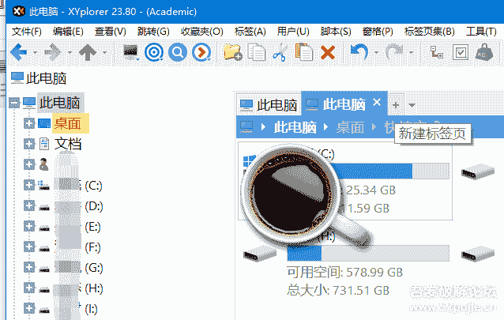
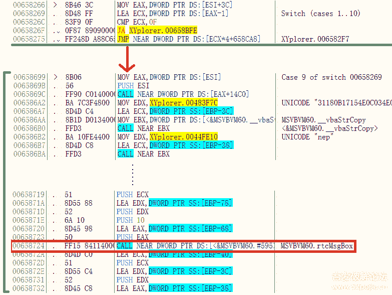
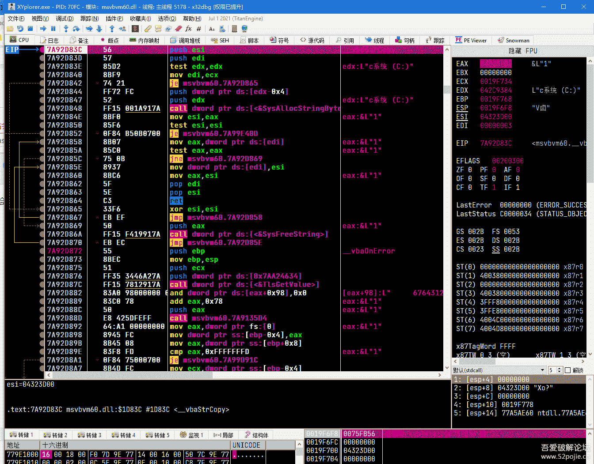
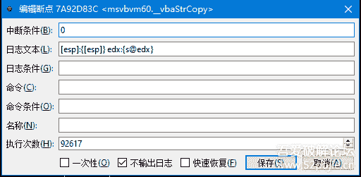
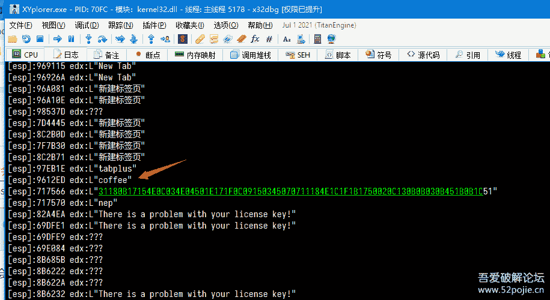
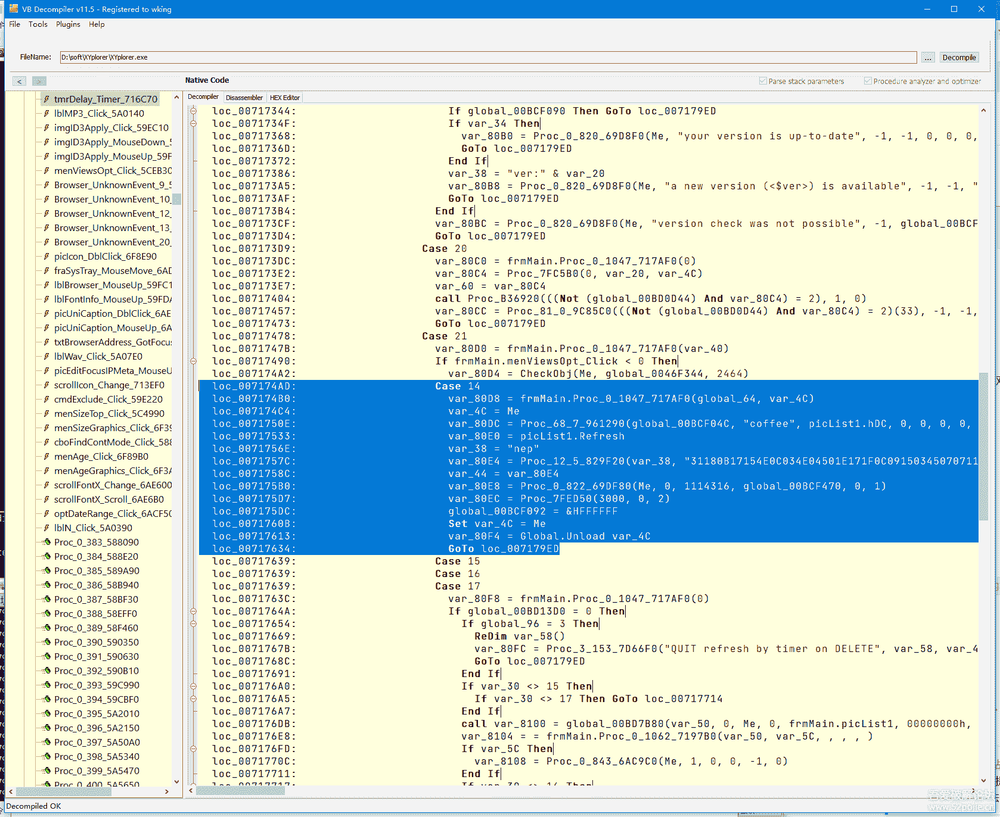
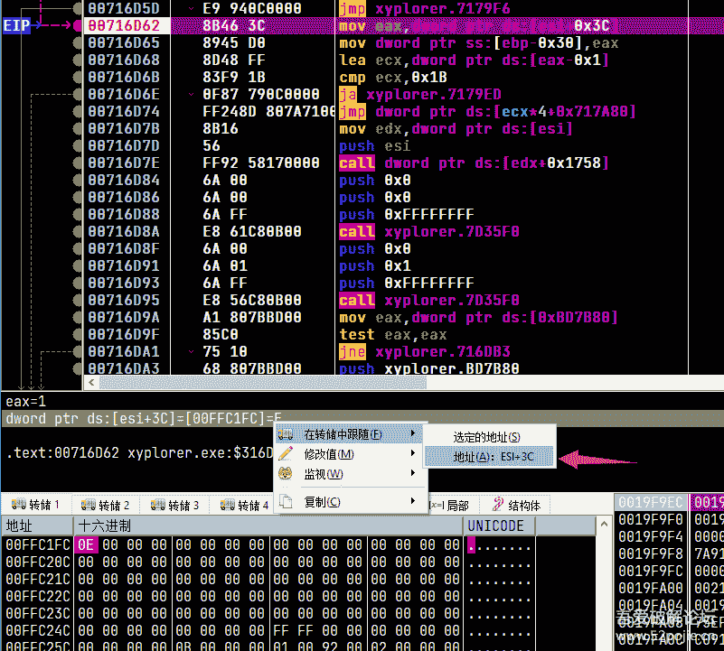
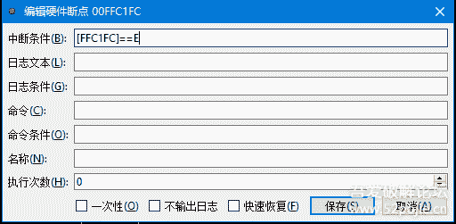
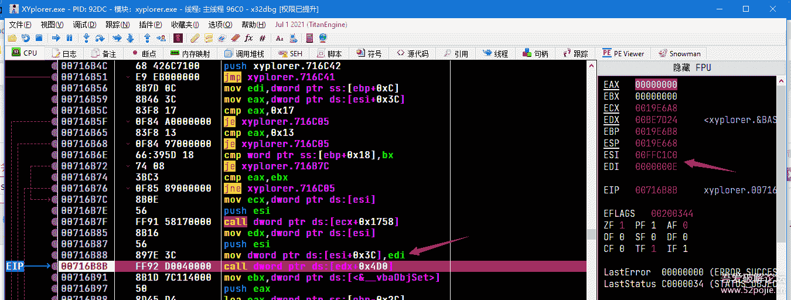
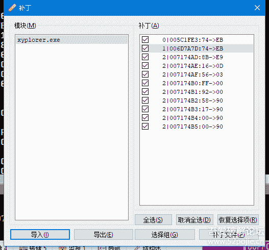

# \[原创\] XYplorer 解决 喝咖啡和 There is a problem with your license key! 错误

- 原帖: [https://www.52pojie.cn/forum.php?mod=viewthread&tid=1734984](https://www.52pojie.cn/forum.php?mod=viewthread&tid=1734984)
- 抓取时间: 2026-11-01T23:02:37

## 目标

使用学习版XYplorer时，打开新标签页和设置菜单，很大几率会出现咖啡图案和提示“There is a problem with your license key!”错误并程序退出。很烦人，今天我们来解决这个问题。



[01.png (86.36 KB, 下载次数: 1)](https://www.52pojie.cn/forum.php?mod=attachment&aid=MjU4NDIwMnw1NmNlZmRlMXwxNzkzNTc0MTU1fDE2ODA4NnwxNzM0OTg0&nothumb=yes)

2023-1-10 13:52 上传

## 开始

### 基本工具

- XYplorer 23.80
- x64dbg
- VB Decompiler v11.5 pro（XYplorer是VB写的）

### 切入点

由于是程序退出，先在x64dbg里下了`ExitProcess`断点，发现追不回去。在网上发现了[transcendperfection.wordpress.com/2012/12/17/inline-injection-to-fix-xyplorers-licensing-error-message](https://transcendperfection.wordpress.com/2012/12/17/inline-injection-to-fix-xyplorers-licensing-error-message/)，他帖子里是跳出对话框，和我们现在的情况不一样，但是帖子里有个截图，如下图



[00.png (98.02 KB, 下载次数: 3)](https://www.52pojie.cn/forum.php?mod=attachment&aid=MjU4NDIwOXwwYzUwY2QwYnwxNzkzNTc0MTU1fDE2ODA4NnwxNzM0OTg0&nothumb=yes)

2023-1-10 14:22 上传

图中弹出对话框`CALL`前面有一个`vbaStrCopy`调用引起了我的注意，那就下个`bp __vbaStrCopy`断点试试。

启动程序，下`bp __vbaStrCopy`断点，发现被断下来的次数也太多了，需要做条件筛选。

观察x64dbg寄存器，发现`EDX`总是字符串，`ESP`是调用返回地址



[02.png (244.42 KB, 下载次数: 2)](https://www.52pojie.cn/forum.php?mod=attachment&aid=MjU4NDIwNnw3OGE0YTVjNHwxNzkzNTc0MTU1fDE2ODA4NnwxNzM0OTg0&nothumb=yes)

2023-1-10 14:10 上传

那么编辑`vbaStrCopy`断点条件如下图



[03.png (19.31 KB, 下载次数: 3)](https://www.52pojie.cn/forum.php?mod=attachment&aid=MjU4NDIwN3xkNDI4YzU5NHwxNzkzNTc0MTU1fDE2ODA4NnwxNzM0OTg0&nothumb=yes)

2023-1-10 14:10 上传

现在点新标签页，直到出现咖啡图案和错误提示。出现咖啡图案后，程序会自动退出。我们再看看x64dbg的日志窗口



[04.png (79.48 KB, 下载次数: 2)](https://www.52pojie.cn/forum.php?mod=attachment&aid=MjU4NDIwOHxiMDMxOGQ2YXwxNzkzNTc0MTU1fDE2ODA4NnwxNzM0OTg0&nothumb=yes)

2023-1-10 14:15 上传

`"There is a problem with your license key!"`字符串已经出现了。按说我们要去追踪这个`82A4E`地址，但别着急，之前提到的帖子截图里，有个UNICODE字符串`"31180B...."`和`"nep"`，我们日志这里也出现了，那按照他帖子截图的代码，应该是出现这两个字符串后调用对话框，对话框代码再复制`"There is a problem"`字符串。因此我们也先追踪`717566`地址的`"31180B...."`字符串看看。

### 717566地址

删除`vbaStrCopy`断点，重启程序，按`CTRL+G`来到`717566`地址，上下翻动查看，发现这段代码还挺长。不要紧，我们换用VB Decompiler软件。

打开VB Decompiler，载入XYplorer程序，也按`CTRL+G`来到`717566`地址，发现`717566`地址属于`switch case 14`分支。



[05.png (273.74 KB, 下载次数: 3)](https://www.52pojie.cn/forum.php?mod=attachment&aid=MjU4NDIxNXxkMDI4OGUzN3wxNzkzNTc0MTU1fDE2ODA4NnwxNzM0OTg0&nothumb=yes)

2023-1-10 14:33 上传

代码段中有`coffee`、`picList1.Refresh`、`Global.Unload`字样，那这很明显，这段代码段的功能就是显示咖啡图案并且程序退出。因此我们不能让这段代码运行。

### switch分支

看看switch分支选择在哪里。VB Decompiler 的`717566`代码段往上拉到顶，有一句

```
loc_00716D74: Select Case Me
```

这句就是分支选择语句。切换到x64dbg，按`CTRL+G`跳转到`716D74`地址

```
00716D62 | 8B46 3C           | mov eax,dword ptr ds:[esi+0x3C]        |
00716D65 | 8945 D0           | mov dword ptr ss:[ebp-0x30],eax        |
00716D68 | 8D48 FF           | lea ecx,dword ptr ds:[eax-0x1]         |
00716D6B | 83F9 1B           | cmp ecx,0x1B                           |
00716D6E | 0F87 790C0000     | ja xyplorer.7179ED                     |
00716D74 | FF248D 807A7100   | jmp dword ptr ds:[ecx*4+0x717A80]      |
```

`ecx`的值是由`eax`传过来的。在`716D62`行下断点，`CTRL+F2`重启程序并运行。

先得知道正常的`switch`分支段。经我随便尝试，取消最大化时，会触发断点。被断下来时`[esi+0x3C]=0x18`。`0x18`的十进制是24，对应`switch 24`分支，地址是`007177BF`。

```
loc_007177BF:                       Case 24
```

在Xyplorer里点新建标签页加号，多点几次直至被断下。此时`[esi+0x3C]=0xE`。`E`的十进制是14，也就对应`switch 14`分支。

由于我们不能让`14`分支代码执行，可以用一个`jmp`指令强制跳转`14`分支到`24`分支。

14分支开头代码：

```
007174AD | 8B16              | mov edx,dword ptr ds:[esi]             |
007174AF | 56                | push esi                               |
007174B0 | FF92 58170000     | call dword ptr ds:[edx+0x1758]         |
007174B6 | 8B06              | mov eax,dword ptr ds:[esi]             |
007174B8 | 56                | push esi                               |
007174B9 | FF90 F0040000     | call dword ptr ds:[eax+0x4F0]          |
007174BF | 50                | push eax                               |
```

直接修改`7174AD`行，改为`jmp`强制跳转到`24`分支去。

```
007174AD | E9 0D030000       | jmp xyplorer.7177BF                    |
007174B2 | 90                | nop                                    |
007174B3 | 90                | nop                                    |
007174B4 | 90                | nop                                    |
007174B5 | 90                | nop                                    |
007174B6 | 8B06              | mov eax,dword ptr ds:[esi]             |
007174B8 | 56                | push esi                               |
007174B9 | FF90 F0040000     | call dword ptr ds:[eax+0x4F0]          |
007174BF | 50                | push eax                               |
```

好，现在我们重启XY程序运行试试。XY程序目前我们点击新标签页加号，程序已经不会出错。但经常会点击后不打开新标签页。这实际上就是程序从`14`分支跳到`24`分支，还不是正常的程序流程。

那么接下来我们从根源上追踪`[esi+0x3C]`这个代码分支选择数值是哪里来的。

### [esi+0x3C]写入追踪

在下面这行上下断点：

```
00716D62 | 8B46 3C           | mov eax,dword ptr ds:[esi+0x3C]        |
```

XY程序里点几次新标签页，程序断下来。转储跟随`[esi+0x3C]`地址，如下图



[06.png (108.33 KB, 下载次数: 2)](https://www.52pojie.cn/forum.php?mod=attachment&aid=MjU4NDIzNXwxZDBjODRmN3wxNzkzNTc0MTU1fDE2ODA4NnwxNzM0OTg0&nothumb=yes)

2023-1-10 15:31 上传

我这里是`FFC1FC`地址，这个地址每次重启XY程序都不一样。

在`FFC1FC`地址下断点-硬件写入-字节，发现会被多次断下。那我们再用条件断点筛选一下。我们需要当`FFC1FC`地址数值为`E`时断下，因此可以如图设置



[07.png (16.99 KB, 下载次数: 1)](https://www.52pojie.cn/forum.php?mod=attachment&aid=MjU4NDIzNnxhNjQ0Y2JhOHwxNzkzNTc0MTU1fDE2ODA4NnwxNzM0OTg0&nothumb=yes)

2023-1-10 15:37 上传

设置好后，让XY程序运行，继续点新标签页直至断下



[08.png (133.27 KB, 下载次数: 2)](https://www.52pojie.cn/forum.php?mod=attachment&aid=MjU4NDIzN3xlYzJkYzRkM3wxNzkzNTc0MTU1fDE2ODA4NnwxNzM0OTg0&nothumb=yes)

2023-1-10 15:39 上传

虽然断在了`716B8B`行，但其实是`716B88`行修改的数值，`ESI+3C`就是`FFC1FC`，`EDI=E`。

切换到VB Decompiler的`716B8B`地址，整个函数如下


```
Private Sub Proc_0_1046_716A10(arg_C, arg_10, arg_14, arg_18, arg_1C) '716A10
  loc_00716A5A: If arg_14 Then
  loc_00716A68:   If global_60 = arg_C Then GoTo loc_00716B59
  loc_00716A70:   If global_60 = 0 Then GoTo loc_00716B59
  loc_00716A79:   If arg_C = 24 Then GoTo loc_00716B59
  loc_00716A82:   var_8004 = frmMain.tmrDelay_Timer
  loc_00716AA6:   If global_60 Then
  loc_00716ABC:     ReDim var_30()
  loc_00716B1C:     var_801C = Proc_3_153_7D66F0("setDelayedAction (" & CStr(arg_C) & "): could not trigger queued because " & CStr(global_60), var_30, 0)
  loc_00716B51:     GoTo loc_00716C41
  loc_00716B56:   End If
  loc_00716B59: End If
  loc_00716B5F: If global_00716C42.Reset <> 23 Then
  loc_00716B68:   If global_00716C42.Reset <> 19 Then
  loc_00716B72:     If arg_18 Then
  loc_00716B76:       If global_00716C42.Reset Then GoTo loc_00716C05
  loc_00716B7C:     End If
  loc_00716B7F:     var_8020 = .Proc_0_1047_717AF0(0)
  loc_00716BA7:     frmMain.tmrDelay.Interval = arg_10
  loc_00716BE1:     frmMain.tmrDelay.Enabled = True
  loc_00716C05:   End If
  loc_00716C05: End If
  loc_00716C0A: GoTo loc_00716C41
  loc_00716C40: Exit Sub
  loc_00716C41: ' Referenced from: 00716B51
  loc_00716C41: ' Referenced from: 00716C0A
End Sub
```

虽然看不太明白，但大概是设置了一个 `Delay_Timer`，之后设置了 `frmMain.tmrDelay` 的值。

这里我尝试将 `00716B5F` 行强行 `jmp`，发现无效，因此只有继续回溯看是哪个函数调用了这个代码段。

```
loc_00716B5F: If global_00716C42.Reset <> 23 Then

00716B5F | 0F84 A0000000     | je xyplorer.716C05                     |
```

## 谁调用了 `716A10`

删除硬件断点，在 `716B88` 行上下条件断点（中断条件 `EDI==E`），继续点 XY 的新标签页直至断下。

断下后，`F8` 单步运行，直至返回调用函数，可以看到是 `5C1FF2` 调用的。

```
005C1FF2 | FF90 50170000     | call dword ptr ds:[eax+0x1750]         |
```

切换到 VB Decompiler，`CTRL+G` 来到 `5C1FF2` 地址，代码如下：

```
Private Sub Proc_0_455_5C1F10(arg_C, arg_10, arg_14, arg_18, arg_1C, arg_20, arg_24, arg_28, arg_2C, arg_30, arg_34) '5C1F10

  loc_005C1FAC: var_28 = arg_10

  loc_005C1FBC: If global_00BCF088 Then

  loc_005C1FD5:   var_8004 = frmMain.Proc_0_617_5FC560(0, 0, 0, 0, 0, )

  loc_005C1FE3:   If Proc_12_4_829930(, , ) Then

  loc_005C1FF2:     var_800C = frmMain.Proc_0_1046_716A10(14, 100, 0, 0, var_5C)

  loc_005C1FFE:     GoTo loc_005C2FA3

  loc_005C2003:   End If

  loc_005C2003: End If

End Sub
```

很明显，只要屏蔽 `loc_005C1FE3:   If Proc_12_4_829930(, , ) Then` 即可。

切换到 x64dbg，`CTRL+G` 到 `005C1FE3` 地址，直接将

```
005C1FE3 | 74 1E             | je xyplorer.5C2003                     |
```

改为 `jmp` 跳转：

```
005C1FE3 | EB 1E             | jmp xyplorer.5C2003                    |
```

## 测试效果

此时之前我们设置的断点 `00716B88 | 897E 3C           | mov dword ptr ds:[esi+0x3C],edi        |` 仍然有效，如果 `jmp` 修改有效，则这个断点不会再触发。

现在继续点击 XY 程序的新建标签页，点了十几次，都没有触发 `716B88` 断点，也没有出现点击却不打开新标签页。说明修改成功。

## 解决 XY 配置选项错误

新标签页的问题解决了，但打开 XY 的工具-配置选项时，仍然会出现咖啡图案。

确保上面提到的 `716B88` 行条件断点启用，然后打开 XY 的配置选项，如果成功打开配置选项了，那就关了重新打开，直至断下。

仍然断在 `716B88` 行，并且 `EDI=E`，`F8` 单步运行到上级函数（或者 `CTRL+F9` 运行到返回也可以），返回到了

```
006D7A8F | FF91 50170000     | call dword ptr ds:[ecx+0x1750]         |
>>>006D7A95 | 68 E87B6D00       | push xyplorer.6D7BE8                   |
```

同样，切换到 VB Decompiler，`CTRL+G` 到 `6D7A95` 看看。

```
Private Sub Proc_0_912_6D7890

  loc_006D78FE: If global_00BD2468 Then

  loc_006D790B:   If global_00BD246A = 0 Then

  loc_006D7962:     var_800C = "Please unlock the trial version under the Help menu." & vbCrLf & Chr(13) & Chr(10) & "If you haven't purchased a license yet: Click OK to open the online order page."

  loc_006D79D5:     var_8014 = Proc_113_34_B374F0(Proc_70_15_969FC0("Trial Version Expired", 0, var_58, 0, 0), global_00464718, Proc_70_15_969FC0(var_800C, 0, var_5C, 0, 0), 6, 3, -1, 0, var_60, Form())

  loc_006D7A17:     If var_8014 - 1 + 1 = 0 Then GoTo loc_006D7B9D

  loc_006D7A27:     var_58 = &H16

  loc_006D7A36:     If frmMain.menHelpWeb_Click(var_58) >= 0 Then GoTo loc_006D7B9D

  loc_006D7A48:     var_8018 = CheckObj(Me, global_0046F344, 4776)

  loc_006D7A58:   End If

  loc_006D7A58: End If

  loc_006D7A5A: var_801C = Proc_83EC20(global_006D7BE8, 0, 0)

  loc_006D7A62: If var_801C = 0 Then

  loc_006D7A6F:   If global_00BD13CC = 0 Then

  loc_006D7A7D:     If Proc_12_4_829930(0, 0, 0) Then

  loc_006D7A8F:       var_8024 = frmMain.Proc_0_1046_716A10(14, 100, 0, 0, var_58)

  loc_006D7A9A:       GoTo loc_006D7BD5

  loc_006D7A9F:     End If

  loc_006D7AB4:     If var_14
```

很明显这是先判断、验证序列号，之后执行 `frmConfig.Show`。

修改同样，屏蔽 `loc_006D7A7D:     If Proc_12_4_829930(0, 0, 0) Then`。

x64dbg 里 `CTRL+G` 跳到 `006D7A7D` 地址，`je` 直接修改为 `jmp` 即可。

```
006D7A7D | 74 20             | je xyplorer.6D7A9F                     |
```

修改后，打开 XY 的配置选项，再也不会出现咖啡图案了。

`Proc_12_4_829930(0, 0, 0)` 是判断序列号是否有问题的函数，有兴趣的同学可以研究一下。

## 总结

本文没什么难度，XYplorer 没加壳，用 VB Decompiler 几乎和读源代码没什么区别。

### 修改的地方

由于论坛禁止发成品和补丁，我贴一下特征码应该没问题吧？

x64dbg 补丁：



`09.png` (32.33 KB, 下载次数: 2)

[forum.php?mod=attachment&aid=MjU4NDI1M3w5OTVlYTA0Y3wxNzkzNTc0MTU1fDE2ODA4NnwxNzM0OTg0&nothumb=yes](https://www.52pojie.cn/forum.php?mod=attachment&aid=MjU4NDI1M3w5OTVlYTA0Y3wxNzkzNTc0MTU1fDE2ODA4NnwxNzM0OTg0&nothumb=yes)

2023-1-10 16:30 上传

标签页特征码：

```
E8 ?? ?? ?? ?? 66 85 C0 74 1E 8B 06
```

改为

```
E8 ?? ?? ?? ?? 66 85 C0 EB 1E 8B 06
```

配置选项特征码：

```
E8 ?? ?? ?? ?? 66 85 C0 74 ?? 8B ?? ?? 8D ?? ?? 52 53
```

改为

```
E8 ?? ?? ?? ?? 66 85 C0 EB ?? 8B ?? ?? 8D ?? ?? 52 53
```
