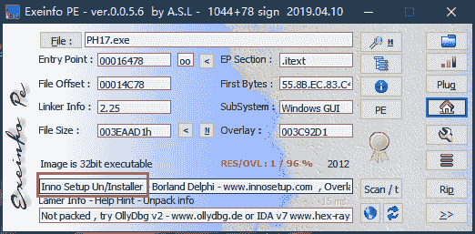
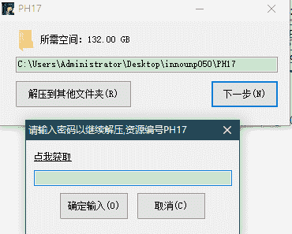
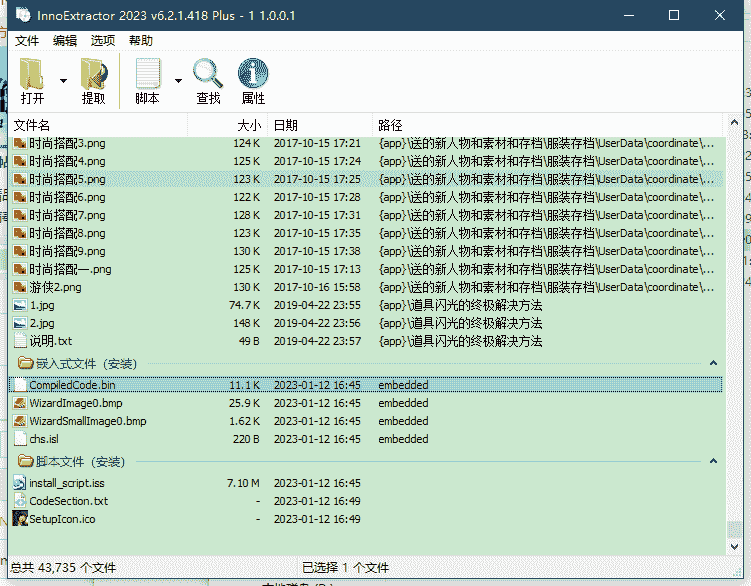
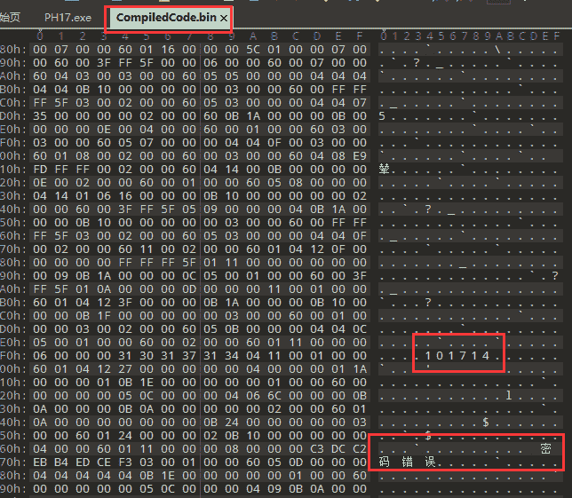

# [分享] innosetup 制作的安装包 密码破解思路

- 原帖: https://www.52pojie.cn/forum.php?mod=viewthread&tid=1735716
- 抓取时间: 2026-11-01T23:02:28

## innosetup 制作的安装包 密码破解思路

### 如果是这种的exe可以按以下步骤破解密码

- `exeinfo` 展示信息为此信息的是 innosetup 制作的安装包



- 输入密码如图所示:



- 下载 `InnoExtractor`, 打开想要破解的exe

注意如果文件过多,会加载很长时间.耐心等待即可, 加载完成后源码文件如下图:



- 把如图所示的`CompiledCode.bin`解压出来, 里面就是 innosetip 的二进制代码. 直接打开 `CompiledCode.bin` 看密码即可:



### 破解过程解析及源码

#### 示例exe

下载了一个很大的游戏,但是发现安装的时候居然有密码, 而且原论坛提供的密码不对

原贴

[//www.52pojie.cn/thread-1729506-1-1.html" target="_blank" rel="noopener noreferrer nofollow"](https://www.52pojie.cn/thread-1729506-1-1.html:href="https)

把其中的密码程序提取出来`PH17.exe`:

[//wwtw.lanzoum.com/itwIj0ktqzfg" target="_blank" rel="noopener noreferrer nofollow"](https://wwtw.lanzoum.com/itwIj0ktqzfg:rel="nofollow noopener" href="https)

#### od尝试

本来以为很简单的`OD`就好了, 发现`OD`不行.

- 字符串没法找到定位
- vb/delphi 按钮查找脚本 找不到按钮事件

#### innounp

最后在[//stackoverflow.com/questions/49194957/disassembling-strings-from-inno-setup-code/49195240#49195240" target="_blank" rel="noopener noreferrer nofollow"](https://stackoverflow.com/questions/49194957/disassembling-strings-from-inno-setup-code/49195240#49195240:rel="nofollow noopener" href="https), 看到了[//stackoverflow.com/questions/49194957/disassembling-strings-from-inno-setup-code/49195240#49195240" target="_blank" rel="noopener noreferrer nofollow"](https://stackoverflow.com/questions/49194957/disassembling-strings-from-inno-setup-code/49195240#49195240:rel="nofollow noopener" href="https): 使用 `innounp`

[//innounp.sourceforge.net/" target="_blank" rel="noopener noreferrer nofollow"](https://innounp.sourceforge.net/:rel="nofollow noopener" href="https)

[//sourceforge.net/projects/innounp/files/innounp/innounp%200.50/innounp050src.rar/download" target="_blank" rel="noopener noreferrer nofollow"](https://sourceforge.net/projects/innounp/files/innounp/innounp%200.50/innounp050src.rar/download:rel="nofollow noopener" href="https)

```
innounp -x -m PH18.exe
```

`innounp` 他是可以代替 exe 直接解压的

但是如果打包文件过多,因为它不会跳过解压普通文件, 如果文件过大的话,只能必须等他全部解压完.才可以得到 `CompiledCode.bin`, 才可以知道密码.

修改 `innounp` 源码 `innounp.dpr` lin475 前加入

```
AddEmbeddedFiles
```

就可以先解压 `CompiledCode.bin`
