# [Web逆向] 某方数据平台的逆向分析-------学会逆向protobuf

- 原帖: https://www.52pojie.cn/forum.php?mod=viewthread&tid=1735973
- 抓取时间: 2026-11-01T23:02:26

某方数据平台的逆向分析-------学会protobuf

## 声明

本文章中所有内容仅供学习交流，相关链接做了脱敏处理，若有侵权，请联系我立即删除！

## 一、前期准备：

### 1.1 了解protobuf协议：

`Protobuf`（`Protocol Buffer`）是 Google 开发的一套数据存储传输协议，为二进制序列化格式，可用作 `JSON` 或 `XML` 等格式的更有效替代方案。开发人员可以在 `.proto` 文件中定义消息格式，并使用 protobuf 编译器（`protoc`）按他们选择的语言生成消息处理程序。`Protobuf` 编码是二进制的，与 `json`、`xml` 不同，它不是可读的，也不容易手动修改。`Protobuf` 能够把数据压缩得很小，所以传输数据就比 `xml` 和 `json` 快几倍，使用其有利于提高效率，但同时增加了分析或修改数据的难度。

序列化 (`Serialization`) 是指将对象转换为字节序列的过程，在序列化期间，对象将其当前状态写入到临时或持久性存储区，以后，可以通过从存储区中读取或反序列化对象的状态，重新创建该对象。

protobuf知识补充见：[//www.52pojie.cn/thread-1735975-1-1.html" target="_blank" rel="noopener noreferrer nofollow"](https://www.52pojie.cn/thread-1735975-1-1.html:href="https)

### 1.2 Protobuf 环境配置：

下载`protoc`文件：[//github.com/protocolbuffers/protobuf/releases/tag/v21.12" target="_blank" rel="noopener noreferrer nofollow"](https://github.com/protocolbuffers/protobuf/releases/tag/v21.12:rel="nofollow noopener" href="https)

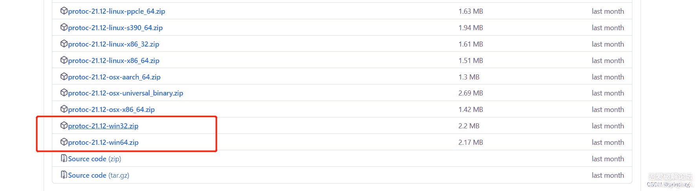

1.png (75.73 KB, 下载次数: 3)

[href="forum.php?mod=attachment&aid=MjYxNTg4NXxmZDY3MTRjMXwxNzkzNTc0MTQzfDE2ODA4NnwxNzM1OTcz&nothumb=yes" target="_blank"](https://www.52pojie.cn/forum.php?mod=attachment&aid=MjYxNTg4NXxmZDY3MTRjMXwxNzkzNTc0MTQzfDE2ODA4NnwxNzM1OTcz&nothumb=yes)

2023-5-18 17:38 上传

然后添加到环境变量，便于之后使用。

## 二、目标网站：

aHR0cHM6Ly9zLndhbmZhbmdkYXRhLmNvbS5jbi9wYXBlcj9xPSVFNyU4OCVBQyVFOCU5OSVBQg==

打开网站（以第2页为例），找到我们这次需要分析的包。

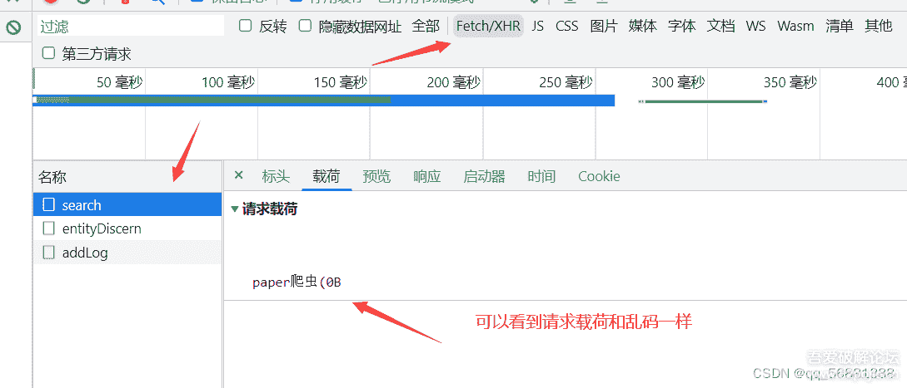

2.png (47.03 KB, 下载次数: 2)

[href="forum.php?mod=attachment&aid=MjYxNTg4Nnw4MzA0Njk1Y3wxNzkzNTc0MTQzfDE2ODA4NnwxNzM1OTcz&nothumb=yes" target="_blank"](https://www.52pojie.cn/forum.php?mod=attachment&aid=MjYxNTg4Nnw4MzA0Njk1Y3wxNzkzNTc0MTQzfDE2ODA4NnwxNzM1OTcz&nothumb=yes)

2023-5-18 17:38 上传

返回数据也是乱码：

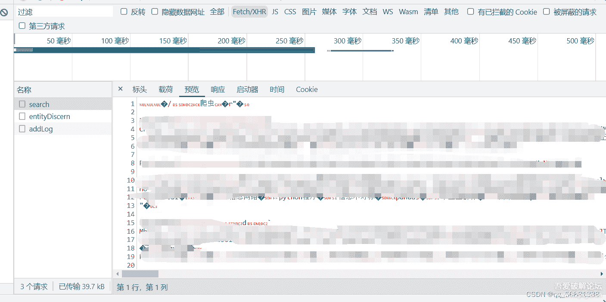

3.png (68.95 KB, 下载次数: 2)

[href="forum.php?mod=attachment&aid=MjYxNTg4N3w0OGMwYTg2Y3wxNzkzNTc0MTQzfDE2ODA4NnwxNzM1OTcz&nothumb=yes" target="_blank"](https://www.52pojie.cn/forum.php?mod=attachment&aid=MjYxNTg4N3w0OGMwYTg2Y3wxNzkzNTc0MTQzfDE2ODA4NnwxNzM1OTcz&nothumb=yes)

2023-5-18 17:38 上传

经过查资料，观察返回的`content-type`为`application/grpc-web+proto` 是以`protobuf`数据结构传输的。

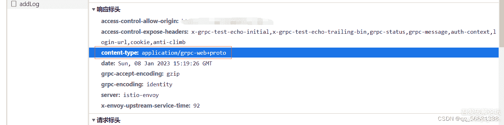

4.png (42.51 KB, 下载次数: 5)

[href="forum.php?mod=attachment&aid=MjYxNTg4OHxkNGIwNDVmYnwxNzkzNTc0MTQzfDE2ODA4NnwxNzM1OTcz&nothumb=yes" target="_blank"](https://www.52pojie.cn/forum.php?mod=attachment&aid=MjYxNTg4OHxkNGIwNDVmYnwxNzkzNTc0MTQzfDE2ODA4NnwxNzM1OTcz&nothumb=yes)

2023-5-18 17:38 上传

我们用`fiddler`抓包看看（黑色16进制数据是发送的数据，蓝色是请求头数据）

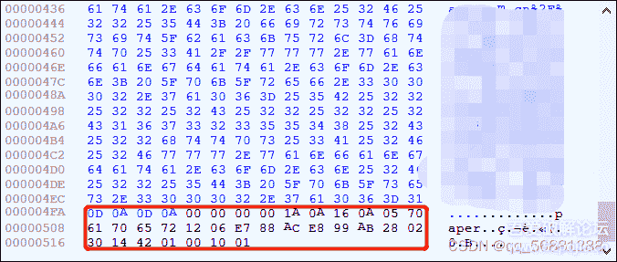

5.png (57.93 KB, 下载次数: 4)

[href="forum.php?mod=attachment&aid=MjYxNTg4OXxiNDNlZGZhZnwxNzkzNTc0MTQzfDE2ODA4NnwxNzM1OTcz&nothumb=yes" target="_blank"](https://www.52pojie.cn/forum.php?mod=attachment&aid=MjYxNTg4OXxiNDNlZGZhZnwxNzkzNTc0MTQzfDE2ODA4NnwxNzM1OTcz&nothumb=yes)

2023-5-18 17:38 上传

我们右键将黑色请求数据（第6位开始括)部分保存下来，为`bin`格式后面分析时候有用，为什么从第6位开始，后面会分析。

## 三、开始分析：

我们下个`xhr`断点看看，看看数据是怎么来的。

可以看到数据是以字节集的形式发出的，与`fd`抓包的16进制数据是一一对应的。

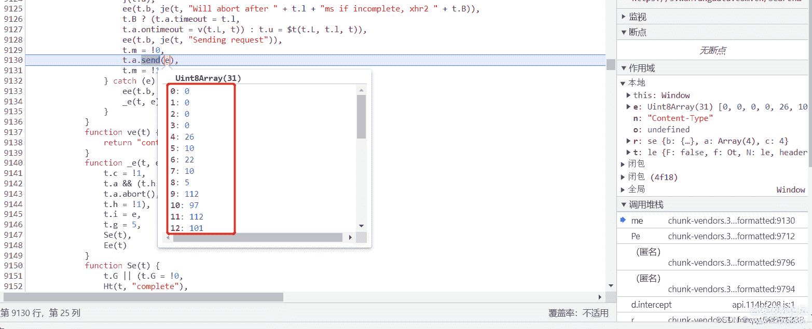

6.png (117.9 KB, 下载次数: 4)

[href="forum.php?mod=attachment&aid=MjYxNTg5MHw0MGJmYjRhMXwxNzkzNTc0MTQzfDE2ODA4NnwxNzM1OTcz&nothumb=yes" target="_blank"](https://www.52pojie.cn/forum.php?mod=attachment&aid=MjYxNTg5MHw0MGJmYjRhMXwxNzkzNTc0MTQzfDE2ODA4NnwxNzM1OTcz&nothumb=yes)

2023-5-18 17:38 上传

接下来，我们看看数据是怎么来的？跟`e`来到上一个栈，可以发现是`a`赋值给`e`的。

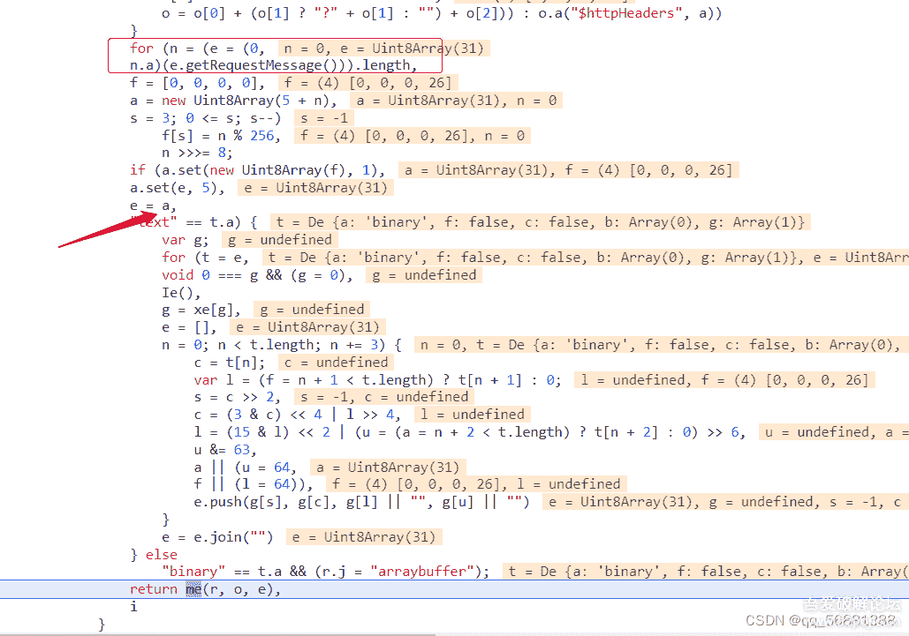

7.png (105.21 KB, 下载次数: 3)

[href="forum.php?mod=attachment&aid=MjYxNTg5MXxhMTgwMjViYXwxNzkzNTc0MTQzfDE2ODA4NnwxNzM1OTcz&nothumb=yes" target="_blank"](https://www.52pojie.cn/forum.php?mod=attachment&aid=MjYxNTg5MXxhMTgwMjViYXwxNzkzNTc0MTQzfDE2ODA4NnwxNzM1OTcz&nothumb=yes)

2023-5-18 17:38 上传

我们在`e`赋值的地方下断点，看看`a`怎么来的，重新调试一次，主要看`a`怎么构成的。

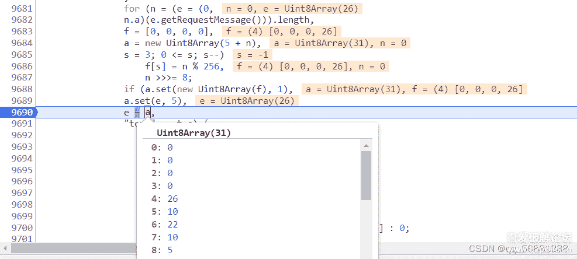

8.png (62.22 KB, 下载次数: 3)

[href="forum.php?mod=attachment&aid=MjYxNTg5MnxiOGRlOWY0MXwxNzkzNTc0MTQzfDE2ODA4NnwxNzM1OTcz&nothumb=yes" target="_blank"](https://www.52pojie.cn/forum.php?mod=attachment&aid=MjYxNTg5MnxiOGRlOWY0MXwxNzkzNTc0MTQzfDE2ODA4NnwxNzM1OTcz&nothumb=yes)

2023-5-18 17:38 上传

发现其实核心就是9681行到9690行赋值这一段。

```js
for(n = (e = (0,n.a)(e.getRequestMessage())).length,
    f = [0, 0, 0, 0],
    a = new Uint8Array(5 + n),
    s = 3; 0 >>= 8;

if (a.set(new Uint8Array(f), 1),
    a.set(e, 5),
    e = a,
```

3> 我们一句句分析：

4> 先`for`循环部分：

`e = (0,n.a)(e.getRequestMessage())`

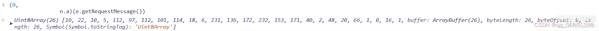

9.png (29.8 KB, 下载次数: 3)

[href="forum.php?mod=attachment&aid=MjYxNTg5NHxmZjc1ZjIyMHwxNzkzNTc0MTQzfDE2ODA4NnwxNzM1OTcz&nothumb=yes" target="_blank"](https://www.52pojie.cn/forum.php?mod=attachment&aid=MjYxNTg5NHxmZjc1ZjIyMHwxNzkzNTc0MTQzfDE2ODA4NnwxNzM1OTcz&nothumb=yes)

2023-5-18 17:38 上传

得到的是一个`unit8Array`数组，刚刚好就是我们的数据从5开始往后数。

`n = (e = (0,n.a)(e.getRequestMessage())).length`

这里得到这个数组长度是26。

`f = [0, 0, 0, 0]`

这里类似设置了一个头，4位空数组

`a = new Uint8Array(5 + n)`

这里`a`的初始化，因为我们知道最后`a`是一个`Uint8Array`的数组，他的长度是`5 + n`。

`s = 3; 0`

这里可以确定整个循环的次数，4次。

因为`js`是以`;`为结束的，所以相当于下列语句循环了4次，那这步操作是干嘛的呢？

```
f[s] = n % 256,
n >>>= 8;
```

给`f`数组各位赋值的，刚刚好`f`数组就是4位。所以说先给`f`的第四位赋值相当于`f[3]`， 再 `n`进行`>>>=`移位操作

得到


```
f[3] =26%256=26    26 >>>8=0 =>n=0
f[2] = 0%256 =0    0  >>>8=0 =>n=0
f[1] = 0%256 =0    0  >>>8=0 =>n=0
f[0] = 0%256 =0    0  >>>8=0 =>n=0

f=[0, 0, 0, 26]
```

## 4> 后面就是给a赋值了：

`a.set(new Uint8Array(f), 1)`

`a`是数组，然后查mdn文档，可知`set`方法的作用：

[//developer.mozilla.org/zh-CN/docs/Web/JavaScript/Reference/Global_Objects/TypedArray/set" target="_blank" rel="noopener noreferrer nofollow"](https://developer.mozilla.org/zh-CN/docs/Web/JavaScript/Reference/Global_Objects/TypedArray/set:rel="nofollow noopener" href="https)

`set()`方法用于从指定数组中读取值，并将其存储在类型化数组中。

有两个参数，`typedarray`，`offset`(可选，默认为 0)

`typedarray`对应 `new Uint8Array(f)`

`offset` 对应 `1`

相当于从下标1开始，给`a`数组插入值`f`。

所以得到

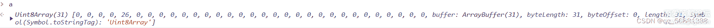

10.png (23.66 KB, 下载次数: 2)

[href="forum.php?mod=attachment&aid=MjYxNTg5NXxmZDdlNTY5MHwxNzkzNTc0MTQzfDE2ODA4NnwxNzM1OTcz&nothumb=yes" target="_blank"](https://www.52pojie.cn/forum.php?mod=attachment&aid=MjYxNTg5NXxmZDdlNTY5MHwxNzkzNTc0MTQzfDE2ODA4NnwxNzM1OTcz&nothumb=yes)

2023-5-18 17:38 上传

这里核心就是这个`set`方法，不懂查一下就理解了。

`a.set(e, 5)`

相当于从数组下标5开始把`e`的值赋值给`a`

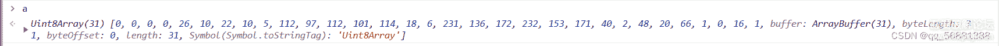

11.png (27.4 KB, 下载次数: 3)

[href="forum.php?mod=attachment&aid=MjYxNTg5NnxlYTMzOTZiMHwxNzkzNTc0MTQzfDE2ODA4NnwxNzM1OTcz&nothumb=yes" target="_blank"](https://www.52pojie.cn/forum.php?mod=attachment&aid=MjYxNTg5NnxlYTMzOTZiMHwxNzkzNTc0MTQzfDE2ODA4NnwxNzM1OTcz&nothumb=yes)

2023-5-18 17:38 上传

ok，我们到这里已经把`a`怎么来的理解清楚了，也明白了前面5位是怎么来的。

但是，我们还是没接触到protobuf啊，只是知道了数据得到的大概过程。核心就在`(0,n.a)(e.getRequestMessage())`里面。

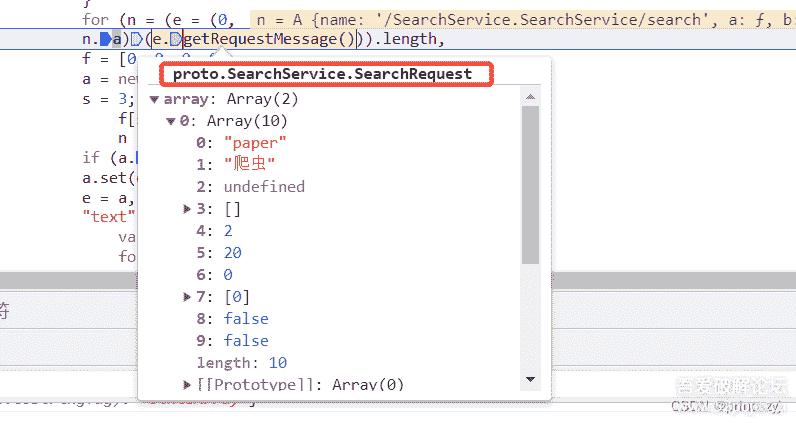

12.png (46.46 KB, 下载次数: 2)

[href="forum.php?mod=attachment&aid=MjYxNTg5N3w3NWQxOGMwNXwxNzkzNTc0MTQzfDE2ODA4NnwxNzM1OTcz&nothumb=yes" target="_blank"](https://www.52pojie.cn/forum.php?mod=attachment&aid=MjYxNTg5N3w3NWQxOGMwNXwxNzkzNTc0MTQzfDE2ODA4NnwxNzM1OTcz&nothumb=yes)

2023-5-18 17:39 上传

发现了我们的要讲的核心，protobuf。

看文章，看官方文档可以知道要构造这个protobuf格式数据，就是刚刚我们得到的那个数组，我们要先写proto文件，然后生成对应语言的proto版本，然后发包。

## 2> 四、写proto文件（核心）

跟进`n.a`方法

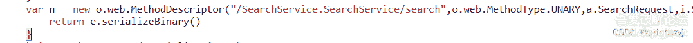

13.png (16.4 KB, 下载次数: 3)

[href="forum.php?mod=attachment&aid=MjYxNTg5OHw5NTU4MmQ0YXwxNzkzNTc0MTQzfDE2ODA4NnwxNzM1OTcz&nothumb=yes" target="_blank"](https://www.52pojie.cn/forum.php?mod=attachment&aid=MjYxNTg5OHw5NTU4MmQ0YXwxNzkzNTc0MTQzfDE2ODA4NnwxNzM1OTcz&nothumb=yes)

2023-5-18 17:39 上传

发现了写protobuf数据格式的关键函数：`serializeBinary`

跟进去

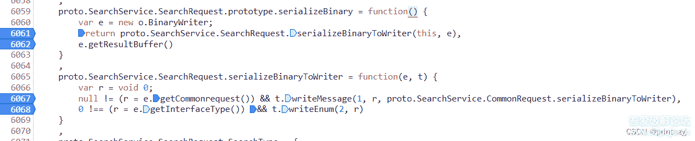

14.png (46.15 KB, 下载次数: 1)

[href="forum.php?mod=attachment&aid=MjYxNTg5OXw2NjExYzllM3wxNzkzNTc0MTQzfDE2ODA4NnwxNzM1OTcz&nothumb=yes" target="_blank"](https://www.52pojie.cn/forum.php?mod=attachment&aid=MjYxNTg5OXw2NjExYzllM3wxNzkzNTc0MTQzfDE2ODA4NnwxNzM1OTcz&nothumb=yes)

2023-5-18 17:39 上传

关键点：

根据`serializeBinaryToWriter`关键函数，可以得到此结构分层，跟进去可以得到包含几个信息

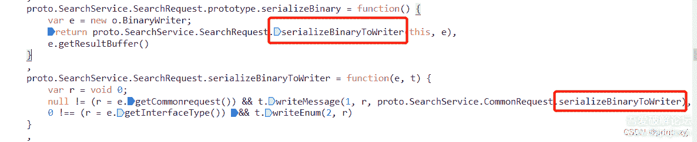

15.png (37.6 KB, 下载次数: 1)

[href="forum.php?mod=attachment&aid=MjYxNTkwMHw0NTQ4NWRkNnwxNzkzNTc0MTQzfDE2ODA4NnwxNzM1OTcz&nothumb=yes" target="_blank"](https://www.52pojie.cn/forum.php?mod=attachment&aid=MjYxNTkwMHw0NTQ4NWRkNnwxNzkzNTc0MTQzfDE2ODA4NnwxNzM1OTcz&nothumb=yes)

2023-5-18 17:39 上传

`write` + （信息类型）函数，第一个参数代表是第几个。（如下图圈主部分）

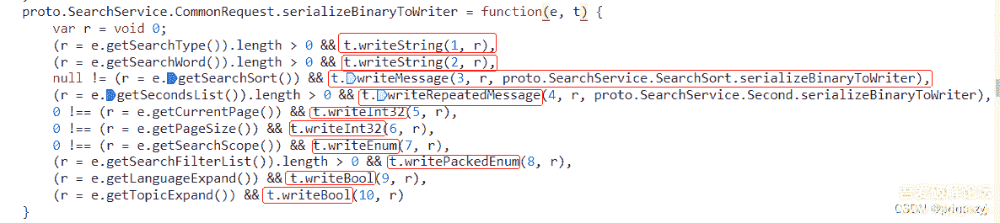

16.png (54.13 KB, 下载次数: 2)

[href="forum.php?mod=attachment&aid=MjYxNTkwMXxkZWFhOGFlZXwxNzkzNTc0MTQzfDE2ODA4NnwxNzM1OTcz&nothumb=yes" target="_blank"](https://www.52pojie.cn/forum.php?mod=attachment&aid=MjYxNTkwMXxkZWFhOGFlZXwxNzkzNTc0MTQzfDE2ODA4NnwxNzM1OTcz&nothumb=yes)

2023-5-18 17:39 上传

看到`writeMessage`，后面有`serializeBinaryToWriter`关键函数，跟进去，就能再次得到此message的结构层次，一样分析，就能得出完整结构。

`packedenum`用`repeated`关键字表示。

一个个分析按顺序写proto文件

```
syntax = "proto3";

message SearchService {

    enum InterfaceType{

        A=0;

    }

    enum SearchScope{

        B = 0;

    }

    enum SearchFilter {

      C = 0;

   }

   enum Order{

        D=0;

    }

    message SearchSort{

        string Field =1;

        Order Order=2;

    }

    message SecondsList{

        string Field=1;

        string Value=2;

    }

    message Commonrequest{

        string SearchType=1;

        string SearchWord=2;

        SearchSort searchSort=3;

        repeated SecondsList secondslist=4;

        int32 CurrentPage=5;

        int32 PageSize=6;

        SearchScope searchscope=7;

        repeated SearchFilter searchFilter = 8;

        bool LanguageExpand=9;

        bool TopicExpand=10;

    }

    message SearchRequest {

        Commonrequest commonrequest = 1; // 任意变量名

        InterfaceType interfaceType = 2; // 任意变量名

    }

}
```

命令行生成可python操作的protobuf文件

```
protoc --python_out=. ./test.proto
```

数据分析：fd抓包下载bin，然后命令行 `protoc --decode_raw`

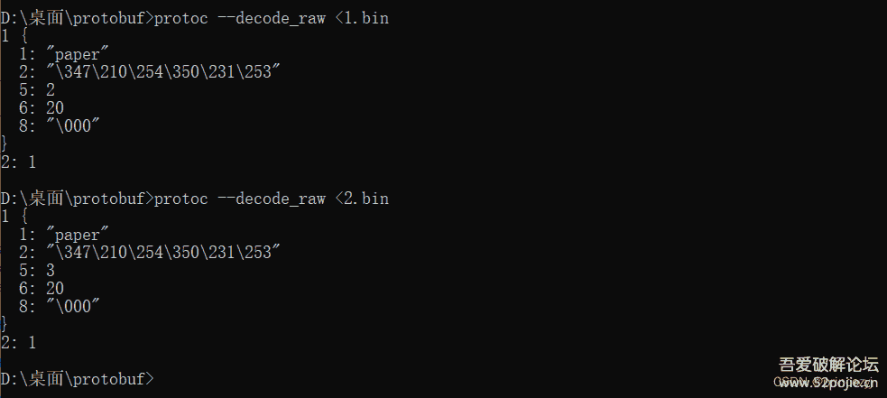

17.png (31.67 KB, 下载次数: 1)

[href="forum.php?mod=attachment&aid=MjYxNTkwMnw2MjAxZTg3N3wxNzkzNTc0MTQzfDE2ODA4NnwxNzM1OTcz&nothumb=yes" target="_blank"](https://www.52pojie.cn/forum.php?mod=attachment&aid=MjYxNTkwMnw2MjAxZTg3N3wxNzkzNTc0MTQzfDE2ODA4NnwxNzM1OTcz&nothumb=yes)

2023-5-18 17:39 上传

然后对应上面的结构找到对应变量，用python赋值运行：

```
import test_pb2 as pb #导入包

SearchRequest= pb.SearchService.SearchRequest() #实例化对象

#按上面解析数据，按照对应的属性设置值
#字符串，数字型的都是直接赋值
SearchRequest.commonrequest.SearchType='paper' 
SearchRequest.commonrequest.SearchWord='爬虫'
SearchRequest.commonrequest.CurrentPage=2
SearchRequest.commonrequest.PageSize=20

#repeated修饰的messsage类型和enum类型，则需要稍微多几个步骤
SearchRequest.commonrequest.searchFilter.append(0)
SearchRequest.interfaceType=1

form_data = SearchRequest.SerializeToString()
print(form_data)

#保存数据玮bin文件供后续对比使用
with open('me.bin', mode="wb") as f:
    f.write(form_data)
```

注意：

字符串，数字型的都是直接赋值

`repeated`修饰的`messsage`类型和`enum`类型，则需要稍微多几个步骤

```
# 可重复message类型，需要调用一个add方法，然后将对应字段赋值
seconds = search_request.commonrequest.Second.add()
seconds.field = "Type"
seconds.value = '"Thesis"'
# 可重复enum枚举类型
search_request.commonrequest.searchFilter.append(0)
```

自己构造的和上面对比，发现完全一致，说明分析正确。

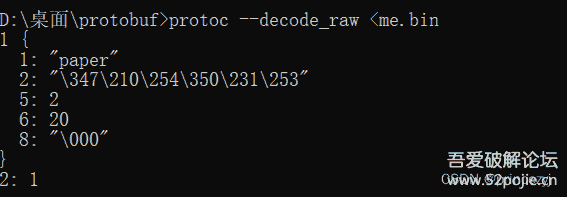

18.png (17.53 KB, 下载次数: 4)

[href="forum.php?mod=attachment&aid=MjYxNTkwM3xkYzhlMTZiY3wxNzkzNTc0MTQzfDE2ODA4NnwxNzM1OTcz&nothumb=yes" target="_blank"](https://www.52pojie.cn/forum.php?mod=attachment&aid=MjYxNTkwM3xkYzhlMTZiY3wxNzkzNTc0MTQzfDE2ODA4NnwxNzM1OTcz&nothumb=yes)

2023-5-18 17:39 上传

用python发包，根据上面的分析，发现需要补头5位

```
bytes_head = bytes([0, 0, 0, 0, len(form_data)])
```

完整代码（获得数据）：


```python
import requests
import test_pb2 as pb
SearchRequest= pb.SearchService.SearchRequest()
SearchRequest.commonrequest.SearchType='paper'
SearchRequest.commonrequest.SearchWord='爬虫'
SearchRequest.commonrequest.CurrentPage=2
SearchRequest.commonrequest.PageSize=20
SearchRequest.commonrequest.searchFilter.append(0)
SearchRequest.interfaceType=1
form_data = SearchRequest.SerializeToString()
print(form_data)
# with open('me1.bin', mode="wb") as f:
#     f.write(form_data)
# print(SearchRequest.SerializeToString().decode())
bytes_head = bytes([0, 0, 0, 0, len(form_data)])
print(bytes_head+form_data)

headers = {
    "Accept": "*/*",
    "Accept-Language": "zh-CN,zh;q=0.9,zh-TW;q=0.8",
    "Content-Type": "application/grpc-web+proto",
    "Origin": "https://*********",
    "Referer": "https://*********/paper",
    "User-Agent": "Mozilla/5.0 (Windows NT 10.0; Win64; x64) AppleWebKit/537.36 (KHTML, like Gecko) Chrome/105.0.0.0 Safari/537.36",
}
url = "https://*********/SearchService.SearchService/search"
response=requests.post(url,headers=headers,data=bytes_head+form_data)
print(response.content)
```

这篇文章最重要的是要学会怎么构造proto文件，请求头怎么一一对应，下一节，我们将对响应进行处理，找出相应的proto文件。

## 五、下部分前言

上一节，我们构造了请求的proto文件，并成功用`python`发包获得了数据，但是得到的数据和`f12`得到的数据是一样的乱码如下图：

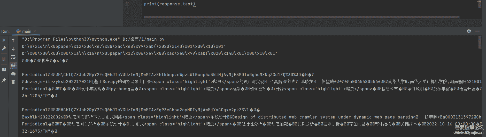

`19.png` (113.39 KB, 下载次数: 4)

[附件下载](https://www.52pojie.cn/forum.php?mod=attachment&aid=MjYxNTkwNHxhZWMwZDc0ZnwxNzkzNTc0MTQzfDE2ODA4NnwxNzM1OTcz&nothumb=yes)

2023-5-18 17:39 上传

其实这个也是protobuf格式，发过去的是protobuf格式，收到的也是protobuf格式，只是它是以二进制序列化格式传输的，所以我们看上去像乱码。

那么我们要怎么让它变好看呢？或者怎样好处理呢？

接下来会带来两种方法：①便捷但不太直观，②直观但有点复杂。

大家因人而异选择处理就好，喜欢用哪个就用哪个。

## 六、介绍处理的两种方法

### 1. 方法一：直接使用第三方库

直接使用`python`应对protobuf的第三方库：`blackboxprotobuf`

安装命令：`pip install blackboxprotobuf`

调用核心函数：`blackboxprotobuf.decode_message(Byte类型数据)`

进行解protobuf格式数据变成我们好理解，直观的数据。

返回值有两个：第一个是数据（和上一节用命令行解出来的那种格式类似，对应着proto文件的位置），第二个是对应位置的类型。

这里我们传`response.content`进去就好了，但是你会发现报错了：

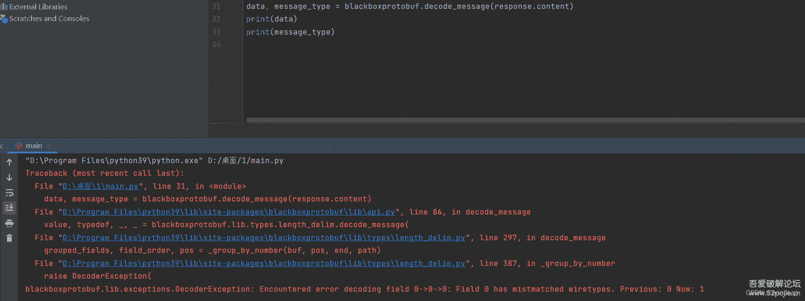

`20.png` (100.97 KB, 下载次数: 3)

[附件下载](https://www.52pojie.cn/forum.php?mod=attachment&aid=MjYxNTkwNXw2NmYxZTg5MHwxNzkzNTc0MTQzfDE2ODA4NnwxNzM1OTcz&nothumb=yes)

2023-5-18 17:39 上传

因为返回值我们还没分析，它发过来的有一部分是头信息，不在protobuf格式里面，所以解析会报错。

我先展示一下正确结果，给大家看看效果，第二种方法的时候，我会详细讲整个过程：

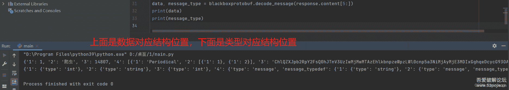

`21.png` (72.6 KB, 下载次数: 2)

[附件下载](https://www.52pojie.cn/forum.php?mod=attachment&aid=MjYxNTkwNnw0ZWRhNzE5MnwxNzkzNTc0MTQzfDE2ODA4NnwxNzM1OTcz&nothumb=yes)

2023-5-18 17:39 上传

所以我们可以分析`data`的结构，找到我们需要的数据，然后取值。

取值就和取`json`数据一样：`对象[键名]`，这里就是`data['2']` ===> 爬虫。

取你想要的，当然要拿出来数据到`json`解析的网站解析一下，然后分析：

这里推荐网站：[spidertools.cn](https://spidertools.cn/)

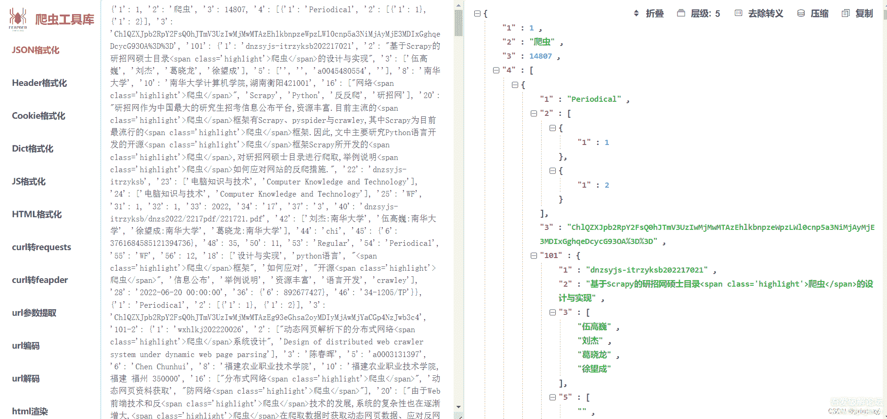

`22.png` (290.95 KB, 下载次数: 4)

[附件下载](https://www.52pojie.cn/forum.php?mod=attachment&aid=MjYxNTkwN3wzYjIyODMyMHwxNzkzNTc0MTQzfDE2ODA4NnwxNzM1OTcz&nothumb=yes)

2023-5-18 17:39 上传

你可以看到，虽然拿到了数据，只是位置序号加内容，我们其实要靠猜才能知道是什么。

这就是我所说的便捷但不直观。

当然，`blackboxprotobuf`库还有其他函数`api`接口，你们可以查阅其他文章了解使用。

### 2. 方法二：写对应的响应的proto文件

写对应的响应的proto文件，和发包一样。当然可以和发包写在一起。

然后同样的用命令行编译成`python`版本的：

```bash
protoc --python_out=. ./test.proto
```

然后一样的创建实例对象，然后使用`.ParseFromString(Byte类型数据)`函数就能解析了：

```python
search_response = test_proto2_pb2.SearchService_SearchResponse()
search_response.ParseFromString(response.content[5:])
print(search_response)
```

这里用的是渔歌之前文章的例子做演示，我们看看效果：

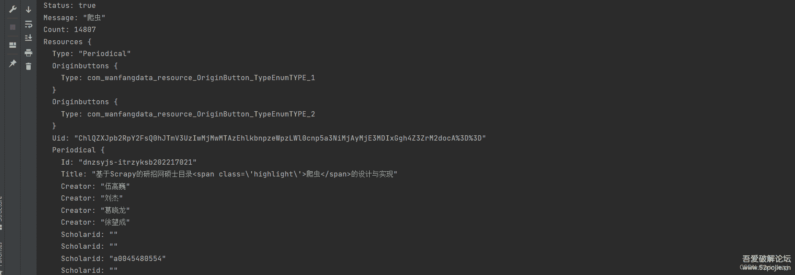

`23.png` (85.81 KB, 下载次数: 2)

[附件下载](https://www.52pojie.cn/forum.php?mod=attachment&aid=MjYxNTkwOHxkMDFlMjBkZnwxNzkzNTc0MTQzfDE2ODA4NnwxNzM1OTcz&nothumb=yes)

2023-5-18 17:39 上传

是不是直观了很多，但是核心还是写proto文件，也是难点。然后分析为什么这里是取部分数据做解析。接下来，我们讲怎么构造响应的proto文件，然后为什么数据是从第6位（数组下标5）开始取。

我们`f12`开始分析，响应其实是最难调试的点，定位也很难，所以我们可以从请求的过程堆栈入手，说不定可以有所启发，发现可疑位置。

下`xhr`断点，跟着堆栈走，主要看`app`开头的`js`，因为`chunk`开头的是基本库，很少在里面做手脚，一般都是在自写的`js`里面做加密或其他操作。

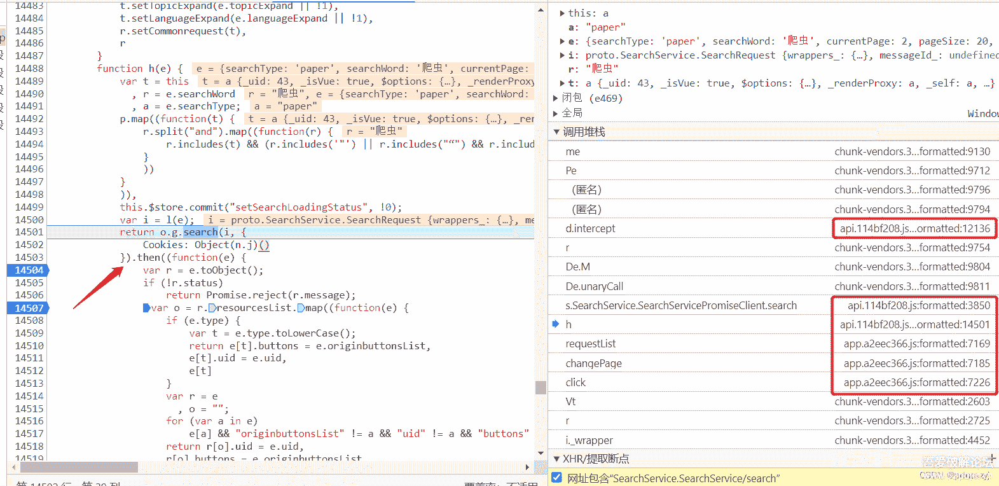

`24.png` (189.6 KB, 下载次数: 2)

[附件下载](https://www.52pojie.cn/forum.php?mod=attachment&aid=MjYxNTkxMHw5YzZmNGRjNHwxNzkzNTc0MTQzfDE2ODA4NnwxNzM1OTcz&nothumb=yes)

2023-5-18 17:39 上传

可以发现`h`这里有点可疑，异步然后获得了值去`.toObject`，这个`toObject`就是proto文件转`js`的时候会产生的一个`api`函数接口，大家可以简单使用`protoc`去尝试转化成`js`看看。

> （下载低于3.21.0 的`protoc`版本，因为原项目已将它独立出来，下载最新版本的`protoc`，运行`js_out`会缺少插件）

```bash
protoc --js_out=import_style=commonjs,binary:. 你的proto文件名.proto
```

然后下断点执行，你会看到下面数据如图：

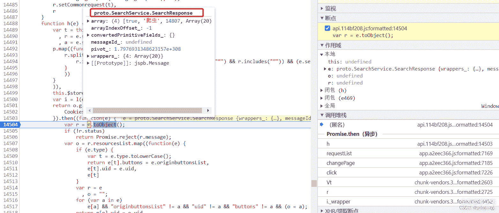

`25.png` (153.7 KB, 下载次数: 3)

[附件下载](https://www.52pojie.cn/forum.php?mod=attachment&aid=MjYxNTkxMXw4NDNjODQzOXwxNzkzNTc0MTQzfDE2ODA4NnwxNzM1OTcz&nothumb=yes)

2023-5-18 17:39 上传

发现和之前请求的是不是很像，其实这已经是解包好的了，所以应该在前面，但是异步我们不好跟了，或者我们在`then`那里下一个断点，然后单步跟，我就用另一种方式了，我们复制这一段，全局搜索一下：`proto.SearchService.SearchResponse`

会找到我这节要说的写响应，返回值proto文件的核心关键词：

`deserializeBinary`------`deserializeBinaryFromReader`（重点核心）

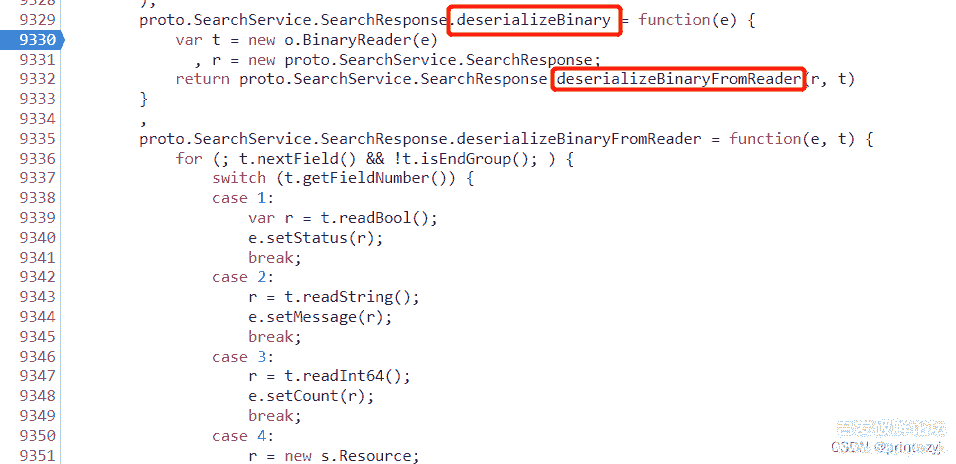

`26.png` (58.93 KB, 下载次数: 3)

[附件下载](https://www.52pojie.cn/forum.php?mod=attachment&aid=MjYxNTkxMnw5MjQxYmZiOXwxNzkzNTc0MTQzfDE2ODA4NnwxNzM1OTcz&nothumb=yes)

2023-5-18 17:39 上传

其实和请求包的关键词很像，就前面加了`de`，相当于解的意思。这里要多亏了志远大佬的指导，因为其实找响应的时候没一点头绪，然后很多文章都没讲清楚解包的关键词，异步也不太好跟，然后他稍微指点了一下，然后下断点就能定位了。

我们下一个断点看看，放开，重新点击：

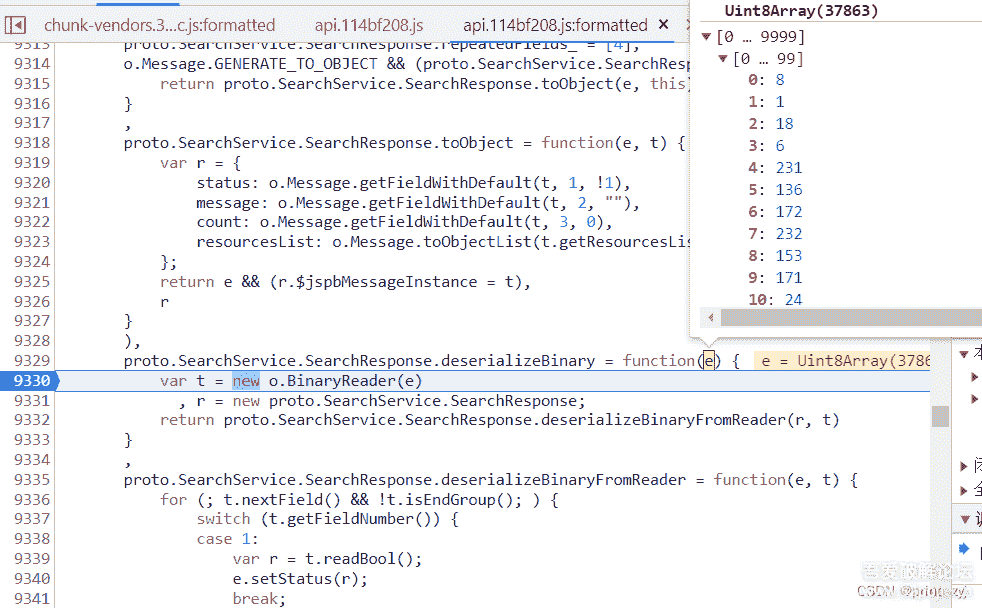

`27.png` (104.25 KB, 下载次数: 0)

[附件下载](https://www.52pojie.cn/forum.php?mod=attachment&aid=MjYxNTkxM3xhMmYwN2RhNHwxNzkzNTc0MTQzfDE2ODA4NnwxNzM1OTcz&nothumb=yes)

2023-5-18 17:39 上传

我们成功来到这个位置，和`fiddler`数据对比一下：

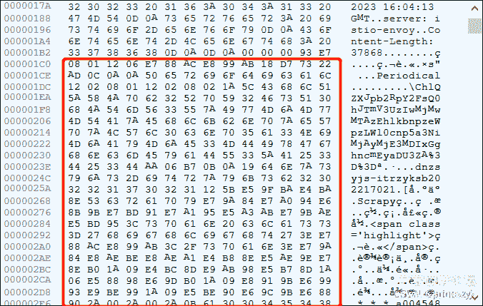

`28.png` (81.65 KB, 下载次数: 3)

[附件下载](https://www.52pojie.cn/forum.php?mod=attachment&aid=MjYxNTkxNHxjMTczNDZiYnwxNzkzNTc0MTQzfDE2ODA4NnwxNzM1OTcz&nothumb=yes)

2023-5-18 17:39 上传

发现是从第6位开始解包，所以就解决了上面我们的疑问，为什么从第6位开始取数据。

刚刚不是提到了两个关键词吗？

`deserializeBinary`------`deserializeBinaryFromReader`（重点核心）

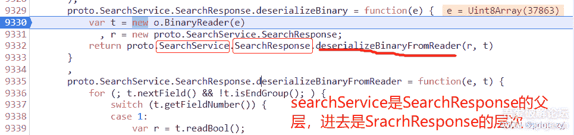

`29.png` (51.69 KB, 下载次数: 3)

[附件下载](https://www.52pojie.cn/forum.php?mod=attachment&aid=MjYxNTkxNXxiMDcyZTVlY3wxNzkzNTc0MTQzfDE2ODA4NnwxNzM1OTcz&nothumb=yes)

2023-5-18 17:39 上传

和请求的一样理解，只是他现在变成了`case`语句来表示位置，`read`后面的类型来表示类型。

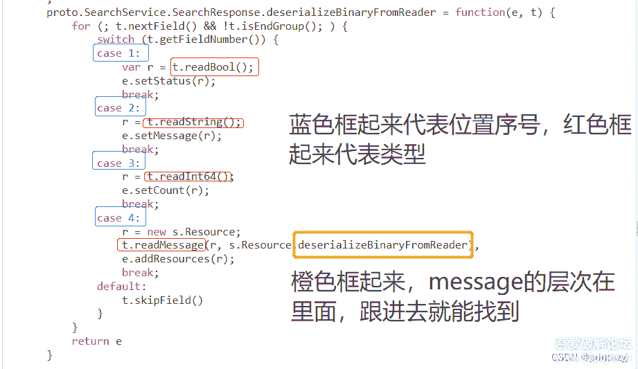

`30.png` (66.02 KB, 下载次数: 2)

[附件下载](https://www.52pojie.cn/forum.php?mod=attachment&aid=MjYxNTkxNnxiNjZkMDg3NXwxNzkzNTc0MTQzfDE2ODA4NnwxNzM1OTcz&nothumb=yes)


2023-5-18 17:39 上传

# Protobuf 反向工程笔记

## 自写 AST 处理 switch 语句

也是一层一层，慢慢的可以跟出来，当然，这个返回的数据量太大了，标号也特别的多，我们刚刚也看到了，所以有没有什么更好的方法得到`proto`文件呢？

那就是自写`ast`，然后用`ast`来处理这种`switch`语句。先安装`babel`解析库在当前目录下

```bash
npm install @babel/core --save-dev
```

我对`ast`还不是很熟悉，我就采用渔歌之前写好的（文末会附上链接），因为网站`js`也有小更新，之前的使用会报错。

按照文章，我们先把这一个`js`保存起来，我这里保存成`1.js`，运行

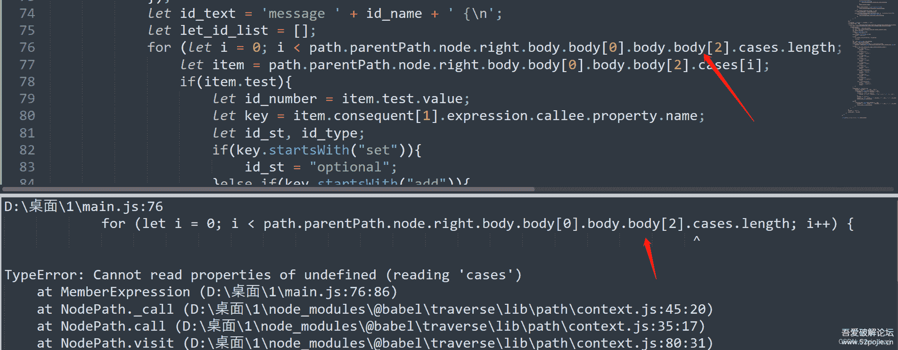

31.png (264.84 KB, 下载次数: 2)

[href="forum.php?mod=attachment&aid=MjYxNTkxN3xkNjExZTBkOXwxNzkzNTc0MTQzfDE2ODA4NnwxNzM1OTcz&nothumb=yes" target="_blank"](https://www.52pojie.cn/forum.php?mod=attachment&aid=MjYxNTkxN3xkNjExZTBkOXwxNzkzNTc0MTQzfDE2ODA4NnwxNzM1OTcz&nothumb=yes)

2023-5-18 17:39 上传

发现报错了，我稍微调试修改一下

原来的：

```
path.parentPath.node.right.body.body[0].body.body[2].cases.length
```

修改为：

```
path.parentPath.node.right.body.body[0].body.body[0].cases.length
```

还加了`try`处理，因为，有些是取不到`length`的，我也没太仔细分析原因，只是单纯从报错入手，然后小修改了一下。

`proto2`改成了`proto3`，`optional`关键字删除。

```javascript
const parser = require("@babel/parser");

// 为parser提供模板引擎

const template = require("@babel/template").default;

// 遍历AST

const traverse = require("@babel/traverse").default;

// 操作节点，比如判断节点类型，生成新的节点等

const t = require("@babel/types");

// 将语法树转换为源代码

const generator = require("@babel/generator");

// 操作文件

const fs = require("fs");

//定义公共函数

function wtofile(path, flags, code) {

    var fd = fs.openSync(path,flags);

    fs.writeSync(fd, code);

    fs.closeSync(fd);

}

function dtofile(path) {

    fs.unlinkSync(path);

}

var file_path = '1.js'; //你要处理的文件

var jscode = fs.readFileSync(file_path, {

    encoding: "utf-8"

});

// 转换为AST语法树

let ast = parser.parse(jscode);

let proto_text = `syntax = "proto3";\n\n// protoc --python_out=. app_proto2.proto\n\n`;

traverse(ast, {

    MemberExpression(path){

        if(path.node.property.type === 'Identifier' && path.node.property.name === 'deserializeBinaryFromReader' && path.parentPath.type === 'AssignmentExpression'){

            let id_name = path.toString().split('.').slice(1, -1).join('_');

            path.parentPath.traverse({

                VariableDeclaration(path_2){

                    if(path_2.node.declarations.length === 1){

                        path_2.replaceWith(t.expressionStatement(

                            t.assignmentExpression(

                                "=",

                                path_2.node.declarations[0].id,

                                path_2.node.declarations[0].init

                            )

                        ))

                    }

                },

                SwitchStatement(path_2){

                    for (let i = 0; i
```

这个`ast`代码单纯只是针对这个站点，其他站点也是类似分析。

运行完后，我们得到了`app_proto3.proto`文件，打开来，我们发现了报错，如下图，渔歌文章也讲清楚了原因，因为对象调用`deserializeBinaryFromReader`方法的时候，`ast`代码处理对象无法确定，所以就没加载到。

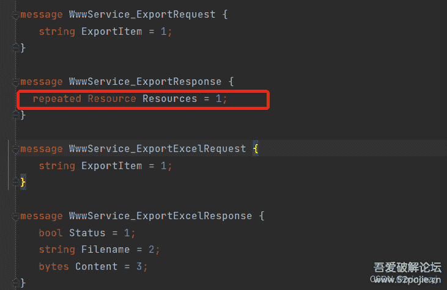

32.png (53.31 KB, 下载次数: 3)

[href="forum.php?mod=attachment&aid=MjYxNTkxOHw3NzY4ZTVlNXwxNzkzNTc0MTQzfDE2ODA4NnwxNzM1OTcz&nothumb=yes" target="_blank"](https://www.52pojie.cn/forum.php?mod=attachment&aid=MjYxNTkxOHw3NzY4ZTVlNXwxNzkzNTc0MTQzfDE2ODA4NnwxNzM1OTcz&nothumb=yes)

2023-5-18 17:39 上传

我们在调试里面，搜索关键词`ExportResponse.deserializeBinaryFromReader`

就能找到位置，根据我上面说的上下级关系，然后跟进去

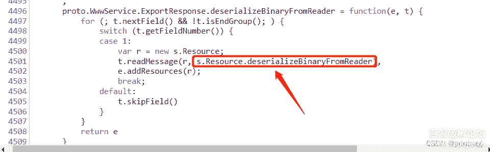

33.png (39.14 KB, 下载次数: 4)

[href="forum.php?mod=attachment&aid=MjYxNTkxOXxiZjA4NGJiNXwxNzkzNTc0MTQzfDE2ODA4NnwxNzM1OTcz&nothumb=yes" target="_blank"](https://www.52pojie.cn/forum.php?mod=attachment&aid=MjYxNTkxOXxiZjA4NGJiNXwxNzkzNTc0MTQzfDE2ODA4NnwxNzM1OTcz&nothumb=yes)

2023-5-18 17:39 上传

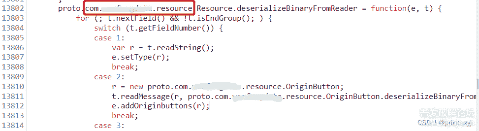

34.png (44.07 KB, 下载次数: 3)

[href="forum.php?mod=attachment&aid=MjYxNTkyMHxkNmE4M2UyN3wxNzkzNTc0MTQzfDE2ODA4NnwxNzM1OTcz&nothumb=yes" target="_blank"](https://www.52pojie.cn/forum.php?mod=attachment&aid=MjYxNTkyMHxkNmE4M2UyN3wxNzkzNTc0MTQzfDE2ODA4NnwxNzM1OTcz&nothumb=yes)

2023-5-18 17:39 上传

就能找到`s`代表的是什么了。

然后我们依次像这样把报错补好就行了。

得到了`proto`文件，基本上我们的任务就完成了，我们发包试试吧。

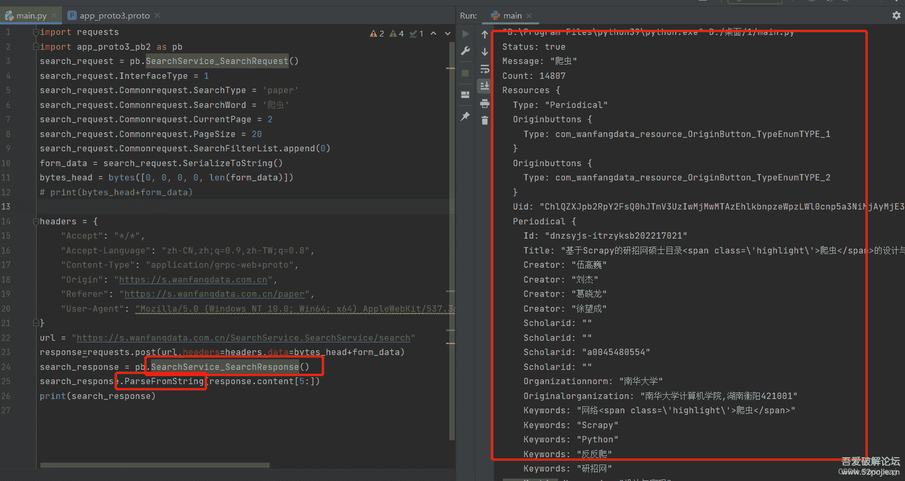

35.png (233.18 KB, 下载次数: 2)

[href="forum.php?mod=attachment&aid=MjYxNTkyMXxjMjYzMjIyYXwxNzkzNTc0MTQzfDE2ODA4NnwxNzM1OTcz&nothumb=yes" target="_blank"](https://www.52pojie.cn/forum.php?mod=attachment&aid=MjYxNTkyMXxjMjYzMjIyYXwxNzkzNTc0MTQzfDE2ODA4NnwxNzM1OTcz&nothumb=yes)

2023-5-18 17:39 上传

可以看到很直观，取值也方便。我们的`protobuf`之旅也基本上结束了！

## 完整代码

```python
import requests
import app_proto3_pb2 as pb
import blackboxprotobuf

search_request = pb.SearchService_SearchRequest()
search_request.InterfaceType = 1
search_request.Commonrequest.SearchType = 'paper'
search_request.Commonrequest.SearchWord = '爬虫'
search_request.Commonrequest.CurrentPage = 2
search_request.Commonrequest.PageSize = 20
search_request.Commonrequest.SearchFilterList.append(0)
form_data = search_request.SerializeToString()
# with open('me1.bin', mode="wb") as f:
#     f.write(form_data)
# print(SearchRequest.SerializeToString().decode())
bytes_head = bytes([0, 0, 0, 0, len(form_data)])
# print(bytes_head+form_data)

headers = {
    "Accept": "*/*",
    "Accept-Language": "zh-CN,zh;q=0.9,zh-TW;q=0.8",
    "Content-Type": "application/grpc-web+proto",
    "Origin": "https://**********",
    "Referer": "https://**********/paper",
    "User-Agent": "Mozilla/5.0 (Windows NT 10.0; Win64; x64) AppleWebKit/537.36 (KHTML, like Gecko) Chrome/105.0.0.0 Safari/537.36",
}
url = "https://**********/SearchService.SearchService/search"
response=requests.post(url,headers=headers,data=bytes_head+form_data)
# print(response.content)
# deserialize_data, message_type = blackboxprotobuf.decode_message(response.content[5:])
# data, message_type = blackboxprotobuf.decode_message(response.content[5:])
# print(data)
# print(message_type)
search_response = pb.SearchService_SearchResponse()
search_response.ParseFromString(response.content[5:])
print(search_response)
```

## 七、注意

其实这段代码还有点问题，就是最后取的`response.content`的真实长度是多少，从第6位开始，一共有多长呢，我们只是刚刚好取完是正确的。我们在从`fiddler`的抓包分析，刚刚不是前面还有5位16进制数：00 00 00 93 E7吗?我们在网站解析一下

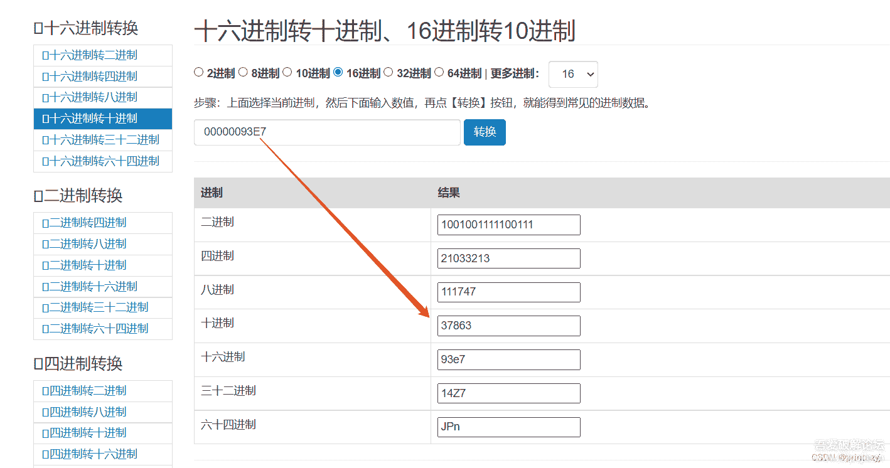

36.png (101.25 KB, 下载次数: 4)

[href="forum.php?mod=attachment&aid=MjYxNTkyMnwyODA1Nzc5MXwxNzkzNTc0MTQzfDE2ODA4NnwxNzM1OTcz&nothumb=yes" target="_blank"](https://www.52pojie.cn/forum.php?mod=attachment&aid=MjYxNTkyMnwyODA1Nzc5MXwxNzkzNTc0MTQzfDE2ODA4NnwxNzM1OTcz&nothumb=yes)

2023-5-18 17:39 上传

刚刚好就是我们断点时的

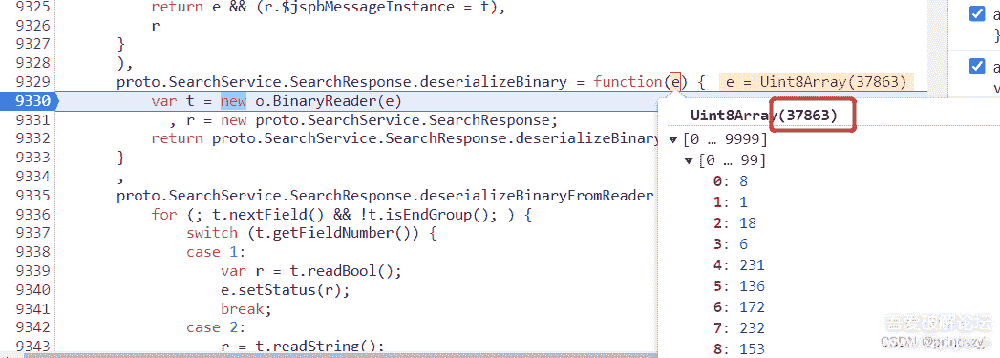

37.png (66.55 KB, 下载次数: 4)

[href="forum.php?mod=attachment&aid=MjYxNTkyM3wxZjVhMTQ3M3wxNzkzNTc0MTQzfDE2ODA4NnwxNzM1OTcz&nothumb=yes" target="_blank"](https://www.52pojie.cn/forum.php?mod=attachment&aid=MjYxNTkyM3wxZjVhMTQ3M3wxNzkzNTc0MTQzfDE2ODA4NnwxNzM1OTcz&nothumb=yes)

2023-5-18 17:39 上传

所以前5位十六进制代表的是我们需要的响应数据的长度。

处理方法：

```python
data_len=int.from_bytes(response.content[:5], 'big') #bytes转int

search_response = pb.SearchService_SearchResponse()

search_response.ParseFromString(response.content[5:5+data_len])
```

希望我们的文章能让你们对`protobuf`类型网站的逆向有更深的理解，某音直播弹幕其实也是类似原理，抓住这节和上节说的关键词,相信大家都能解决。

`deserializeBinary`------`deserializeBinaryFromReader`（重点核心）

`serializeBinary`------`serializeBinaryFromReader`（重点核心）

有说的不够好的地方欢迎指出，希望你看了有所收获！感谢！

如果想我多出文章，就多点赞转发，谢谢啦，写一篇真的好累，好久啊........

## 八、参考文章

[//blog.csdn.net/qq_35491275/article/details/111721639" target="_blank" rel="noopener noreferrer nofollow"](https://blog.csdn.net/qq_35491275/article/details/111721639:rel="nofollow noopener" href="https)

[//mp.weixin.qq.com/s/DzCz66_Szc7vfG6bpl956w" target="_blank" rel="noopener noreferrer nofollow"](https://mp.weixin.qq.com/s/DzCz66_Szc7vfG6bpl956w:rel="nofollow noopener" href="https)

[//bbs.kanxue.com/thread-265537.htm" target="_blank" rel="noopener noreferrer nofollow"](https://bbs.kanxue.com/thread-265537.htm:rel="nofollow noopener" href="https)
