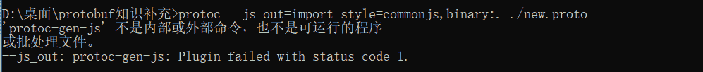
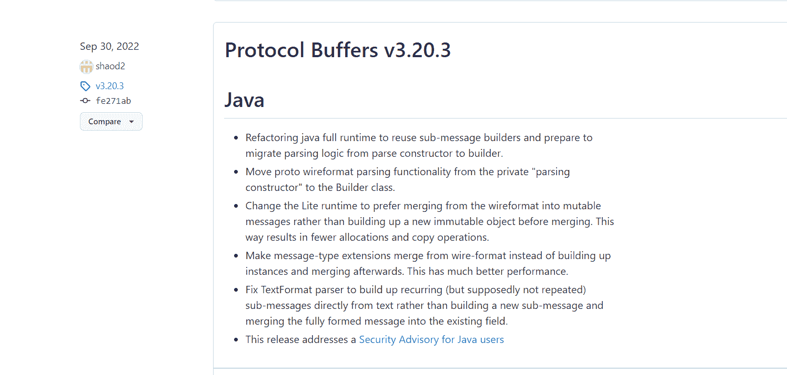

# [Web逆向] protobuf知识补充

- 原帖：<https://www.52pojie.cn/forum.php?mod=viewthread&tid=1735975>
- 抓取时间：2026-11-01T23:02:23

## protobuf知识补充

### 前言

前面两篇文章讲了protobuf的逆向，有些人对protobuf一些基本认识还不够，这里我将补充一点protobuf知识。

我将从`proto`文件转javascript文件入手，看看我们上一期所见到的一些关键词，希望能让你对protobuf网站逆向更深刻，有新的认识。

### 一、前期准备

下载低于 3.21.0 的`protoc`版本，因为原项目已将它独立出来，下载最新版本的`protoc`，运行`js_out`会缺少插件，如下图。

下载地址：[//github.com/protocolbuffers/protobuf/releases/](https://github.com/protocolbuffers/protobuf/releases/)

下载对应版本，可以添加到环境变量（之前添加过的记得删除原来的），也可以把`proto`文件移到`bin`目录下执行。

### 二、将`proto`文件编译成javascript文件

我们先看一下`proto`文件有什么数据类型吧。

参考文章：[//www.jianshu.com/p/362a6cdb63c5](https://www.jianshu.com/p/362a6cdb63c5)

#### 基础类型

| `.proto`类型 | java类型 | C++类型 | 备注 |
| --- | --- | --- | --- |
| `double` |  |  |  |
