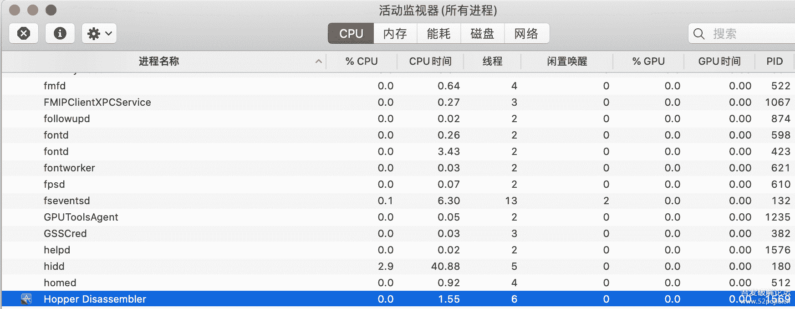
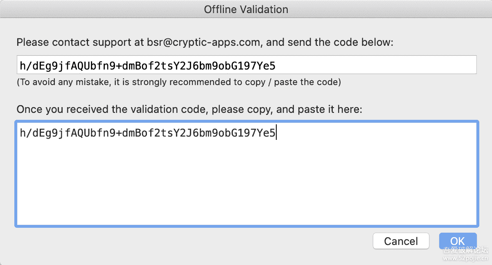
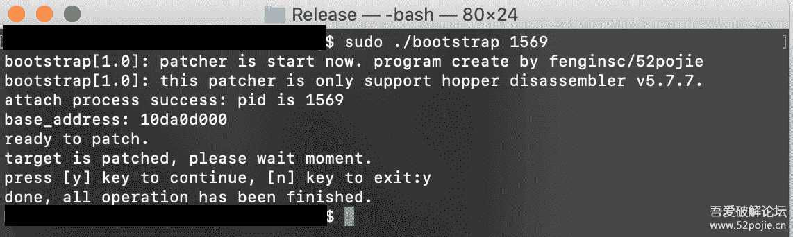
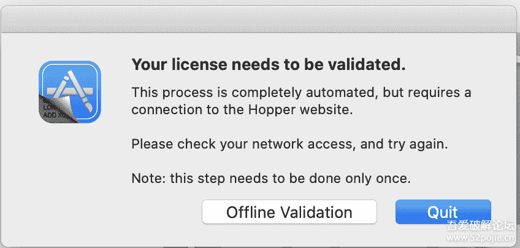

# [原创] Hopper Disassembler v5.7.7 for macOS patch 交流研究和使用方法

> 原帖：https://www.52pojie.cn/forum.php?mod=viewthread&tid=1737990
>
> 抓取时间：2026-11-01T23:02:02

原版 Hopper Disassembler v5.7.7 for macOS 完整安装包下载地址：[https://www.52pojie.cn/thread-1737979-1-1.html](https://www.52pojie.cn/thread-1737979-1-1.html)

## 软件保护机制分析

相信研究过 Hopper Disassembler 这款软件的人都知道，macOS 版本非常难 patch 掉。这款软件有很多校验，看得出作者是下了功夫的：

- 使用了 xcode 固化运行时（hardened runtime），绑定了 macOS 的 SIP（macOS 10.14+）
- 启动时可执行文件校验（运行目录不能有其他文件，不然会启动崩溃）
- 二进制证书签名验证（开发者 RSA 证书签名，替换或删除签名会无法启动）
- 目录签名验证（可执行文件目录组件签名验证）
- 文件内存校验（修改文件启动闪退）
- 联网验证
- 代码花指令混淆（静态分析困难，找不到引用）
- 反调试（附加会闪退，无法以调试模式启动，动态分析困难）
- 反修改，运行时闪退（内藏大量暗桩）

## 补丁说明

经过我的一些研究，既然不能直接修改文件，我参考了 Windows 上制作内存补丁的方式，制作了本 crack 补丁。

但因为有内存校验、花指令混淆和暗桩运行时闪退，静态分析找不到崩溃的位置，所以有暗桩无法清除，希望有人能一起讨论研究。

初步分析是作者有一些内存溢出的未处理异常、错误的地址 `call` 和嵌入汇编码 `asm {ud2}` 等导致程序人为闪退，但具体崩溃的位置不好找。

本 crack 补丁不完美，有一定的机率会闪退，但功能基本都可用，欢迎一起讨论研究，方法是直接回复本贴。

## 2023.01.24 更新 patcher v1.1 版本

- 引导启动模式由手动操作改为全自动模式，不用再手动输入 `y` 执行后续操作了。
- 手动挂载模式添加 `auto` 选项，不用再自己找 `pid` 了，使用方法 `sudo ./bootstrap auto`；之前的 `sudo ./bootstrap $pid` 还能继续使用。

## 目前的情况和遇到的问题

目前的情况和遇到的问题如下，前面打 `x` 的代表已解决，有兴趣的可以一起研究，直接回复本帖即可。

- [x] 联网验证，已加入 `hosts` 文件屏蔽网络连接
- [x] patch 后程序 100% 闪退，已通过内存补丁的方式解决
- [x] 不能分析某些类型的文件
- [x] 不能使用动态调试器功能
- [x] 不能使用导出二进制文件和保存分析结果功能
- [-] 导出和保存功能每次打开只能使用一次，用完程序就闪退（暗桩，原因不明）
- [x] 提示要求网络连接再次验证，已通过手动挂载模式再次离线激活绕过
- [-] 弹窗要求再次离线激活后有一定几率程序闪退（暗桩，原因不明）
- [-] M 芯片使用 Rosetta 启动，因为 macOS 系统 `W^X` 安全机制，导致部分内存补丁不生效（点击 `try demo` 可以完整使用全部功能，但有兼容性问题）
- [-] M 芯片原生 Arm64 内存补丁会导致程序运行卡死（暗桩，原因不明）

## 使用本 crack 补丁的前置准备工作

1. 将 `hopperapp.com` 和 `www.hopperapp.com` 加入 macOS 的 `hosts` 文件防止联网验证（`hosts` 文件在 `/etc` 文件夹下）：

    ```
    127.0.0.1 hopperapp.com
    127.0.0.1 www.hopperapp.com
    ```

2. 如果你的 macOS 系统版本高于 10.14（mojave），需要关闭 macOS 的 SIP。

    - Intel 处理器的 mac 关闭方法是开机时按住（`command+R`）进入 macOS 的恢复模式，在终端输入 `csrutil disable`，然后 `reboot` 重启。
    - Apple 处理器的 mac 关闭方法是开机时按住指纹解锁键（`touch id`）进入 macOS 的恢复模式，在终端输入 `csrutil disable`，然后 `reboot` 重启。

3. 下载好 crack 补丁和伪造的授权文件，安装原版的安装包到 `/Applications` 目录下即可开始。

## 使用步骤

1. 先打开原版程序，导入伪造的授权文件，点击 Offline Activation。

    

    （525.39 KB，下载次数：2，2023-1-21 12:15 上传；[附件下载](https://www.52pojie.cn/forum.php?mod=attachment&aid=MjU4NTgyNHxlNTRjZTBlYXwxNzkzNTc0MTE5fDE2ODA4NnwxNzM3OTkw&nothumb=yes)）

2. 将补丁解压，打开终端，`cd` 到解压后的目录，然后输入 `chmod 755 ./bootstrap` 赋予 patcher 运行权限。

3. 打开 macOS 活动监视器，查找到进程的 `pid`。

    

    （191.49 KB，下载次数：0，2023-1-21 12:15 上传；[附件下载](https://www.52pojie.cn/forum.php?mod=attachment&aid=MjU4NTgyMnwyMDgyMWM3ZHwxNzkzNTc0MTE5fDE2ODA4NnwxNzM3OTkw&nothumb=yes)）

4. 然后输入命令 `sudo ./bootstrap pid` 启动补丁，我这里的示例是 `sudo ./bootstrap 1569`。

5. 回到激活窗口，复制上面的代码到下面的框，点击 OK。

    

    （81.67 KB，下载次数：1，2023-1-21 12:15 上传；[附件下载](https://www.52pojie.cn/forum.php?mod=attachment&aid=MjU4NTgyM3w3NmRjODBkMHwxNzkzNTc0MTE5fDE2ODA4NnwxNzM3OTkw&nothumb=yes)）

6. 回到终端输入 `y`，程序自动执行剩余流程；如果你输入 `n`，在加载文件的时候 100% 闪退。`n` 只是让你提前退出而不执行后续操作。

    

    （303.61 KB，下载次数：3，2023-1-21 12:31 上传；[附件下载](https://www.52pojie.cn/forum.php?mod=attachment&aid=MjU4NTgyNnxhNzI4NGE1YXwxNzkzNTc0MTE5fDE2ODA4NnwxNzM3OTkw&nothumb=yes)）

7. 到此为止，你已经可以使用 Hopper Disassembler 的全部功能。如果出现：

    

    （72.29 KB，下载次数：2，2023-1-21 12:15 上传；[附件下载](https://www.52pojie.cn/forum.php?mod=attachment&aid=MjU4NTgyMXxiYThhNTE2ZXwxNzkzNTc0MTE5fDE2ODA4NnwxNzM3OTkw&nothumb=yes)）

    你可能需要重复上述步骤。如果出现闪退，不可避免，只能重新来过再操作一次。

8. 已经使用伪造授权激活过一次的，可以直接输入命令 `sudo ./bootstrap` 启动，不再需要附加 `pid`。

## 结语

使用教程到这里就结束了，最后祝大家新年快乐。

补丁和授权文件下载地址在附件。

如果你有更好的方法欢迎讨论研究，特此另开的一贴，希望能和大家互相交流学习。
