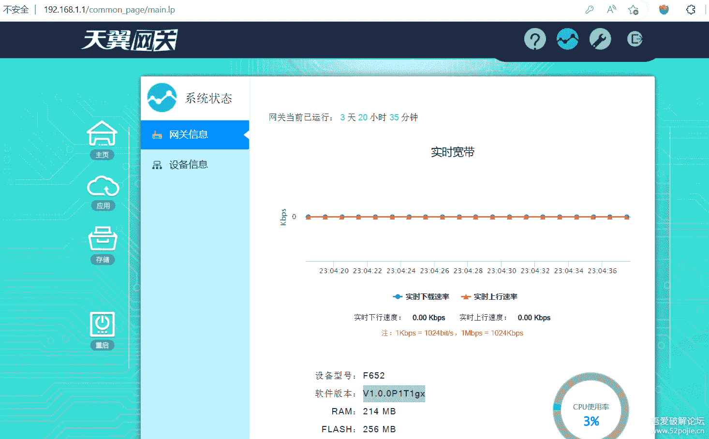
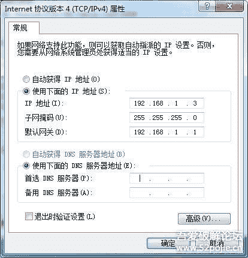
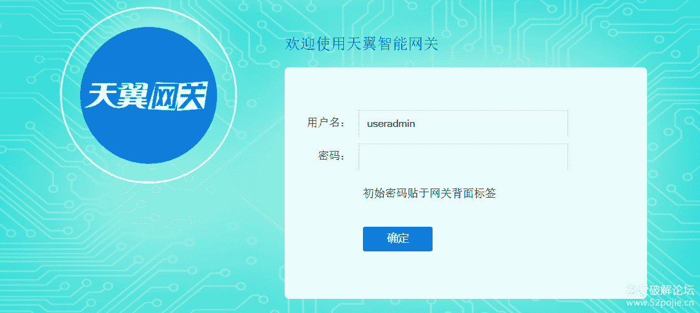
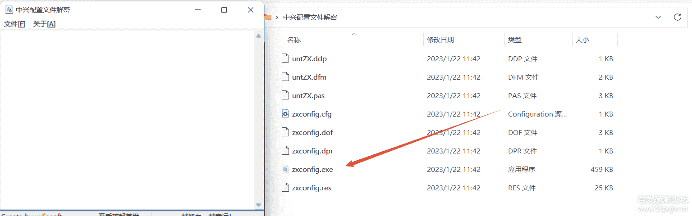
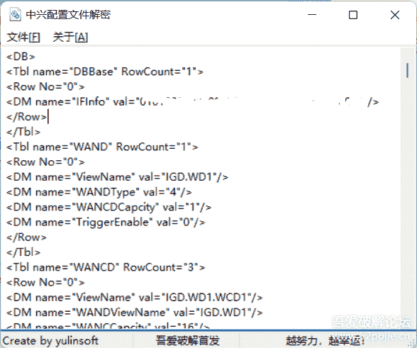
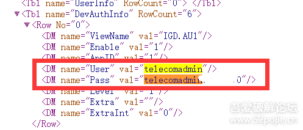

# [原创] 电信光猫F652获取超级密码

- 原帖: https://www.52pojie.cn/forum.php?mod=viewthread&tid=1738384
- 抓取时间: 2026-11-01T23:01:53

最近这段时间折腾了一下电信的IPV6,光猫原来只设置了IPV4的桥接，没有设置IPV6的桥接，要光猫改一下设置就行了，本着不麻烦别人的原则，百度了一大圈，没有一篇不拆机、不重置光猫获取超级密码的教程，于是开始了折腾之旅。下面开始过程。

## 一、检查设备及版本号

- 设备型号：`F652`
- 软件版本：`V1.0.0P1T1`

其它版本不保证一定通用。

## 二、准备需要的工具和软件

软件中兴配置文件解密，可以百度，也可以从下面下载。

## 三、详细过程

### 1. 电脑网线直连光猫网口
检查一下本地连接的ip是`192.168.1.X`网段，如果不是，自己设置成静态ip到这个网段即可。我设置成了`192.168.1.3`，详细配置如下图：

### 2. 打开 `192.168.1.1` 登陆
用户名和密码在光猫后面可以看到。

### 3. 下载配置文件
将地址栏上面的`http://192.168.1.1/common_page/main.lp`后面的`common_page/main.lp`替换成`common_page/File_Download_lua.lua?downtype=0&IF_FILEPATH=/userconfig/cfg/db_user_cfg.xml&IF_FILENAMEUTF8=db_user_cfg.xml&`，打开上面的地址将得到一个名为`db_user_cfg.xml`的文件。

### 4. 解密配置文件
解压`中兴配置文件解密.zip`并打开进入解压后的文件夹，打开`zxconfig.exe`：

### 5. 打开配置文件
在解密工具中选择文件->打开，打开刚下载的`db_user_cfg.xml`的文件。

### 6. 获取超级密码
在解密工具中选择文件->保存，将解密后的文件保存下来。使用记事本或者浏览器打开，搜索`telecomadmin`，红框部分对应的就是超级用户的账号和密码。

参考链接：
1. 中兴光猫ZXHN-F650不拆机获取超级密码 https://www.52pojie.cn/thread-999381-1-1.html
2. 电信光猫ZXHN F650获取超级密码 https://www.52pojie.cn/thread-1224435-1-1.html
