# [Web逆向] 完整逆向某小程序破解签名算法过程记录

- 原帖: https://www.52pojie.cn/forum.php?mod=viewthread&tid=1738723
- 抓取时间: 2026-11-01T23:01:49

## 起因

一天晚上我正在愉快的网上冲浪的时候突然我一个朋友给我转发了一个叫“大家画我”的小程序，大概意思就是用他小程序里面内置的画板去画个图片，然后就可以显示出来了。

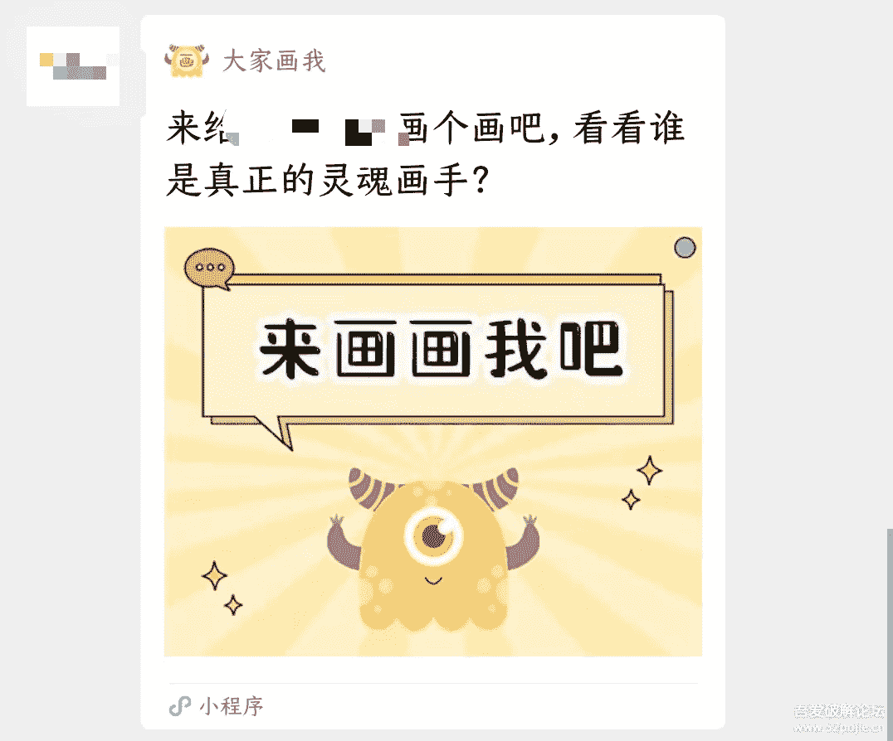

`1.png`（341.57 KB，下载次数：0；2024-8-30 13:13 上传）

[附件链接](https://www.52pojie.cn/forum.php?mod=attachment&aid=MjcyMDY4N3wwMjNiZjYzNHwxNzkzNTc0MTA2fDE2ODA4NnwxNzM4NzIz&nothumb=yes)

## 分析过程

于是我开始了老规矩，黄鸟抓包大法，看看可不可以上传自定义的图片

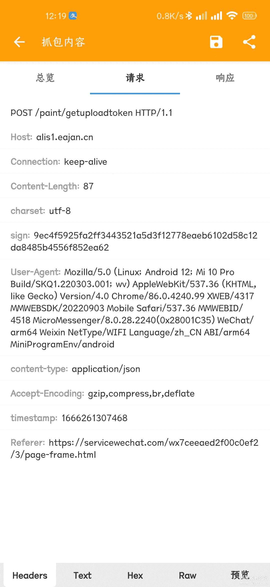

`2.png`（572.18 KB，下载次数：0；2024-8-30 13:14 上传）

[附件链接](https://www.52pojie.cn/forum.php?mod=attachment&aid=MjcyMDY4OHw2MjdmY2RkNnwxNzkzNTc0MTA2fDE2ODA4NnwxNzM4NzIz&nothumb=yes)

通过黄鸟帮我捋清步骤，发现他的图片是储存在七牛云上面的，于是我便感觉可以搞一手，但是通过抓包发现他在请求头是有一个`sign`的字段去验证签名的，不过都是小问题

直接去 github 克隆一份`wxappUnpacker`，把小程序解包，分析一下签名的算法，当然也是顺利的解了包，并且通过全局搜索发现了签名的算法

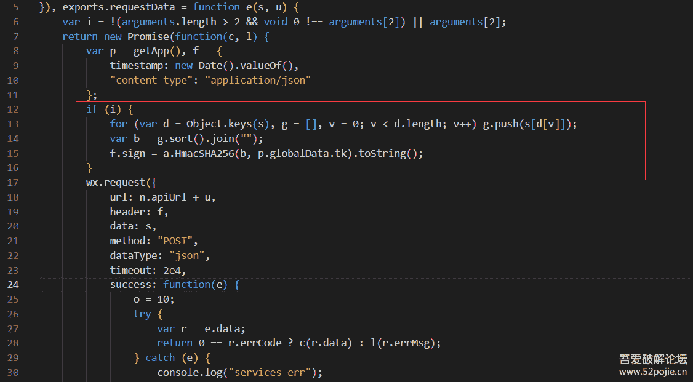

`3.png`（70.05 KB，下载次数：0；2024-8-30 13:14 上传）

[附件链接](https://www.52pojie.cn/forum.php?mod=attachment&aid=MjcyMDY4OXw1NmYyNWYyMHwxNzkzNTc0MTA2fDE2ODA4NnwxNzM4NzIz&nothumb=yes)

可以看出来它使用的是`Hmac_Sha256`算法，这也是比较常见的后端验证的方法，大概思路就是把参数的`value`通过 ascii 码的顺序来排序，然后来计算签名

光知道算法可不行，还得找到他的密钥，于是我又开始搜索`p.globalData.tk`的定义，当然也是非常轻松就找到了

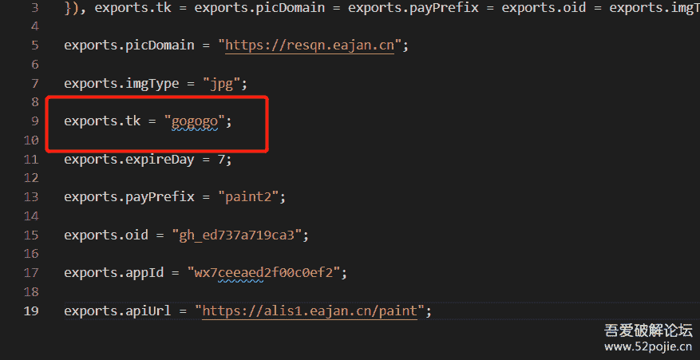

`4.png`（38.34 KB，下载次数：0；2024-8-30 13:15 上传）

[附件链接](https://www.52pojie.cn/forum.php?mod=attachment&aid=MjcyMDY5Mnw4ZjlkYWJjYnwxNzkzNTc0MTA2fDE2ODA4NnwxNzM4NzIz&nothumb=yes)

当我沾沾自喜的以为密钥就是`gogogo`的时候，现实又很残酷的打了我的脸，当我复刻出算法用现在的`token`去计算签名的时候发现这个密钥不对

我百思不得其解，最后无奈，祭出小黄鸟又开始新一轮的抓包，终于被我发现了猫腻，他是通过一个`getconfig`接口去获取的`tk`和本地的`tk`去拼接

两个`tk`拼接之后才是真正的密钥，于是又开始搜索相关代码，被我找到了真正的赋值过程

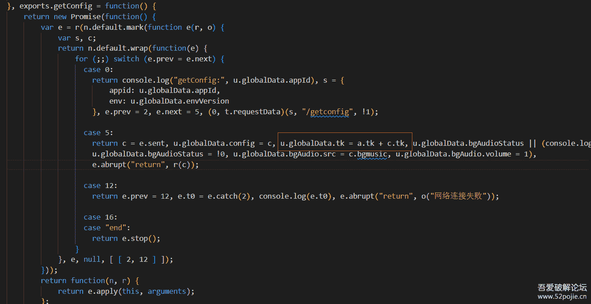

`5.png`（77.47 KB，下载次数：0；2024-8-30 13:15 上传）

[附件链接](https://www.52pojie.cn/forum.php?mod=attachment&aid=MjcyMDY5MXw4MjYzMGRiZXwxNzkzNTc0MTA2fDE2ODA4NnwxNzM4NzIz&nothumb=yes)

这下真正的`tk`也被破解出来，就可以开始复刻签名算法了，这种东西当然是选择`python`了

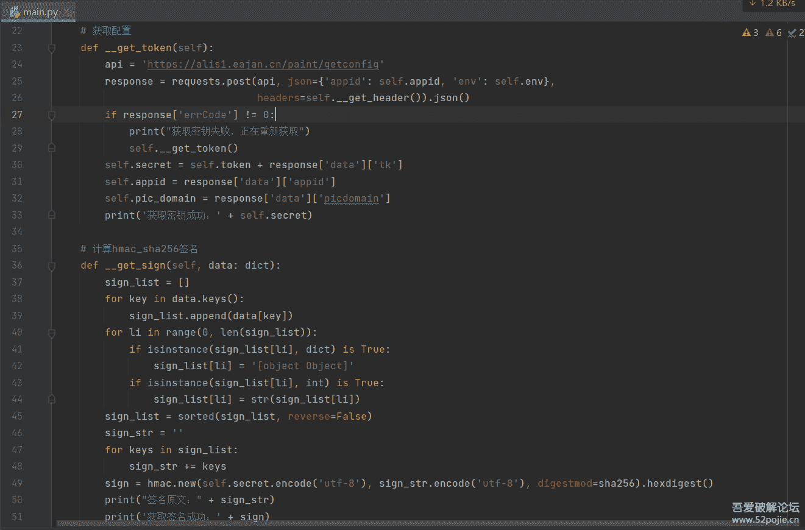

`6.png`（141.29 KB，下载次数：0；2024-8-30 13:15 上传）

[附件链接](https://www.52pojie.cn/forum.php?mod=attachment&aid=MjcyMDY5MHwyNDdlOGQ2NXwxNzkzNTc0MTA2fDE2ODA4NnwxNzM4NzIz&nothumb=yes)

洋洋洒洒写出签名算法之后，就开始伪造数据，并且验证签名结果是否一样了，答案是肯德，毕竟都分析到这种程度了，再不成功就说不过去了

于是开始复刻上传图片到七牛云的过程，大概过程就是：先获取`token`，再上传到七牛云，然后把图片提交给服务器

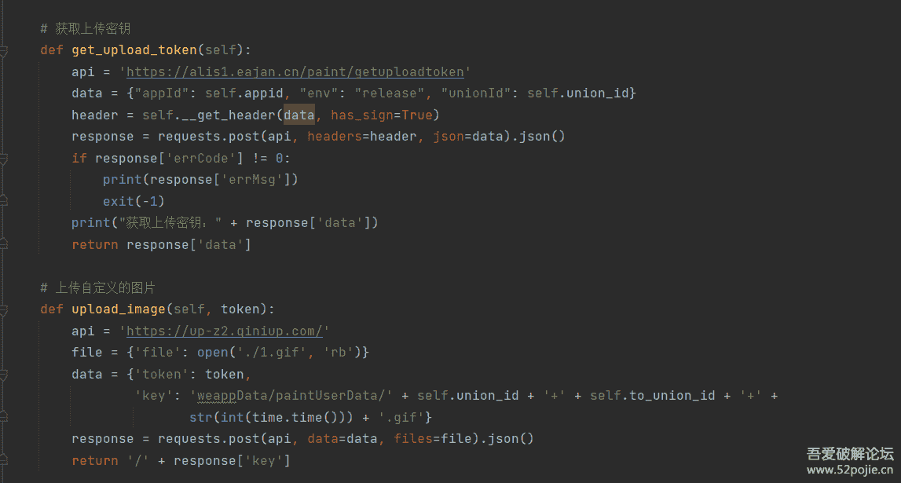

`7.png`（89.29 KB，下载次数：0；2024-8-30 13:18 上传）

[附件链接](https://www.52pojie.cn/forum.php?mod=attachment&aid=MjcyMDY5M3w5MzQyMmU3M3wxNzkzNTc0MTA2fDE2ODA4NnwxNzM4NzIz&nothumb=yes)

然后是把图片提交给服务器，让服务器保存到数据库

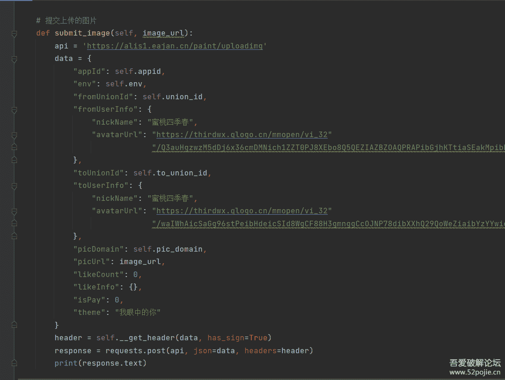

`8.png`（104.68 KB，下载次数：0；2024-8-30 13:18 上传）

[附件链接](https://www.52pojie.cn/forum.php?mod=attachment&aid=MjcyMDY5NHxkOWQ5ODNmZHwxNzkzNTc0MTA2fDE2ODA4NnwxNzM4NzIz&nothumb=yes)

## 结果

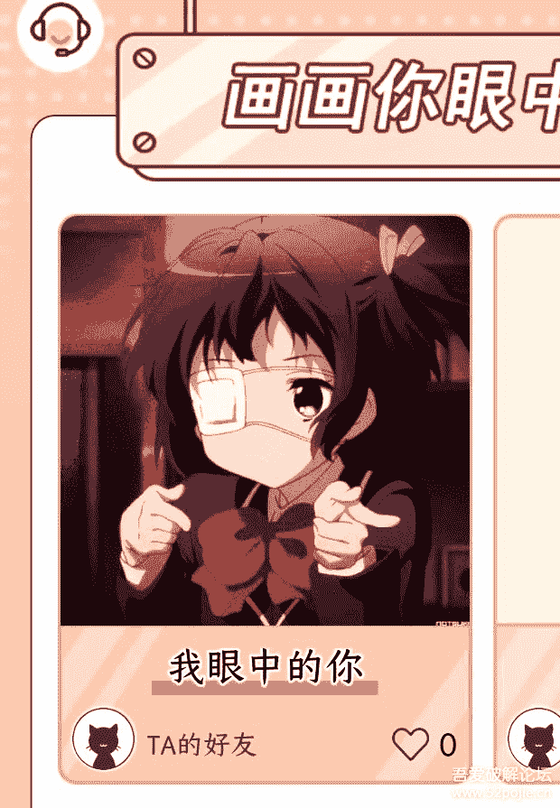

`9.png`（516.57 KB，下载次数：0；2024-8-30 13:18 上传）

[附件链接](https://www.52pojie.cn/forum.php?mod=attachment&aid=MjcyMDY5NXxlZGY5OWE4ZXwxNzkzNTc0MTA2fDE2ODA4NnwxNzM4NzIz&nothumb=yes)

其实这个图是个gif来着，但是因为是截屏所以看不到效果，再给大家看看别人的画风

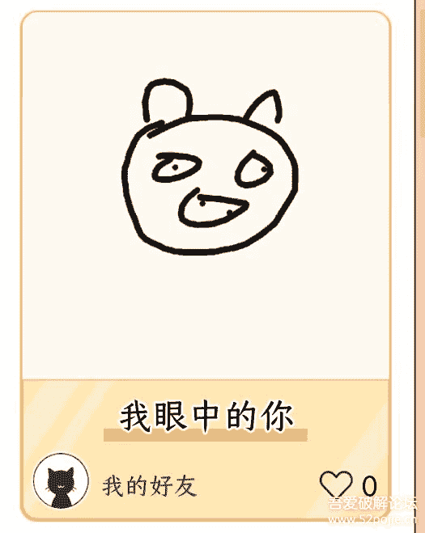

`10.png`（152.8 KB，下载次数：0；2024-8-30 13:18 上传）

[附件链接](https://www.52pojie.cn/forum.php?mod=attachment&aid=MjcyMDY5NnxmNmE3OWMzN3wxNzkzNTc0MTA2fDE2ODA4NnwxNzM4NzIz&nothumb=yes)

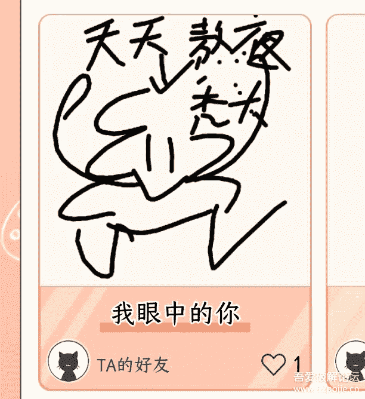

`11.png`（288.36 KB，下载次数：0；2024-8-30 13:19 上传）

[附件链接](https://www.52pojie.cn/forum.php?mod=attachment&aid=MjcyMDY5N3xhYWNjZDcyN3wxNzkzNTc0MTA2fDE2ODA4NnwxNzM4NzIz&nothumb=yes)

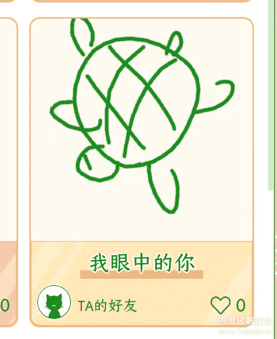

`12.png`（247.84 KB，下载次数：0；2024-8-30 13:19 上传）

[附件链接](https://www.52pojie.cn/forum.php?mod=attachment&aid=MjcyMDY5OHwxODZmNmY0N3wxNzkzNTc0MTA2fDE2ODA4NnwxNzM4NzIz&nothumb=yes)

正所谓没有买卖就没有杀害，呸走错片场了，没有对比就没有伤害

https://www.moleft.cn/usr/uploads/2022/10/48455335.png
