# [MacOS逆向] AirBuddy2 2.6.3 的dylib注入方案 (2)

- 原帖：[https://www.52pojie.cn/forum.php?mod=viewthread&tid=1739112](https://www.52pojie.cn/forum.php?mod=viewthread&tid=1739112)
- 抓取时间：2026-11-01T23:01:45

## 上篇概要

妙控键盘2电源开关坏了，不知道怎么修，就不写了。

有兴趣的直接翻我帖子上一篇看。

 `DF33884F-9E52-4459-BB94-34BDF7A7BADB_1_105_c.jpg` (125.84 KB, 下载次数: 1) [下载](https://www.52pojie.cn/forum.php?mod=attachment&aid=MjU4NjcyM3w0OGJmMTQzN3wxNzkzNTc0MTAzfDE2ODA4NnwxNzM5MTEy&nothumb=yes) 2023-1-27 22:00 上传

就这个小开关，全网找不到卖的。有知道怎么修的朋友给个提示。

现在关机没用，拨回去按两下又通电了，好烦。放包里严重误按。

## 准备工具

- AppCode（需要预装 XCode）
- 编译好的 `insert_dylib` 二进制执行文件
- IDA 7.0 Mac
- VSCode + Frida
- 关闭 Mac 上的 SIP 以注入进程内存
- 人

IDA 在论坛资源区下载，AppCode 不会用可以直接用 XCode。

Frida 不会用可以百度，TypeScript 看不懂可以百度。

`insert_dylib` 源代码下载地址：[Tyilo/insert_dylib](https://github.com/Tyilo/insert_dylib)

注入我用的是 `rd_route` 劫持库。

`h` 文件和 `c` 文件（后面用到）：[rodionovd/rd_route](https://github.com/rodionovd/rd_route)

注意：

楼主没写过 macOS App，也不会写。以下发表的所有 Hook 理解也是根据百度搜索到的资料理解的，如果有理解错误的地方请指正。

关于评论区有朋友问别人拿我的成果卖钱/伪装第一作者/不注明来源偷盗转载的看法：

```
偷盗转载卖钱狗nm似了捏。
我希望这是极少部分人，如果所有人都在盗取别人的研究结果，而没有人愿意分享，那么这对整个行业是一个沉重的打击。
众所周知，原创凉的快，火的都是抄袭者。但是没有原创，那么也就没有人能学到知识。即使对我没有任何好处，我也愿意做一个分享的人。

但是很可惜，上面那些屁话糊弄糊弄刚毕业的还行，毕业三年看遍世间百态，皆为追名逐利之徒，把别人自由分享的东西据为己有变现，偷盗转载提升个人名气的宵小之徒比比皆是。毕竟狗改不了吃屎。

以上种种人间丑态,任世事纷扰,我自且听风吟,一笑置之。
```

关于 `xxxx` 的看法省流：

```
偷盗转载卖钱狗nm4了。
```

## 3. 直入主题

### 4. 第一步 寻找特征

这次我们不破坏原始文件二进制，使用 dylib 注入 Framework 文件的方式劫持内存实施运行时代码注入达到修改目标函数的目的。

其缺点是必须要关闭 SIP，否则无法通过 App 文件的完整性检查。

不破坏 App 的原始签名可以绕过一些权限问题，如后面释出的 CleanMyMac X 4.12.3 破解后无限弹窗问题。

打开软件寻找目标。

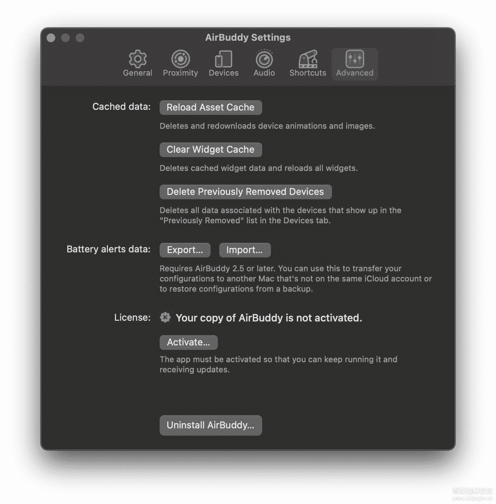 `16748200710851.jpg` (144.88 KB, 下载次数: 1) [下载](https://www.52pojie.cn/forum.php?mod=attachment&aid=MjU4NjY3OHxlYzg5MjFhY3wxNzkzNTc0MTAzfDE2ODA4NnwxNzM5MTEy&nothumb=yes) 2023-1-27 21:52 上传

`Your copy of AirBuddy is not activated.`

这行字我们去搜一下。

我们直接搜索整个 app 文件里面：

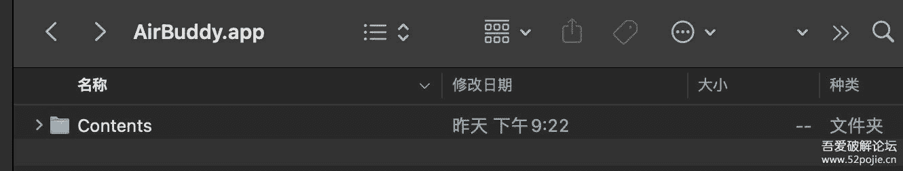 `16748201466722.jpg` (28.56 KB, 下载次数: 3) [下载](https://www.52pojie.cn/forum.php?mod=attachment&aid=MjU4NjY3OXw4Y2ZhODc1M3wxNzkzNTc0MTAzfDE2ODA4NnwxNzM5MTEy&nothumb=yes) 2023-1-27 21:52 上传

好，我们已经找到结果，下面就是根据字符串的引用 key 去 IDA 搜索了。

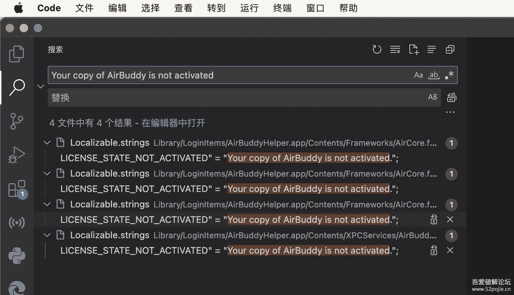 `16748201900543.jpg` (155.64 KB, 下载次数: 1) [下载](https://www.52pojie.cn/forum.php?mod=attachment&aid=MjU4NjY4MHw0Yjc0ZGRjNnwxNzkzNTc0MTAzfDE2ODA4NnwxNzM5MTEy&nothumb=yes) 2023-1-27 21:52 上传

此时多个文件我们怎么检查呢？

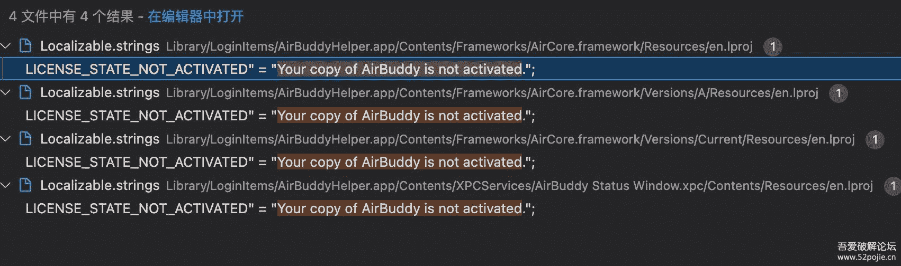 `16748202423792.jpg` (133.55 KB, 下载次数: 1) [下载](https://www.52pojie.cn/forum.php?mod=attachment&aid=MjU4NjY4MXwwYjA0MjhlZXwxNzkzNTc0MTAzfDE2ODA4NnwxNzM5MTEy&nothumb=yes) 2023-1-27 21:52 上传

注意看，这些文件是一个 `framework` 和一个 `xpc` 文件中存在的。`xpc` 就不多说了，就没有意义。我们直接重点关注 `AirCore.framework` 文件。

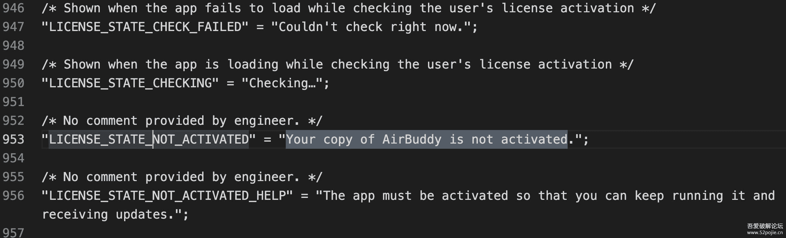 `16748203288826.jpg` (177.94 KB, 下载次数: 0) [下载](https://www.52pojie.cn/forum.php?mod=attachment&aid=MjU4NjY4MnxlYmQyYmE5MnwxNzkzNTc0MTAzfDE2ODA4NnwxNzM5MTEy&nothumb=yes) 2023-1-27 21:52 上传

可以看到字符串引用 `key` 就是 `LICENSE_STATE_NOT_ACTIVATED`。

我们直接在 IDA 中打开此文件搜索：

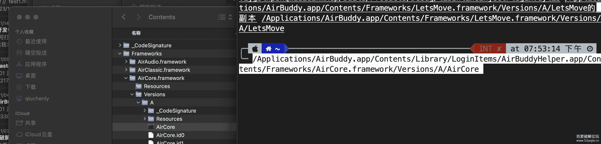 `16748204212479.jpg` (214.49 KB, 下载次数: 4) [下载](https://www.52pojie.cn/forum.php?mod=attachment&aid=MjU4NjY4M3w5NzliZDk4OXwxNzkzNTc0MTAzfDE2ODA4NnwxNzM5MTEy&nothumb=yes) 2023-1-27 21:52 上传

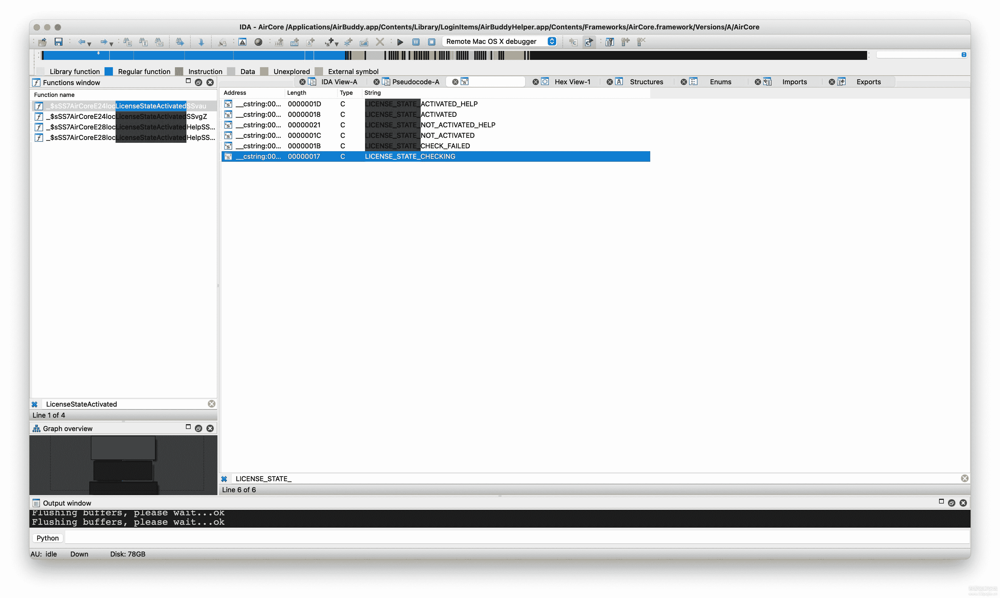 `16748204383430.jpg` (546.78 KB, 下载次数: 2) [下载](https://www.52pojie.cn/forum.php?mod=attachment&aid=MjU4NjY4NHw0ZDBiNWZlY3wxNzkzNTc0MTAzfDE2ODA4NnwxNzM5MTEy&nothumb=yes) 2023-1-27 21:53 上传

我们查到了索引，那么这里很可能就是调用方了。跳过去看下：

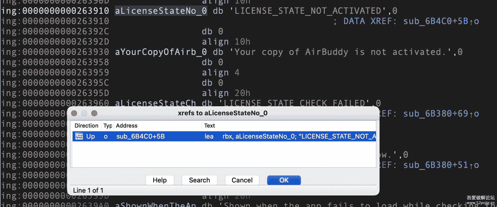 `16748205033331.jpg` (233.52 KB, 下载次数: 0) [下载](https://www.52pojie.cn/forum.php?mod=attachment&aid=MjU4NjY4NXxkMjI4MTk3NXwxNzkzNTc0MTAzfDE2ODA4NnwxNzM5MTEy&nothumb=yes) 2023-1-27 21:53 上传

继续跳！

来到函数 `6B4C0`.

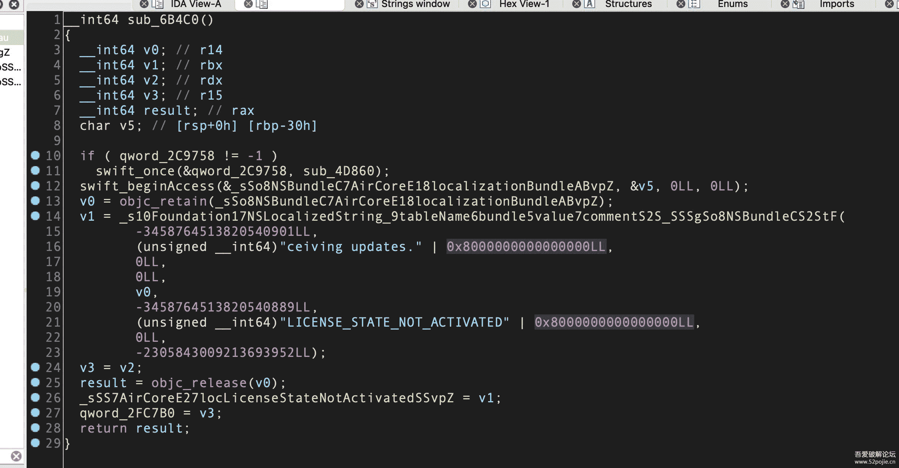 `16748205229411.jpg` (285.06 KB, 下载次数: 1) [下载](https://www.52pojie.cn/forum.php?mod=attachment&aid=MjU4NjY4NnwzY2ZkYWI1ZXwxNzkzNTc0MTAzfDE2ODA4NnwxNzM5MTEy&nothumb=yes) 2023-1-27 21:53 上传

继续查找：

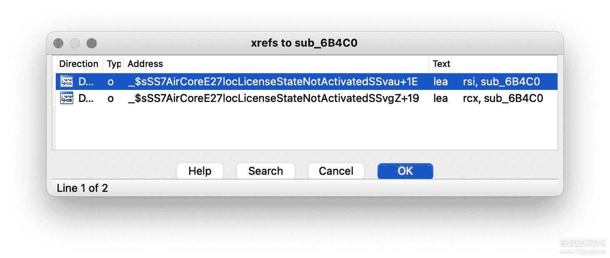 `16748205653334.jpg` (84.21 KB, 下载次数: 1) [下载](https://www.52pojie.cn/forum.php?mod=attachment&aid=MjU4NjY4N3wwYzE0NWY4Y3wxNzkzNTc0MTAzfDE2ODA4NnwxNzM5MTEy&nothumb=yes) 2023-1-27 21:53 上传

有两个调用方，那么我们看看第一个：

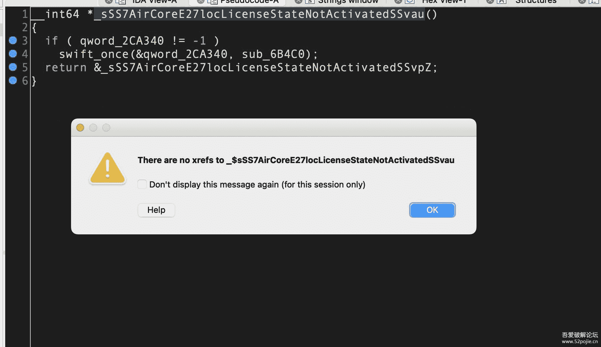 `16748205900153.jpg` (132.76 KB, 下载次数: 1) [下载](https://www.52pojie.cn/forum.php?mod=attachment&aid=MjU4NjY4OHw2MGVjZWM5YXwxNzkzNTc0MTAzfDE2ODA4NnwxNzM5MTEy&nothumb=yes) 2023-1-27 21:53 上传

事情此时变得有趣了起来：这个一看就很不对劲的函数没有任何调用方！

下面那个函数也是如此，那么他是如何被调用的呢？

由于这不是在主进程中，所以我们大胆假设：这是一个导出函数！

 `16748207061651.jpg` (143.96 KB, 下载次数: 2) [下载](https://www.52pojie.cn/forum.php?mod=attachment&aid=MjU4NjY4OXxjNmExZWM1MHwxNzkzNTc0MTAzfDE2ODA4NnwxNzM5MTEy&nothumb=yes) 2023-1-27 21:53 上传

我们到 Exports 里面复制一部分的文字搜索，果然。

那么问题来了，哪里引用了呢？

我们直接搜主程序试试：

主程序：`/Applications/AirBuddy.app/Contents/MacOS/AirBuddy`

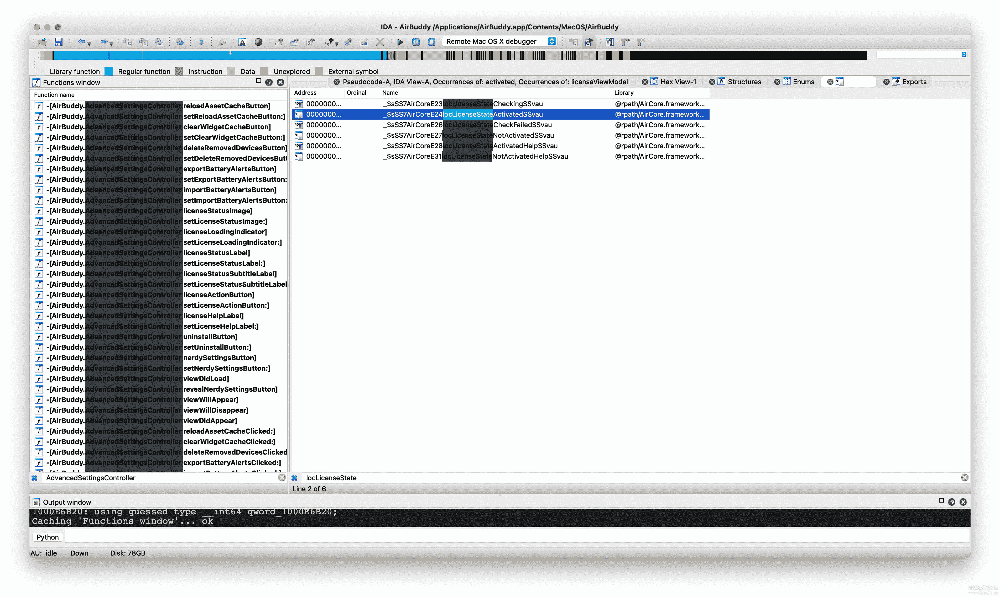 `16748207727278.jpg` (883.23 KB, 下载次数: 0) [下载](https://www.52pojie.cn/forum.php?mod=attachment&aid=MjU4NjY5MHxhYjcwNWUzNnwxNzkzNTc0MTAzfDE2ODA4NnwxNzM5MTEy&nothumb=yes) 2023-1-27 21:53 上传

果然不出所料。

我们继续跟进去看看他是如何被调用的：

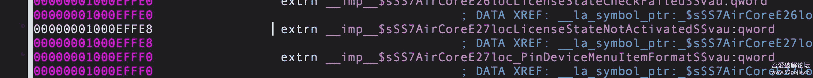 `16748208343595.jpg` (109.99 KB, 下载次数: 1) [下载](https://www.52pojie.cn/forum.php?mod=attachment&aid=MjU4NjY5MXwyYjJmZDM4NXwxNzkzNTc0MTAzfDE2ODA4NnwxNzM5MTEy&nothumb=yes) 2023-1-27 21:53 上传

到这里我们继续在函数名上按下 X 查找引用：

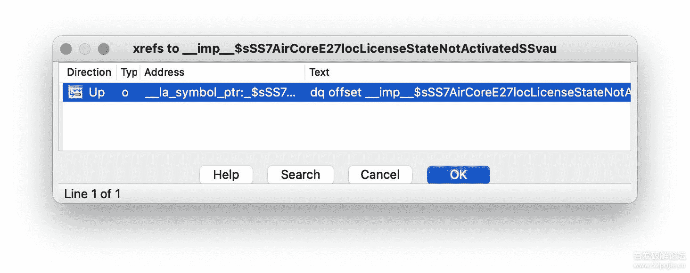 `16748208576833.jpg` (75.48 KB, 下载次数: 1) [下载](https://www.52pojie.cn/forum.php?mod=attachment&aid=MjU4NjY5MnwwZjI4YWVkNXwxNzkzNTc0MTAzfDE2ODA4NnwxNzM5MTEy&nothumb=yes) 2023-1-27 21:53 上传


[href="forum.php?mod=attachment&aid=MjU4NjY5Mnw5ODhlNWI5NHwxNzkzNTc0MTAzfDE2ODA4NnwxNzM5MTEy&nothumb=yes" target="_blank"](https://www.52pojie.cn/forum.php?mod=attachment&aid=MjU4NjY5Mnw5ODhlNWI5NHwxNzkzNTc0MTAzfDE2ODA4NnwxNzM5MTEy&nothumb=yes)

2023-1-27 21:53 上传

又跳到了一个符号表：

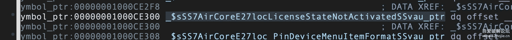

`16748208831363.jpg` (78.88 KB, 下载次数: 2)

[href="forum.php?mod=attachment&aid=MjU4NjY5M3wxM2ExNTk1MHwxNzkzNTc0MTAzfDE2ODA4NnwxNzM5MTEy&nothumb=yes" target="_blank"](https://www.52pojie.cn/forum.php?mod=attachment&aid=MjU4NjY5M3wxM2ExNTk1MHwxNzkzNTc0MTAzfDE2ODA4NnwxNzM5MTEy&nothumb=yes)

2023-1-27 21:53 上传

继续跳：

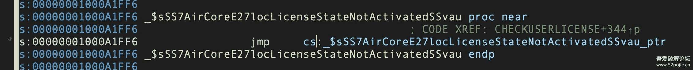

`16748208995163.jpg` (93.54 KB, 下载次数: 0)

[href="forum.php?mod=attachment&aid=MjU4NjY5NHwzNWQ4ZGU3MHwxNzkzNTc0MTAzfDE2ODA4NnwxNzM5MTEy&nothumb=yes" target="_blank"](https://www.52pojie.cn/forum.php?mod=attachment&aid=MjU4NjY5NHwzNWQ4ZGU3MHwxNzkzNTc0MTAzfDE2ODA4NnwxNzM5MTEy&nothumb=yes)

2023-1-27 21:53 上传

终于逮住了。

我们继续追查：

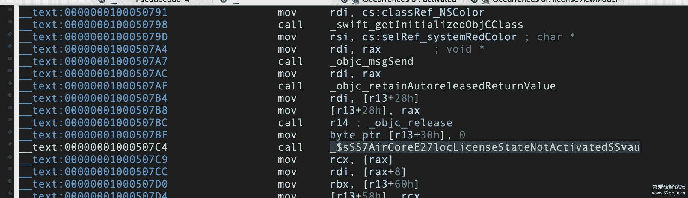

`16748209313919.jpg` (226.2 KB, 下载次数: 1)

[href="forum.php?mod=attachment&aid=MjU4NjY5NXw3OTliMGYyZnwxNzkzNTc0MTAzfDE2ODA4NnwxNzM5MTEy&nothumb=yes" target="_blank"](https://www.52pojie.cn/forum.php?mod=attachment&aid=MjU4NjY5NXw3OTliMGYyZnwxNzkzNTc0MTAzfDE2ODA4NnwxNzM5MTEy&nothumb=yes)

2023-1-27 21:53 上传

原来如此。我们`F5`看下伪代码：

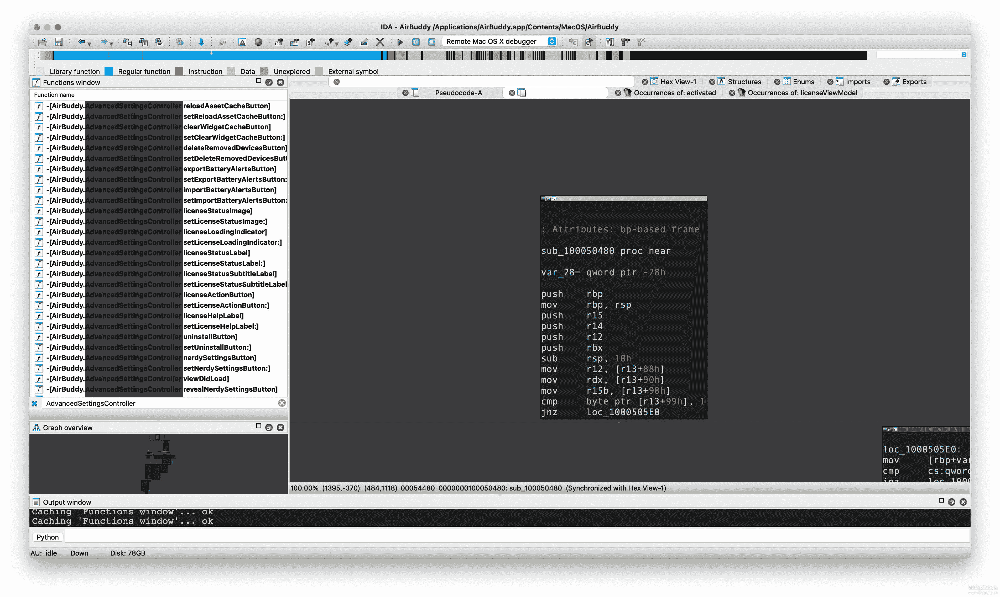

`16748210080329.jpg` (806.83 KB, 下载次数: 2)

[href="forum.php?mod=attachment&aid=MjU4NjY5NnxiYzliZjY4ZHwxNzkzNTc0MTAzfDE2ODA4NnwxNzM5MTEy&nothumb=yes" target="_blank"](https://www.52pojie.cn/forum.php?mod=attachment&aid=MjU4NjY5NnxiYzliZjY4ZHwxNzkzNTc0MTAzfDE2ODA4NnwxNzM5MTEy&nothumb=yes)

2023-1-27 21:53 上传

他是来自一个叫`100050480`的函数调用：

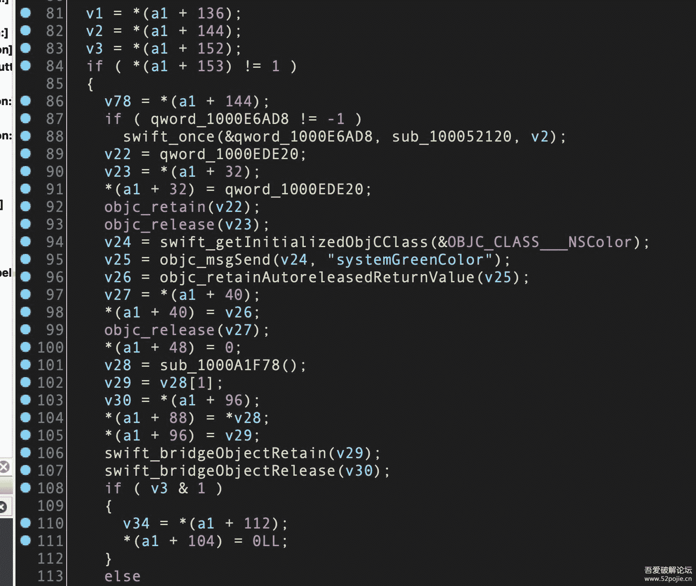

`16748210787238.jpg` (233.92 KB, 下载次数: 3)

[href="forum.php?mod=attachment&aid=MjU4NjY5N3w4MzFkMTE4MHwxNzkzNTc0MTAzfDE2ODA4NnwxNzM5MTEy&nothumb=yes" target="_blank"](https://www.52pojie.cn/forum.php?mod=attachment&aid=MjU4NjY5N3w4MzFkMTE4MHwxNzkzNTc0MTAzfDE2ODA4NnwxNzM5MTEy&nothumb=yes)

2023-1-27 21:53 上传

在这个函数的入口中，`a1`所在的`r13`寄存器对内存+153的偏移处进行判断，如果不等于1那么执行这里的`A1F78`函数（101行），否则执行刚刚找到的`NotActivated`。

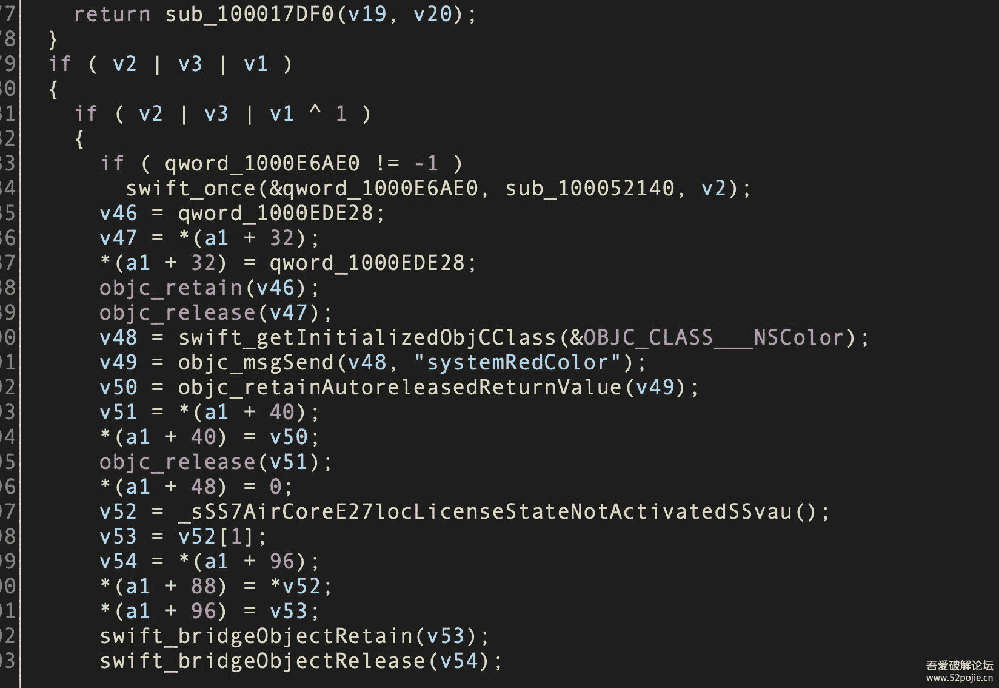

`16748212014049.jpg` (193.29 KB, 下载次数: 1)

[href="forum.php?mod=attachment&aid=MjU4NjY5OHxjYjExYjM1NXwxNzkzNTc0MTAzfDE2ODA4NnwxNzM5MTEy&nothumb=yes" target="_blank"](https://www.52pojie.cn/forum.php?mod=attachment&aid=MjU4NjY5OHxjYjExYjM1NXwxNzkzNTc0MTAzfDE2ODA4NnwxNzM5MTEy&nothumb=yes)

2023-1-27 21:53 上传

而且注意最上面一个`return sub_100017DF0(v19，v20)`，也就是说如果这个内存偏移地址的值不等于1就会返回这个函数的返回值而不执行下面的`NotActivated`。也就是界面上红色的X。

那么我们可以算是找到爆破点了，但是我们不打算用暴力修改的方式，我们今天试一下内存注入。

打开最爱的`VSCode`，打开`frida`，开始测试注入结果！

## 第二步 注入内存修改内存指针所处的值

`python`文件新建，写入如下：

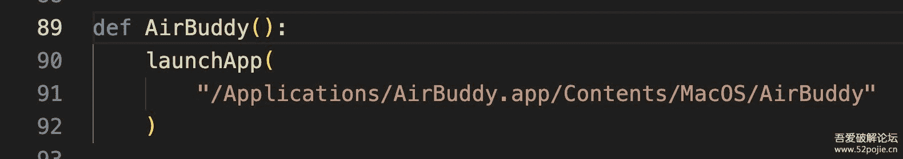

`16748214105733.jpg` (39.18 KB, 下载次数: 0)

[href="forum.php?mod=attachment&aid=MjU4NjY5OXw1MjM3NDVmOXwxNzkzNTc0MTAzfDE2ODA4NnwxNzM5MTEy&nothumb=yes" target="_blank"](https://www.52pojie.cn/forum.php?mod=attachment&aid=MjU4NjY5OXw1MjM3NDVmOXwxNzkzNTc0MTAzfDE2ODA4NnwxNzM5MTEy&nothumb=yes)

2023-1-27 21:53 上传

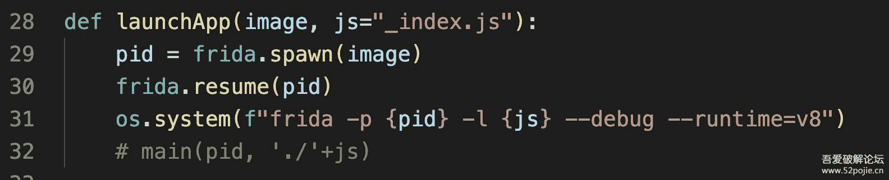

`16748214286843.jpg` (55.36 KB, 下载次数: 1)

[href="forum.php?mod=attachment&aid=MjU4NjcwMHxlMzY5NTA4YXwxNzkzNTc0MTAzfDE2ODA4NnwxNzM5MTEy&nothumb=yes" target="_blank"](https://www.52pojie.cn/forum.php?mod=attachment&aid=MjU4NjcwMHxlMzY5NTA4YXwxNzkzNTc0MTAzfDE2ODA4NnwxNzM5MTEy&nothumb=yes)

2023-1-27 21:53 上传

然后我们要准备一个`_index.js`，否则就没戏唱了。

那么有玩`frida`比较多的朋友可能会问，为什么不用`frida -f xxx`启动这个`app`进程 还要`python`这么麻烦？

解答：

`frida`在`macOS`上的`inlinehook`有问题，会造成`app`挂起无法恢复运行状态导致超时，系统强制终止进程。因为系统认为`app`卡死了。启动失败嘛。

下面我们看下`ts`文件：

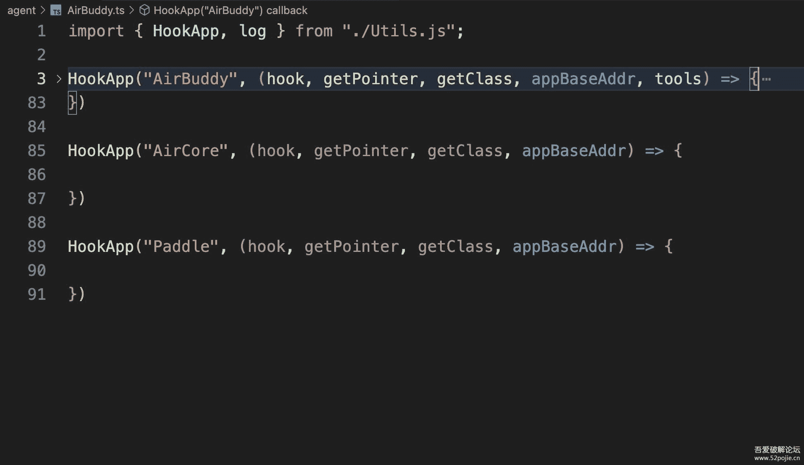

`16748216060079.jpg` (124.54 KB, 下载次数: 1)

[href="forum.php?mod=attachment&aid=MjU4NjcwMXxkNWVmNjA1ZXwxNzkzNTc0MTAzfDE2ODA4NnwxNzM5MTEy&nothumb=yes" target="_blank"](https://www.52pojie.cn/forum.php?mod=attachment&aid=MjU4NjcwMXxkNWVmNjA1ZXwxNzkzNTc0MTAzfDE2ODA4NnwxNzM5MTEy&nothumb=yes)

2023-1-27 21:53 上传

其中，`Utils.ts`的代码如下：


# Frida Hook 与内存修改

## TypeScript 代码

```ts
export function log(...message: any): void {
    console.log(...message);
}

enum AccessType {
    Pointer,
    ObjectCFunction,
}

export type TargetFunction = {
    target: NativePointerValue,
    accessType: AccessType,
    msgTag: string//打印的日志标记
}

export type Tools = {
    watchMemory: (target: TargetFunction) => void;
}

export function HookApp(module: string, hookStart: (
    hook: (
        target: TargetFunction,
        leave: (
            ths: InvocationContext,
            retval: InvocationReturnValue
        ) => void,
        enter?: (
            ths: InvocationContext,
            args: InvocationArguments
        ) => void,
    ) => void,
    getPointer: (offsetMemmory: string | number | NativePointerValue | UInt64 | Int64) => TargetFunction,
    getClassMethod: (clazzName: string, clazzMethodSign: string) => TargetFunction,
    appBaseAddr: NativePointer,
    tools: Tools
) => void) {
    var appBaseAddr = Module.findBaseAddress(module)
    log(`App [${module}] 内存基址: ${appBaseAddr}`)
    let init = (appBaseAddr: NativePointer) => {
        let hook = (
            target: TargetFunction,
            leave: (ths: InvocationContext, retval: InvocationReturnValue) => void,
            enter?: (ths: InvocationContext, args: InvocationArguments) => void
        ) => {
            attachTarget(target, appBaseAddr, enter, leave, module)
        }
        hookStart(
            hook,
            (offsetMemmory: string | number | NativePointerValue | UInt64 | Int64) => {
                return {
                    target: appBaseAddr.add(offsetMemmory),
                    msgTag: "0x" + offsetMemmory.toString(16),
                    accessType: AccessType.Pointer
                }
            },
            (clazzName: string, clazzMethodSign: string) => {
                return {
                    target: ObjC.classes[clazzName][clazzMethodSign].implementation,
                    accessType: AccessType.ObjectCFunction,
                    msgTag: clazzName + " [" + clazzMethodSign + "]"
                }
            },
            appBaseAddr,
            {
                watchMemory: (target) => {
                    MemoryAccessMonitor.enable({
                        base: new NativePointer(target.target),
                        size: 16
                    }, {
                        onAccess: function (details) {
                            log("对内存[" + target.msgTag + "]访问来自", (details.from.sub(appBaseAddr)).toString())
                        }
                    })
                }
            }
        )
    }
    if (appBaseAddr != null) init(appBaseAddr)
}

function attachTarget(
    target: TargetFunction,
    appBaseAddr: NativePointer,
    enter?: (
        ths: InvocationContext,
        args: InvocationArguments
    ) => void,
    leave?: (
        ths: InvocationContext,
        retval: InvocationReturnValue
    ) => void,
    module?: string) {
    var line = "=".repeat(32);
    Interceptor.attach(target.target, {
        onEnter(this: InvocationContext, args: InvocationArguments) {
            log(line + ` \n${module} 进入函数 ` + target.msgTag + "\n")
            enter?.(this, args)
            log(line, "\n")
        },
        onLeave(retval) {
            log(line + ` \n${module} 退出函数 ` + target.msgTag + "\n")
            log("修改前返回值", retval)
            leave?.(this, retval)
            log("修改后返回值", retval, "\n" + line, "\n")
        },
    });
}
```

## 编译与监视

然后编译 ts 到 js 文件的指令：


`build` 是编译，`-w` 是监视文件修改自动编译。

我们执行 `watch` 的指令即可自动编译了。

## Hook 函数

注意：关于 nodejs 前端代码的问题请不要发问，不会解答任何关于前端 js 的问题，因为我默认你会使用并知晓以上简单的基本 js 知识。

实在不会可以百度。

准备工作完成，那么我们开始 hook 函数 `__int64 __usercall sub_100050480@(__int64 a1@)` 看看：

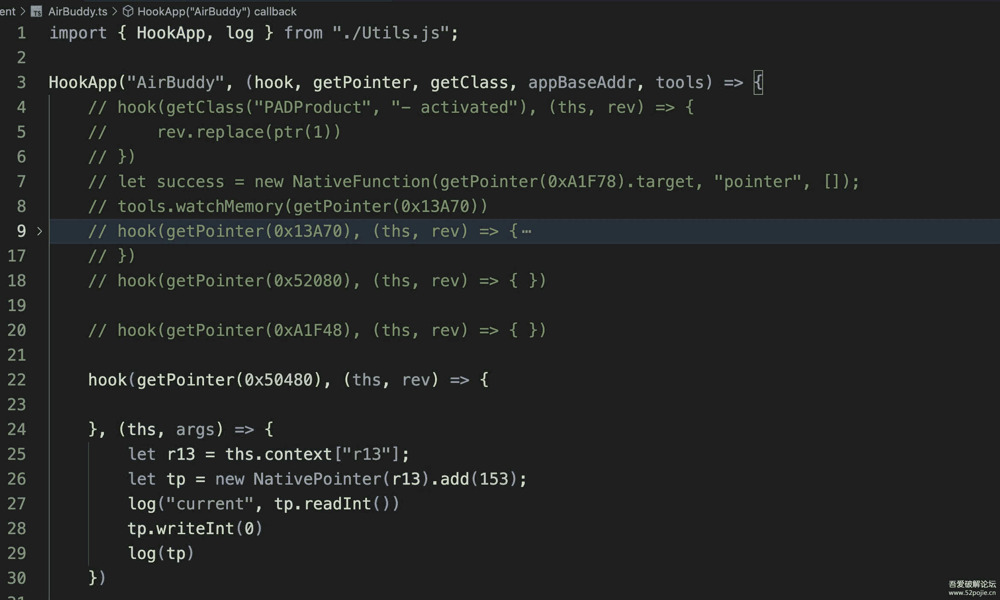

我们把可执行文件的名称写在参数 1 中，这样就会自动锁定内存里这个同名进程进行注入。

然后我们获取这个指针所在的地址，开始进入函数的挂钩：

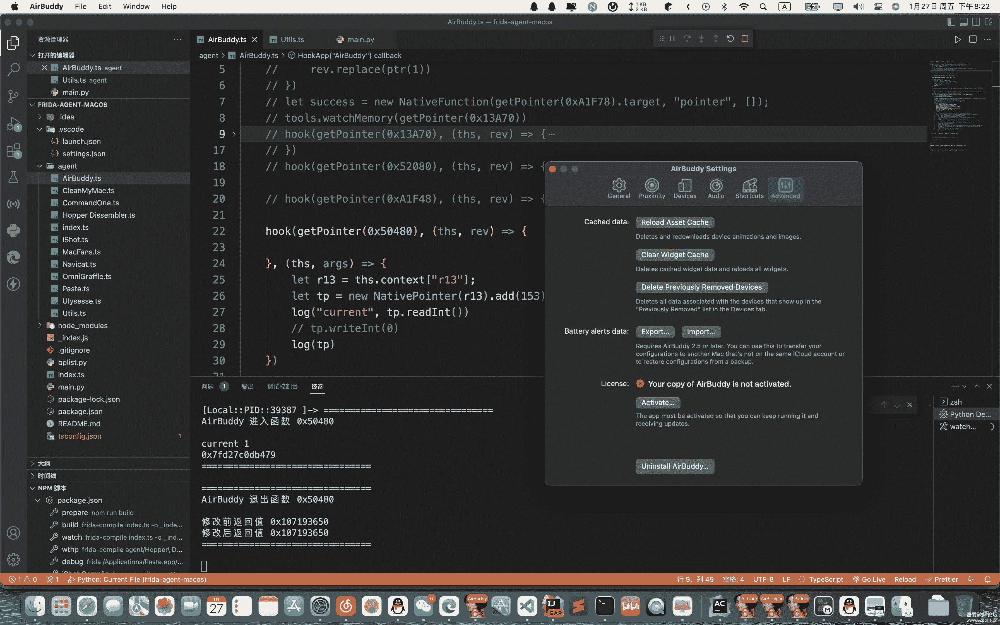

启动 `python` 文件，我们可以看到已经对函数成功挂钩。

那么前面我们知道他是对内存偏移进行判断：

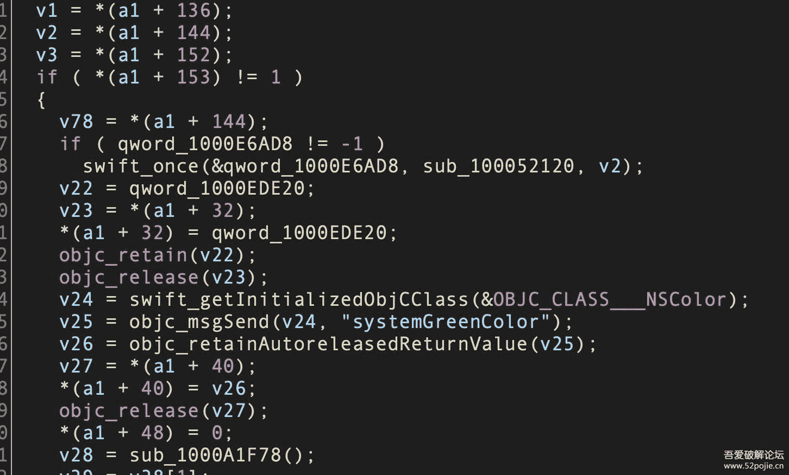

## 分析激活逻辑

其实到这个时候也不怕你们知道，`v28 = sub_1000A1F78();` 函数 `sub_1000A1F78` 进去一看：

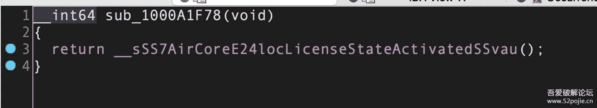

再回到 `AirCore` 文件里一搜：

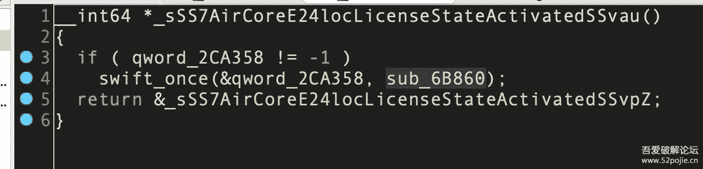

函数 `6B860` 进去看下：

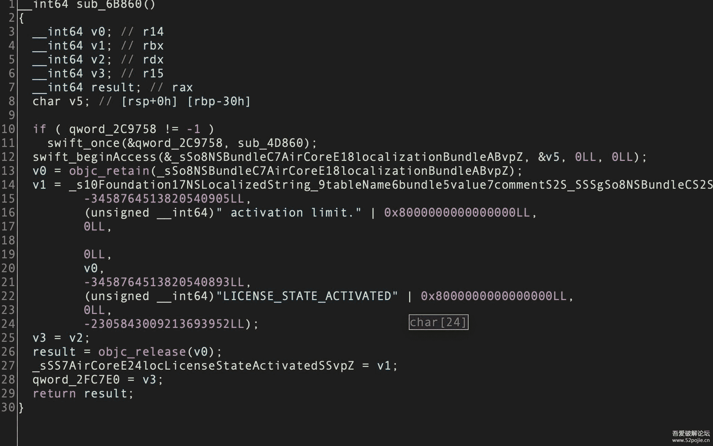

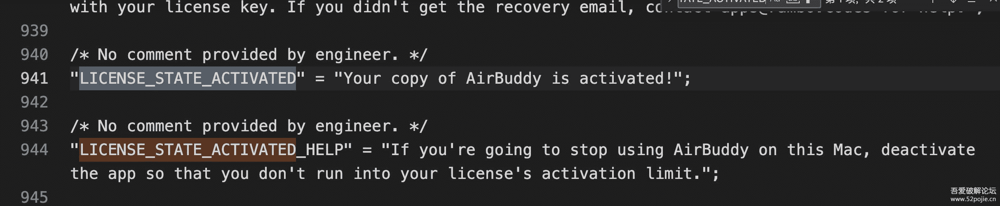

搜一下 `key` 发现是已经激活的提示文字。

## 修改判断值

那么此时回到 `AirBuddy` 文件，我们整个函数已经一目了然：

```text
if ( *(a1 + 153) != 1 )
{
    已经激活
} else {
    需要激活
}
```

那么我们还犹豫什么？

只要在函数进入之前修改 `*(a1 + 153)` 的值即可。

但是怎么修改呢？

别急，我们看下反汇编：

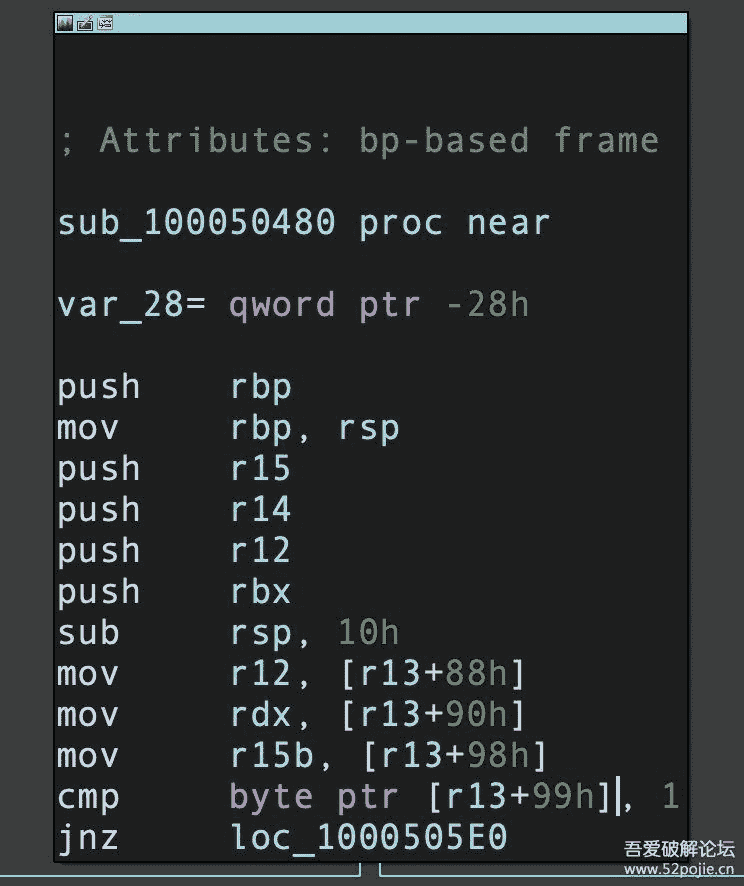

`cmp` 就是这个判断，我们要修改的就是 `r13+99h` 内存指针的值为 0 即可。

回到 Frida，我们首先已经挂上钩子了：

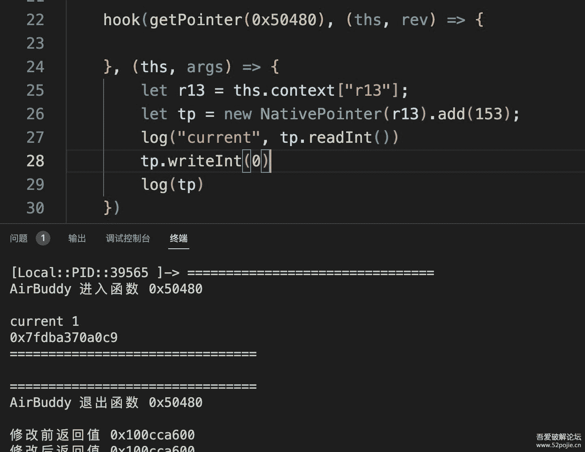

所以我们先拿到 CPU 寄存器此时 `r13` 的指针，然后 `add(153)`，`99H` 就是十进制的 153。


先读一下内存，发现是1，那么按正常逻辑我们会发现确实和 `if ( *(a1 + 153) != 1 )` 条件不成立，所以未激活。

那么我们就狠狠的 `writeInt(0)`！

保存，自动编译为 `_index.js`，然后运行 `python` 文件让他自动注入app：

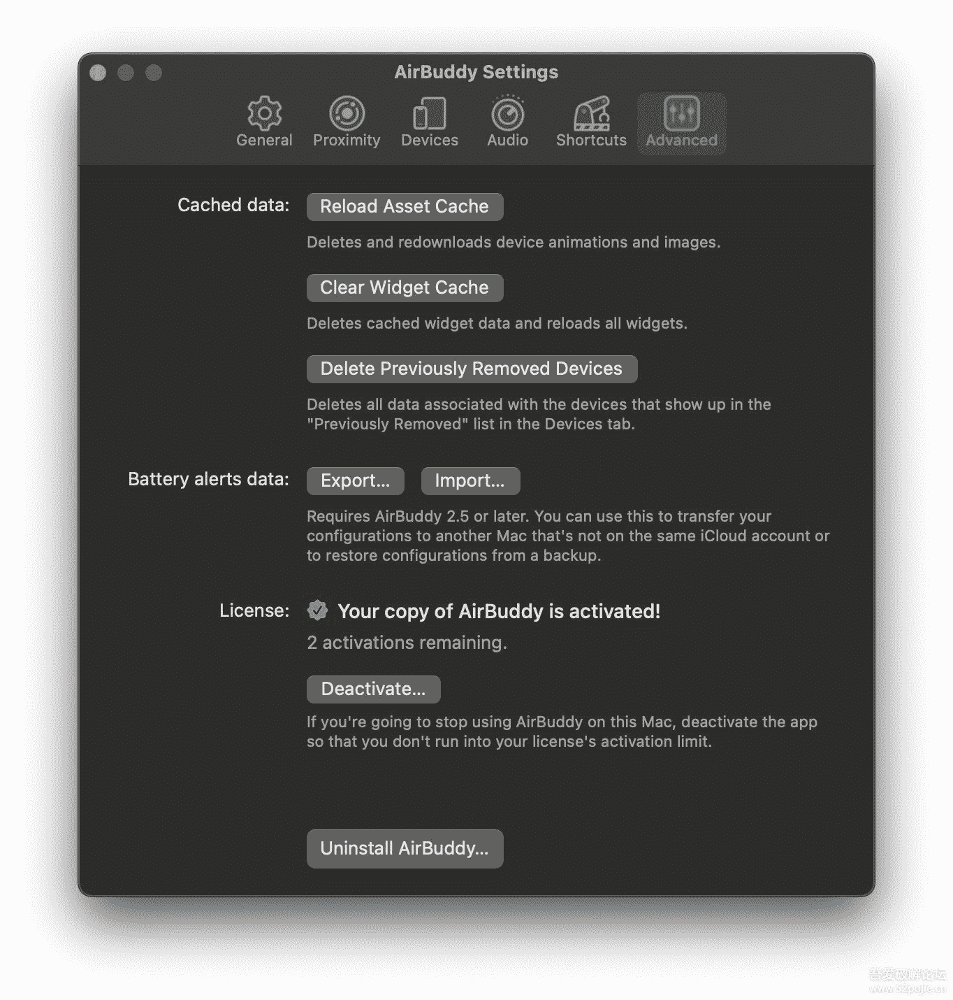

`16748226984007.jpg` (151.12 KB, 下载次数: 0)

[附件](https://www.52pojie.cn/forum.php?mod=attachment&aid=MjU4NjcxMnxkOTg4NDJhYXwxNzkzNTc0MTAzfDE2ODA4NnwxNzM5MTEy&nothumb=yes)

2023-1-27 21:54 上传

绿绿的，很喜欢。

是不是很简单？大家都学会了吧？下面我们用object-c写一遍去持久化注入App。

> 估计没几个人能认真看到这里，我偷偷喵两句：
> 这个软件真是不懂那个几十美元收的是什么钱，激活了也不知道新增了什么功能，完全不知道收费版和不收费有什么区别。难道是这个绿色和红色的区别？
> 大家都喜欢绿油油的？呃呃呃蝈楠那可真够下头的捏。
> @ 腾讯公司 过来学习先进皮肤经验。（一开始没想到论坛真有这个人 还艾特出来了。。。）

## 第三步 dylib持续化注入

毕竟不能靠Frida先启动然后再启动app，这并不酷，也不符合我对高科技的想象。

### 新建项目

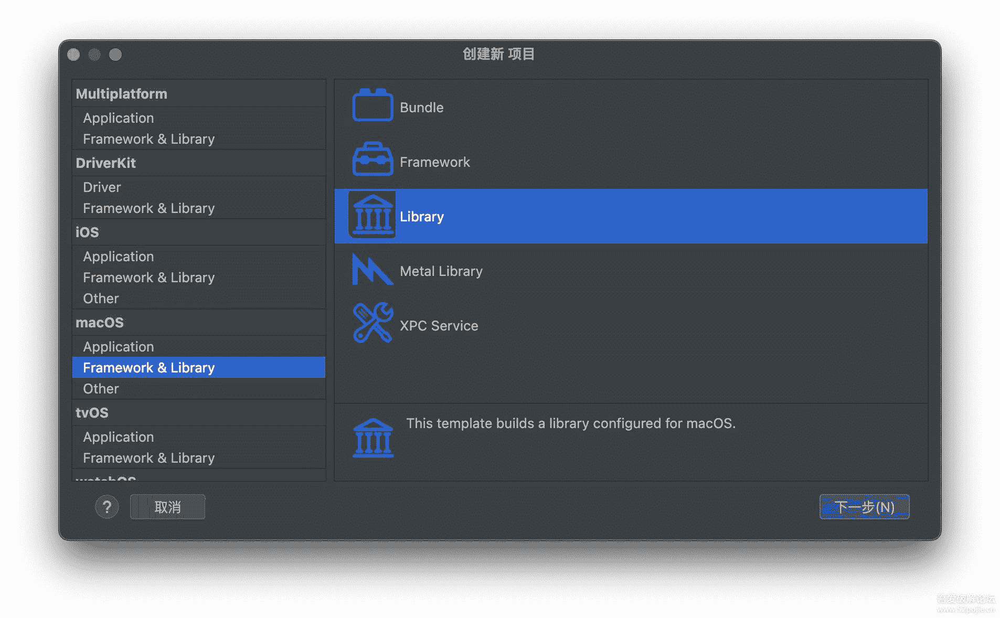

`16748231731920.jpg` (130.04 KB, 下载次数: 3)

[附件](https://www.52pojie.cn/forum.php?mod=attachment&aid=MjU4NjcxM3w0YjU3YjNkN3wxNzkzNTc0MTAzfDE2ODA4NnwxNzM5MTEy&nothumb=yes)

2023-1-27 21:54 上传

然后随便起个名：

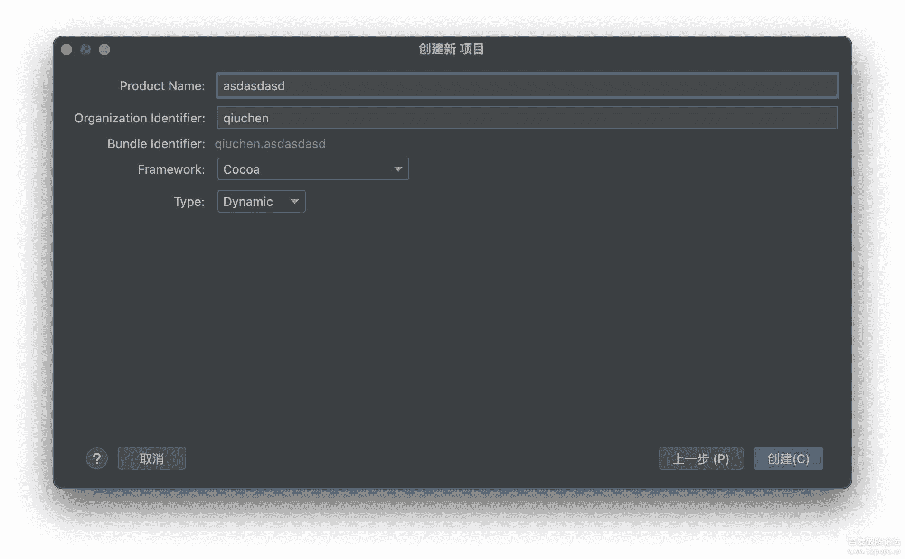

`16748231970122.jpg` (96.05 KB, 下载次数: 2)

[附件](https://www.52pojie.cn/forum.php?mod=attachment&aid=MjU4NjcxNHw5NTBjMmFhOHwxNzkzNTc0MTAzfDE2ODA4NnwxNzM5MTEy&nothumb=yes)

2023-1-27 21:54 上传

点创建选择一个保存的路径即可。

然后我们打开 `.m` 文件开始编写代码。


`16748232399429.jpg` (12.12 KB, 下载次数: 2)

[附件](https://www.52pojie.cn/forum.php?mod=attachment&aid=MjU4NjcxNXxiYWQ4MzA5ZHwxNzkzNTc0MTAzfDE2ODA4NnwxNzM5MTEy&nothumb=yes)

2023-1-27 21:54 上传

直接把 `rd_route` 复制两个文件到项目里即可。

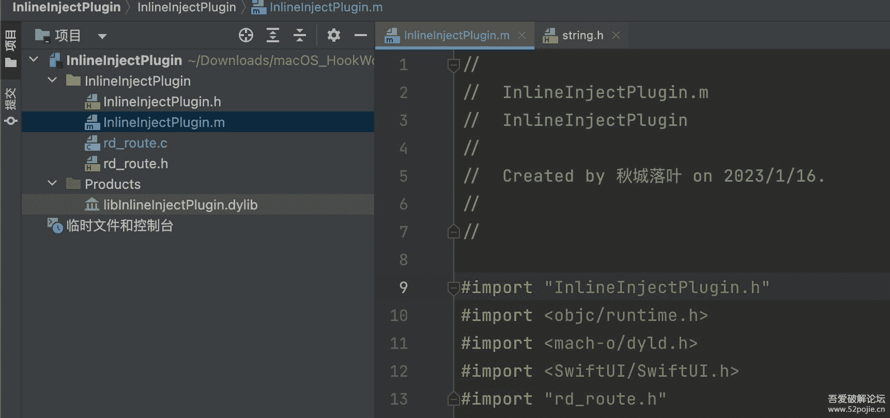

`16748233192993.jpg` (105.64 KB, 下载次数: 1)

[附件](https://www.52pojie.cn/forum.php?mod=attachment&aid=MjU4NjcxNnw5NTU0ZGE2Y3wxNzkzNTc0MTAzfDE2ODA4NnwxNzM5MTEy&nothumb=yes)

2023-1-27 21:54 上传

如图所示。

然后 `import` 一下几个基本库：

UI控件库是注入CleanMyMac的，可以不写。

然后我们在 `load` 中写自己的ObjectC代码

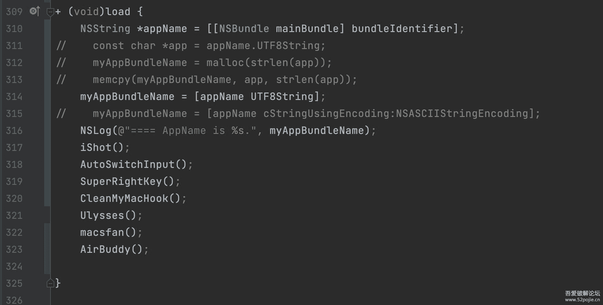

`16748233952045.jpg` (125.08 KB, 下载次数: 1)

[附件](https://www.52pojie.cn/forum.php?mod=attachment&aid=MjU4NjcxN3xiZjI2NjQ3N3wxNzkzNTc0MTAzfDE2ODA4NnwxNzM5MTEy&nothumb=yes)

2023-1-27 21:54 上传

我们今天主要看AirBuddy，大家不要在意上面的一连串注入代码。

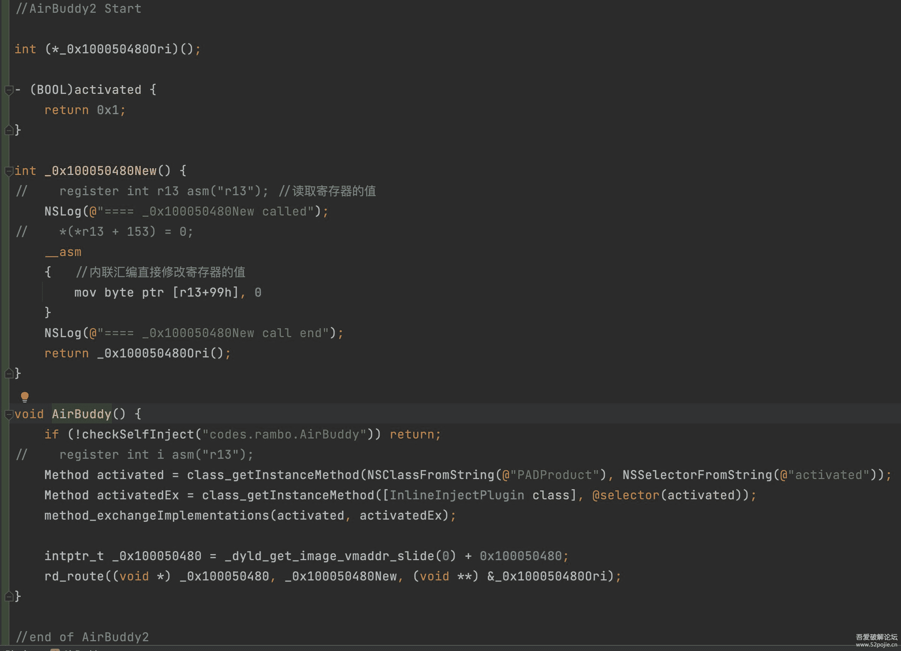

`16748234566506.jpg` (243.71 KB, 下载次数: 2)

[附件](https://www.52pojie.cn/forum.php?mod=attachment&aid=MjU4NjcxOHxhYTQzNTMwOXwxNzkzNTc0MTAzfDE2ODA4NnwxNzM5MTEy&nothumb=yes)

2023-1-27 21:54 上传

我们在frida里面直接能修改寄存器，OC里很遗憾不能直接操作。

但是我们有ASM！

直接写内联汇编啊铁子！（突然激动）

我们首先屏蔽掉 `activate` 函数，这没用。

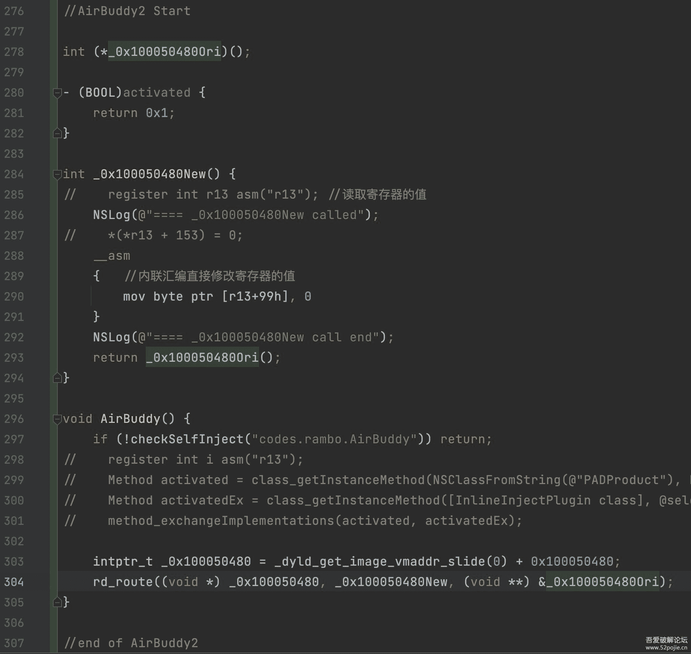

`16748235786385.jpg` (216.75 KB, 下载次数: 0)

[附件](https://www.52pojie.cn/forum.php?mod=attachment&aid=MjU4NjcxOXw2ODliYjE3YXwxNzkzNTc0MTAzfDE2ODA4NnwxNzM5MTEy&nothumb=yes)

2023-1-27 21:54 上传

然后我们用 `_dyld_get_image_vmaddr_slide(0) + 0x100050480;` 加上函数偏移得到内存中这个函数的偏移地址。

为什么 `_dyld_get_image_vmaddr_slide` 参数选0捏？因为这是选择第一个镜像（也就是可执行文件本身的内存空间镜像基址），具体细节懒得说，百度搜一下大家就懂了。

记住写0就是表示App可执行文件本身，也就是你注入的那个进程本身。别乱写哦，因为app在运行时不止一个内存镜像。

然后我们伪造一个函数进行挂钩。

```
int _0x100050480New() {

    NSLog(@"==== _0x100050480New called");

    __asm

    {   //内联汇编直接修改寄存器的值

        //对比原始二进制反汇编 cmp byte ptr [r13+99h], 1

        mov byte ptr [r13+99h], 0

    }

    NSLog(@"==== _0x100050480New call end");

    return _0x100050480Ori();//调用原函数恢复执行

}
```

接下来声明一下原始函数保存地址，这里直接转换成函数结构体可以直接调用

`int (_0x100050480Ori)();`

定义原函数返回值 `int` 无参数，加上取该变量内存地址里的值以被下面挂钩函数赋新值：

`rd_route((void *) _0x100050480, _0x100050480New, (void ) &_0x100050480Ori);`

`(void ) &_0x100050480Ori` 这里用 `(void *)` 进行类型转换，`&` 取地址符传递地址进函数。

然后 `_0x100050480Ori` 保存的就是原函数地址了，注意如果不写 `*` 你会得到 `_0x100050480Ori` 的内存地址而不是这个内存地址里面的值。

然后使用经典的 `mov` 指令在函数进入时将寄存器的值赋予0，并恢复原函数执行，这样原函数读到的就是新的 `r13` 寄存器里的这个0值啦！


```
__asm
{   //内联汇编直接修改寄存器的值
    mov byte ptr [r13+99h], 0
}
```

按下 `Command + F9` 狠狠的编译出 `dylib` 文件。

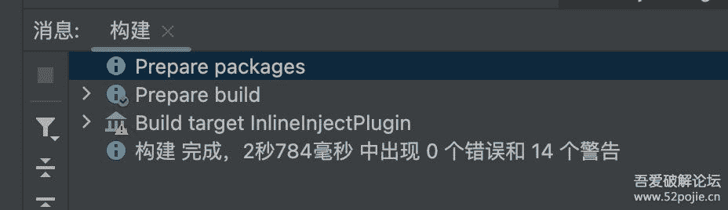

`16748244457951.jpg` (28.98 KB, 下载次数: 2)

[附件下载](https://www.52pojie.cn/forum.php?mod=attachment&aid=MjU4NjcyMHw5ZmQ1NDkxZXwxNzkzNTc0MTAzfDE2ODA4NnwxNzM5MTEy&nothumb=yes)

2023-1-27 21:54 上传

好耶！

现在拿出我们的注入文件去注入app:

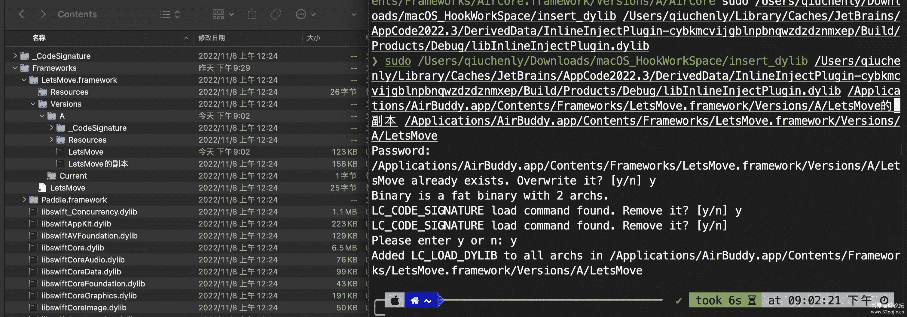

`16748245600178.jpg` (557.51 KB, 下载次数: 2)

[附件下载](https://www.52pojie.cn/forum.php?mod=attachment&aid=MjU4NjcyMXwxMjM3YjBjMXwxNzkzNTc0MTAzfDE2ODA4NnwxNzM5MTEy&nothumb=yes)

2023-1-27 21:54 上传

`insert_dylib` 文件是编译自项目：`insert_dylib`，代码在开头自己编译。我不提供的原因是老有阴谋论在那边发癫说这个可执行文件有后门 让我们关SIP一定是你的阴谋 我要控制所有人的MacBook 统治整个世界！我是淫魔是吧？阴谋论歇歇吧别搁那发癫了。

注入完成打开app：

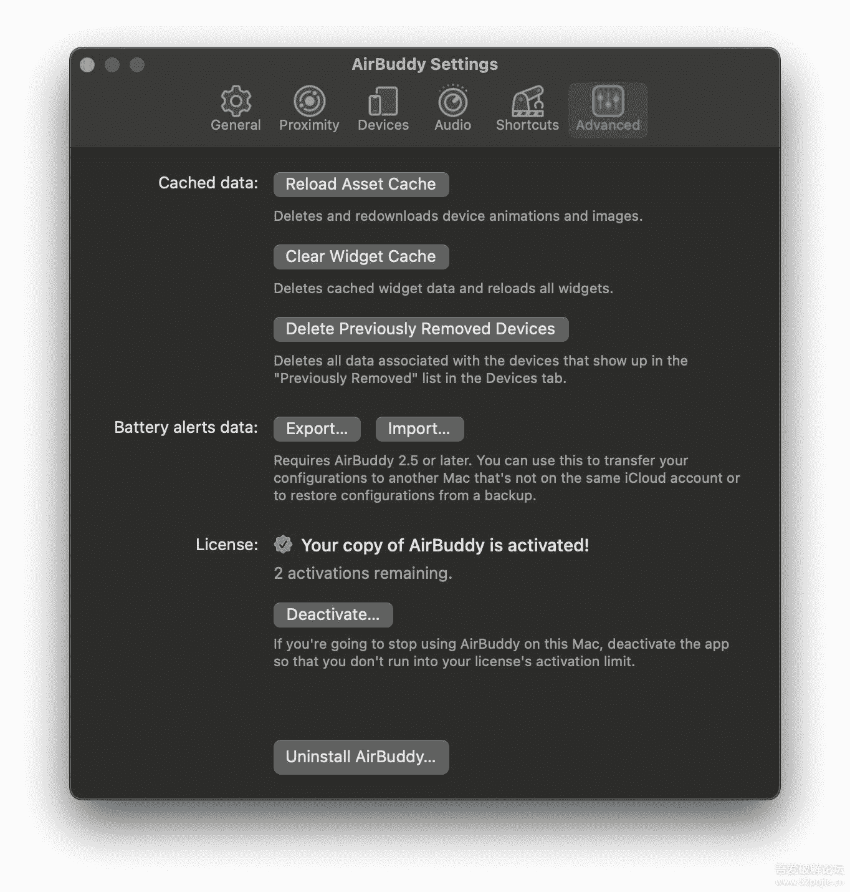

`16748247844169.jpg` (151.64 KB, 下载次数: 2)

[附件下载](https://www.52pojie.cn/forum.php?mod=attachment&aid=MjU4NjcyMnxiMTBmZmY3NnwxNzkzNTc0MTAzfDE2ODA4NnwxNzM5MTEy&nothumb=yes)

2023-1-27 21:54 上传

成功。

## 第四步 注意事项

我们想修改内存的是主程序二进制文件，所以我们千万不要注入任何影响到偏移地址有关的文件，如 `AirCore` 和 `AirBuddy` 二进制文件，为什么呢？因为这样会造成文件偏移错误。我们的偏移地址是根据 IDA 读出的原始二进制来算的，如果你注入了这些文件地址就会发生移位，这就无法通过原地址进行正确的注入了。所以我挑了个好欺负的小文件。也别去注入几 MB 的大文件，手动来回复制文件很麻烦的。

## 注入文件和补丁

仅供参考学习使用，有些人不要发癫！

试试注入 CleanMyMac 4.12.3 中国特供版，有彩蛋哦。

源码：`insert_dylib`


[附件下载](https://www.52pojie.cn/forum.php?mod=attachment&aid=MjU4NjcyNHw2ZWVlNjUzY3wxNzkzNTc0MTAzfDE2ODA4NnwxNzM5MTEy)

(13 KB, 下载次数: 40)

2023-1-27 22:01 上传

点击文件名下载附件
下载积分: 吾爱币 -1 CB

`rd_toute`


[附件下载](https://www.52pojie.cn/forum.php?mod=attachment&aid=MjU4NjcyNnw1ZGM0MGNiNXwxNzkzNTc0MTAzfDE2ODA4NnwxNzM5MTEy)

(10.34 KB, 下载次数: 36)

2023-1-27 22:01 上传

点击文件名下载附件
下载积分: 吾爱币 -1 CB

编译好的二进制文件：


[附件下载](https://www.52pojie.cn/forum.php?mod=attachment&aid=MjU4NjcyNXw4YzM2YWY3ZnwxNzkzNTc0MTAzfDE2ODA4NnwxNzM5MTEy)

(8.47 KB, 下载次数: 44)

2023-1-27 22:01 上传

点击文件名下载附件
下载积分: 吾爱币 -1 CB


[附件下载](https://www.52pojie.cn/forum.php?mod=attachment&aid=MjU4NjcyOHxlYTdhYTliMnwxNzkzNTc0MTAzfDE2ODA4NnwxNzM5MTEy)

(10.44 KB, 下载次数: 50)

2023-1-27 22:03 上传

点击文件名下载附件
下载积分: 吾爱币 -1 CB

仅供参考学习使用。

注入方法：

```
sudo insert_dylib libInlineInjectPlugin.dylib /Applications/AirBuddy.app/Contents/Frameworks/LetsMove.framework/Versions/A/LetsMove /Applications/AirBuddy.app/Contents/Frameworks/LetsMove.framework/Versions/A/LetsMove
```

`libInlineInjectPlugin.dylib` 文件建议固定放在某个位置，注入成功后移动或删除文件都会导致注入失败。

`sudo insert_dylib`

## 参考资料 Reference&Credit

- 2023, Search Engine By Google.
- 2023, Bing Global Search Engine By Microsoft.
- 2023, MacOS动态注入的三种方式及hook方案, [https://blog.csdn.net/tangsilian/article/details/89442802](https://blog.csdn.net/tangsilian/article/details/89442802)
- 2023, macOS 逆向從入門到破解 Frida + Hopper + `dylib` 注入, [https://beeeeemo.dev/2021/08/macos-%E9%80%86%E5%90%91%E5%BE%9E%E5%85%A5%E9%96%80%E5%88%B0%E7%A0%B4%E8%A7%A3-frida-hopper-dylib-%E6%B3%A8%E5%85%A5/](https://beeeeemo.dev/2021/08/macos-%E9%80%86%E5%90%91%E5%BE%9E%E5%85%A5%E9%96%80%E5%88%B0%E7%A0%B4%E8%A7%A3-frida-hopper-dylib-%E6%B3%A8%E5%85%A5/)
- 2023, 404 WebSite by code-examples.net, [https://code-examples.net/zh-CN/q/204273](https://code-examples.net/zh-CN/q/204273)
- 2023, JianShu by [https://www.jianshu.com/p/3c8a9a6cee8d](https://www.jianshu.com/p/3c8a9a6cee8d)
- 2023, 404 WebSite by [https://github.com/rodionovd/rd_route](https://github.com/rodionovd/rd_route)
- 2023, 使用Frida优雅调试010 Editor [https://www.chinapyg.com/thread-134972-1-1.html](https://www.chinapyg.com/thread-134972-1-1.html)
- 2023，Objective-C的hook方案（一）: Method Swizzling by [https://blog.csdn.net/yiyaaixuexi/article/details/9374411](https://blog.csdn.net/yiyaaixuexi/article/details/9374411)
- 2023，运行时注入方式破解最新Mac版010 Editor v9.0.1 [https://www.52pojie.cn/forum.php?mod=viewthread&tid=861809&extra=page%3D1%26filter%3Dtypeid%26typeid%3D377](https://www.52pojie.cn/forum.php?mod=viewthread&tid=861809&extra=page%3D1%26filter%3Dtypeid%26typeid%3D377)
- 还有好多，懒癌犯了不想写了。
