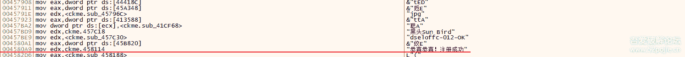
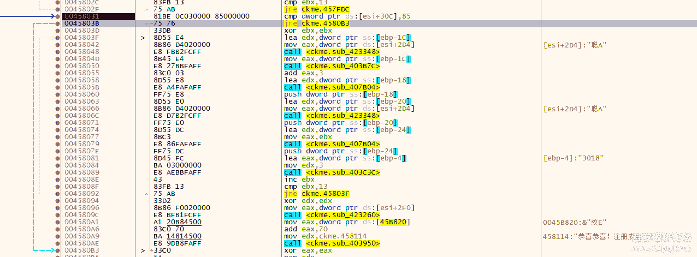
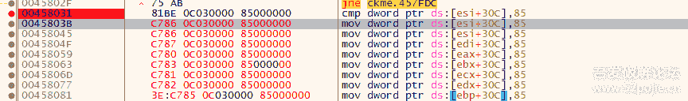
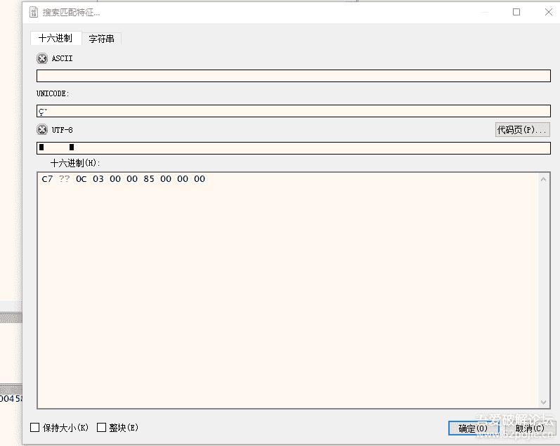
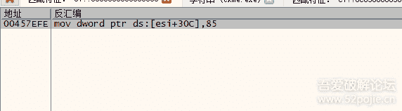
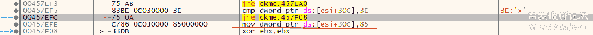
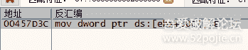
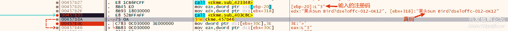
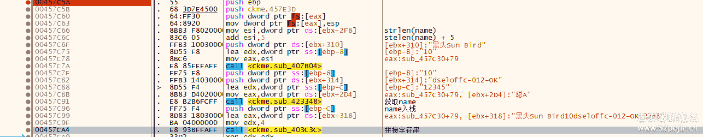

# [原创] 破解练习-CRACKME004

- 原帖: https://www.52pojie.cn/forum.php?mod=viewthread&tid=1739423
- 抓取时间: 2026-11-01T23:01:44

## 004-注册算法分析

### 一、工具和调试环境

- 动态调试工具：`x64dbg`
- 系统环境：win10 1909

### 二、分析用户名/注册码的算法

先随便输入用户名和注册码，然后验证。可惜无论点什么地方都没有错误提示。

因为对Delphi不了解，一开始按照vc的思路给API下断点，但是都不会断下来。查看了下字符串，发现并不多，翻了一下就能看到一个疑似成功注册的提示语。究竟是不是呢，直接跟过去瞅瞅就知道了



004-01.png (38.47 KB, 下载次数: 1)
[forum.php?mod=attachment&aid=MjU4NjkyM3w0MTUyNjdiZHwxNzkzNTc0MTAxfDE2ODA4NnwxNzM5NDIz&nothumb=yes](https://www.52pojie.cn/forum.php?mod=attachment&aid=MjU4NjkyM3w0MTUyNjdiZHwxNzkzNTc0MTAxfDE2ODA4NnwxNzM5NDIz&nothumb=yes)
2023-1-28 20:37 上传



004-02.png (125.19 KB, 下载次数: 1)
[forum.php?mod=attachment&aid=MjU4NjkyNHwxM2JiOWU5N3wxNzkzNTc0MTAxfDE2ODA4NnwxNzM5NDIz&nothumb=yes](https://www.52pojie.cn/forum.php?mod=attachment&aid=MjU4NjkyNHwxM2JiOWU5N3wxNzkzNTc0MTAxfDE2ODA4NnwxNzM5NDIz&nothumb=yes)
2023-1-28 20:37 上传

向上找到一个跳过该提示的跳转，经测试，为关键跳转。也就是会检测`esi + 30C`处的内存是否是`0x85`，如果是就注册成功。接下来就是寻找是哪里向该地址处写入了`0x85`，esi貌似是一个结构体或者对象首地址，那么写入的时候很可能也是一个寄存器加上偏移`0x30C`，如：`mov dword ptr [esi + 30C], 85`。但是寄存器很可能不一样，写出各寄存器的情况，获取通用特征码为：`C7?? 0C030000 85000000`



004-03.png (45.93 KB, 下载次数: 1)
[forum.php?mod=attachment&aid=MjU4NjkyNXw2ZGRhZTk4NXwxNzkzNTc0MTAxfDE2ODA4NnwxNzM5NDIz&nothumb=yes](https://www.52pojie.cn/forum.php?mod=attachment&aid=MjU4NjkyNXw2ZGRhZTk4NXwxNzkzNTc0MTAxfDE2ODA4NnwxNzM5NDIz&nothumb=yes)
2023-1-28 20:37 上传

右键->搜索->当前模块->匹配特征，搜索特征码：`C7?? 0C030000 85000000`



004-04.png (20.75 KB, 下载次数: 0)
[forum.php?mod=attachment&aid=MjU4NjkyNnw2NDQ3YjIxY3wxNzkzNTc0MTAxfDE2ODA4NnwxNzM5NDIz&nothumb=yes](https://www.52pojie.cn/forum.php?mod=attachment&aid=MjU4NjkyNnw2NDQ3YjIxY3wxNzkzNTc0MTAxfDE2ODA4NnwxNzM5NDIz&nothumb=yes)
2023-1-28 20:37 上传



004-05.png (11.68 KB, 下载次数: 1)
[forum.php?mod=attachment&aid=MjU4NjkyN3wxOGIzYmI4OHwxNzkzNTc0MTAxfDE2ODA4NnwxNzM5NDIz&nothumb=yes](https://www.52pojie.cn/forum.php?mod=attachment&aid=MjU4NjkyN3wxOGIzYmI4OHwxNzkzNTc0MTAxfDE2ODA4NnwxNzM5NDIz&nothumb=yes)
2023-1-28 20:37 上传

很好，只有一个，我们跟过去看看，经过测试，`0x00457EFC`处为关键跳转，会检测`esi + 30C`处的内存是否是`0x3E`，如果是就会重新将该处内存赋值为`0x85`



004-06.png (23.63 KB, 下载次数: 1)
[forum.php?mod=attachment&aid=MjU4NjkyOHxhZjc0MjY5YXwxNzkzNTc0MTAxfDE2ODA4NnwxNzM5NDIz&nothumb=yes](https://www.52pojie.cn/forum.php?mod=attachment&aid=MjU4NjkyOHxhZjc0MjY5YXwxNzkzNTc0MTAxfDE2ODA4NnwxNzM5NDIz&nothumb=yes)
2023-1-28 20:37 上传

按照之前的特征码搜索继续寻找，特征码：`C7?? 0C030000 3E000000`



004-07.png (10.84 KB, 下载次数: 1)
[forum.php?mod=attachment&aid=MjU4NjkyOXwwMmRkNjRkOXwxNzkzNTc0MTAxfDE2ODA4NnwxNzM5NDIz&nothumb=yes](https://www.52pojie.cn/forum.php?mod=attachment&aid=MjU4NjkyOXwwMmRkNjRkOXwxNzkzNTc0MTAxfDE2ODA4NnwxNzM5NDIz&nothumb=yes)
2023-1-28 20:37 上传

也只有一个，就很nice，跟过去，可以发现是根据`sub_403C8C`函数的返回值来决定是否给上面结构体`0x30C`处赋值为`0x3E`的，经过调试，该函数类似字符串比较，将我们输入的注册码和真码进行比较。终于看见真码的身影了，接下来就一直溯源到真码的算法位置。



004-08.png (43.42 KB, 下载次数: 1)
[forum.php?mod=attachment&aid=MjU4NjkzMHxhNDdlMGRkZXwxNzkzNTc0MTAxfDE2ODA4NnwxNzM5NDIz&nothumb=yes](https://www.52pojie.cn/forum.php?mod=attachment&aid=MjU4NjkzMHxhNDdlMGRkZXwxNzkzNTc0MTAxfDE2ODA4NnwxNzM5NDIz&nothumb=yes)
2023-1-28 20:37 上传

下面就是关键算法的部分，注册码为：`"黑头Sun Bird" + 用户名的长度 + "dseloffc-012-OK" + 用户名`



004-09.png (87.77 KB, 下载次数: 1)
[forum.php?mod=attachment&aid=MjU4NjkzMXw1Y2IyNDJlZnwxNzkzNTc0MTAxfDE2ODA4NnwxNzM5NDIz&nothumb=yes](https://www.52pojie.cn/forum.php?mod=attachment&aid=MjU4NjkzMXw1Y2IyNDJlZnwxNzkzNTc0MTAxfDE2ODA4NnwxNzM5NDIz&nothumb=yes)
2023-1-28 20:37 上传

### 三、算法核心代码模拟

```
char* GetSerial4(char* szName)
{
    static char szSerial[60] = {};

    char szTmp1[] = "黑头Sun Bird";
    char szTmp2[] = "dseloffc-012-OK";
    int key = strlen(szName) + 5;

    sprintf(szSerial, "%s%d%s%s", szTmp1, key, szTmp2, szName);
    return szSerial;
}
```
