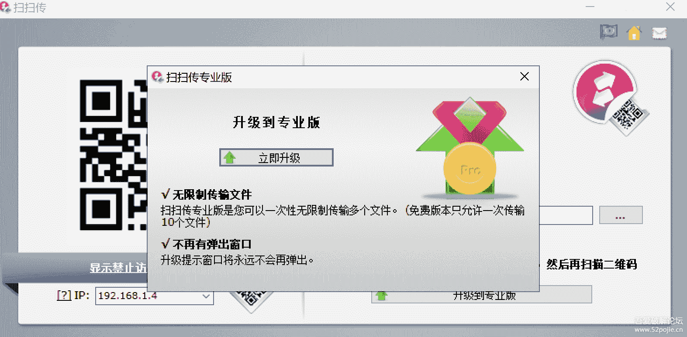
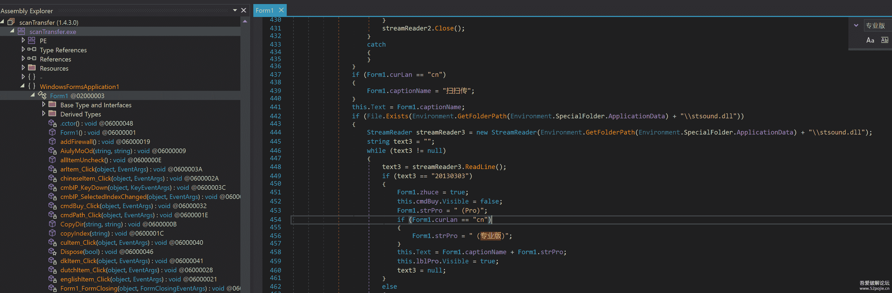
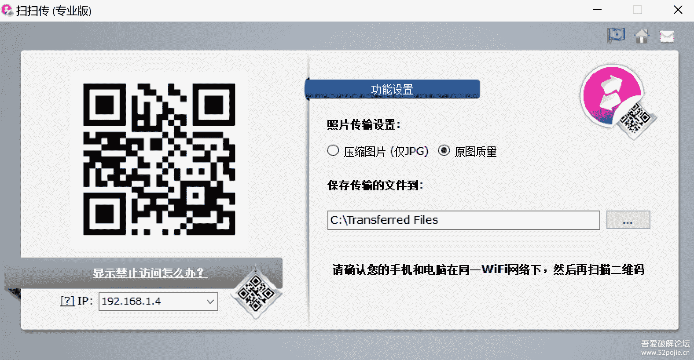

# [.NET逆向] 某扫码传文件软件令人无语的授权认证方式 - 一行命令授权

- 原帖: https://www.52pojie.cn/forum.php?mod=viewthread&tid=1739563
- 抓取时间: 2026-11-01T23:01:40

今天发现一款扫码传文件软件，该软件可以帮助用户把手机上的文件上传到电脑里，未授权版本上传图片文件会添加水印。
由于授权方式过于令人无语，这里就不放软件链接了


8.PNG (164.77 KB, 下载次数: 1)
[href="forum.php?mod=attachment&aid=MjU4NzAzNXwyNTAwMGVhOXwxNzkzNTc0MDk4fDE2ODA4NnwxNzM5NTYz&nothumb=yes" target="_blank"](https://www.52pojie.cn/forum.php?mod=attachment&aid=MjU4NzAzNXwyNTAwMGVhOXwxNzkzNTc0MDk4fDE2ODA4NnwxNzM5NTYz&nothumb=yes)
2023-1-29 11:31 上传

首先把壳脱了，看看里面到底是怎么认证的，随便翻翻代码，找到`form1`，搜一搜"专业版"试试:

7.PNG (344.09 KB, 下载次数: 1)
[href="forum.php?mod=attachment&aid=MjU4NzAzNnxjYzQ5YjkwZXwxNzkzNTc0MDk4fDE2ODA4NnwxNzM5NTYz&nothumb=yes" target="_blank"](https://www.52pojie.cn/forum.php?mod=attachment&aid=MjU4NzAzNnxjYzQ5YjkwZXwxNzkzNTc0MDk4fDE2ODA4NnwxNzM5NTYz&nothumb=yes)
2023-1-29 11:31 上传

貌似这一块就是认证授权逻辑了，我们看看里面写了些啥。
What??? 就这???
在系统目录检查这个位置的文件：`C:/Users/你的用户名/AppData/Roaming/stsound.dll`
如果这个文件里的内容是20130303，就认为是专业版，如果不是就是免费版。
额，这，打开`cmd`命令行，输入下面的命令：

[Shell] 纯文本查看 复制代码
```
echo 20130303> %AppData%\stsound.dll
```
重启软件，变成专业版了...

9.PNG (135.76 KB, 下载次数: 1)
[href="forum.php?mod=attachment&aid=MjU4NzAzN3w0YzVkOWM5N3wxNzkzNTc0MDk4fDE2ODA4NnwxNzM5NTYz&nothumb=yes" target="_blank"](https://www.52pojie.cn/forum.php?mod=attachment&aid=MjU4NzAzN3w0YzVkOWM5N3wxNzkzNTc0MDk4fDE2ODA4NnwxNzM5NTYz&nothumb=yes)
2023-1-29 11:32 上传
