# [Web逆向] 【WEB逆向】某瓣读书搜索接口

- 原帖: `https://www.52pojie.cn/forum.php?mod=viewthread&tid=1739717`
- 抓取时间: `2026-11-01T23:01:38`

在论坛潜水了这么久，都没发过贴，发现n年前写过一篇某瓣的逆向，里面的东西挺有意思的，就搬来这里了（网站可能已经更新，懒得去看了 😂）

首先来看一下原始数据，可以看到 `window.DATA` 里面是一大串意义不明的乱码

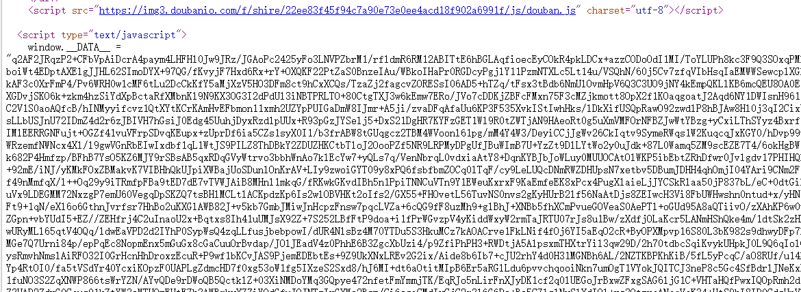

直接全局搜索 `window.__DATA__` 然后下断点，刷新页面

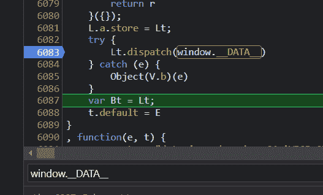

进入到 `Lt.dispatch` 函数内部

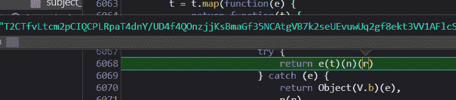

这里很明显，`r` 就是 `window.__DATA__`，即原始数据，`e(t)(n)` 意思是原始数据经过了若干个函数的处理

我们进入到函数内部，看看具体做了什么，以及怎么用python来实现相同的功能

## 第一个函数

首先是 `(n)` 函数

函数.png)

可以看到里面有好几处处理，我们一个一个来复现

- `a = e.from(r, "base64")`


原始数据 `r` 经过 `e.from` 函数的处理后，变成了 `Unit8Array` 的数据类型，其实就是对原始数据进行 `base64` 解码

python主要使用 `base64` 标准库实现

```
a = list(base64.b64decode(data))
```

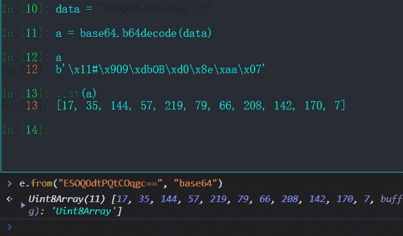

从上图可以看到两个的效果都是一样的

- `s` 和 `u`

```
s = Math.max(Math.floor((a.length - 2 * i) / 3), 0)
u = a.slice(s, s + i)
```

这两个就不用多说了，`s` 是地板除（后面的 `0` 可以忽视），`u` 是切片操作，python实现：

```
s = floor((len(a) - 2 * i) / 3)
u = a[s : s + i]
```

- `a = e.concat([a.slice(0, s), a.slice(s + i)])`

`concat` 是连接的意思，`e.concat` 其实就是对两个数组进行合并操作

```
a = a[0:s] + a[s + i :]
```

- `c = Object(o.hash)(e.concat([u, e.from(t)]))`

这一步进行了较多操作，首先是 `e.concat([u, e.from(t)])`，几次打断点发现 `e.from(t)` 都是空数组，所以这里结果只有 `u` 数组

然后是 `Object(o.hash)` 很明显这里是一个 `hash` 函数来处理 `u`，进入到内部看一下

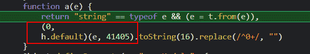

继续进入 `h.default` 内部


这里就得凭经验来判断了，如果熟悉 `xxhash` 算法（`https://create.stephan-brumme.com/xxhash/`），下方红框处的五个 `magic constants` 应该就会很眼熟，对照五个常数，确认是64位的 `xxhash` 算法

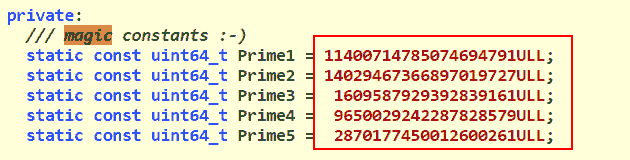

python的话，直接使用第三方的 `https://pypi.org/project/xxhash/`，`seed` 则是固定的 `41405`，两者的结果对比：

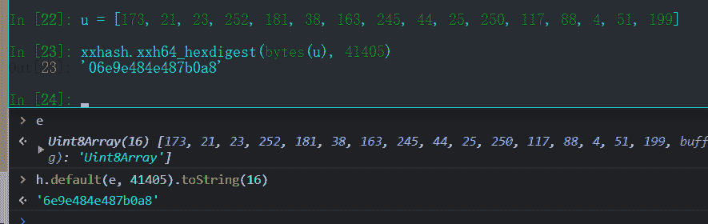

> 这里涉及到 `bytes` 和 `list` 的相互转换，直接使用对应的内置函数就行

`xxh64_hexdigest` 只能处理字节

## 第二个函数

第一个函数处理就到此结束，主要是为了得到 `a` 和 `c` 两个参数，下面进入第二个函数（需要经过三次 step in & out）：

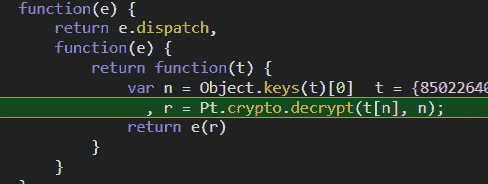

这里注意到 `r = Pt.crypto.decrypt(t[n], n)`， `t[n]` 对应上一步的 `a`，`n` 则对应 `c`，所以我们需要进入 `decrypt` 内部看看做了什么

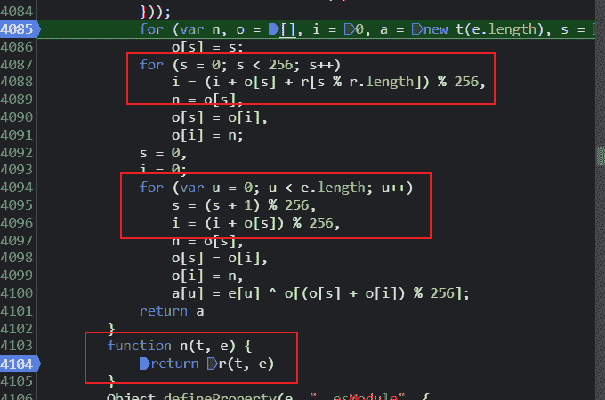

这里有几处很明显的特征，如果熟悉 `rc4` 算法的朋友，应该能很快地认出来，下面是 `rc4` 的 `wiki`

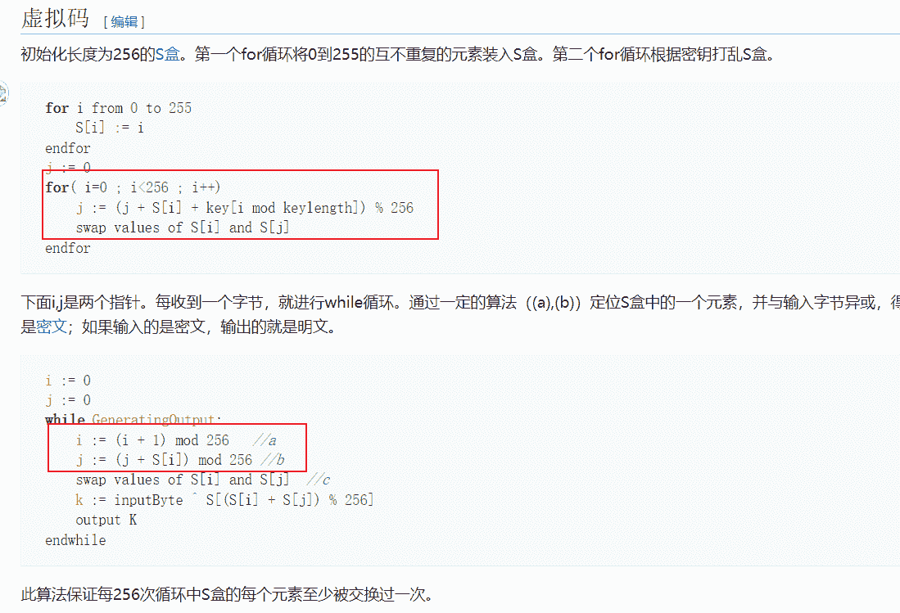

> 当然，如果认不出是 `rc4` 也没关系，就几十行代码，完全可以照着写实现整个过程，就是重复造轮子比较花时间

我们直接使用 `Crypto` 库 `ARC4` 模块

```
def crypto_rc4(text: bytes, sec_key: str):
    cipher = ARC4.new(sec_key.encode())
    cipher_text = cipher.encrypt(text)
    return cipher_text
```

拿一小段字节，分别进行加密测试，对比结果，成功复现原功能：

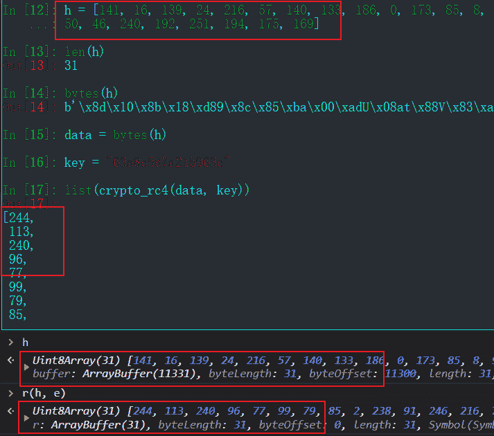

## 第三个函数

第二步一样，3次 step into & out 后，我们进入第三个函数内部，可以看到参数 `t` 就是经过 `rc4` 加密后的数组

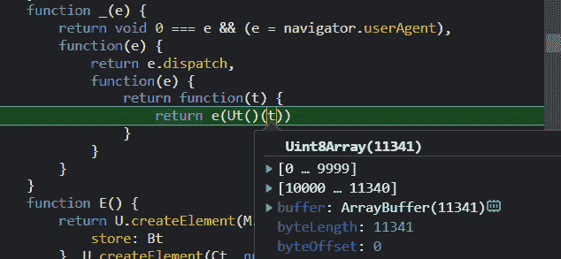

再次进入函数内部


进入最后的 `r` 函数内部


这里我们无法确定用的是哪种解析，直接拿出全部的关键词去 `google` 一下吧，出现最多的关键词是 `bplist`，看一下它的 `https://gist.github.com/manekinekko/e897e5025048cfa10fedcfd6317aab5d`，是不是和豆瓣的很相似？

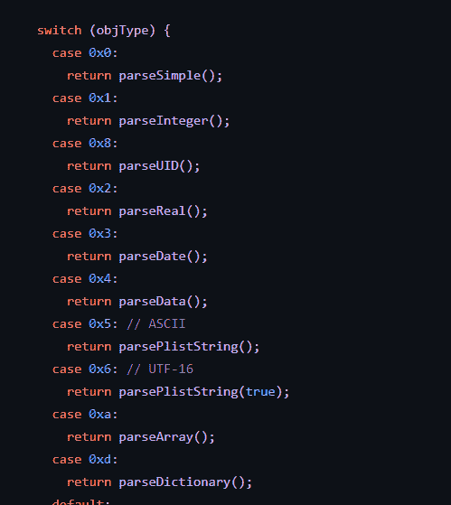

> `bplist` 的全称是 Binary Property List，`plist` 属性列表是一种 `ios` 系统中用来存储少量数据的文件格式，可以和 `json`、`xml`、`binary` 等格式互相转换，这里有 `https://medium.com/@karaiskc/understanding-apples-binary-property-list-format-281e6da00dbd`

最终将 `binary` 数组转成 `json` 数据

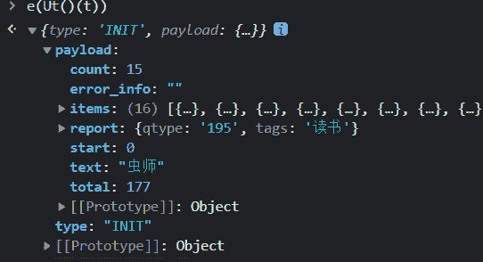

python的 `https://docs.python.org/3/library/plistlib.html` 已经有 `plistlib` 专门来处理 `plist` 文件，直接使用 `loads` 方法来加载 `binary` 就行

```
import plistlib
import struct

'''
需要引入 struct 模块，不然会报 undefined error
'''

pb_results = plistlib.loads(rc4_bytes, fmt=plistlib.FMT_BINARY)
```

最终的解析结果是一个数组：

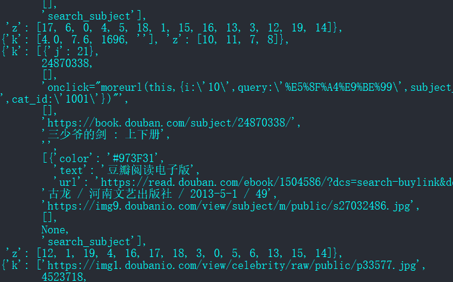

## 代码整理

```
import requests
import base64
import re
import xxhash
import plistlib
import struct

from pprint import pprint
from Crypto.Cipher import ARC4
from math import floor
from plistlib import FMT_BINARY, _BinaryPlistParser, _undefined

def crypto_rc4(raw_data: bytes, sec_key: str):
    cipher = ARC4.new(sec_key.encode())
    rc4_bytes = cipher.encrypt(raw_data)
    return rc4_bytes

def judge_title(a):
    if "onclick" not in a and a != "search_subject" and a != "" and "doubanio" not in a:
        return True
    return False

def main():
    url = f"https://search.douban.com/book/subject_search?search_text=虫师&cat=1001"
    res = requests.get(url)
    data = re.search(r'window.__DATA__ = "(.+?)"', res.text, flags=re.DOTALL).group(1)

    i = 16
    a = base64.b64decode(data)
    s = floor((len(a) - 2 * i) / 3)
    u = a[s : s + i]
    raw_bytes = a[0:s] + a[s + i :]
    sec_key = xxhash.xxh64_hexdigest(u, 41405)
    # print(sec_key)
    # print(raw_text)

    rc4_bytes = crypto_rc4(raw_bytes, sec_key)
    # print(rc4_bytes)
    pb_results = plistlib.loads(rc4_bytes, fmt=FMT_BINARY)
    print("最终结果为：")
    pprint(pb_results)
    results = list(
        filter(
            lambda d: isinstance(d, dict)
            and len(d["k"]) > 10
            and len(d.keys()) == 2,
            pb_results,
        )
    )

    for d in results:
        for a in d["k"]:
            if bool(a) and isinstance(a, int) or isinstance(a, str):
                a = str(a)
                if "img" in a:
                    print(f"封面：{a}")
                elif "book.douban.com" in a:
                    print(f"豆瓣链接：{a}")
                elif a.isdigit():
                    print(f"豆瓣id：{a}")
                elif " / " in a:
                    print(f"出版信息：{a}")
                elif judge_title(a):
                    print(f"书名：{a}")
        print("cxs".center(50, "-"))

if __name__ == "__main__":
    main()
```

运行结果如下，我做了一下筛选和格式化输出

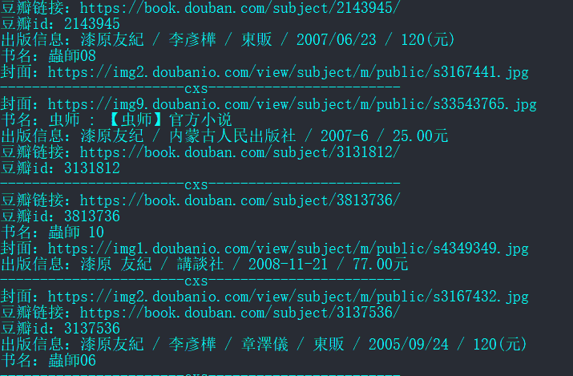

最后，其实 `m` 端的豆瓣接口没有加密，可以直接用 `xpath` 提取数据，不用去逆向这么麻烦 🤣🤣🤣
