# [原创] 破解练习-CRACKME006

- 原帖: https://www.52pojie.cn/forum.php?mod=viewthread&tid=1741747
- 抓取时间: 2026-11-01T23:01:23

## 006-注册算法分析

### 一、工具和调试环境

- PE信息查看工具：`Die`
- 动态调试工具：`x64dbg`
- 反编译工具：`IDR`(`Interactive Delphi Reconstructor 01.04.2017`)，`IDA` 7.6
- 系统环境：win10 1909

### 二、分析用户名/注册码的算法

#### 2.1运行程序

作者意图是让我们将`OK`和`Cancella`两个按钮隐藏。其中`OK`按钮是不可点击的。需要填写`Nome`和`Codice`。

#### 2.2查壳

用`Die`查壳，没有加壳，是`Delphi`程序，貌似是`Delphi 4`，记住版本后面会用到

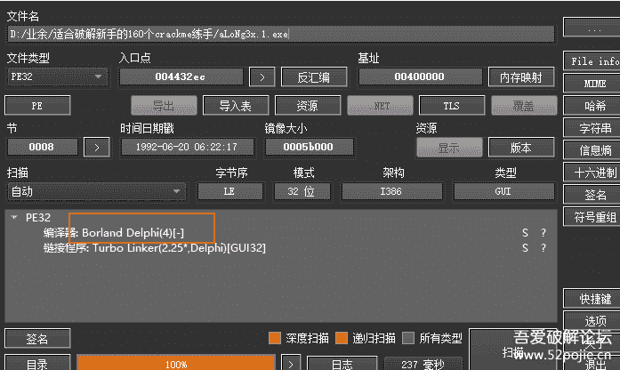

006-01.png (30.73 KB, 下载次数: 2)

[href="forum.php?mod=attachment&aid=MjU4ODA0NXxiMmE4NmRhY3wxNzkzNTc0MDgwfDE2ODA4NnwxNzQxNzQ3&nothumb=yes" target="_blank"](https://www.52pojie.cn/forum.php?mod=attachment&aid=MjU4ODA0NXxiMmE4NmRhY3wxNzkzNTc0MDgwfDE2ODA4NnwxNzQxNzQ3&nothumb=yes)

2023-2-4 00:05 上传

#### 2.3详细分析

通过005的分析，我们了解到了`Delphi`的改变控件有效状态的`api`为：`SetVisible`，更具体点为：`TControl.SetVisible`。那么下面就借助`IDR`，找到该`API`的地址

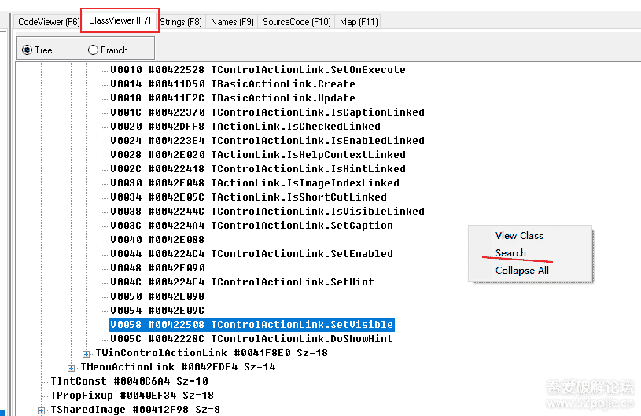

006-02.png (30.09 KB, 下载次数: 2)

[href="forum.php?mod=attachment&aid=MjU4ODA0NnxiNTFiMDI5YXwxNzkzNTc0MDgwfDE2ODA4NnwxNzQxNzQ3&nothumb=yes" target="_blank"](https://www.52pojie.cn/forum.php?mod=attachment&aid=MjU4ODA0NnxiNTFiMDI5YXwxNzkzNTc0MDgwfDE2ODA4NnwxNzQxNzQ3&nothumb=yes)

2023-2-4 00:05 上传

如上图，选择`ClassViewer`视图，然后在该视图空白处右键`Search`，然后如下图，在弹出的查找框中寻找`SetVisible`

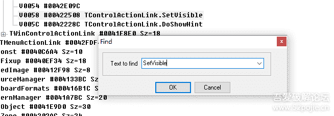

006-03.png (15.4 KB, 下载次数: 2)

[href="forum.php?mod=attachment&aid=MjU4ODA0N3wzMTY3MGIyNHwxNzkzNTc0MDgwfDE2ODA4NnwxNzQxNzQ3&nothumb=yes" target="_blank"](https://www.52pojie.cn/forum.php?mod=attachment&aid=MjU4ODA0N3wzMTY3MGIyNHwxNzkzNTc0MDgwfDE2ODA4NnwxNzQxNzQ3&nothumb=yes)

2023-2-4 00:05 上传

找到如下地址


006-04.png (1.76 KB, 下载次数: 2)

[href="forum.php?mod=attachment&aid=MjU4ODA0OHwwZjkwOWEwY3wxNzkzNTc0MDgwfDE2ODA4NnwxNzQxNzQ3&nothumb=yes" target="_blank"](https://www.52pojie.cn/forum.php?mod=attachment&aid=MjU4ODA0OHwwZjkwOWEwY3wxNzkzNTc0MDgwfDE2ODA4NnwxNzQxNzQ3&nothumb=yes)

2023-2-4 00:05 上传

双击，会跳转到`CodeViewer`视图，显示该函数代码，可以看到`TControl.SetVisible`

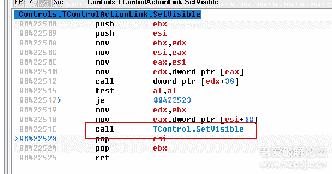

006-05.png (15.04 KB, 下载次数: 2)

[href="forum.php?mod=attachment&aid=MjU4ODA0OXw3NTBhM2E3Y3wxNzkzNTc0MDgwfDE2ODA4NnwxNzQxNzQ3&nothumb=yes" target="_blank"](https://www.52pojie.cn/forum.php?mod=attachment&aid=MjU4ODA0OXw3NTBhM2E3Y3wxNzkzNTc0MDgwfDE2ODA4NnwxNzQxNzQ3&nothumb=yes)

2023-2-4 00:05 上传

双击进去，就可以得到`TControl.SetVisible`的地址了，如下图为：0x004231B0

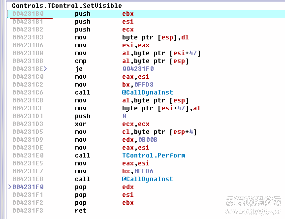

006-06.png (20.01 KB, 下载次数: 2)

[href="forum.php?mod=attachment&aid=MjU4ODA1MHxlMjA1ZmRhMnwxNzkzNTc0MDgwfDE2ODA4NnwxNzQxNzQ3&nothumb=yes" target="_blank"](https://www.52pojie.cn/forum.php?mod=attachment&aid=MjU4ODA1MHxlMjA1ZmRhMnwxNzkzNTc0MDgwfDE2ODA4NnwxNzQxNzQ3&nothumb=yes)

2023-2-4 00:05 上传

但是如果`x64dbg`在该地址下断点，并不能找到关键地方。只有使用正确的方法使`Cancella`隐藏才是我们想要的触发，问题的关键是我们就是在寻找正确的方法。

那么怎么办呢？接下来就要请出我们的新伙伴`IDA`了。

使用`IDA`打开程序，然后打开签名视图，如下图或者直接使用快捷键`Shift + F5`

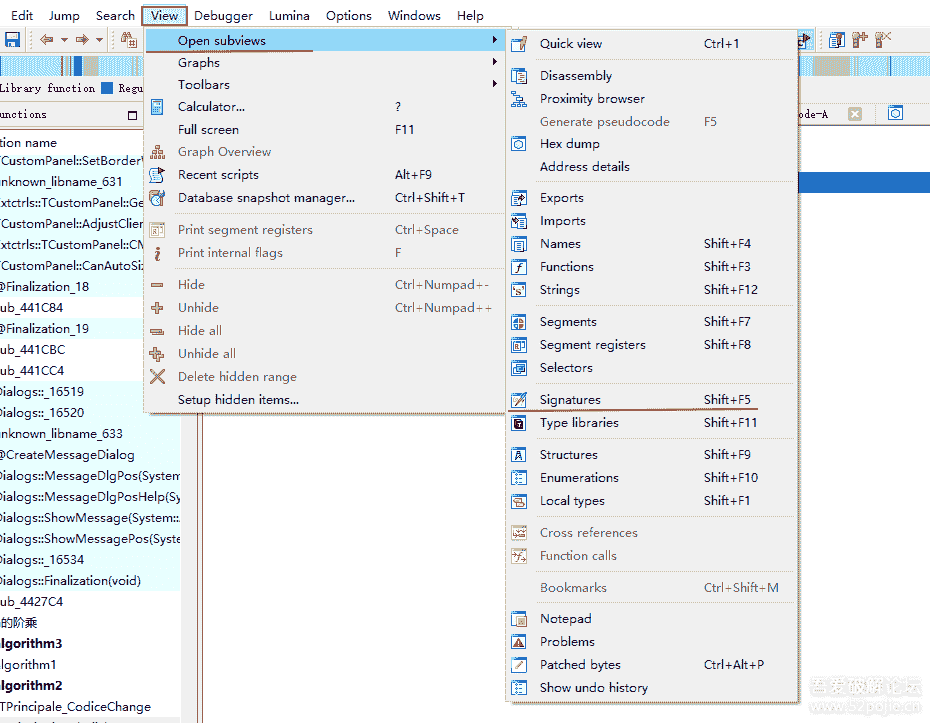

006-07.png (97.48 KB, 下载次数: 2)

[href="forum.php?mod=attachment&aid=MjU4ODA1MXw4NWU0M2U0OXwxNzkzNTc0MDgwfDE2ODA4NnwxNzQxNzQ3&nothumb=yes" target="_blank"](https://www.52pojie.cn/forum.php?mod=attachment&aid=MjU4ODA1MXw4NWU0M2U0OXwxNzkzNTc0MDgwfDE2ODA4NnwxNzQxNzQ3&nothumb=yes)

2023-2-4 00:05 上传

在签名视图空白处右键选择添加一个新的签名，或者使用快捷键`Ins`，然后选择`Delphi 4`（之前`Die`查到的版本）

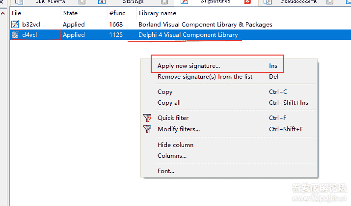

006-08.png (26.94 KB, 下载次数: 2)

[href="forum.php?mod=attachment&aid=MjU4ODA1Mnw1NTk2ZDM0NHwxNzkzNTc0MDgwfDE2ODA4NnwxNzQxNzQ3&nothumb=yes" target="_blank"](https://www.52pojie.cn/forum.php?mod=attachment&aid=MjU4ODA1Mnw1NTk2ZDM0NHwxNzkzNTc0MDgwfDE2ODA4NnwxNzQxNzQ3&nothumb=yes)

2023-2-4 00:05 上传

在汇编视图中查找之前的函数(`TControl.SetVisible`)地址：0x004231B0

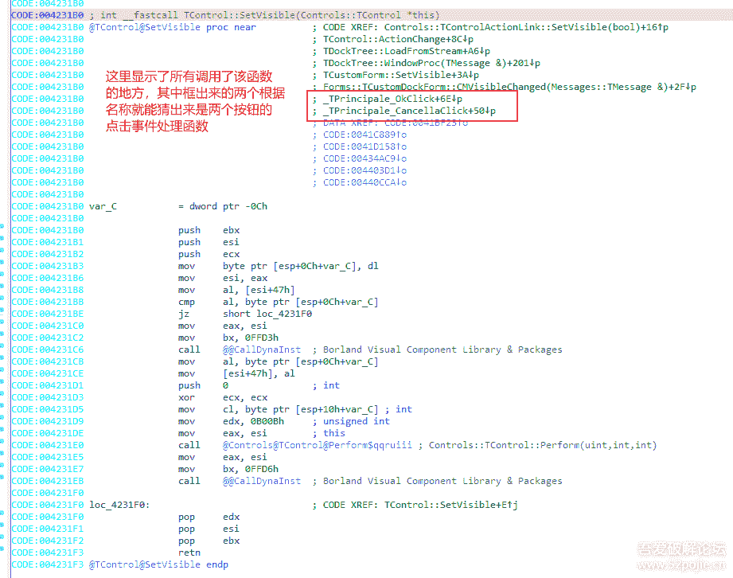

006-09.png (106.46 KB, 下载次数: 1)

[href="forum.php?mod=attachment&aid=MjU4ODA1M3xmYjhmMmVhY3wxNzkzNTc0MDgwfDE2ODA4NnwxNzQxNzQ3&nothumb=yes" target="_blank"](https://www.52pojie.cn/forum.php?mod=attachment&aid=MjU4ODA1M3xmYjhmMmVhY3wxNzkzNTc0MDgwfDE2ODA4NnwxNzQxNzQ3&nothumb=yes)

2023-2-4 00:05 上传

由于`OK`按钮目前是不可点击的，那么我们先看`Cancella`按钮的点击事件，双击过去。然后和`IDR`对照看，如有不懂，可以先看上一篇005

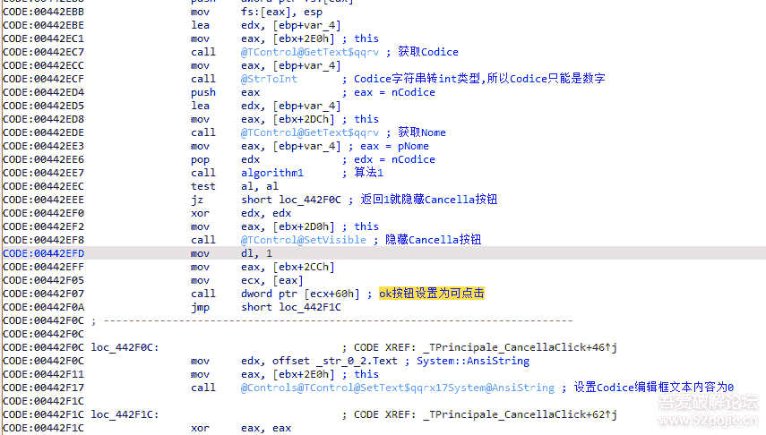

006-10.png (65.83 KB, 下载次数: 2)

[href="forum.php?mod=attachment&aid=MjU4ODA1NHw4Yzk5OGQ4MHwxNzkzNTc0MDgwfDE2ODA4NnwxNzQxNzQ3&nothumb=yes" target="_blank"](https://www.52pojie.cn/forum.php?mod=attachment&aid=MjU4ODA1NHw4Yzk5OGQ4MHwxNzkzNTc0MDgwfDE2ODA4NnwxNzQxNzQ3&nothumb=yes)

2023-2-4 00:05 上传

可以看出关键的地方在于0x442EE7处的`call algorithm1`(`algorithm1`名字是我改的，算法1)函数调用，当该函数返回非0时(`algorithm1`其实返回值不是0就是1)，`Cancella`按钮会被隐藏且`ok`按钮变为可点击。如果返回为0时，`Codice`编辑框内容重新设置为0。

接下来就进入`algorithm1`函数中，看如何使其返回1。关键算法如下

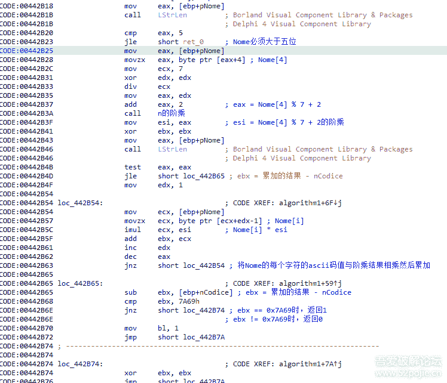

006-11.png (79.58 KB, 下载次数: 2)

[href="forum.php?mod=attachment&aid=MjU4ODA1NXw4NzI3M2EwNXwxNzkzNTc0MDgwfDE2ODA4NnwxNzQxNzQ3&nothumb=yes" target="_blank"](https://www.52pojie.cn/forum.php?mod=attachment&aid=MjU4ODA1NXw4NzI3M2EwNXwxNzkzNTc0MDgwfDE2ODA4NnwxNzQxNzQ3&nothumb=yes)

2023-2-4 00:05 上传

`Nome`必须大于五位，且`Codice`和`Nome`满足以下关系就返回1，否则返回0。

`Codice`与`Nome`的关系：`Nome`的第5个字符的`ASCII`码值模7，再加上2。其结果的阶乘与`Nome`的每一个字符的`ASCII`码值相乘，所有乘积累加。新的结果减去0x7A69，就是`Codice`的内容。算法代码如下

```
char* GetSerial6_1(char* szNome)
{
        static char szCodice[60] = {};

        int nNomeLen = strlen(szNome);
        if (nNomeLen
```

现在成功的隐藏了`Cancella`按钮，且`ok`按钮可点击了。接下来就是隐藏`ok`按钮了。还记得前面查找的`OK`按钮的点击处理函数中也调用了控件隐藏的函数。那么就看看`ok`按钮的点击处理函数

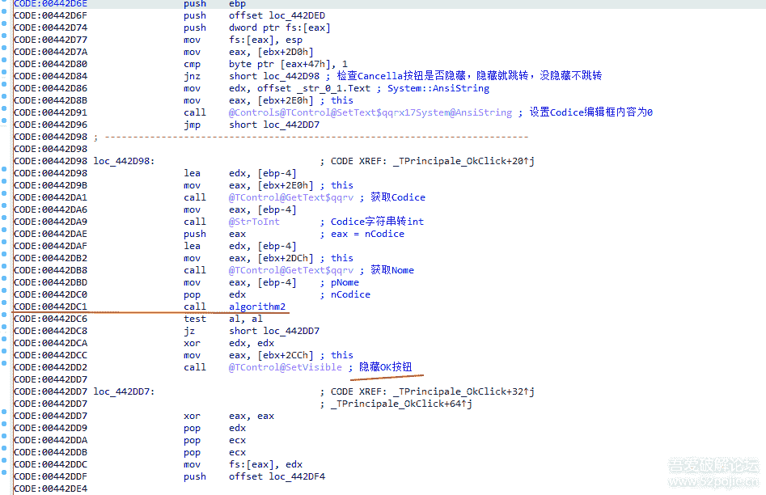

006-12.png (80.91 KB, 下载次数: 1)

[href="forum.php?mod=attachment&aid=MjU4ODA1Nnw5YWMyNzM2MXwxNzkzNTc0MDgwfDE2ODA4NnwxNzQxNzQ3&nothumb=yes" target="_blank"](https://www.52pojie.cn/forum.php?mod=attachment&aid=MjU4ODA1Nnw5YWMyNzM2MXwxNzkzNTc0MDgwfDE2ODA4NnwxNzQxNzQ3&nothumb=yes)

2023-2-4 00:05 上传

可以看出关键的地方在于0x442DC1处的`call algorithm2`(`algorithm2`名字是我改的，算法2)函数调用，当该函数返回非0时(`algorithm2`其实返回值不是0就是1)，`OK`按钮会被隐藏。如果返回为0时，不做处理。和前面`Cancella`按钮点击处理函数差不多。不过该处理函数，会首先检测`Cancella`按钮是否被隐藏，如果没隐藏就会将`Codice`编辑框内容设置为0，然后返回。只有`Cancella`被隐藏了。才会执行前面关键代码。

接下来就进入`algorithm2`函数中，看如何使其返回1。关键算法如下

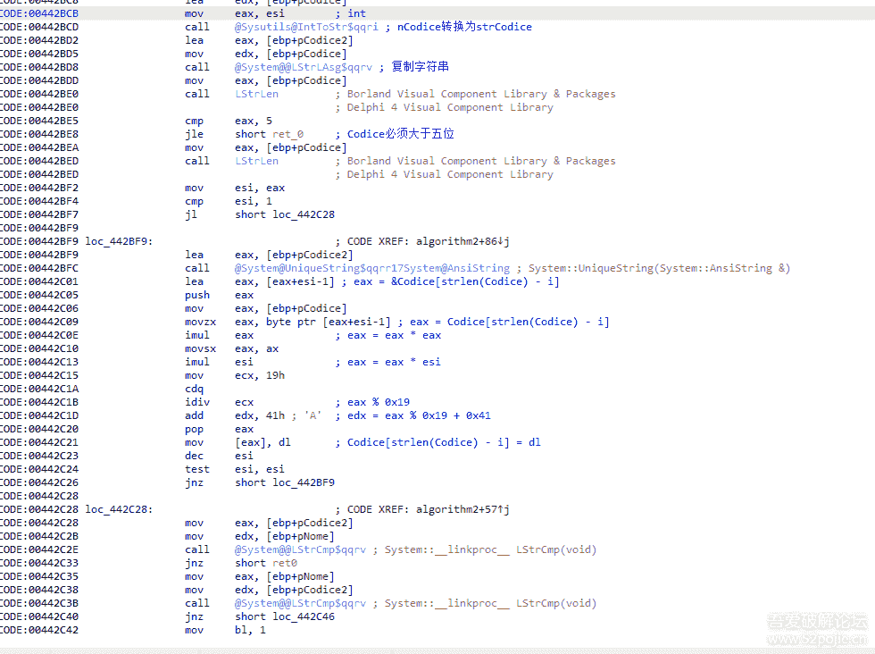

006-13.png (95.7 KB, 下载次数: 2)

[href="forum.php?mod=attachment&aid=MjU4ODA1N3xiZWVkYzJkMnwxNzkzNTc0MDgwfDE2ODA4NnwxNzQxNzQ3&nothumb=yes" target="_blank"](https://www.52pojie.cn/forum.php?mod=attachment&aid=MjU4ODA1N3xiZWVkYzJkMnwxNzkzNTc0MDgwfDE2ODA4NnwxNzQxNzQ3&nothumb=yes)

2023-2-4 00:05 上传

`Codice`必须大于五位，且`Codice`和`Nome`满足以下关系就返回1，否则返回0。

`Codice`与`Nome`的关系：`Codice`的数字转换为字符串，然后将该字符串的每个字符的`ascii`码值进行平方计算，计算结果再乘以该字符的字符串中的位数（从1开始）得到新的结果，再用新的结果模0x19，最后再加上0x41。得到的新的字符串和`Nome`字符串相同就返回1，否则返回0。

算法代码如下：

```
char* GetSerial6_2(char* szCodice)
{
        static char szNome[60] = {};

        int nCodiceLen = strlen(szCodice);
        if (nCodiceLen
```
