# [CTF] 【2023】春节解题领红包之二

- 原帖：https://www.52pojie.cn/forum.php?mod=viewthread&tid=1742329
- 抓取时间：2026-11-01T23:01:16

## 工具

吾爱破解专用虚拟机，`IDA Pro 7.5`。

其实这道题比较直接的方式是根据历年题目的答案使用穷举法猜出答案，不过要是猜不出的话也没关系，这是大佬的手法，学不来的（大佬有技术，有手法，我们要是靠猜的话遇到变化的题就又搞不定了），我们小白还是要试着去分析得到正确的答案。

## 查壳

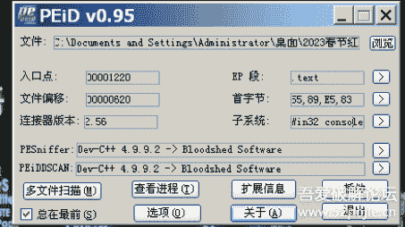

`001查壳.png`（69.76 KB，下载次数：1）；[附件链接](https://www.52pojie.cn/forum.php?mod=attachment&aid=MjU4ODM1N3wwMzVhNDI2NnwxNzkzNTc0MDczfDE2ODA4NnwxNzQyMzI5&nothumb=yes)；2023-2-5 23:59 上传

可以知道程序无壳，可以直接开始分析。先运行程序，输入测试用例，查看输出。

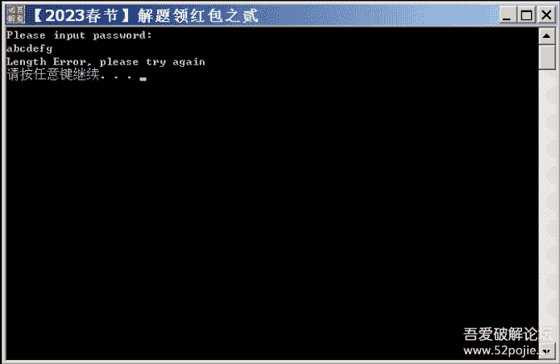

`002输出.png`（46.83 KB，下载次数：1）；[附件链接](https://www.52pojie.cn/forum.php?mod=attachment&aid=MjU4ODM1OHxmM2MyNTlkYXwxNzkzNTc0MDczfDE2ODA4NnwxNzQyMzI5&nothumb=yes)；2023-2-5 23:59 上传

根据提示信息可知，`key`的长度不足，以此为切入点进行分析。

## OD调试

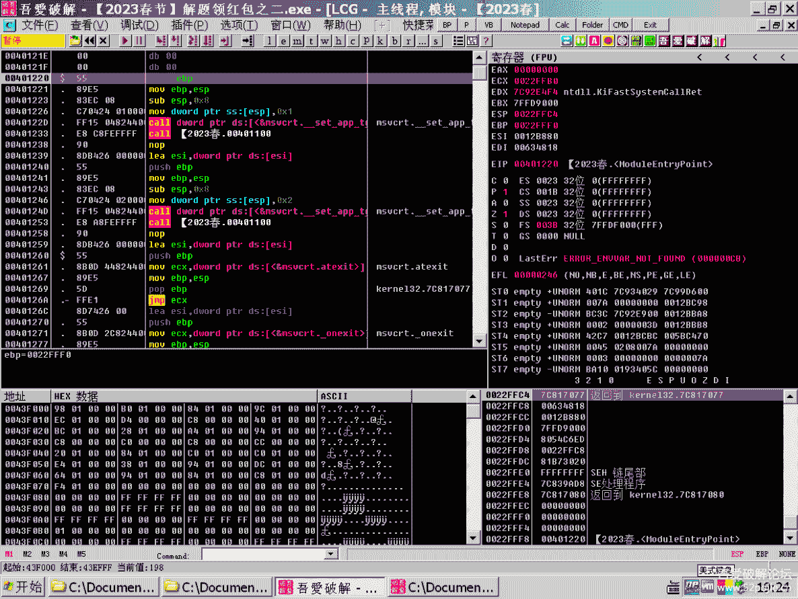

`003主页面.png`（403.85 KB，下载次数：1）；[附件链接](https://www.52pojie.cn/forum.php?mod=attachment&aid=MjU4ODM1OXw0ZTU0NTJlYXwxNzkzNTc0MDczfDE2ODA4NnwxNzQyMzI5&nothumb=yes)；2023-2-5 23:59 上传

由于程序无壳，所以可以直接使用字符串搜索工具，`右键 -> 中文搜索引擎 -> 智能搜索`。

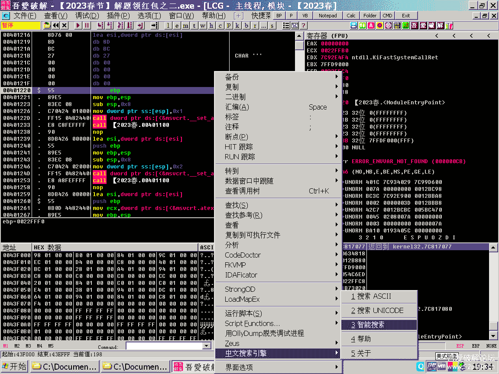

`004字符串搜索.png`（92.89 KB，下载次数：0）；[附件链接](https://www.52pojie.cn/forum.php?mod=attachment&aid=MjU4ODM2MHw2MmQ2Yzg4ZnwxNzkzNTc0MDczfDE2ODA4NnwxNzQyMzI5&nothumb=yes)；2023-2-6 00:00 上传

很快可以看到`Length Error，please try again`，双击此行可以回到汇编窗口。（此处可以发现还有`Success`，`Wrong...`等字样，可以先留意一下，如果直接在`Success`处分析，对初学者来说，可能容易犯迷糊，所以先从已知的条件入手）

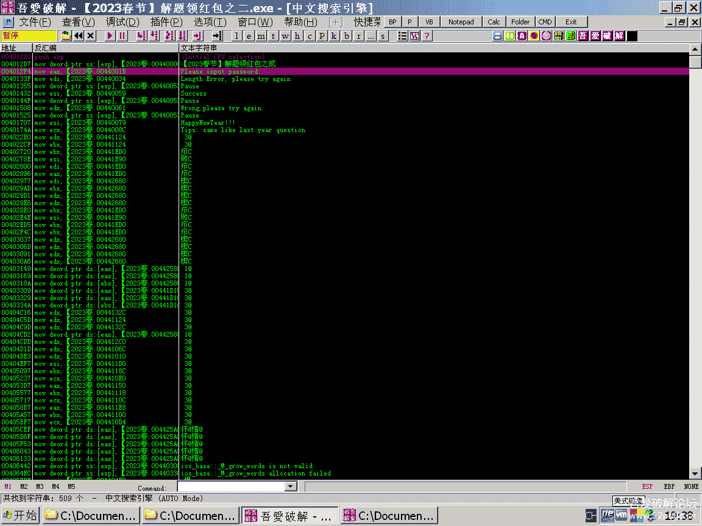

`005字符串列表.png`（84.15 KB，下载次数：2）；[附件链接](https://www.52pojie.cn/forum.php?mod=attachment&aid=MjU4ODM2MXxmY2JjNmNiYXwxNzkzNTc0MDczfDE2ODA4NnwxNzQyMzI5&nothumb=yes)；2023-2-6 00:00 上传

很快可以发现对应代码上方有一个`je`（相等则跳转）向下的跳转，再向上可以看到`cmp`指令，根据其对应的一个操作数为`0x1D`（十进制数29），和上方读取内存地址数据操作，可以断定`password`长度为29。

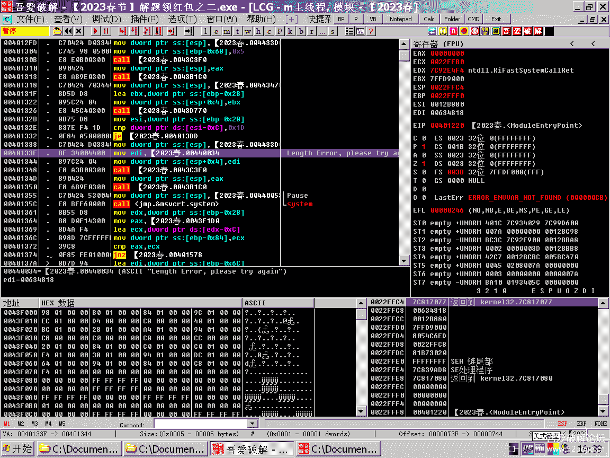

`006length汇编1.png`（99.17 KB，下载次数：2）；[附件链接](https://www.52pojie.cn/forum.php?mod=attachment&aid=MjU4ODM2MnwwYWVhMGZlM3wxNzkzNTc0MDczfDE2ODA4NnwxNzQyMzI5&nothumb=yes)；2023-2-6 00:00 上传

构造长度为29的字符串，`abcdefghijklmnopqrstuvwxyzabc`，再次输入，提示信息变为`Wrong，please try again`，结合之前提到对字符信息的分析步骤，在字符窗口中使用同样的操作找到对应汇编代码位置。

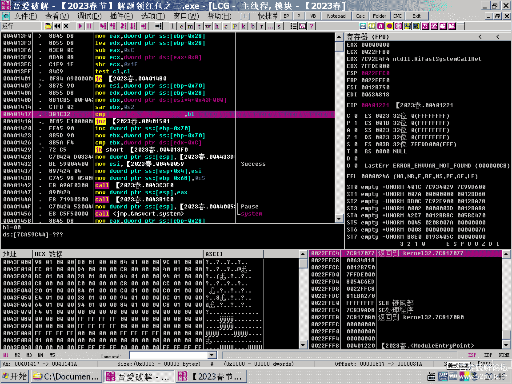

`007length汇编2.png`（96.92 KB，下载次数：3）；[附件链接](https://www.52pojie.cn/forum.php?mod=attachment&aid=MjU4ODM2M3w2N2Y5NjQ2YXwxNzkzNTc0MDczfDE2ODA4NnwxNzQyMzI5&nothumb=yes)；2023-2-6 00:00 上传

在它的上一行可以发现一个来自`0040141A`的跳转（向上滑动或者直接`Ctrl+G`搜索该地址），

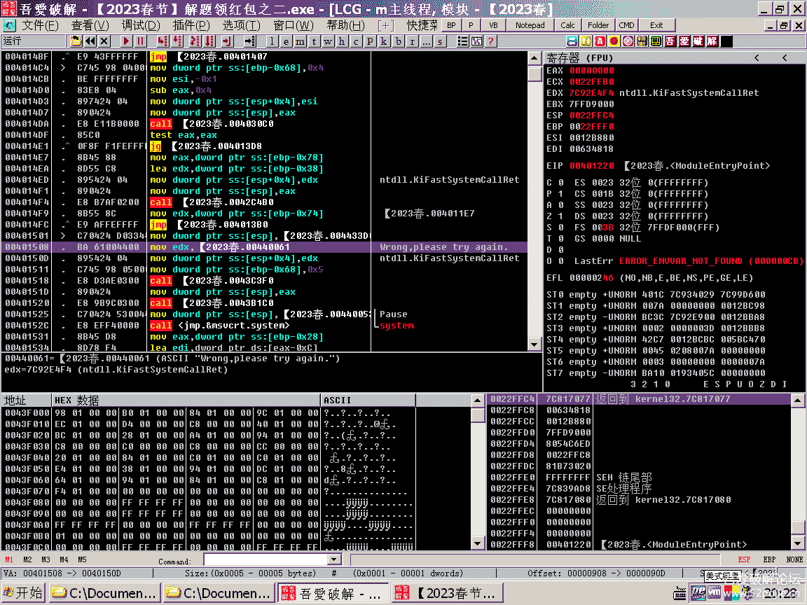

`008length汇编3.png`（99.4 KB，下载次数：2）；[附件链接](https://www.52pojie.cn/forum.php?mod=attachment&aid=MjU4ODM2NHw3NWYxNWY1ZXwxNzkzNTc0MDczfDE2ODA4NnwxNzQyMzI5&nothumb=yes)；2023-2-6 00:00 上传

定位到此处发现它刚好跳过了`Success`，而我们的目标是需要让它不执行跳转，因此继续向上分析，可以发现上面又有一条`cmp`指令（`cmp`比较两个操作数是否相等，使用减法操作，如果结果相等即为0，那么右边对应的`Z`标志位就会变为1），既然`JNZ`（`Z`标志位为0时则跳转，此时表示两个操作数结果不相等）与它有关，使用`F2`在此下一个断点即可。


`009success定位.png`（96.92 KB，下载次数：1）；[附件链接](https://www.52pojie.cn/forum.php?mod=attachment&aid=MjU4ODM2NXxkZGZiNTBhYnwxNzkzNTc0MDczfDE2ODA4NnwxNzQyMzI5&nothumb=yes)；2023-2-6 00:00 上传

重新载入程序，按`F9`使其运行，输入`abcdefghijklmnopqrstuvwxyzabc`，此时回车后程序将在`00401417`处暂停，这里要注意红框圈起来的地方，可以看到密码第一位为应该为`f`，而我们输入的是`a`，所以程序继续向下执行就会提示答案错误，此处一种思路就是如此重复操作29次，确定出最终答案。这里可以看出今年官方的出题不同以往，以前可以在寄存器窗口看到用`cmp`直接比较最终结果的方式，可以比较容易知道最终的结果，这一次是逐位比较了。

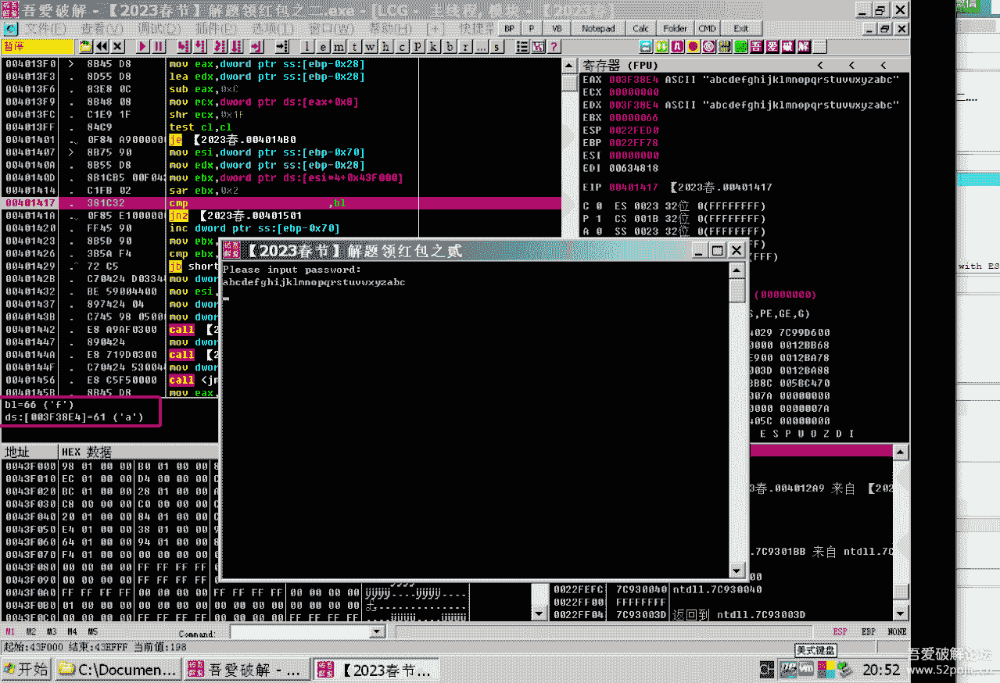

`010逐位比较.png`（395.99 KB，下载次数：1）；[附件链接](https://www.52pojie.cn/forum.php?mod=attachment&aid=MjU4ODM2NnxkYjI4Zjc0OHwxNzkzNTc0MDczfDE2ODA4NnwxNzQyMzI5&nothumb=yes)；2023-2-6 00:00 上传

当然我们可以选择继续向上分析，`cmp`指令上一行为`sar ebx, 0x2`，也就是对`ebx`中的数据做右移两位的操作后，再赋值给`ebx`，再向上可以看到`mov`指令，取出内存地址的值赋值给`ebx`，此处的`dword ptr ds:[esi*4+0x43F000]`，根据`F8`单步执行分析，`esi`每次会自增1，即每次从数据取出四个字节的十六进制数据，而数据窗口的值为`98 01 00 00`，而我们看到左下角的值为`00000198`（`0x198 >> 2 = 66 = 'f'`），这是因为数据窗口的数据遵循小端序的规则。大小端序是计算机内存中一种存储多字节数据的排列方式，由于计算机电路优先处理低位字节，这种存储方式被广泛应用于现代CPU内部存储数据，这也是为什么有的教程中修改数据时，需要将数据反过来写的原因。

因此程序执行的思路如下，首先判断长度是否正确，然后循环按位比较输入的字符是否与实际的`password`的值，由于`password`的值做了移位处理，因此需要先要进行右移2位后将其还原，再进行比较，如果使用`F8`单步调试会发现从`004013F0`到`00401429`就是循环并逐位比较的代码部分。

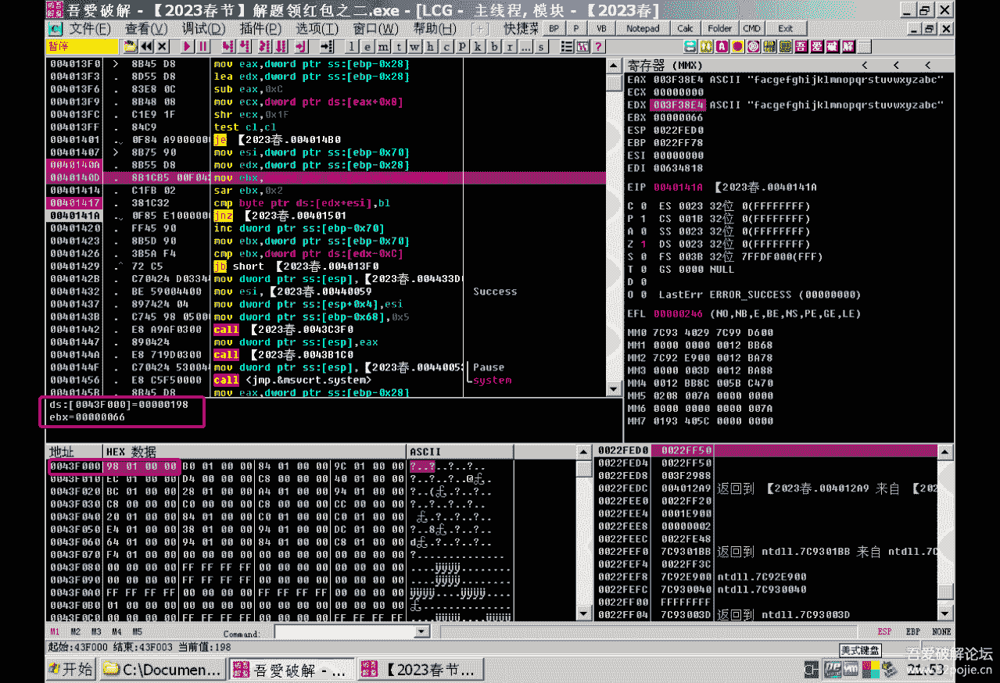

`011逐位比较代码分析.png`（493.3 KB，下载次数：1）；[附件链接](https://www.52pojie.cn/forum.php?mod=attachment&aid=MjU4ODM2N3wzNWMzZmVhNXwxNzkzNTc0MDczfDE2ODA4NnwxNzQyMzI5&nothumb=yes)；2023-2-6 00:00 上传

在数据窗口中选择116字节数据，将其转为大端序，`98 01 00 00 => 00 00 01 98`

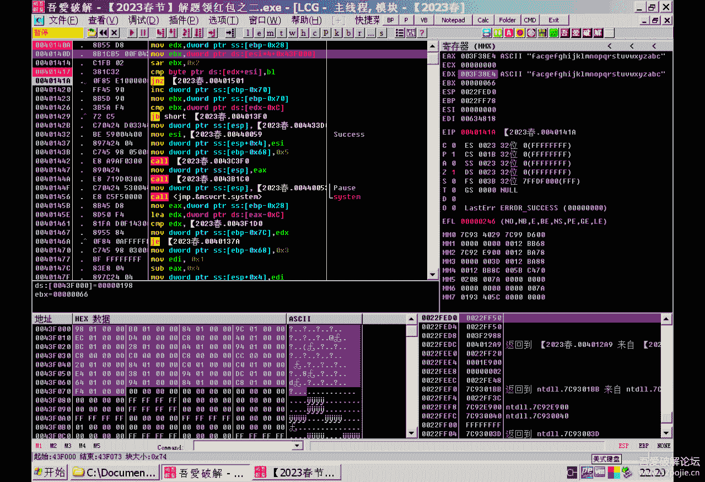

`012数据窗口字节.png`（501.17 KB，下载次数：2）；[附件链接](https://www.52pojie.cn/forum.php?mod=attachment&aid=MjU4ODM2OHw3MTJmY2QwNnwxNzkzNTc0MDczfDE2ODA4NnwxNzQyMzI5&nothumb=yes)；2023-2-6 00:00 上传

或者使用如下操作获得对应的十进制数。

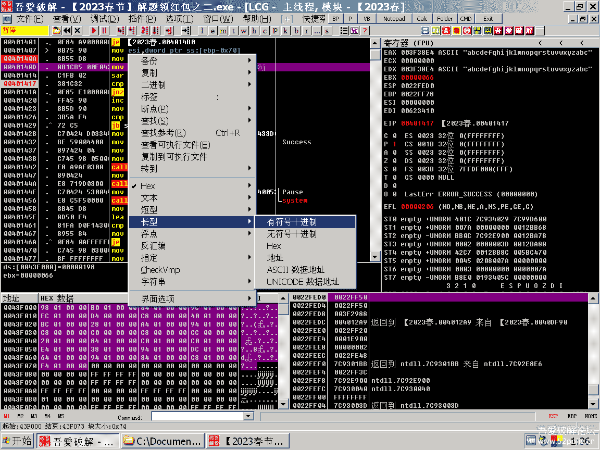

`013长整型.png`（94.78 KB，下载次数：1）；[附件链接](https://www.52pojie.cn/forum.php?mod=attachment&aid=MjU4ODM2OXw0NWIwZTkxYXwxNzkzNTc0MDczfDE2ODA4NnwxNzQyMzI5&nothumb=yes)；2023-2-6 00:00 上传

对其进行右移两位操作后，转为`ascii`码即可，即为最终答案。文末有`Java`代码实现。

408,432,388,412,492,212,200,320,444,296,420,404,200,192,200,204,288,388,448,448,484,312,404,476,356,404,388,456,500

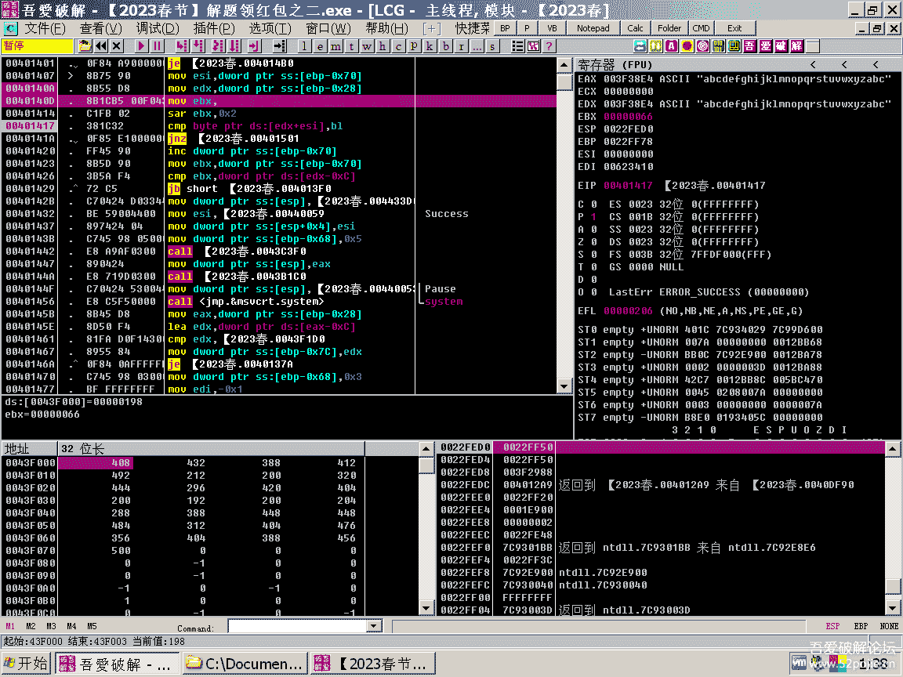

`014长整型2.png`（92.49 KB，下载次数：0）；[附件链接](https://www.52pojie.cn/forum.php?mod=attachment&aid=MjU4ODM3MHw5NDljMjI2ZHwxNzkzNTc0MDczfDE2ODA4NnwxNzQyMzI5&nothumb=yes)；2023-2-6 00:00 上传

最终结果为`flag{52PoJie2023HappyNewYear}`

## IDA分析

上面的循环部分的汇编或许看起来会比较吃力，所以可以选择使用`IDA`帮我们理清思路。打开`IDA`选择文件，点击`ok`即可。

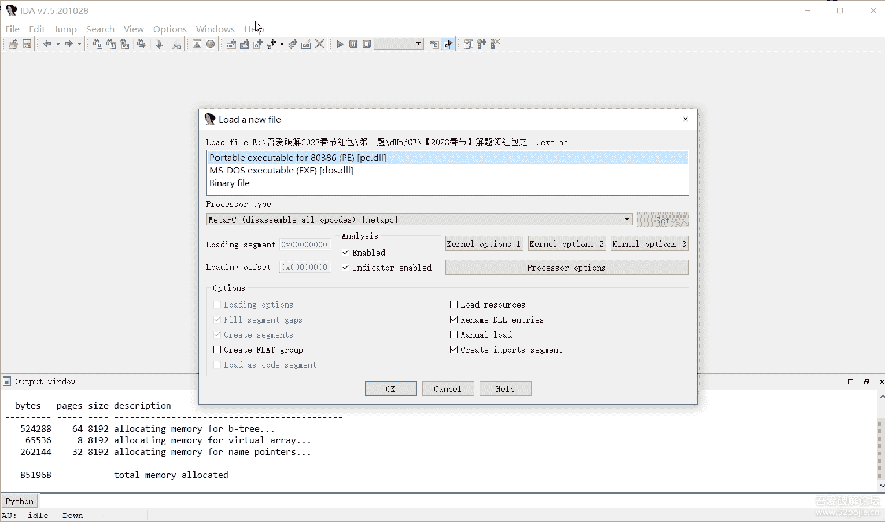

`016ok.png`（63.86 KB，下载次数：1）；[附件链接](https://www.52pojie.cn/forum.php?mod=attachment&aid=MjU4ODM3MXxiNTc5OTgzZXwxNzkzNTc0MDczfDE2ODA4NnwxNzQyMzI5&nothumb=yes)；2023-2-6 00:00 上传

待程序加载完成，可以看到很清晰的看到其运行的流程图，在此页面按下`F5`即可将其转换为源代码。

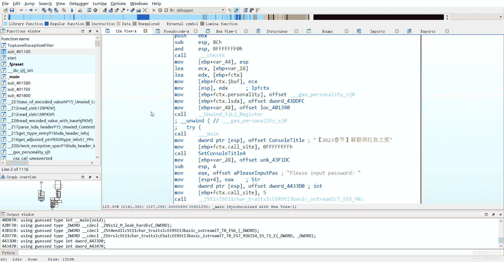

`017graph.png`（301.56 KB，下载次数：1）


[href="forum.php?mod=attachment&aid=MjU4ODM3Mnw2NzI1OGU4Y3wxNzkzNTc0MDczfDE2ODA4NnwxNzQyMzI5&nothumb=yes" target="_blank"](https://www.52pojie.cn/forum.php?mod=attachment&aid=MjU4ODM3Mnw2NzI1OGU4Y3wxNzkzNTc0MDczfDE2ODA4NnwxNzQyMzI5&nothumb=yes)

2023-2-6 00:00 上传

这里很容易就已经看到`success`的提示，不难看出第22行为判断长度，第29行为右移逐位比较是否相等，31行判断是否比较完成。结合之前的分析分析就对程序有很清楚的了解了。

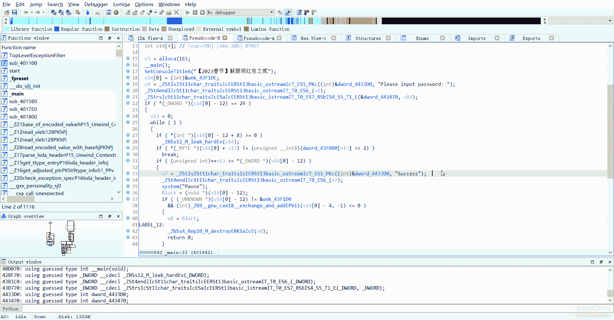

`018伪代码.png` (185.37 KB, 下载次数: 2)

[href="forum.php?mod=attachment&aid=MjU4ODM3M3w4NjlhY2NiN3wxNzkzNTc0MDczfDE2ODA4NnwxNzQyMzI5&nothumb=yes" target="_blank"](https://www.52pojie.cn/forum.php?mod=attachment&aid=MjU4ODM3M3w4NjlhY2NiN3wxNzkzNTc0MDczfDE2ODA4NnwxNzQyMzI5&nothumb=yes)

2023-2-6 00:00 上传

## 代码

```java
class Solution {
    public static void main(String[] args) {
        int [] arr = new int[]{
            408,432,388,412,492,212,200,320,444,296,420,404,200,192,200,204,288,388,448,448,484,312,404,
            476,356,404,388,456,500
        };
        for(int c : arr){
            System.out.print((char)(c>>2));
        }
    }
}
```

> 4> 其它题解
>
> 5> 【2023】春节解题领红包之三https://www.52pojie.cn/thread-1742449-1-1.html
>
> 5> 【2023】春节解题领红包之四https://www.52pojie.cn/thread-1742785-1-1.html
>
> 5> 【2023】春节解题领红包之web篇——不完美题解https://www.52pojie.cn/thread-1743080-1-1.html
