# [CTF] 高一人的第一次正经逆向——吾爱2023新年领红包Windows题分析

- 原帖: https://www.52pojie.cn/forum.php?mod=viewthread&tid=1742332
- 抓取时间: 2026-11-01T23:01:12

作为一个啥都会点的高一人，逆向一直是拿来玩玩和用在不能说的地方()
今年看到吾爱有逆向题目领红包，就过来试试水(^^ゞ

## 1. Windows 初级题

首先将程序拉进 `ExeinfoPe` 查壳, 一看没壳，还是32位，先拉 `IDA` 里面去静态分析

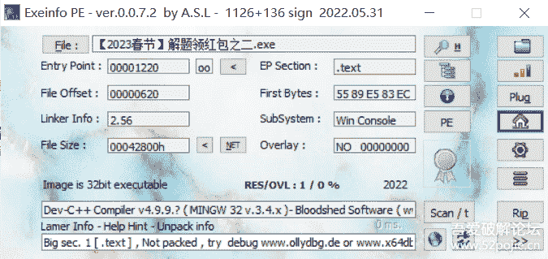

初级题查壳.png (185.84 KB, 下载次数: 2)

[href="forum.php?mod=attachment&aid=MjU4ODM4MnwwMDUzYTRhZXwxNzkzNTc0MDY5fDE2ODA4NnwxNzQyMzMy&nothumb=yes" target="_blank"](https://www.52pojie.cn/forum.php?mod=attachment&aid=MjU4ODM4MnwwMDUzYTRhZXwxNzkzNTc0MDY5fDE2ODA4NnwxNzQyMzMy&nothumb=yes)

2023-2-6 00:28 上传

拉进 `IDA` 之后直接 `F5` 看伪C

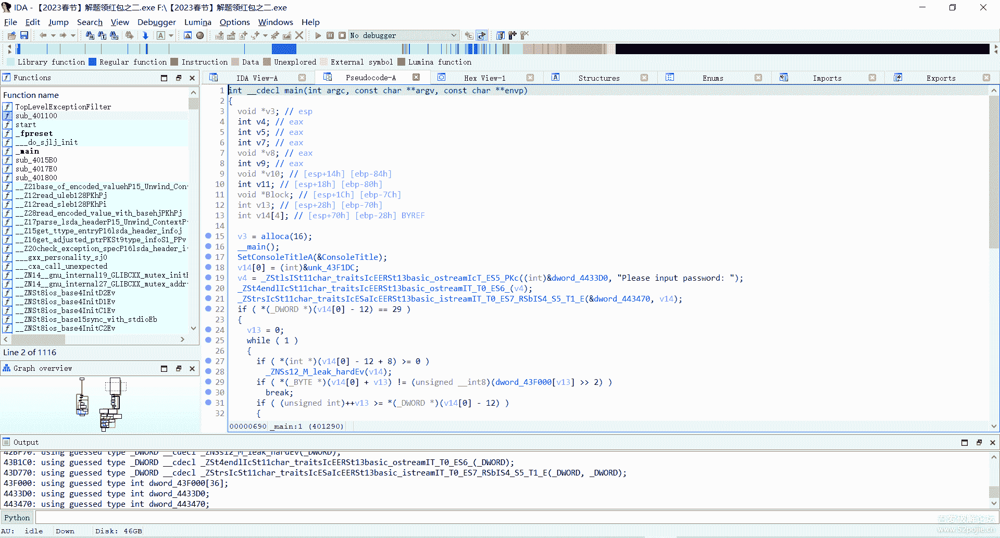

初级题IDA.png (170.99 KB, 下载次数: 2)

[href="forum.php?mod=attachment&aid=MjU4ODM4M3xiMjkwODg3MnwxNzkzNTc0MDY5fDE2ODA4NnwxNzQyMzMy&nothumb=yes" target="_blank"](https://www.52pojie.cn/forum.php?mod=attachment&aid=MjU4ODM4M3xiMjkwODg3MnwxNzkzNTc0MDY5fDE2ODA4NnwxNzQyMzMy&nothumb=yes)

2023-2-6 00:28 上传

整体的逻辑也很简单，先检查输入的字符串长度是不是29，符合的话就进入循环与预定的flag比较，如果正确打印`Success`，错误打印`Wrong`。

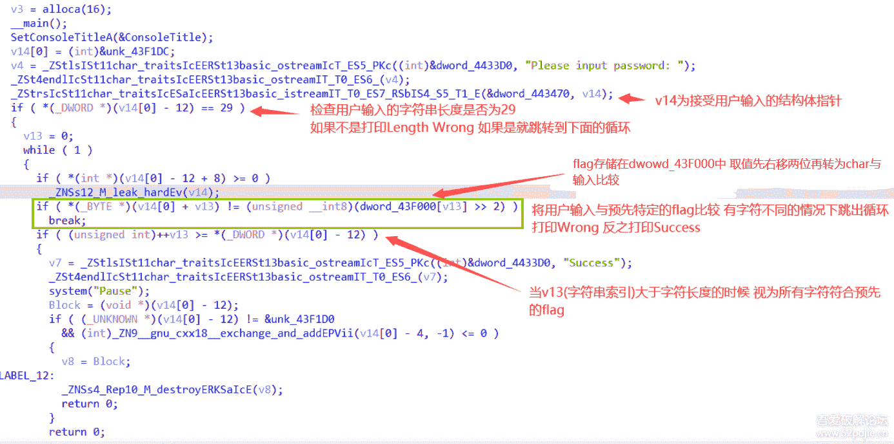

初级题分析.png (278.28 KB, 下载次数: 0)

[href="forum.php?mod=attachment&aid=MjU4ODM4NHxmZDc5MjhmZnwxNzkzNTc0MDY5fDE2ODA4NnwxNzQyMzMy&nothumb=yes" target="_blank"](https://www.52pojie.cn/forum.php?mod=attachment&aid=MjU4ODM4NHxmZDc5MjhmZnwxNzkzNTc0MDY5fDE2ODA4NnwxNzQyMzMy&nothumb=yes)

2023-2-6 00:28 上传

把伪C代码放进 `ChatGPT` 分析，也得到了相同的结论

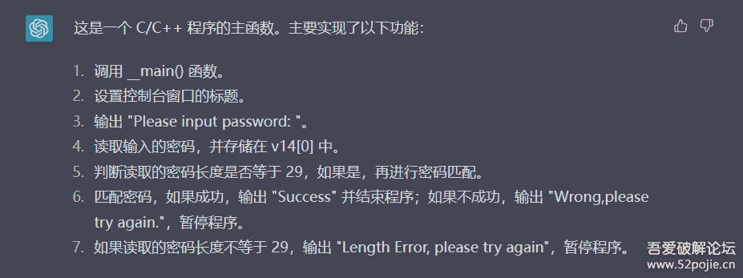

ChatGPT初级题分析.png (46.01 KB, 下载次数: 2)

[href="forum.php?mod=attachment&aid=MjU4ODM4NXwxMzM4ZjlhMnwxNzkzNTc0MDY5fDE2ODA4NnwxNzQyMzMy&nothumb=yes" target="_blank"](https://www.52pojie.cn/forum.php?mod=attachment&aid=MjU4ODM4NXwxMzM4ZjlhMnwxNzkzNTc0MDY5fDE2ODA4NnwxNzQyMzMy&nothumb=yes)

2023-2-6 00:29 上传

双击`dword_43F000`跳转到 `IDA View`，先调整一下数组大小，再导出数组

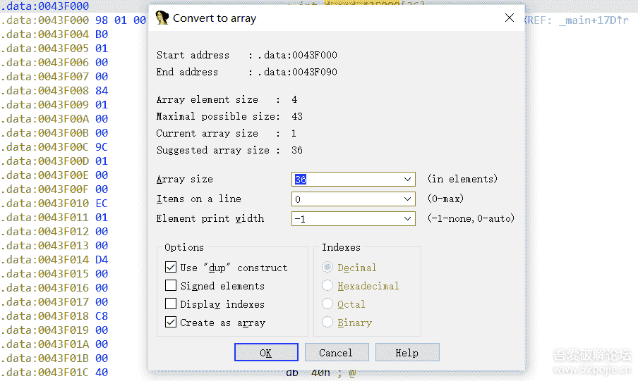

初级题调整数组大小.png (60.07 KB, 下载次数: 2)

[href="forum.php?mod=attachment&aid=MjU4ODM4NnwxZTFjNTM2NHwxNzkzNTc0MDY5fDE2ODA4NnwxNzQyMzMy&nothumb=yes" target="_blank"](https://www.52pojie.cn/forum.php?mod=attachment&aid=MjU4ODM4NnwxZTFjNTM2NHwxNzkzNTc0MDY5fDE2ODA4NnwxNzQyMzMy&nothumb=yes)

2023-2-6 00:29 上传

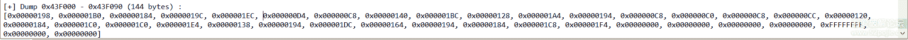

初级题导出数组.png (15.96 KB, 下载次数: 1)

[href="forum.php?mod=attachment&aid=MjU4ODM4N3w0MjEyOGNiOHwxNzkzNTc0MDY5fDE2ODA4NnwxNzQyMzMy&nothumb=yes" target="_blank"](https://www.52pojie.cn/forum.php?mod=attachment&aid=MjU4ODM4N3w0MjEyOGNiOHwxNzkzNTc0MDY5fDE2ODA4NnwxNzQyMzMy&nothumb=yes)

2023-2-6 00:29 上传

导出数组后用`Python`打印预定的flag，得到flag为 `flag{52PoJie2023HappyNewYear}`

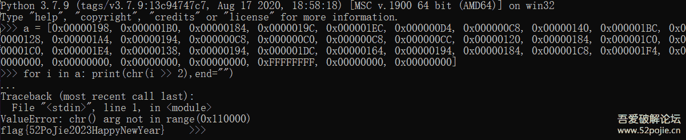

初级题Python.png (39.33 KB, 下载次数: 2)

[href="forum.php?mod=attachment&aid=MjU4ODM4OHxhODdiYTg4ZXwxNzkzNTc0MDY5fDE2ODA4NnwxNzQyMzMy&nothumb=yes" target="_blank"](https://www.52pojie.cn/forum.php?mod=attachment&aid=MjU4ODM4OHxhODdiYTg4ZXwxNzkzNTc0MDY5fDE2ODA4NnwxNzQyMzMy&nothumb=yes)

2023-2-6 00:29 上传

## 2. Windows 中级题

### 2.1 脱壳

首先运行一下程序，发现程序需要输入`UID`和`Key`，并且用了`GUI`

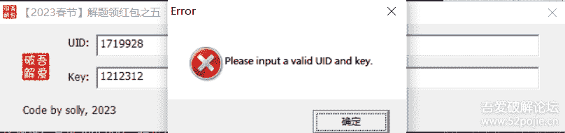

中级运行1.png (43.17 KB, 下载次数: 2)

[href="forum.php?mod=attachment&aid=MjU4ODM4OXw2YTRiYjhmNHwxNzkzNTc0MDY5fDE2ODA4NnwxNzQyMzMy&nothumb=yes" target="_blank"](https://www.52pojie.cn/forum.php?mod=attachment&aid=MjU4ODM4OXw2YTRiYjhmNHwxNzkzNTc0MDY5fDE2ODA4NnwxNzQyMzMy&nothumb=yes)

2023-2-6 00:30 上传

将程序拉进 `ExeinfoPe` 查壳，`UPX`的壳

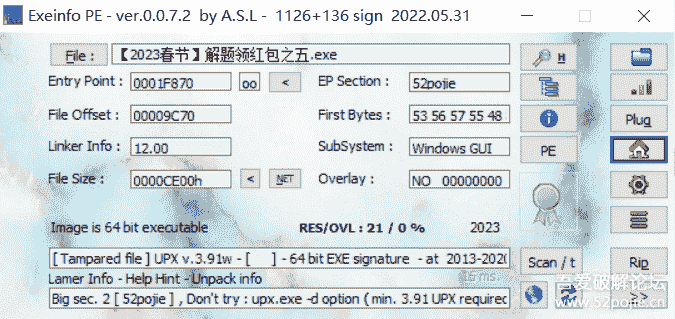

中级题查壳.png (185.53 KB, 下载次数: 2)

[href="forum.php?mod=attachment&aid=MjU4ODM5MHw2MGFhNGQzYXwxNzkzNTc0MDY5fDE2ODA4NnwxNzQyMzMy&nothumb=yes" target="_blank"](https://www.52pojie.cn/forum.php?mod=attachment&aid=MjU4ODM5MHw2MGFhNGQzYXwxNzkzNTc0MDY5fDE2ODA4NnwxNzQyMzMy&nothumb=yes)

2023-2-6 00:30 上传

用`upx -d`脱壳报错，怀疑对解压缩的结构体动了手脚，直接拉进`x64dbg`用`rsp`定律脱壳

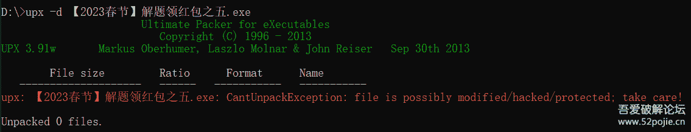

中级题UPX尝试脱壳.png (33.95 KB, 下载次数: 2)

[href="forum.php?mod=attachment&aid=MjU4ODM5MXw1Y2RhNjY3MnwxNzkzNTc0MDY5fDE2ODA4NnwxNzQyMzMy&nothumb=yes" target="_blank"](https://www.52pojie.cn/forum.php?mod=attachment&aid=MjU4ODM5MXw1Y2RhNjY3MnwxNzkzNTc0MDY5fDE2ODA4NnwxNzQyMzMy&nothumb=yes)

2023-2-6 00:31 上传

拖进`x64dbg`发现有反调试，直接`SharpOD`一套带走，成功加载

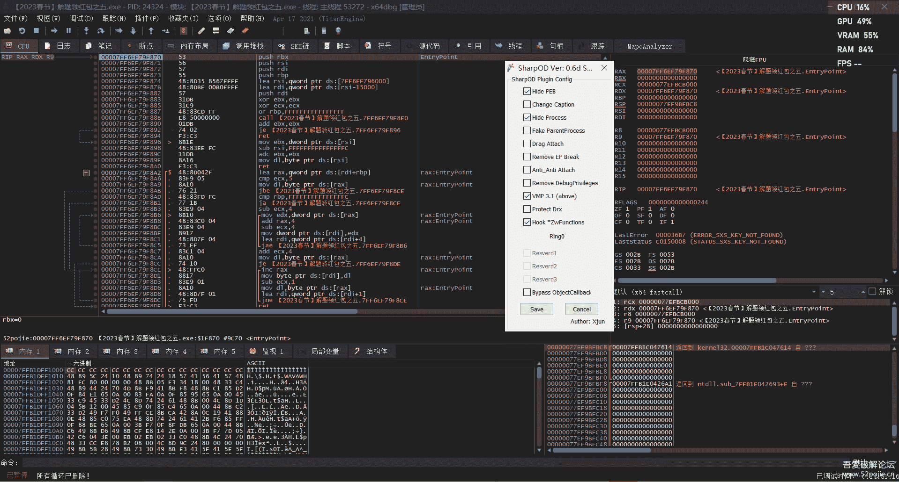

中级X64dbg反反调试.png (324.9 KB, 下载次数: 1)

[href="forum.php?mod=attachment&aid=MjU4ODM5Mnw2Mjc5NWViY3wxNzkzNTc0MDY5fDE2ODA4NnwxNzQyMzMy&nothumb=yes" target="_blank"](https://www.52pojie.cn/forum.php?mod=attachment&aid=MjU4ODM5Mnw2Mjc5NWViY3wxNzkzNTc0MDY5fDE2ODA4NnwxNzQyMzMy&nothumb=yes)

2023-2-6 00:31 上传

用`RSP`定律脱壳，到了`OEP`直接拿`Scylla Dump`，运气不错可以自动修`IAT`

同时发现导入表中有 `GetDlgItemTextW`，大概率用来获取用户输入

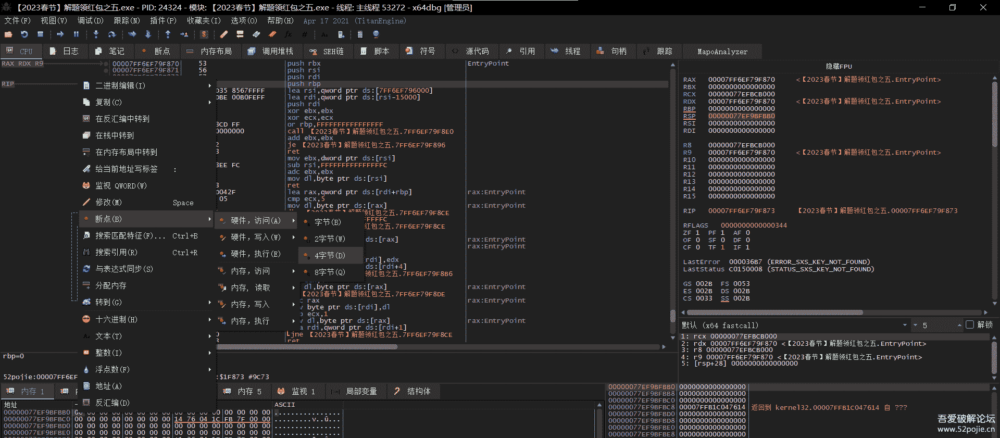

中级X64DBG_RSP.png (192.5 KB, 下载次数: 2)

[href="forum.php?mod=attachment&aid=MjU4ODM5M3w3NGQwYmIwZnwxNzkzNTc0MDY5fDE2ODA4NnwxNzQyMzMy&nothumb=yes" target="_blank"](https://www.52pojie.cn/forum.php?mod=attachment&aid=MjU4ODM5M3w3NGQwYmIwZnwxNzkzNTc0MDY5fDE2ODA4NnwxNzQyMzMy&nothumb=yes)

2023-2-6 00:31 上传

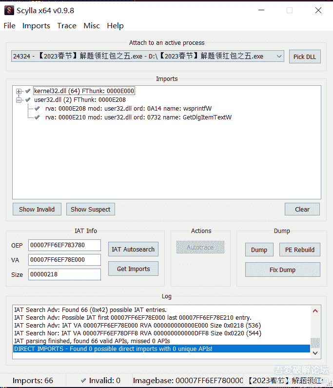

中级Scylla.png (53.81 KB, 下载次数: 1)

[href="forum.php?mod=attachment&aid=MjU4ODM5NHwwMzlhZjU5ZXwxNzkzNTc0MDY5fDE2ODA4NnwxNzQyMzMy&nothumb=yes" target="_blank"](https://www.52pojie.cn/forum.php?mod=attachment&aid=MjU4ODM5NHwwMzlhZjU5ZXwxNzkzNTc0MDY5fDE2ODA4NnwxNzQyMzMy&nothumb=yes)

2023-2-6 00:31 上传

### 2.2 初步静态分析

将修好`IAT`的脱壳后程序扔进 `IDA` 里面分析，寻找 `GetDlgItemTextW` 的交叉引用，发现有两个函数引用

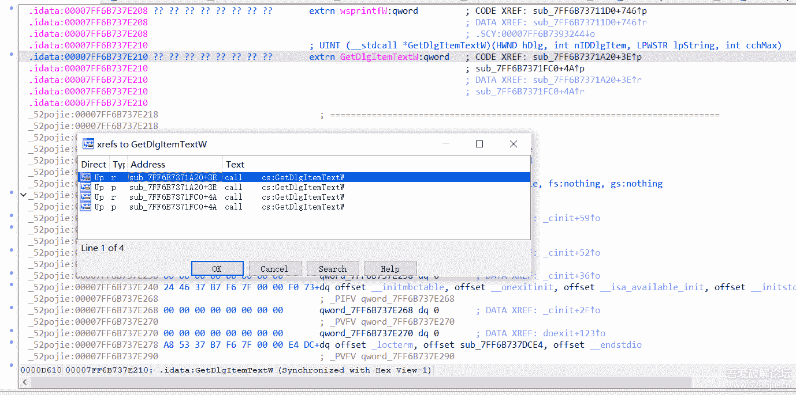

IDA_1.png (109.87 KB, 下载次数: 1)

[href="forum.php?mod=attachment&aid=MjU4ODM5N3w4NjAyYTlmZnwxNzkzNTc0MDY5fDE2ODA4NnwxNzQyMzMy&nothumb=yes" target="_blank"](https://www.52pojie.cn/forum.php?mod=attachment&aid=MjU4ODM5N3w4NjAyYTlmZnwxNzkzNTc0MDY5fDE2ODA4NnwxNzQyMzMy&nothumb=yes)

2023-2-6 00:32 上传

进入`sub_7FF6B7371A20` 发现这是一个获取用户输入的函数 至于输入的是`UID`还是`Key`暂时还不知道 继续查看交叉引用找到主要逻辑函数`sub_7FF6B73711D0`

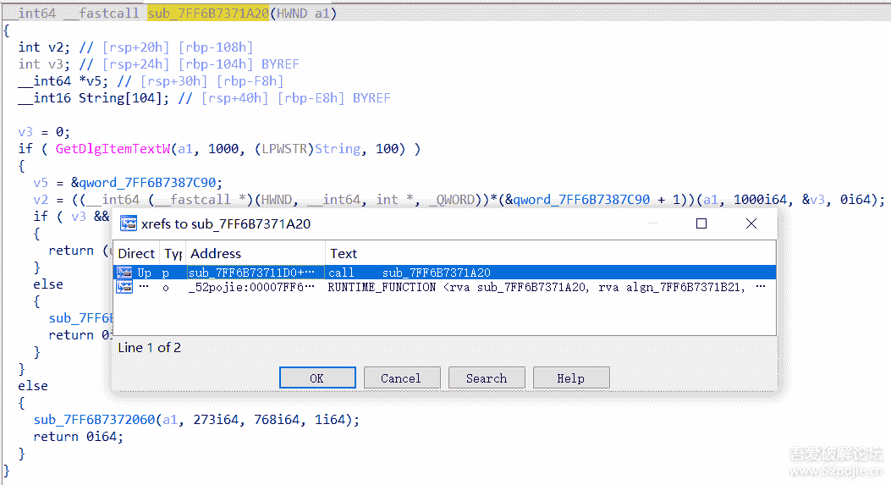

IDA_2.png (56.04 KB, 下载次数: 1)

[href="forum.php?mod=attachment&aid=MjU4ODM5NXw2ZDg3MThlOHwxNzkzNTc0MDY5fDE2ODA4NnwxNzQyMzMy&nothumb=yes" target="_blank"](https://www.52pojie.cn/forum.php?mod=attachment&aid=MjU4ODM5NXw2ZDg3MThlOHwxNzkzNTc0MDY5fDE2ODA4NnwxNzQyMzMy&nothumb=yes)

2023-2-6 00:32 上传

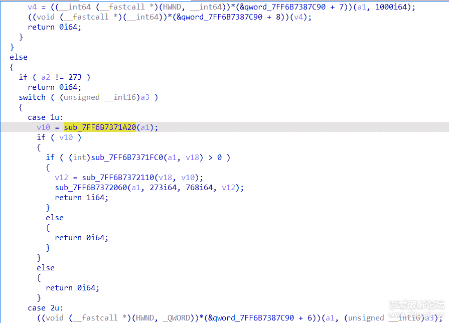

IDA_3.png (46.12 KB, 下载次数: 2)

[href="forum.php?mod=attachment&aid=MjU4ODM5NnxiZjJiMGZiM3wxNzkzNTc0MDY5fDE2ODA4NnwxNzQyMzMy&nothumb=yes" target="_blank"](https://www.52pojie.cn/forum.php?mod=attachment&aid=MjU4ODM5NnxiZjJiMGZiM3wxNzkzNTc0MDY5fDE2ODA4NnwxNzQyMzMy&nothumb=yes)

2023-2-6 00:32 上传

同时在`sub_7FF6B7371A20`中看到了 `qword_7FF6B7387C90 + 偏移` 的函数调用方式，怀疑是自己实现的导入表，点进去一看，确实是－O－

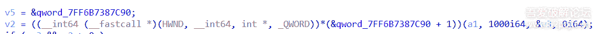

qword_7FF6B7387C90_1.png (15.23 KB, 下载次数: 2)

[href="forum.php?mod=attachment&aid=MjU4ODM5OHw5M2FlMTAwOXwxNzkzNTc0MDY5fDE2ODA4NnwxNzQyMzMy&nothumb=yes" target="_blank"](https://www.52pojie.cn/forum.php?mod=attachment&aid=MjU4ODM5OHw5M2FlMTAwOXwxNzkzNTc0MDY5fDE2ODA4NnwxNzQyMzMy&nothumb=yes)

2023-2-6 00:32 上传

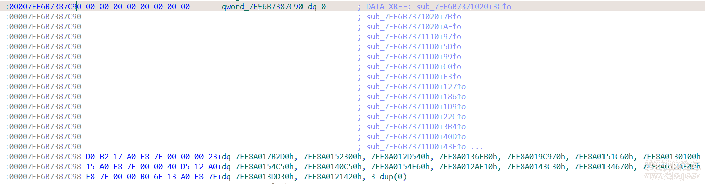

qword_7FF6B7387C90_2.png (63.96 KB, 下载次数: 2)

[href="forum.php?mod=attachment&aid=MjU4ODM5OXw1MjU2NTM3YXwxNzkzNTc0MDY5fDE2ODA4NnwxNzQyMzMy&nothumb=yes" target="_blank"](https://www.52pojie.cn/forum.php?mod=attachment&aid=MjU4ODM5OXw1MjU2NTM3YXwxNzkzNTc0MDY5fDE2ODA4NnwxNzQyMzMy&nothumb=yes)

2023-2-6 00:32 上传

修改 `qword_7FF6B7387C90` 数组长度为20 (因为`qword_7FF6B7387C90`的第0位和第17-19位为零)，导出地址之后一个个输入到`x64dbg`里面获取具体的`API`，最后处理结果为


```
qword_7FF6B7387C90[1] : user32.GetDlgItemInt
qword_7FF6B7387C90[2] : user32.GetDlgItemTextW
qword_7FF6B7387C90[3] : user32.SendMessageW
qword_7FF6B7387C90[4] : user32.LoadIconW
qword_7FF6B7387C90[5] : user32.MessageBoxW
qword_7FF6B7387C90[6] : user32.EndDialog
qword_7FF6B7387C90[7] : user32.GetDlgItem
qword_7FF6B7387C90[8] : user32.SetFocus
qword_7FF6B7387C90[9] : user32.GetDlgCtrlID
qword_7FF6B7387C90[10] : user32.SetWindowPos
qword_7FF6B7387C90[11] : user32.OffsetRect
qword_7FF6B7387C90[12] : user32.CopyRect
qword_7FF6B7387C90[13] : user32.GetWindowRect
qword_7FF6B7387C90[14] : user32.GetDesktopWindow
qword_7FF6B7387C90[15] : user32.GetParent
qword_7FF6B7387C90[16] : user32.SendDlgItemMessageW
```

由于`sub_7FF6B7371A20`中调用的是 `user32.GetDlgItemInt` (`qword_7FF6B7387C90[1]`)，于是可以确定`sub_7FF6B7371A20`为获取`UID`的函数 `v10`为返回的`UID`

同理可得`sub_7FF6B7371FC0`为获取`Key`的函数 `v18`为返回的`Key`字符串

之后将`UID`和`Key`作为参数调用`sub_7FF6B7372110` 返回值存储在`v12`中

## 2.3 `sub_7FF6B7372110`算法分析

直接进入`sub_7FF6B7372110`，一眼发现有一个循环没有结束条件，直接看汇编，还原代码

补充：看其他师傅的文章发现这个循环貌似是没问题的，算我这里分析出了问题`(>﹏)′`

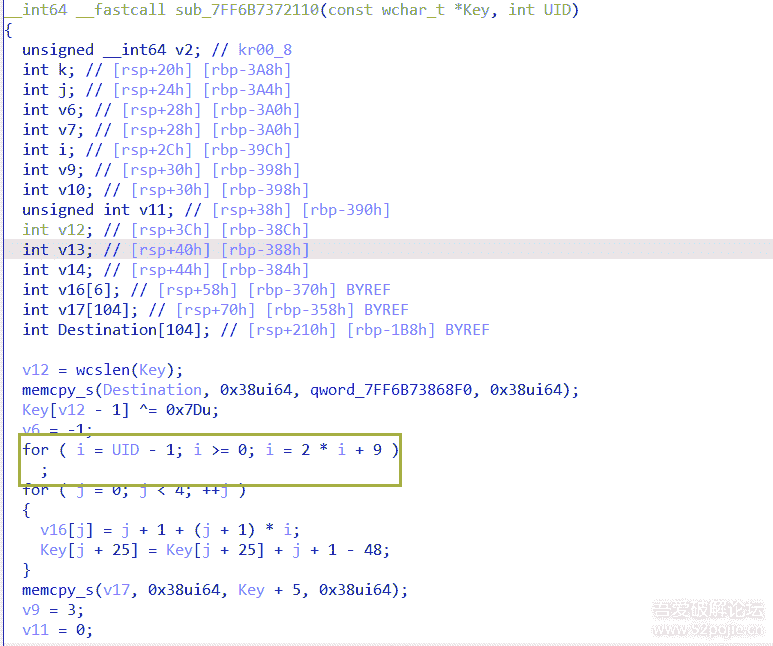

sub_7FF6B7372110_1.png (56 KB, 下载次数: 1)

[href="forum.php?mod=attachment&aid=MjU4ODQwM3wzN2JkYTQ0OXwxNzkzNTc0MDY5fDE2ODA4NnwxNzQyMzMy&nothumb=yes" target="_blank"](https://www.52pojie.cn/forum.php?mod=attachment&aid=MjU4ODQwM3wzN2JkYTQ0OXwxNzkzNTc0MDY5fDE2ODA4NnwxNzQyMzMy&nothumb=yes)

2023-2-6 00:33 上传

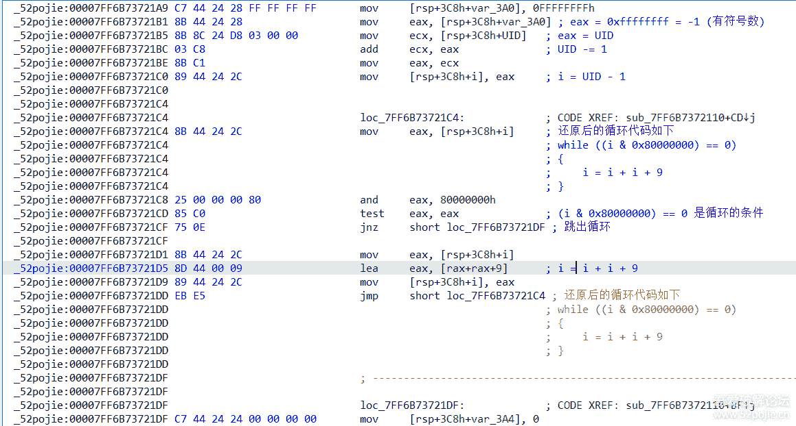

sub_7FF6B7372110_2.png (95.37 KB, 下载次数: 2)

[href="forum.php?mod=attachment&aid=MjU4ODQwMHxhNmM5NWFiN3wxNzkzNTc0MDY5fDE2ODA4NnwxNzQyMzMy&nothumb=yes" target="_blank"](https://www.52pojie.cn/forum.php?mod=attachment&aid=MjU4ODQwMHxhNmM5NWFiN3wxNzkzNTc0MDY5fDE2ODA4NnwxNzQyMzMy&nothumb=yes)

2023-2-6 00:33 上传

分析代码后，发现主要是将输入的`Key`作为一个`int`数组，循环这个数组，将每个元素的前后16位调换+异或特定魔数后，输入`sub_7FF6B7371D70`进行处理

并将处理后的值于一个同样经过`sub_7FF6B7371D70`处理过的数组`qword_7FF6B73868F0`比较，如果数组中的所有值相等，返回0，反之返回`v11`

ChatGPT的解释也验证了我们的分析 (见下图)

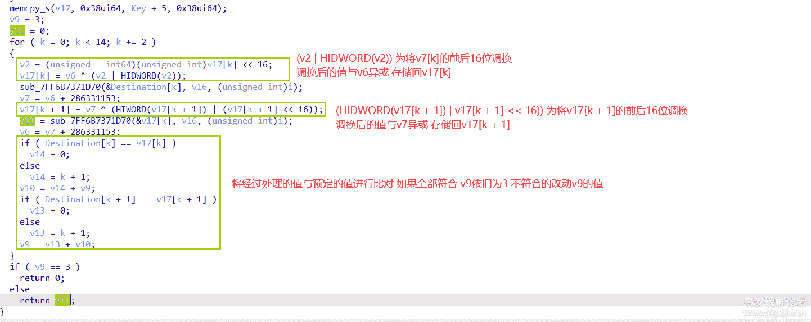

sub_7FF6B7372110_3.png (65.57 KB, 下载次数: 2)

[href="forum.php?mod=attachment&aid=MjU4ODQwMXxmYzRkMDJmNHwxNzkzNTc0MDY5fDE2ODA4NnwxNzQyMzMy&nothumb=yes" target="_blank"](https://www.52pojie.cn/forum.php?mod=attachment&aid=MjU4ODQwMXxmYzRkMDJmNHwxNzkzNTc0MDY5fDE2ODA4NnwxNzQyMzMy&nothumb=yes)

2023-2-6 00:33 上传

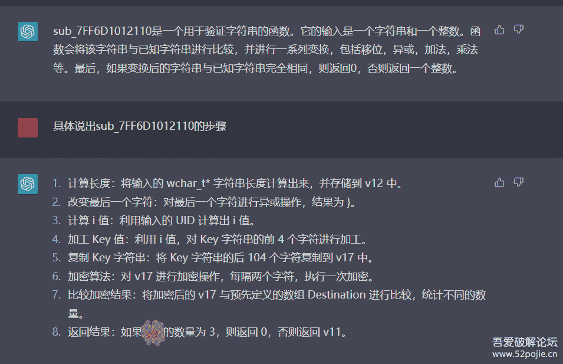

sub_7FF6B7372110_ChatGPT.png (75.19 KB, 下载次数: 2)

[href="forum.php?mod=attachment&aid=MjU4ODQwMnxkOWVmZGE3MnwxNzkzNTc0MDY5fDE2ODA4NnwxNzQyMzMy&nothumb=yes" target="_blank"](https://www.52pojie.cn/forum.php?mod=attachment&aid=MjU4ODQwMnxkOWVmZGE3MnwxNzkzNTc0MDY5fDE2ODA4NnwxNzQyMzMy&nothumb=yes)

2023-2-6 00:33 上传

这就是说，只要我们输入的值处理后与`qword_7FF6B73868F0`的值相等，就可以让`sub_7FF6B7372110`返回0，用Python写出逆运算算法之后算出Key数组如下

```
wchar_t Key_1[] = {102, 108, 97, 103, 123, 61135, 61135, 13074, 13075, 4441, 4429, 30503, 30519, 4424, 4422, 13181, 13165, 4422, 4439, 65446, 65441, 4432, 4443, 13164, 13152, 4432, 4430, 30577, 30576, 4400, 4407, 13074, 13075, 0};
```

结果，将`Key1`输入时依旧报错，看来这并不是判断`Key`是否正确的函数 / \

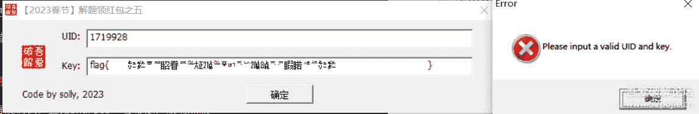

Key_1.png (51.83 KB, 下载次数: 2)

[href="forum.php?mod=attachment&aid=MjU4ODQwNHwxNDNmMTJiZHwxNzkzNTc0MDY5fDE2ODA4NnwxNzQyMzMy&nothumb=yes" target="_blank"](https://www.52pojie.cn/forum.php?mod=attachment&aid=MjU4ODQwNHwxNDNmMTJiZHwxNzkzNTc0MDY5fDE2ODA4NnwxNzQyMzMy&nothumb=yes)

2023-2-6 00:34 上传

## 2.4 动态调试 + 更多的静态分析

在 `switch ((unsigned __int16)a3)` 处下断点，对应汇编 `cmp eax, 1` 处，输入`Key`，点击确定，发现这一处被触发了3次，同时`eax`第一次为1，剩下两次为0x300，说明对`Key`做校验的函数在0x300的分支中


动态调试_1.png (3.99 KB, 下载次数: 1)

[href="forum.php?mod=attachment&aid=MjU4ODQwNnw5YWVkYTkwY3wxNzkzNTc0MDY5fDE2ODA4NnwxNzQyMzMy&nothumb=yes" target="_blank"](https://www.52pojie.cn/forum.php?mod=attachment&aid=MjU4ODQwNnw5YWVkYTkwY3wxNzkzNTc0MDY5fDE2ODA4NnwxNzQyMzMy&nothumb=yes)

2023-2-6 00:34 上传

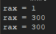

动态调试_2.png (924 Bytes, 下载次数: 1)

[href="forum.php?mod=attachment&aid=MjU4ODQwNXw3ZTMzMzM5OHwxNzkzNTc0MDY5fDE2ODA4NnwxNzQyMzMy&nothumb=yes" target="_blank"](https://www.52pojie.cn/forum.php?mod=attachment&aid=MjU4ODQwNXw3ZTMzMzM5OHwxNzkzNTc0MDY5fDE2ODA4NnwxNzQyMzMy&nothumb=yes)

2023-2-6 00:34 上传

回到 `IDA` ，0x300的分支先通过比较字符串得到`v6`的值，再根据`v6`走不同的分支，具体解释可以看ChatGPT给出的解释

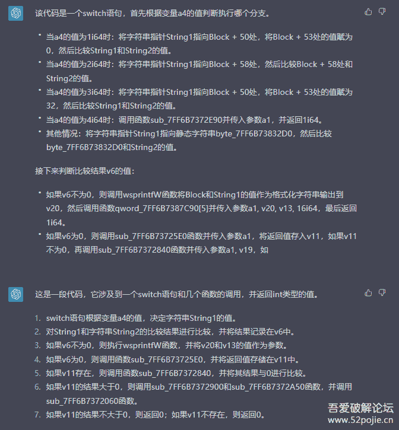

ChatGPT_2.png (103.24 KB, 下载次数: 1)

[href="forum.php?mod=attachment&aid=MjU4ODQwN3w1NzEzMTdhY3wxNzkzNTc0MDY5fDE2ODA4NnwxNzQyMzMy&nothumb=yes" target="_blank"](https://www.52pojie.cn/forum.php?mod=attachment&aid=MjU4ODQwN3w1NzEzMTdhY3wxNzkzNTc0MDY5fDE2ODA4NnwxNzQyMzMy&nothumb=yes)

2023-2-6 00:34 上传

同时根据调试器的结果，可以判断第一次走的是 `v6 == 0` 的分支，第二次走的是 `v6 != 0` 的分支，而 `v6 != 0` 的分支调用了 `user32.MessageBoxW` (`qword_7FF6B7387C90[5]`)，可以确定第二次走0x300分支为输出结果，那么第一次走0x300分支就是对`Key`进行校验了

根据调试器中`a4`输出的结果，发现第一次的`a4`为 `sub_7FF6B7372110` 的返回值，第二次的`a4`是一个`flag`，用于指定`MessageBoxW`输出的值

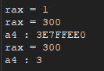

动态调试_3.png (1.86 KB, 下载次数: 3)

[href="forum.php?mod=attachment&aid=MjU4ODQwOHxjYjI1YTI2NnwxNzkzNTc0MDY5fDE2ODA4NnwxNzQyMzMy&nothumb=yes" target="_blank"](https://www.52pojie.cn/forum.php?mod=attachment&aid=MjU4ODQwOHxjYjI1YTI2NnwxNzkzNTc0MDY5fDE2ODA4NnwxNzQyMzMy&nothumb=yes)

2023-2-6 00:34 上传

进入 `v6 == 0` 分支，可以分析出 `sub_7FF6B73725E0` 和 `sub_7FF6B7372840` 分别为 `GetUID` 和 `GetKey` (具体分析懒得写了，基本上有两种方法判断，一是从控件的资源`ID`判断，`UID`为1000，`Key`的为1001；二是从返回值和具体的前后文判断)，初步分析的代码如下

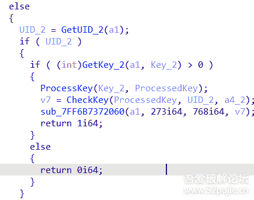

IDA_4.png (21.12 KB, 下载次数: 1)

[href="forum.php?mod=attachment&aid=MjU4ODQwOXw5ZGJjNmM1N3wxNzkzNTc0MDY5fDE2ODA4NnwxNzQyMzMy&nothumb=yes" target="_blank"](https://www.52pojie.cn/forum.php?mod=attachment&aid=MjU4ODQwOXw5ZGJjNmM1N3wxNzkzNTc0MDY5fDE2ODA4NnwxNzQyMzMy&nothumb=yes)

2023-2-6 00:35 上传

### CheckKey分析

`CheckKey`的整体逻辑也很简单: 将经过`sub_7FF6B73726E0`处理过的`ProcessedKey`数组与`v16`数组比较，如果全部正确，返回值为4，反正返回值为3，计算魔数那里在还原的时候直接照抄即可

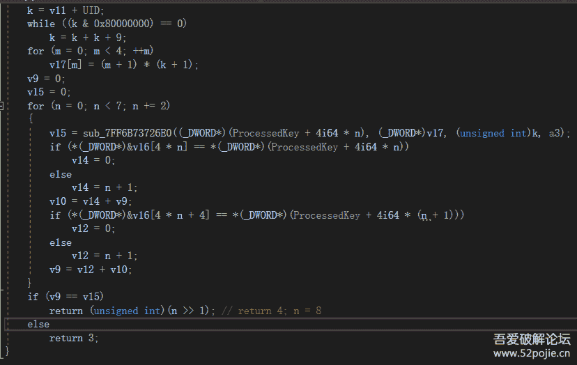

CheckKey_1.png (60.13 KB, 下载次数: 3)

[href="forum.php?mod=attachment&aid=MjU4ODQxMHw0ZWQzNzBhNnwxNzkzNTc0MDY5fDE2ODA4NnwxNzQyMzMy&nothumb=yes" target="_blank"](https://www.52pojie.cn/forum.php?mod=attachment&aid=MjU4ODQxMHw0ZWQzNzBhNnwxNzkzNTc0MDY5fDE2ODA4NnwxNzQyMzMy&nothumb=yes)

2023-2-6 00:35 上传

而`v16`数组的值为 `char v16[] = "flag{!!!_HAPPY_NEW_YEAR_2023!!!}"`，将其转换为`unsigned int`数组结果为 `{0x67616c66, 0x2121217b, 0x5041485f, 0x4e5f5950, 0x595f5745, 0x5f524145, 0x33323032, 0x7d212121}`，也就是说，当我们输入的`Key`经过`sub_7FF6B73726E0`的运算处理后与`v16`相等时，这个`Key`就是正确的，所以我们将`v16`经过`sub_7FF6B73726E0`的逆运算后，即可解出这道题的`Key`

补充：后面看其他师傅的解释才知道`sub_7FF6B73726E0`是一个`tea`的解密函数，还是经验不足呀 (⊙ˍ⊙)

逆运算的C++代码如下


# 逆向分析

```
void reverse_sub_7ff6b73726e0(unsigned int* arg1, _DWORD* a2, int a3, unsigned int a4)
{
        unsigned int v5 = arg1[0];
        unsigned int v6 = arg1[1];

        for (int i = 0; i > 5)) ^ (a4 + v6) ^ (*a2 + 16 * v6);
                v6 += (a2[3] + (v5 >> 5)) ^ (a4 + v5) ^ (a2[2] + 16 * v5);
        }
        arg1[0] = v5;
        arg1[1] = v6;
}
```

## `a4` 初始值的确定

其中这里还有一个问题，就是 `reverse_sub_7ff6b73726e0` 中 `a4` 的初始值如何确定，将 `sub_7FF6B73726E0` 算法还原之后进行动态调试，得到下面的表格，可以很明显的看出 `sub_7FF6B73726E0` 最后会将 `a4` 递减至0，所以 `reverse_sub_7ff6b73726e0` 中 `a4` 的初始值为0。

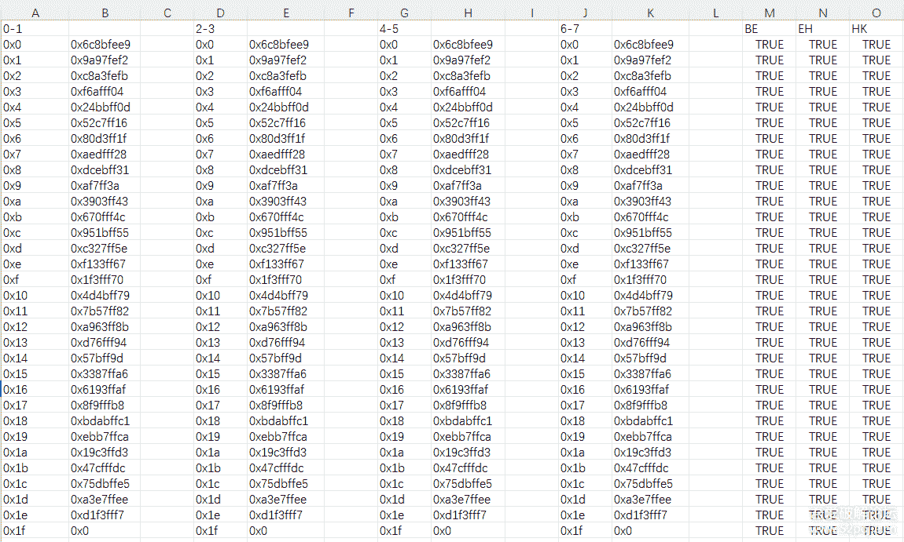

`表格.png` (65.59 KB, 下载次数: 1)

[附件下载](https://www.52pojie.cn/forum.php?mod=attachment&aid=MjU4ODQxMXw3OWVlNTU1ZXwxNzkzNTc0MDY5fDE2ODA4NnwxNzQyMzMy&nothumb=yes)

2023-2-6 00:35 上传

## `a2` 和 `a3` 的值

至于 `a2` 和 `a3` 的值可直接从 `CheckKey` 里的魔数生成部分中抄下来。

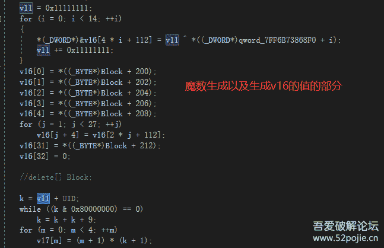

`CheckKey_2.png` (53.87 KB, 下载次数: 2)

[附件下载](https://www.52pojie.cn/forum.php?mod=attachment&aid=MjU4ODQxMnwyZDMyNThhMXwxNzkzNTc0MDY5fDE2ODA4NnwxNzQyMzMy&nothumb=yes)

2023-2-6 00:35 上传

## `ProcessedKey` 的还原

最后还原出 `ProcessedKey` 数组的值应为 `{0x805b431,0xc46f31a2,0x67d178e8,0xb1d33200,0x17d8e19b,0xc1266b7d,0xc5bbd440,0xfb25dbda}`。

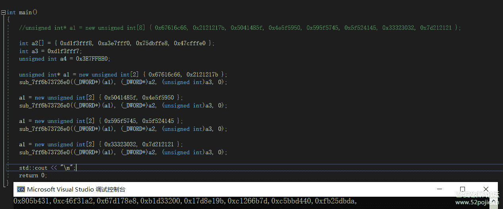

`还原ProccessedKey.png` (93.64 KB, 下载次数: 1)

[附件下载](https://www.52pojie.cn/forum.php?mod=attachment&aid=MjU4ODQxM3xiZjgxYzcyZnwxNzkzNTc0MDY5fDE2ODA4NnwxNzQyMzMy&nothumb=yes)

2023-2-6 00:36 上传

## 4> 2.5 得到最终的 `Key`

由于 `ProcessedKey` 的值由 `ProcessKey` 函数得来，我们需要对 `ProcessKey` 进行分析，进而得到真正的用户应该输入的 `Key`。

根据 ChatGPT 的解释，`ProcessKey` 是用来将字符串转换成整数的，同时提醒了我们 `Key` 的长度应该是8的倍数。

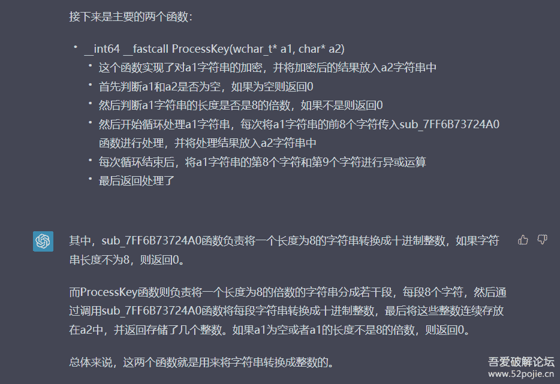

`ChatGPT_3.png` (85.13 KB, 下载次数: 2)

[附件下载](https://www.52pojie.cn/forum.php?mod=attachment&aid=MjU4ODQxNHxhNjY1YjQ2MnwxNzkzNTc0MDY5fDE2ODA4NnwxNzQyMzMy&nothumb=yes)

2023-2-6 00:36 上传

然后让 ChatGPT 写出 `ProcessKey` 的逆函数，但是调试之后怪怪的......

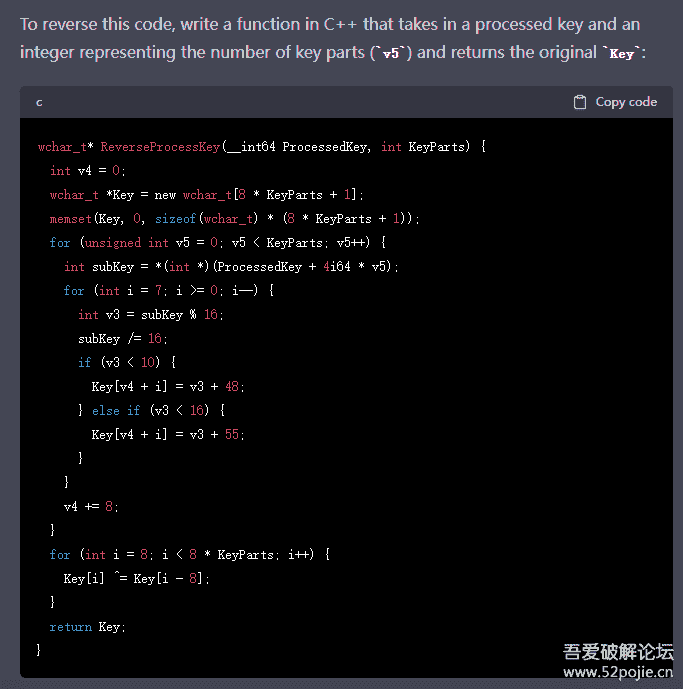

`ChatGPT_4.png` (26.85 KB, 下载次数: 3)

[附件下载](https://www.52pojie.cn/forum.php?mod=attachment&aid=MjU4ODQxNXw0YmE5N2YwYnwxNzkzNTc0MDY5fDE2ODA4NnwxNzQyMzMy&nothumb=yes)

2023-2-6 00:36 上传

随后查看 `a1` 的值，发现 `ProcessedKey` 的前8个字符已经被还原，并且全部字符为大写，再根据上面对 `ProcessKey` 的解释，猜测出用户输入应该是 `ProcessedKey` 数组的16进制。

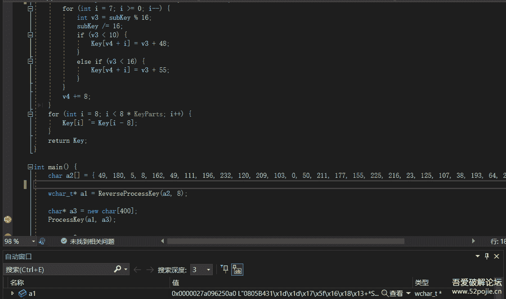

`调试_1.png` (74.12 KB, 下载次数: 1)

[附件下载](https://www.52pojie.cn/forum.php?mod=attachment&aid=MjU4ODQxNnxiMjMwMjNlZHwxNzkzNTc0MDY5fDE2ODA4NnwxNzQyMzMy&nothumb=yes)

2023-2-6 00:36 上传

## 调试与测试

撸几行代码测试一下，最终得到正确的 `Key`，成功拿下ヾ(^▽^*)))

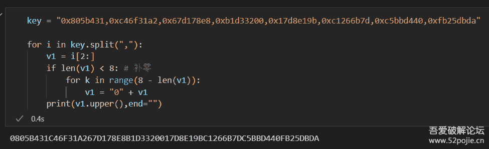

`Python.png` (31.62 KB, 下载次数: 2)

[附件下载](https://www.52pojie.cn/forum.php?mod=attachment&aid=MjU4ODQxN3w3OTQ1YjcyNnwxNzkzNTc0MDY5fDE2ODA4NnwxNzQyMzMy&nothumb=yes)

2023-2-6 00:37 上传

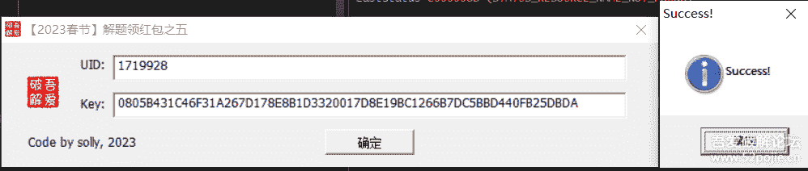

`Final.png` (56.26 KB, 下载次数: 2)

[附件下载](https://www.52pojie.cn/forum.php?mod=attachment&aid=MjU4ODQxOHxiOGM3ZWRjY3wxNzkzNTc0MDY5fDE2ODA4NnwxNzQyMzMy&nothumb=yes)

2023-2-6 00:37 上传

## 注册机代码

文章末尾附上注册机代码如下：

```
#include 

// 由ChatGPT生成

wchar_t* reverse_sub_7FF6B73724A0(unsigned int input) {

        wchar_t* result = new wchar_t[9];

        result[8] = 0;

        for (int i = 7; i >= 0; i--) {

                result[i] = input % 16;

                if (result[i] > 5)) ^ (a4 + v6) ^ (*a2 + 16 * v6);

                v6 += (a2[3] + (v5 >> 5)) ^ (a4 + v5) ^ (a2[2] + 16 * v5);

        }

        arg1[0] = v5;

        arg1[1] = v6;

}

int main()

{

        int v11 = 0x11111111;

        for (int i = 0; i > UID;

        std::cout 
```

## 3> 3. 总结

这篇文章其实还有一些东西没写，像 0x37异或字符串算法，`Block` 数组的还原都没有详细去讲，因为这两个一个是没多大用处，一个可以直接抄 IDA 生成的伪C代码，所以也就不浪费空间写这两个了。

这次的 Windows 中级题相对来说难度还行，主要是不熟悉 Windows 原生的 Gui 函数拖延了很多时间，在调试和理解代码这方面也花了很多时间，不过确实也学到了很多东西 (^^ゞ
