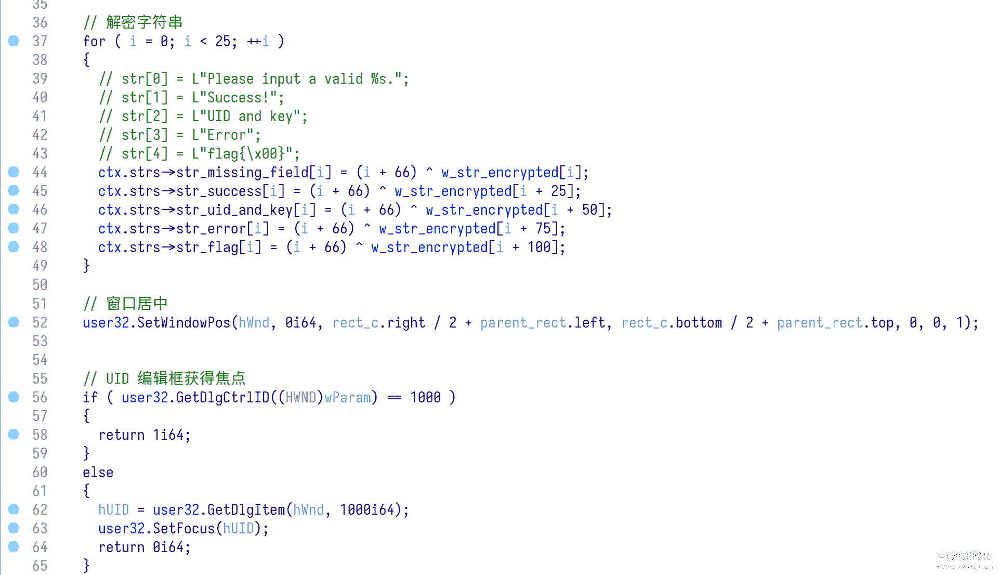

# [CTF] 吾爱破解 - 2023 春节解题领红包 2-6 + 部分 web 题

- 原帖：[https://www.52pojie.cn/forum.php?mod=viewthread&tid=1742339](https://www.52pojie.cn/forum.php?mod=viewthread&tid=1742339)
- 抓取时间：2026-11-01T23:01:05

## 吾爱破解 - 2023 春节解题领红包

- [（2、5） ← 你在这里](https://www.52pojie.cn/thread-1742339-1-1.html)
- [（3、4、6、7） - 其中 7 挑战失败](https://www.52pojie.cn/forum.php?mod=redirect&goto=findpost&ptid=1742339&pid=45546422)
- [缺少 4、8、9、12。](https://www.52pojie.cn/forum.php?mod=redirect&goto=findpost&ptid=1742339&pid=45546427)

因为安卓部分有些代码太长了在编辑器会被截断，所以拆出来发了…

### 【春节】解题领红包之二 {Windows 初级题}

打开程序，随便输入个 `12345`，提示长度错误。

偷懒直接用 `IDA` 看伪代码，看到一个像检查长度的：

```c
if ( *((_DWORD *)str.buffer - 3) == 29 )      // str len
```

以及附近有 `"Success"` 字样，继续分析该分支，可以看到一个 `for` 循环（`IDA` 识别为 `while`）遍历每一个字符：

```c
i = 0;
while (1) {
  // ... 省略部分
  // 遍历字符串
  if (str.buffer[i] != (unsigned __int8)(g_password[i] >> 2))
    break;
  if (++i >= str.size()) {
    // 遍历结束，提示成功
  }
}
```

最后就是回到 `g_password`，将数值导出然后变化一下（js 代码）：

```js
[
  408, 432, 388, 412, 492, 212, 200, 320, 444, 296, 420, 404, 200, 192, 200,
  204, 288, 388, 448, 448, 484, 312, 404, 476, 356, 404, 388, 456, 500,
].map((v) => String.fromCharCode(v >> 2)).join("");
```

得到答案 `flag{52PoJie2023HappyNewYear}`。

### 4> 【春节】解题领红包之五 {Windows 中级题}

首先，这玩意脱壳我不会，即便是魔改过的 `UPX` _(:3__

于是让程序在 `x64dbg` 内跑起来，直接用 `Scylla` 转储内存来静态分析。

用 `IDA` 载入，查看字符串列表并没有什么能用的东西。于是在调试器附加后找字符串引用，把找到的提示错误都下个断点然后按下确认按钮，断下。

此时断下的地址是比较迟的了，但是也因祸得福找到了事件派发函数 `WndProc`，于是继续在 `IDA` 慢慢分析。

需要注意：

- 下方的伪代码含有剧透内容，因为是从我分析结束后的 `IDA` 数据库里提取的内容，部分意义不明的地方已经加上了注解与更名。
- 软件有尝试藏匿 API 调用与字符串来对抗静态分析，但是因为可以直接从调试器获取到对应的信息，所以没有加到文章中。部分字符串解密可以在事件处理函数的 `WM_INITDIALOG` 事件处理分支找到。有一部分的 API 调用是在需要调用的时候使用 `GetProcAddress` 动态获取函数地址。

看了下其他人对这题的分析好像都没有在 `IDA` 里面做笔记 / 改变量名。这个是我 `dump` 的 `exe` + `i64` 数据库，处理得漂漂亮亮的：


[下载附件](https://www.52pojie.cn/forum.php?mod=attachment&aid=MjU4ODQzNHwwYWIxNTViMnwxNzkzNTc0MDYyfDE2ODA4NnwxNzQyMzM5)

（495.8 KB，下载次数：18；2023-2-6 06:05 上传）

点击文件名下载附件

收 1CB 不过分吧下载积分: 吾爱币 -1 CB



wndproc.png（60.07 KB，下载次数：1；2023-2-6 06:05 上传）

[查看原图](https://www.52pojie.cn/forum.php?mod=attachment&aid=MjU4ODQzM3w0YjVkZWNhYnwxNzkzNTc0MDYyfDE2ODA4NnwxNzQyMzM5&nothumb=yes)

#### 5> 验证流程

首先看看「确认」按钮按下后的流程：

```c
// WM_COMMAND 分支下
switch (wParam) {
case 1: // 1 是 [ 确认 ] 按钮
    uid = GetUID_0(hWnd);
    if ( uid != 0 && GetKeyStr(hWnd, key_buff) > 0 ) {
        tea_sum = encrypt_payload(key_buff, uid); // 初始化?
        PostMessageW(hWnd, WM_COMMAND, 0x300/* wParam */, tea_sum);
        return 1;
    }
    return 0;
// 忽略其他情况
}
```

`encrypt_payload` 这个函数其实并没有很明白在干什么，不过里面调用了一个 TEA 加密的变形，返回了一个值。

然后就带着这个值一起提交到窗口事件列表，结束当前操作。

经过了一段时间后，事件派发函数再次被执行。这次是 `wParam === 0x300` 的情况：

```c
// WM_COMMAND 分支下
switch (wParam) {
case 0x300u: // 自定义组件 ID
    switch (lParam) {
    case 1: // 错误: UID 是空的
        str_err_context = ctx.strs->str_uid_and_key;
        ctx.strs->str_uid_and_key[3] = 0;
        break;
    case 2: // ???
        str_err_context = &ctx.strs->str_uid_and_key[8]; // L"e4x#Tgs9T2FU" ???
        break;
    case 3: // 错误: UID 与密钥的组合错误
        str_err_context = ctx.strs->str_uid_and_key;
        ctx.strs->str_uid_and_key[3] = ' ';
        break;
    case 4: // 弹窗: 挑战成功
        MessageBoxSuccess(hWnd);
        return 1;
    default: // 默认
        str_err_context = L"";
        break;
    }

    if (wcscmp(str_err_context, L"") != 0) { // 错误显示
        str_error = ctx.strs->str_error;
        wsprintfW(str_message, ctx.strs->str_missing_field, str_err_context);
        user32.MessageBoxW(hWnd, str_message, str_error, MB_ICONERROR);
        return 1;
    } else if ((uid = GetUID(hWnd)) && GetUserKey(hWnd, buf_key_str) > 0) {
        // 取到的 uid 不得为 0，且 key 的长度必须大于 0
        // 基本上不需要管它…

        // 将十六进制字符串转换为 u32 数组
        HexStringToBlocks(buf_key_str, key);

        // 验证密钥，返回值可以是 3 或 4
        next_error_code = VerifyKey(key, uid, lParam_dup); // 3 or 4

        // 投递下一则消息
        // 3 = 失败
        // 4 = 成功
        PostMessageW(hWnd, WM_COMMAND, 0x300, next_error_code);
        return 1;
    }
    return 0;
// 忽略其他情况
}
```

一开始看到这的时候还以为是个状态机，虚惊一场。前几个判断的情况都是根据代码显示对应的信息。

刚才的 `tea_sum` 作为 `lParam` 传了进来，而这个值最高位会被设定（`0x8000_0000`），因此必定会跑到 `default` 的情况，然后到下面的 `else if` 分支继续。

最终成功或失败则是取决于 `VerifyKey` 的返回值。

#### 5> 算法分析

因为最终成功或失败取决于 `VerifyKey`，因此优先分析这个函数和它的返回处：

```c
int VerifyKey(uint32_t *p_user_key, int uid, unsigned int sum)
{
  int i; // [rsp+20h] [rbp-188h] MAPDST
  uint32_t tea_delta; // [rsp+24h] [rbp-184h] MAPDST
  int error_counter; // [rsp+28h] [rbp-180h] MAPDST
  int err_pos; // [rsp+38h] [rbp-170h] MAPDST
  int expected_sum; // [rsp+3Ch] [rbp-16Ch]
  flag_data flag; // [rsp+40h] [rbp-168h]
  wchar_t flag_content[104]; // [rsp+B0h] [rbp-F8h]
  uint32_t tea_key[4]; // [rsp+180h] [rbp-28h] BYREF

  if ( !p_user_key )
    return 0;

  tea_delta = 0x11111111;

  for ( i = 1; i str_flag[0];   // 拼接 "flag{"
  flag.as_str.str[1] = ctx.strs->str_flag[1];
  flag.as_str.str[2] = ctx.strs->str_flag[2];
  flag.as_str.str[3] = ctx.strs->str_flag[3];
  flag.as_str.str[4] = ctx.strs->str_flag[4];

  for ( i = 1; i str_flag[6]);// 拷贝 "}\x00"

  // 等价代码
  // tea_delta += uid;
  // while ((tea_delta >> 31) == 0) {
  //   tea_delta = tea_delta * 2 + 9;
  // }

  for ( tea_delta += uid; (tea_delta & 0x80000000) == 0; tea_delta = 2 * tea_delta + 9 )
    ;

  for ( i = 0; i > 1;                              // ret 4, 成功
  else
    return 3;                                   // fail
}
```

我在看这个函数的时候是从下向上反推的。因为已知返回值 3 是失败，因此 `error_counter` 与 `expected_sum` 的值需要相等。而 TEA 算法在解密后，`sum` 这个值通常会等于 0。

因此最后面这一段循环可以这么改写/理解：

```c
for ( i = 0; i
```

再这么一看，不就是把用户输入的内容解密后看是不是等于固定的一个值？

分析到这里，我就去调用 `tea_decrypt` 前后位置分别下了一个断点，然后得到了 `flag` (`"flag{!!!_HAPPY_NEW_YEAR_2023!!!}"`)、`tea_key` (`LittleEndian {0xabe63ff8, 0x57cc7ff0, 0x03b2bfe8, 0xaf98ffe0)`)、`tea_sum` (`0x7CC7FEE0`)、`tea_delta` (`0xABE63FF7`) 以及加解密前后的值。

对照着解密函数实现一个，然后用抓到的数据做验证。就目前看来，除了 `delta`、`sum` 和 `TEA_ROUND` 这三个参数之外，与标准 TEA 的实现没有什么不同。

```cpp
constexpr int TEA_ROUND = 32; // 这个值一般是 16

// 其实用宏也可以，这段是从以前写的 TEA 实现里抠出来的。
// 让编译器自己优化就好。

inline uint32_t single_round_tea(uint32_t value, uint32_t sum, uint32_t key1, uint32_t key2) {
    return ((value > 5) + key2);
}

// delta 和 sum 一般是固定的值
uint64_t tea_decrypt(uint32_t* buffer, uint32_t* tea_key, uint32_t delta, uint32_t sum) {
    uint32_t y = buffer[0];
    uint32_t z = buffer[1];
    for (int i = 0; i
```

那解密代码调试好了，就剩下加密代码了。有了 `delta` 和 `tea_decrypt` 的实现后很容易做：

```cpp
uint64_t tea_encrypt(uint32_t* buffer, uint32_t* tea_key, uint32_t delta)
{
    uint32_t y = buffer[0];
    uint32_t z = buffer[1];
    uint32_t sum = 0;
    for (int i = 0; i
```

此时我们可以得出 CM 的流程：

- (1) 用户输入 `UID` 和密钥 →
- (2) 密钥被变形/解码 →
- (3) TEA 解密

其中解密后的内容必须与预设内容相同。

因此重新观察 `VerifyKey` 这个函数，发现并没有对加密内容的缓冲区进行额外的操作；回到之前的事件分发函数，可以看到 `HexStringToBlocks` 有两个参数，分别是用户输入的内容与我们的缓冲区。

进去分析，发现就是很普通的十六进制转 `u32` 数组，没有动过手脚。注意一下大小端以及不能有额外的字符就好。

```c
void __fastcall HexStringToBlocks(const wchar_t *src_hex, uint32_t *dst_bin)
{
  wchar_t backup; // [rsp+20h] [rbp-28h]
  int src_idx; // [rsp+24h] [rbp-24h]
  int dst_idx; // [rsp+28h] [rbp-20h]
  LARGE_INT_FLAG ptr_check; // [rsp+2Ch] [rbp-1Ch]

  ptr_check.as_u32.lo = src_hex == nullptr;
  ptr_check.as_u32.hi = dst_bin == nullptr;

  // 两个参数不能是空指针，且 key 的长度必须是 8 的倍数
  if ( ptr_check.as_u64 == 0 && (wcslen(src_hex) % 8) == 0 )
  {
    src_idx = 0;
    dst_idx = 0;
```


```
    while ( src_hex[src_idx] )                  // 是否结束

    {

      backup = src_hex[src_idx + 8];

      src_hex[src_idx + 8] = 0;                 // 将 8 字符后的内容改为结束符字符串结束符

      dst_bin[dst_idx++] = Util::HexToU32(&src_hex[src_idx]);

      src_idx += 8;

      src_hex[src_idx] ^= backup;               // 还原刚才记录的值

    }

  }

}
```
输入范例 L"12345678"，得到 0x12345678，内存中显示为 78-56-34-12。

此时已经可以针对自己的 `UID` 算一个密钥出来了。但是没有完全实现这个加密算法好像不太好，因此还是继续分析一下 `VerifyKey` 这个函数吧。

将无关 `tea_delta` 的代码剔除掉，可以发现计算起来很简单：
```
  tea_delta = 0x11111111;
  for ( i = 0; i > 31) == 0) {
    tea_delta = tea_delta * 2 + 9;
  }
```
于是改写一番：
```
uint32_t uid_to_delta(uint32_t uid) {

    uint32_t delta = uid + uint32_t{ 0x11111111 } *15;

    while ((delta >> 31) == 0) { // 最高位为 1 时停止

        delta = 2 * delta + 9;

    }

    return delta;

}
```
而 `tea_key` 的密钥则是紧随 `delta` 值的初始化下方：
```
  for ( i = 0; i 
```
这个就没什么好说的了，直接照抄就行。

最后的 `tea_sum` 参数在加密的时一般是 0，姑且不管它。

最后就是完整的算法注册机：
```
// main.cpp

#include "tea.h"

#include 

#include 

#include 

#include 

#include 

#include 

#include 

#include 

// 填写从调试器得到的值用于检查

constexpr uint32_t expected_delta = 0xABE63FF7;

constexpr uint32_t expected_sum = 0x7CC7FEE0;

union FlagMagic {

    char as_str[33]; // 32 个字符 + 结束符

    uint32_t as_u32[8];

};

int main() {

    uint32_t tea_delta = uid_to_delta(176017); // 我的 UID :D

    std::cout 
```
虽然只是重复，但是为了代码的完整性还是提供吧：
```
// tea.h
#pragma once
#include 

uint32_t uid_to_delta(uint32_t uid);
uint64_t tea_decrypt(uint32_t* buf, uint32_t* tea_key, uint32_t delta, uint32_t sum);
uint64_t tea_encrypt(uint32_t* out_buf, uint32_t* key, uint32_t delta);

// tea.cpp
#include "tea.h"

uint32_t uid_to_delta(uint32_t uid) {
    uint32_t delta = uid + uint32_t{ 0x11111111 } *15;
    while ((delta >> 31) == 0) { // 最高位为 1 时停止
        delta = 2 * delta + 9;
    }
    return delta;
}

constexpr int TEA_ROUND = 32; // 这个值一般是 16

inline uint32_t single_round_tea(uint32_t value, uint32_t sum, uint32_t key1, uint32_t key2) {
    return ((value > 5) + key2);
}

uint64_t tea_decrypt(uint32_t* buffer, uint32_t* tea_key, uint32_t delta, uint32_t sum)
{
    uint32_t y = buffer[0];
    uint32_t z = buffer[1];
    for (int i = 0; i 
```
