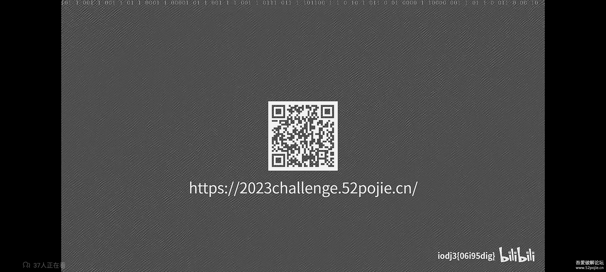

# [CTF] 【2023】吾爱春节红包web题writeup

- 原帖：`https://www.52pojie.cn/forum.php?mod=viewthread&tid=1742557`
- 抓取时间：`2026-11-01T23:00:52`

## 吾爱春节web题writeup

这次吾爱的web题很接近ctf，大部分题难度不大，萌新友好

> 原视频：`https://www.bilibili.com/video/BV123411R7K6/`

### flag1

明牌

`flag1.png` (1.45 MB, 下载次数: 1)

[下载附件](https://www.52pojie.cn/forum.php?mod=attachment&aid=MjU4ODY0M3xiMjg1YjNiZnwxNzkzNTc0MDUwfDE2ODA4NnwxNzQyNTU3&nothumb=yes)

2023-2-6 14:42 上传

`flag1{52pojiehappynewyear}`

### flag2

直接扫这个二维码

`flag2.png` (222.63 KB, 下载次数: 1)

[下载附件](https://www.52pojie.cn/forum.php?mod=attachment&aid=MjU4ODY1MHwxNmU2NDcyZnwxNzkzNTc0MDUwfDE2ODA4NnwxNzQyNTU3&nothumb=yes)

2023-2-6 14:43 上传

得到链接：`https://2023challenge.52pojie.cn/?flag=flag2{878a48f2}`

可以看到 `flag2` 就在参数里

`flag2{878a48f2}`

### flag3

视频 00:26 右下角

`flag3.png` (2.12 MB, 下载次数: 2)

[下载附件](https://www.52pojie.cn/forum.php?mod=attachment&aid=MjU4ODY0OXxkYzQ5NTA2NHwxNzkzNTc0MDUwfDE2ODA4NnwxNzQyNTU3&nothumb=yes)

2023-2-6 14:43 上传

吾爱破解logo变成了以下字符串：

`iodj3{06i95dig}`

字符串形似 `flag`，考虑 `iodj` 各前移 3 个字母正好是 `flag`，可推断其为凯撒密码加密，偏移量 3，数字和符号不位移

由此，可得 `flag3`

`flag3{06f95afd}`

### flag4

留意到视频制作者b站的个性签名

`flag4.png` (66.44 KB, 下载次数: 1)

[下载附件](https://www.52pojie.cn/forum.php?mod=attachment&aid=MjU4ODY0OHxmNTVjMjM1N3wxNzkzNTc0MDUwfDE2ODA4NnwxNzQyNTU3&nothumb=yes)

2023-2-6 14:43 上传

`base64` 解码，得到 `flag4`

`flag4{9cb91117}`

### flag5

视频 00:30-00:38 有发电报声，考虑摩尔斯电码

听译内容：`FLAG5EAIT`

补上 `{}` 即可得出 `flag5{eait}`

`flag5{eait}`

### flag6

在视频开头几秒，很容易能听出是拨号音

根据知乎大佬的讲解（`https://www.zhihu.com/question/19780683/answer/12940239`），按键音对应频率如下表（横行频、纵列频，单位 Hz）

| | 1209 | 1336 | 1477 | 1633 |
|---|---|---|---|---|
| 697 |  |  |  |  |
