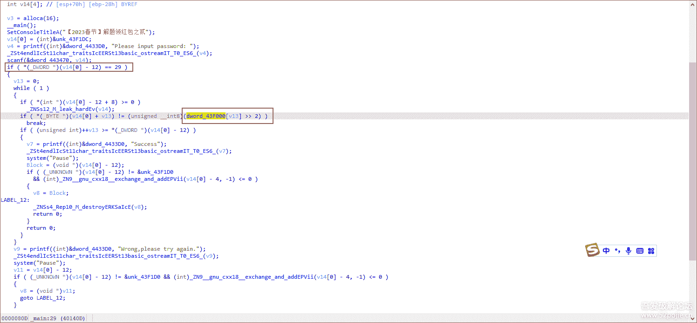
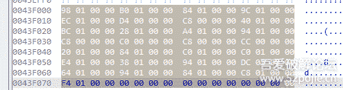
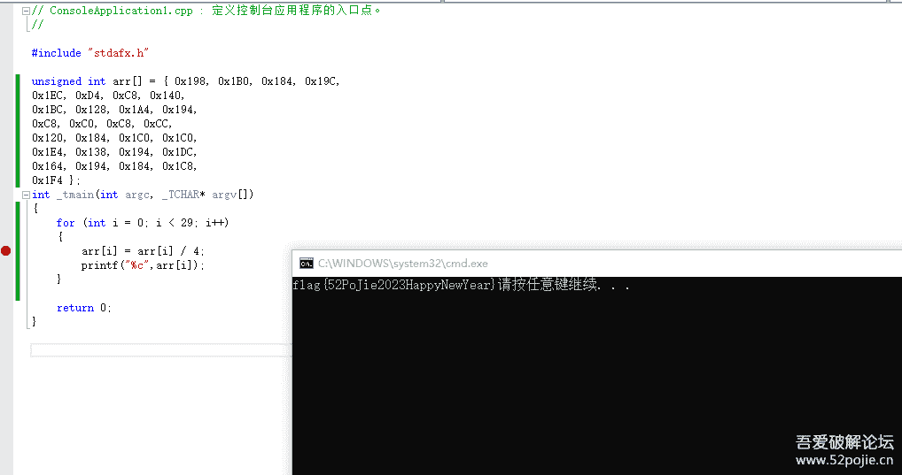
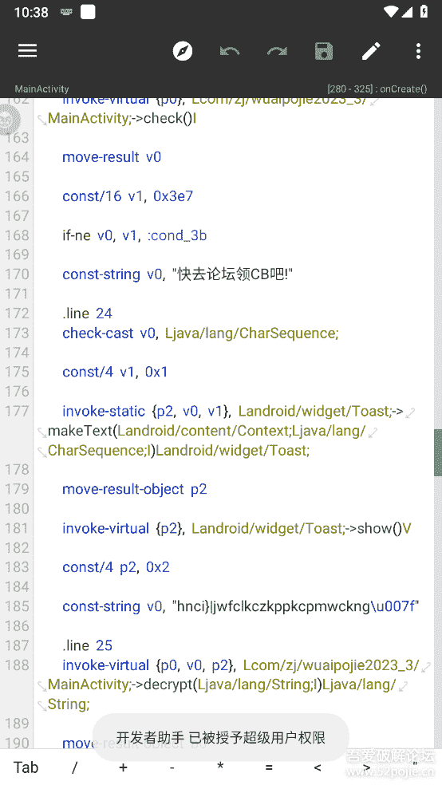
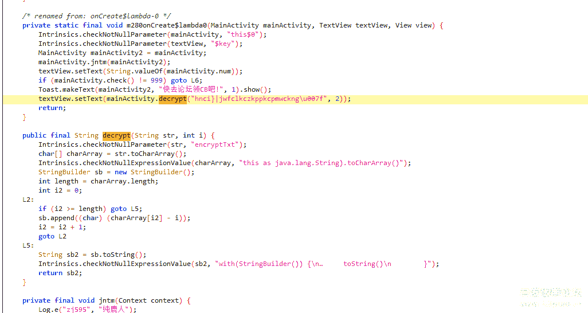
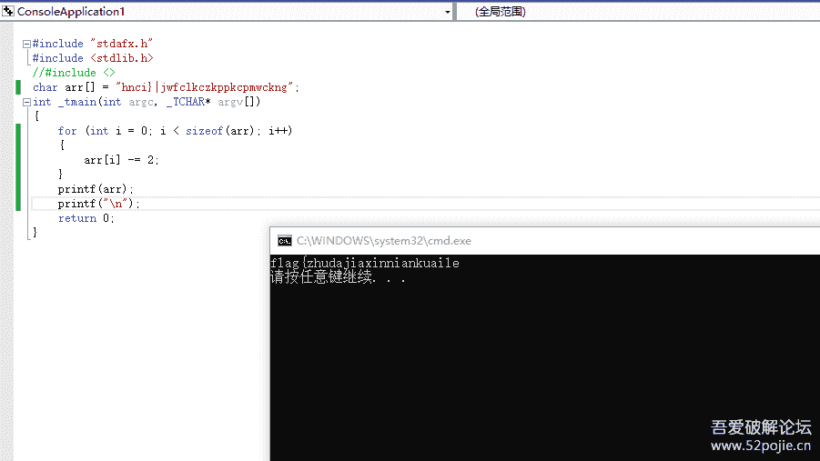
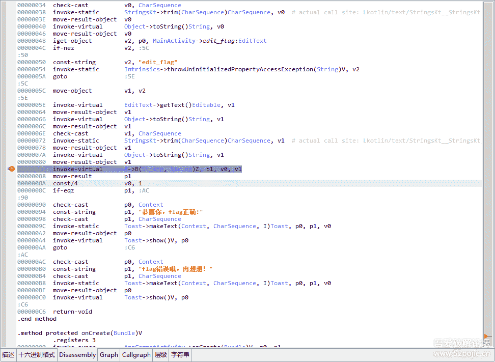
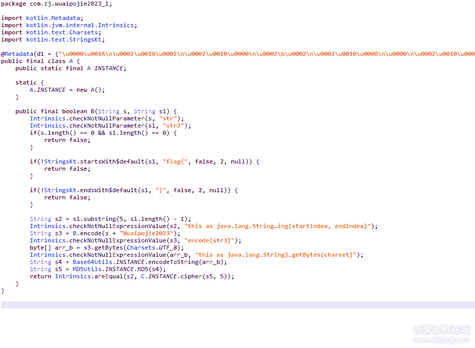
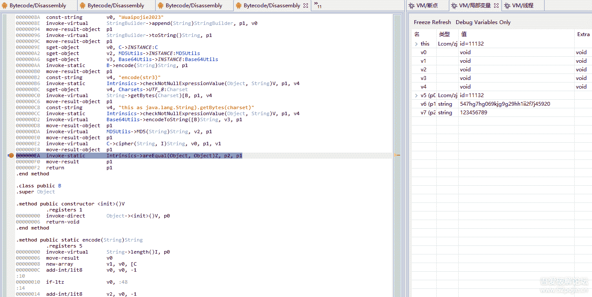
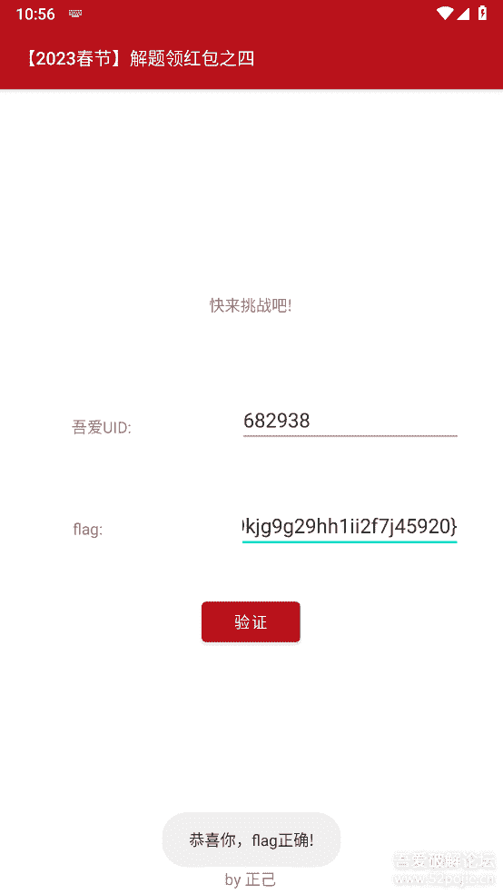

# [CTF] 2023春节 二 三 四

- 原帖: https://www.52pojie.cn/forum.php?mod=viewthread&tid=1742662
- 抓取时间: 2026-11-01T23:00:48

比较菜只做出了3道题

## 解题领红包之二 {Windows 初级题}

32位程序，拖入IDA中分析

第一个 `if` 判断输入长度为 29，然后循环和内存地址（`dword_43F000` 中的值 `>> 2`）判断，相等就会执行 `success`

image-20230123105512291.png (71.63 KB, 下载次数: 5)
[附件下载](https://www.52pojie.cn/forum.php?mod=attachment&aid=MjU4ODkwN3xmNjdmMGYxN3wxNzkzNTc0MDQ2fDE2ODA4NnwxNzQyNjYy&nothumb=yes)
2023-2-6 18:59 上传

将这个内存地址中的值扣出来

image-20230123105949778.png (16.22 KB, 下载次数: 4)
[附件下载](https://www.52pojie.cn/forum.php?mod=attachment&aid=MjU4ODkwOHwyMDU5OWI5MHwxNzkzNTc0MDQ2fDE2ODA4NnwxNzQyNjYy&nothumb=yes)
2023-2-6 19:00 上传

写脚本，得到 `flag`

image-20230123110102664.png (20.13 KB, 下载次数: 4)
[附件下载](https://www.52pojie.cn/forum.php?mod=attachment&aid=MjU4ODkwOXw4NzU3YzhjOHwxNzkzNTc0MDQ2fDE2ODA4NnwxNzQyNjYy&nothumb=yes)
2023-2-6 19:00 上传

## 解题领红包之三 {Android 初级题}

打开软件让点击999下，利用开发助手分析 `buttonID` 为 `0x7F080058`

搜索 `id`

image-20230124103827356.png (77.57 KB, 下载次数: 4)
[附件下载](https://www.52pojie.cn/forum.php?mod=attachment&aid=MjU4ODkxMHw0ODQ1OTBjOXwxNzkzNTc0MDQ2fDE2ODA4NnwxNzQyNjYy&nothumb=yes)
2023-2-6 19:00 上传

在第一个中找到 `"快去***"` 字符串，下面那串常字符串应该就是加密了的 `flag` 了

image-20230124103854377.png (175.39 KB, 下载次数: 6)
[附件下载](https://www.52pojie.cn/forum.php?mod=attachment&aid=MjU4ODkxMXw2OGExNjFjYnwxNzkzNTc0MDQ2fDE2ODA4NnwxNzQyNjYy&nothumb=yes)
2023-2-6 19:00 上传

查看 java 代码

image-20230124105842373.png (53.9 KB, 下载次数: 4)
[附件下载](https://www.52pojie.cn/forum.php?mod=attachment&aid=MjU4ODkxM3wzNmRiOGRiYXwxNzkzNTc0MDQ2fDE2ODA4NnwxNzQyNjYy&nothumb=yes)
2023-2-6 19:00 上传

这里解密就是了 `0x7f - 2 == "}"`

image-20230124105931627.png (18.9 KB, 下载次数: 5)
[附件下载](https://www.52pojie.cn/forum.php?mod=attachment&aid=MjU4ODkxNHwzNGRmYTU3ZHwxNzkzNTc0MDQ2fDE2ODA4NnwxNzQyNjYy&nothumb=yes)
2023-2-6 19:00 上传

## 解题领红包之四 {Android 初级题}

定位 `flag` 错误关键字，在上面这个函数下断点

image-20230125103920420.png (89.62 KB, 下载次数: 2)
[附件下载](https://www.52pojie.cn/forum.php?mod=attachment&aid=MjU4ODkxNXw2MTY0ZWZlZnwxNzkzNTc0MDQ2fDE2ODA4NnwxNzQyNjYy&nothumb=yes)
2023-2-6 19:00 上传

进入这个函数解析成 java 代码，可以看到最后有个 `equal` 比较，在这个函数上下断点，输入的 `flag` 必须要用 `flag{}` 括起来

image-20230125104136715.png (55.84 KB, 下载次数: 4)
[附件下载](https://www.52pojie.cn/forum.php?mod=attachment&aid=MjU4ODkxNnw5NWQ1ZDljNnwxNzkzNTc0MDQ2fDE2ODA4NnwxNzQyNjYy&nothumb=yes)
2023-2-6 19:00 上传

断下来，右边窗口 `v6` 就是 `flag`

image-20230125105049468.png (101.66 KB, 下载次数: 5)
[附件下载](https://www.52pojie.cn/forum.php?mod=attachment&aid=MjU4ODkxN3xhMDc2NTljM3wxNzkzNTc0MDQ2fDE2ODA4NnwxNzQyNjYy&nothumb=yes)
2023-2-6 19:00 上传

正确

image-20230125105654290.png (43 KB, 下载次数: 4)
[附件下载](https://www.52pojie.cn/forum.php?mod=attachment&aid=MjU4ODkxOHw0ODVhN2IyNHwxNzkzNTc0MDQ2fDE2ODA4NnwxNzQyNjYy&nothumb=yes)
2023-2-6 19:00 上传
