# [CTF] 【2023】春节解题领红包之web篇——不完美题解

- 原帖：<https://www.52pojie.cn/forum.php?mod=viewthread&tid=1743080>
- 抓取时间：2026-11-01T23:00:37

## 前言

> “2023challenge里找不出flag，200响应是你最无尽的温柔。”

本文从一个初学者的视角出发，希望能够带给同为小白朋友们一些学习方法，掌握在面对问题时的入手方向，当然web题目也是第一次尝试，才学疏浅，不足之处，还望多多包涵。

为什么称为不完美题解呢，因为找到的静态flag为`flag1`-`flag9`、`flag11`，动态flag为`flagC`。在官方降低难度后勉强完成了Web高级，也算是有一些收获，接下来我将介绍解题步骤和一系列工具，希望能给大家一些帮助。

## 分析

如果面对问题毫无头绪怎么办呢？当然是通过搜索引擎了获取信息，而互联网信息海洋浩瀚如烟，如何获取到我们需要的信息呢？对于这个问题我们首先要知道我们在做什么，我们参加吾爱官方一年一度的活动，目前是Web题目，那么它属于哪个方向呢？查看历年题解/题目分类就可以知道是CTF，那基本方向已经确定，可以通过“CTF Web”的关键字来搜索，这里再可以加上一个“思路”，这个时候可以有一个大致的了解，当然不用深入的去看，只需要粗略的浏览一下即可。然后开始根据题目要求去B站观看视频。

### flag1

视频00:17，`flag1{52pojiehappynewyear}`。

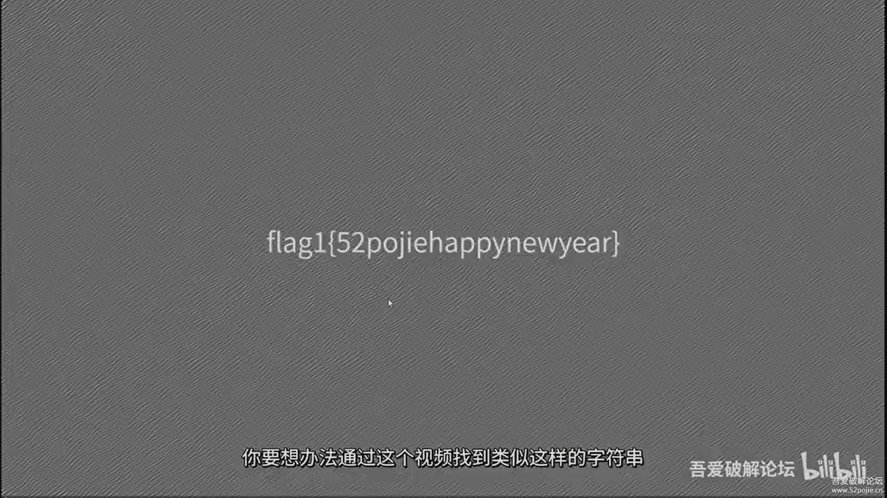

附件：[image-20230207101405604.png](https://www.52pojie.cn/forum.php?mod=attachment&aid=MjU4OTE2MXxlNjllY2U1YnwxNzkzNTc0MDM1fDE2ODA4NnwxNzQzMDgw&nothumb=yes)（2.12 MB，下载次数：2）

2023-2-7 17:09 上传

### flag2

视频00:19的二维码，扫描即可获取。`flag2{878a48f2}`。

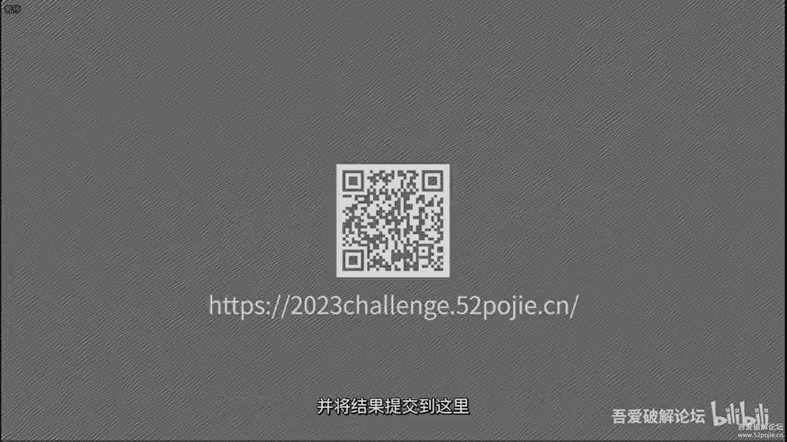

附件：[image-20230207101534917.png](https://www.52pojie.cn/forum.php?mod=attachment&aid=MjU4OTE2MnwwOGIxZDI4YnwxNzkzNTc0MDM1fDE2ODA4NnwxNzQzMDgw&nothumb=yes)（2.11 MB，下载次数：0）

2023-2-7 17:10 上传

### flag3

视频00:25，一般来说可能由于左上角的数字在动，注意力全集中在左上方，而此处需要注意一下右下角的`iodj3{06i95dig}`，根据我们题目所提示的flag格式，那么它原本样子应该是`flag3`，此时`iodj`对应`flag`，可以推断出`i`左移3位得到`f`，其它以此类推，可以知道这是移动3位的凯撒加密，可以手动推出答案，也可以使用在线网站解密（[www.hiencode.com](http://www.hiencode.com/)），在其中选择凯撒加密即可，找不到可用`Ctrl+F`页面搜索。当然这里需要注意一下了，既然视频中已经涉及到凯撒密码了，指不定还有其它的密码，我们可以使用“CTF 加密类型”关键字来搜索，用于扩充一下知识面，这里分享一下我通过多次搜素得出的密码类型文章：[密码类型文章](https://cloud.tencent.com/developer/article/1934568)，以及关于一些脑洞大开的加密方式：[脑洞大开的编码和加密](http://blog.neargle.com/SecNewsBak/drops/CTF%E4%B8%AD%E9%82%A3%E4%BA%9B%E8%84%91%E6%B4%9E%E5%A4%A7%E5%BC%80%E7%9A%84%E7%BC%96%E7%A0%81%E5%92%8C%E5%8A%A0%E5%AF%86%20.html)。

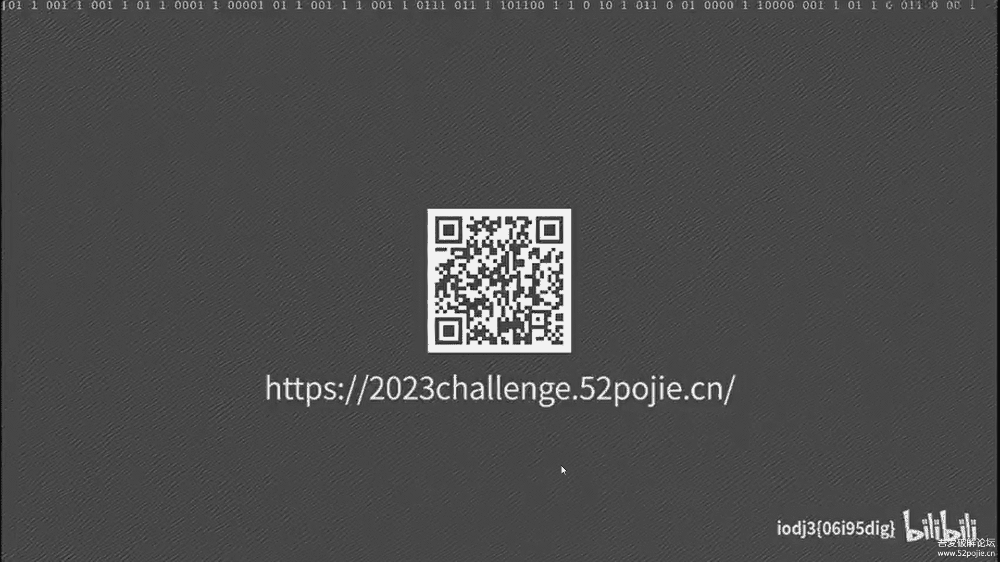

附件：[image-20230207101857465.png](https://www.52pojie.cn/forum.php?mod=attachment&aid=MjU4OTE2M3xmZTY1NzRmMnwxNzkzNTc0MDM1fDE2ODA4NnwxNzQzMDgw&nothumb=yes)（1.61 MB，下载次数：1）

2023-2-7 17:10 上传

### flag4

`flag4`其实在出题人的个性签名里，这个地方可是真够隐秘的，当然这串字符串看起来很奇怪，根据`flag3`中的密文类型识别的文章，可以知道这个字符串应该是Base64编码，因此`flag3`中提到的工具箱，对字符串进行Base64解码即可（[www.hiencode.com/base64.html](http://www.hiencode.com/base64.html)），解得`flag4{9cb91117}`。

附件：[flag4.png](https://www.52pojie.cn/forum.php?mod=attachment&aid=MjU4OTE1N3w5YTk1NDNiOXwxNzkzNTc0MDM1fDE2ODA4NnwxNzQzMDgw&nothumb=yes)（734.72 KB，下载次数：0）

2023-2-7 17:09 上传

### flag5

`flag5`出现于视频00:30，此处可以听见音乐中掺杂了一些滴滴答答的声音，类似于影视剧中的电报音，这里其实是摩尔斯电码，也被称作摩斯密码，这里可以使用一个名为Morse Code Reader的安卓应用，美中不足的是高版本Andorid系统会闪退，因此将在`flag8`中介绍另一种方法。由图可知`flag5{eait}`，此处可以发现视频中的音频似乎隐藏了一些信息，我们搜索关键字可变为CTF 音频，可以对其做一些了解，例如[CTF 音频隐写](https://www.sqlsec.com/2018/01/ctfwav.html)。

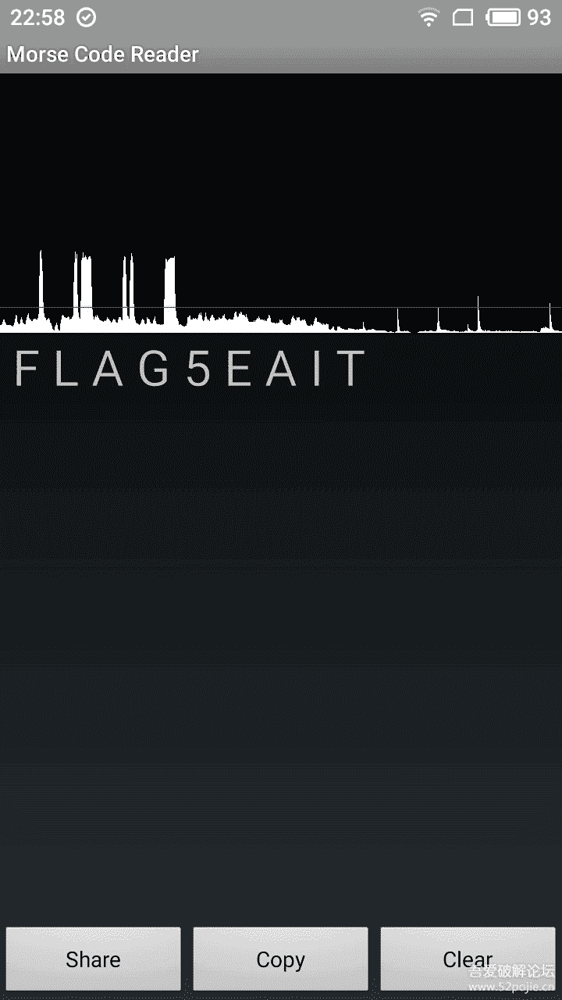

附件：[flag5.png](https://www.52pojie.cn/forum.php?mod=attachment&aid=MjU4OTE1OHxiNjNhZWFjZXwxNzkzNTc0MDM1fDE2ODA4NnwxNzQzMDgw&nothumb=yes)（82.21 KB，下载次数：2）

2023-2-7 17:09 上传

### flag6

视频开头处可以听到类似电话按键的声音，并且也有提示此处为`flag6`，但这个比较考验听力，一开始我用手机按键边按边听，然而最终的答案却不正确，这里推荐一个识别电话按键音的工具`dtmf2num`。

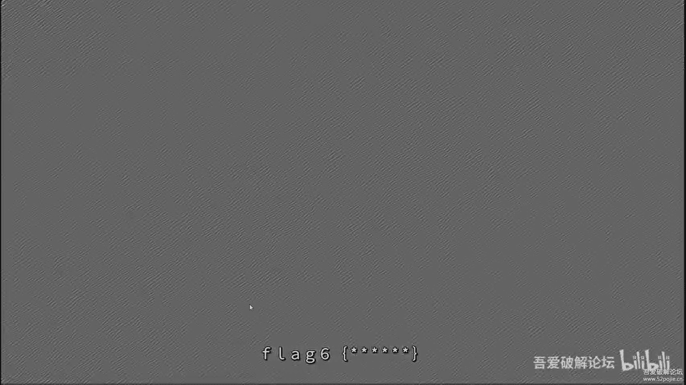

附件：[image-20230207111605931.png](https://www.52pojie.cn/forum.php?mod=attachment&aid=MjU4OTE2Nnw5ZDA1NzIzNXwxNzkzNTc0MDM1fDE2ODA4NnwxNzQzMDgw&nothumb=yes)（1.72 MB，下载次数：1）

2023-2-7 17:10 上传

可以看到效果相当的好啊，由此可知，`flag6{590124}`，这里涉及了音频操作，因此推荐一个在线音频处理网站[100audio 编辑器](https://100audio.com/sound/100audio_editor/)，可以使用它裁剪音频，当然也可以在`flag8`中使用其它工具。

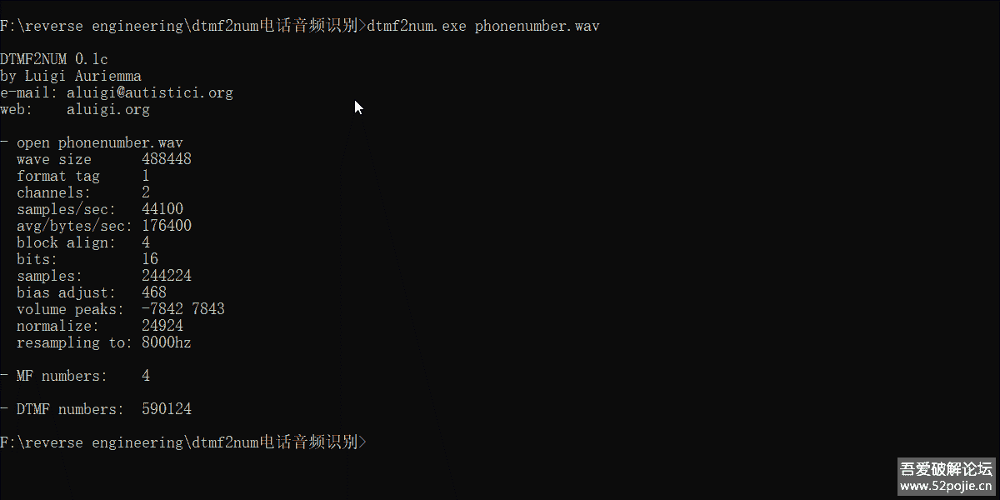

附件：[flag6.png](https://www.52pojie.cn/forum.php?mod=attachment&aid=MjU4OTE2MHwyY2YwNDFiOXwxNzkzNTc0MDM1fDE2ODA4NnwxNzQzMDgw&nothumb=yes)（26.35 KB，下载次数：0）

2023-2-7 17:09 上传

### flag7

在00:30出现的由0和1组成的二进制字符串，刚开始分析将其以摩尔斯电码分析无果，后来将其分为8个一组的二进制字符串，转为ASCii码后我们的`flag7{5d06be63}`出现，这里需要我们有一点点的积累，可以意识到8位的二进制数字可以用来表示字符。转换工具网址：[二进制转文本](https://coding.tools/cn/binary-to-text)。

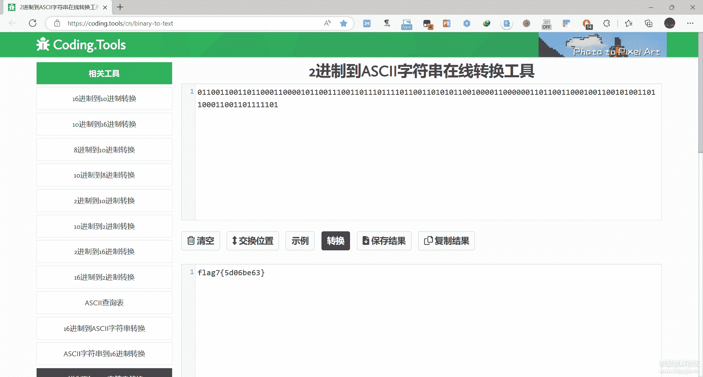

附件：[image-20230207130146601.png](https://www.52pojie.cn/forum.php?mod=attachment&aid=MjU4OTE2OXw3MmUxY2FkM3wxNzkzNTc0MDM1fDE2ODA4NnwxNzQzMDgw&nothumb=yes)（153.87 KB，下载次数：1）

2023-2-7 17:10 上传

### flag8

根据`flag5`中提到的文章可知，这里涉及了一个新的名词，隐写，所以我们可以搜索CTF 隐写相关内容，放一个我搜索出来的[FreeBuf 专栏](https://www.freebuf.com/column/232141.html)，由于`flag5`中工具不兼容高版本系统的问题，这里在分析`flag8`时一并给出一个通用方案，使用Au（论坛搜索可得）音频处理工具，结合这里文章对音频的频谱图做一个分析，以及对`flag6`的摩尔斯电码再做一次分析。要分析音频可以选择将音频分离出来，或者直接将视频拖入Au中也可以的，可以很清楚的看到我们的`flag8{c394d7}`已经出现了，这是频谱图，在Au中可以选择左上角鼠标所指位置，或者直接按快捷键`Shift+D`调出即可，同时在00:30处起可以看到一些亮黄色的小长条，这就是我们听到的摩尔斯电码声，将短的用`.`代替，长的用`-`代替，可以得到`..-. .-.. .- --. ..... . .- .. -`，使用[摩尔斯电码解码](http://www.hiencode.com/morse.html)解码后也可得到同工具识别出的结果。

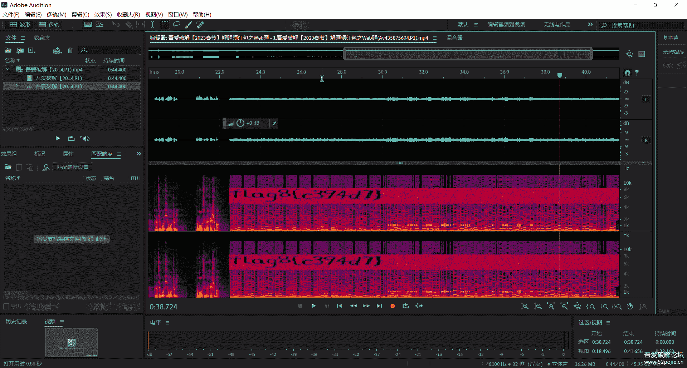

附件：[image-20230207120717455.png](https://www.52pojie.cn/forum.php?mod=attachment&aid=MjU4OTE2OHxiMzY1NGQ0ZXwxNzkzNTc0MDM1fDE2ODA4NnwxNzQzMDgw&nothumb=yes)（1.2 MB，下载次数：0）

2023-2-7 17:10 上传

### flag9

通过反复观看视频，可以听到最后几秒处似乎有声音，但是又不是`flag9`的声音，这里其实需要将音频反转后可以听到音乐中混杂的`flag9`，在Au中依次点击效果，反向将原音频反转，然后左键按住选择前三秒之后，再右键点击存储选区为，在弹窗中选择自己的文件路径，保存文件即可。不过这里依旧很考验听力，Au虽然有降噪功能，但稍微麻烦一些，分离后依旧有些不太清楚。使用[Vocal Remover](https://vocalremover.org/)可以将音频中的人声分离出来，之后将`Music`的按钮拉到最小，将得到`flag9{21c5f8}`。

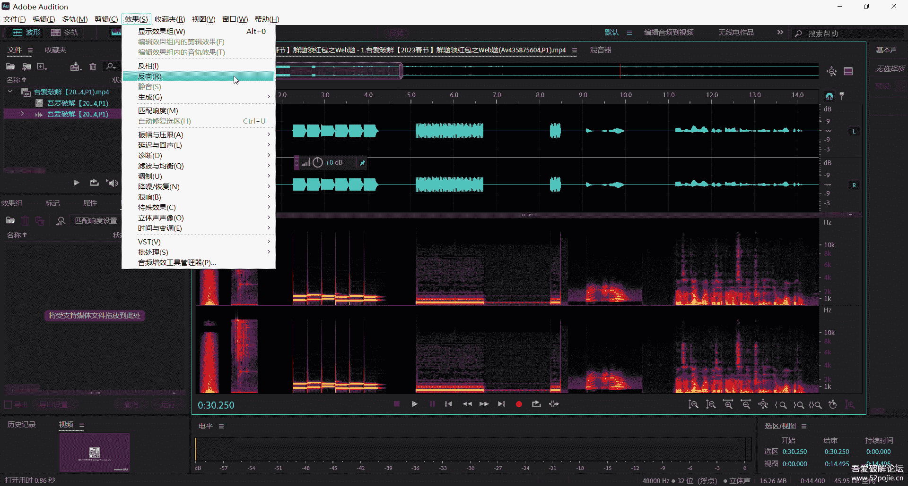

附件：[image-20230207130818007.png](https://www.52pojie.cn/forum.php?mod=attachment&aid=MjU4OTE3MHwzMzg2NDE3MXwxNzkzNTc0MDM1fDE2ODA4NnwxNzQzMDgw&nothumb=yes)（920.1 KB，下载次数：0）

2023-2-7 17:10 上传

### flag11

如果有对`flag3`中推荐的文章细看的话，那么可以很快知道在视频00:30时底部的字符串其实就是brainfuck，一开始我以为它是JSFuck，各种拆解分析无果之后，发现了`flag3`中的文章，进而`flag11{5d06be63}`得以出现，这里给出brainfuck的解码网站（[Ook!](https://www.splitbrain.org/services/ook)）。

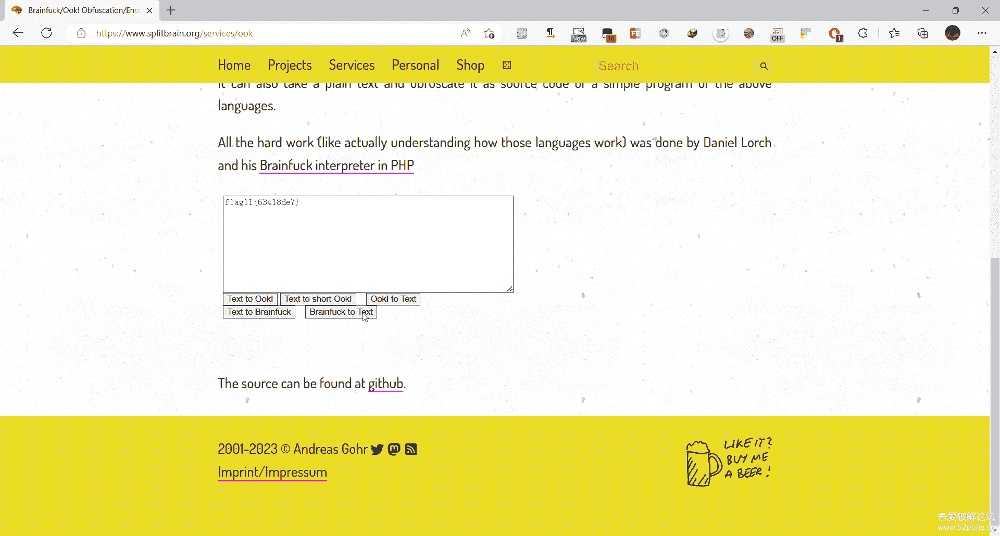

附件：[image-20230207131512589.png](https://www.52pojie.cn/forum.php?mod=attachment&aid=MjU4OTE3MXxhOGFkYTYwNXwxNzkzNTc0MDM1fDE2ODA4NnwxNzQzMDgw&nothumb=yes)（1.22 MB，下载次数：1）

2023-2-7 17:10 上传

### flagC

### `flagC`属于动态码，在视频中有提示到说`2023challenge.52pojie.cn`这个网站无法访问，可能是因为域名解析(`DNS`,域名解析服务，由于不同服务器之间通信需要的是ip地址，但ip比较长不太好记，为此人们给服务器配备了域名，而将域名指向服务器称为域名解析服务，这样一来通过易于记忆的域名就可以找到对应的服务器)的问题，以及它和吾爱用的是同一个服务器，根据这些信息可以知道，`2023challenge.52pojie.cn`它的域名解析指向了吾爱主站(`www.52pojie.cn`)的服务器，首先我们得知道吾爱主站所解析的服务器的ip地址，然后相办法将`2023challenge.52pojie.cn`这个域名解析到主站服务器上。

### 在此之前提一个小问题，这也是面试中高频 问题，权当复习了。

### 浏览器输入URL按下回车后发生了什么？

### 简单来说分为以下几点:
- 浏览器先查看浏览器缓存-系统缓存-路由器缓存，如果缓存中有，会直接在屏幕中显示页面内容。若没有，则跳到第三步操作。
- 在发送`http`请求前，需要域名解析(`DNS`解析)，解析获取相应的IP地址。
- 浏览器向服务器发起`tcp`连接，与浏览器建立`tcp`三次握手。
- 握手成功后，浏览器向服务器发送`http`请求，请求数据包。
- 服务器处理收到的请求，将数据返回至浏览器
- 浏览器收到`HTTP`响应
- 读取页面内容，浏览器渲染，解析`html`源码
- 生成`Dom`树、解析`css`样式、`js`交互。

### 其实我们重点关注第一步，读取缓存的操作，由于我们无法访问因此浏览器缓存读取后仍然无法到达目标地址，因此需要考虑系统缓存，这里的系统缓存其实就是`hosts`文件中存放缓存，试想如果我们在`hosts`文件中添加了网站到服务器之间的映射关系，那么就可以不用后边的路由缓存，亦不用在进行`DNS`服务器解析，直接就可以访问网站了。所以我们先通过`https://www.t00ls.com/domain.html` 网站查询吾爱主站对应的服务器ip。

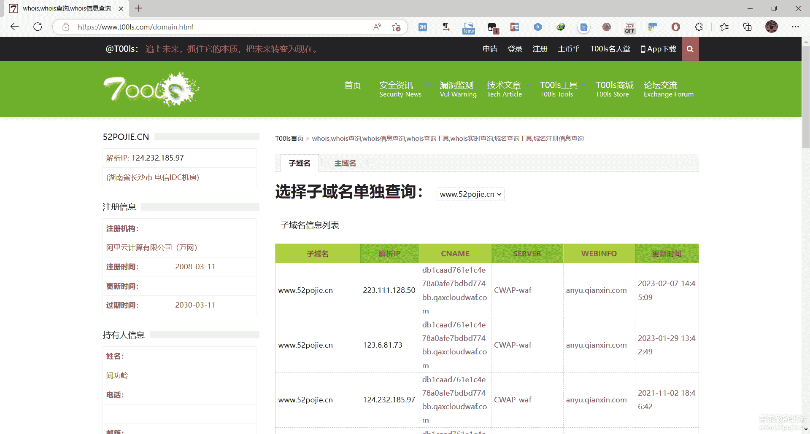
image-20230207144559570.png (193.68 KB, 下载次数: 2)
[href="forum.php?mod=attachment&aid=MjU4OTE3NHxlOWFiZmE1MXwxNzkzNTc0MDM1fDE2ODA4NnwxNzQzMDgw&nothumb=yes" target="_blank"](https://www.52pojie.cn/forum.php?mod=attachment&aid=MjU4OTE3NHxlOWFiZmE1MXwxNzkzNTc0MDM1fDE2ODA4NnwxNzQzMDgw&nothumb=yes)
2023-2-7 17:10 上传

### 任选其中之一将其填入`hosts`文件中，根据此文`https://blog.csdn.net/chasegan/article/details/107622167`进行修改，或者使用 火绒 安全工具的修改`hosts`文件功能对其进行修改。

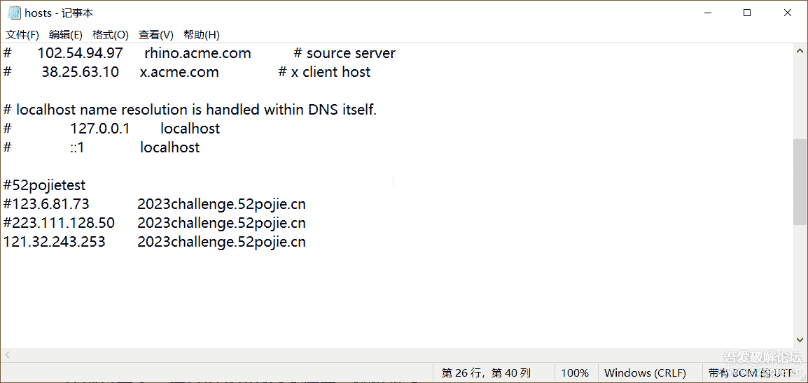
image-20230207144952693.png (41.94 KB, 下载次数: 2)
[href="forum.php?mod=attachment&aid=MjU4OTE3Nnw1MTJjNWUyZHwxNzkzNTc0MDM1fDE2ODA4NnwxNzQzMDgw&nothumb=yes" target="_blank"](https://www.52pojie.cn/forum.php?mod=attachment&aid=MjU4OTE3Nnw1MTJjNWUyZHwxNzkzNTc0MDM1fDE2ODA4NnwxNzQzMDgw&nothumb=yes)
2023-2-7 17:10 上传

### 如果修改后仍然无法打开，请检查`win10`的系统代{过}{滤}理是否关闭!!!(这个问题卡了我好久)

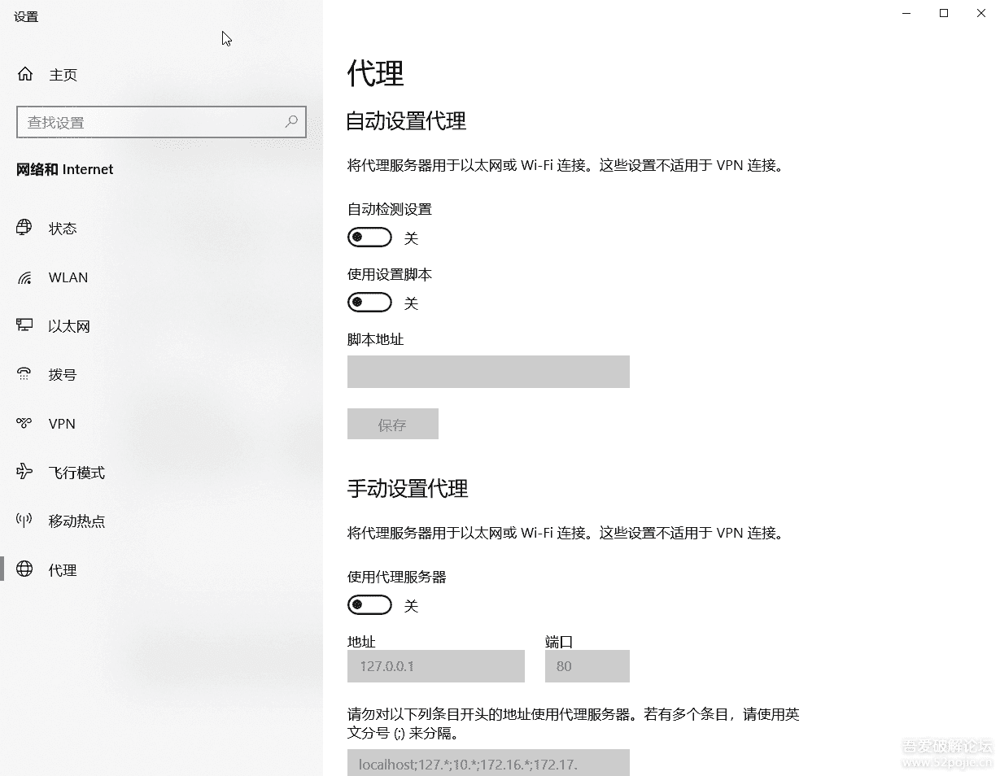
image-20230207145140780.png (324.44 KB, 下载次数: 1)
[href="forum.php?mod=attachment&aid=MjU4OTE3N3wyOTFlNzE3YXwxNzkzNTc0MDM1fDE2ODA4NnwxNzQzMDgw&nothumb=yes" target="_blank"](https://www.52pojie.cn/forum.php?mod=attachment&aid=MjU4OTE3N3wyOTFlNzE3YXwxNzkzNTc0MDM1fDE2ODA4NnwxNzQzMDgw&nothumb=yes)
2023-2-7 17:10 上传

### 一切就绪就可以打开网站了，非常滴有感觉啊，点击登录后，结果发现输入框不能输入，这里直接`F12`一手，点击这里的选择工具定位到输入框后，可以看到右边的源码中有一个`disabled`属性，在它上面双击，然后删掉它，就可发现我们`uid`的可以填写了。

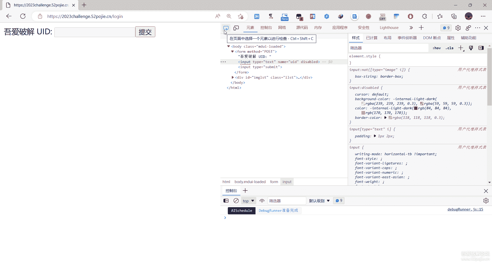
image-20230207145553225.png (146.21 KB, 下载次数: 1)
[href="forum.php?mod=attachment&aid=MjU4OTE3OHxkYzkyMTFlY3wxNzkzNTc0MDM1fDE2ODA4NnwxNzQzMDgw&nothumb=yes" target="_blank"](https://www.52pojie.cn/forum.php?mod=attachment&aid=MjU4OTE3OHxkYzkyMTFlY3wxNzkzNTc0MDM1fDE2ODA4NnwxNzQzMDgw&nothumb=yes)
2023-2-7 17:10 上传

### 然而，事情并没有那么简单，输入`uid`却提示你不是`admin`，无法获取`flag`，眼看到手的`flag`就飞了，这怎么行。此时需要把搜索的关键字变为"`CTF Web admin`"，相信可以找到一些相关的信息的。通过`https://blog.csdn.net/qq_37410729/article/details/109248378`这篇文章可以看到同类型的题目的解法，根据它用到了`cookie`，那我们可以先看看我们的`cookie`是什么样，在当前的`F12`打开窗口中，依次选择应用程序，在左栏窗口中选择`Cookie`，然后带点击我们当前网站的域名，发现右边侧栏中有一个名为`2023_challenge_jwt_token`的项目，虽然这么长一串字符串不知道是什么，但是我们可以先对进行一些搜索，既然`2023_challage`看起来与我们访问的网站域名只差一个下划线，但是我们关注的点应该在其后半部分，也就是`jwt_token`上，依据“`CTF Web jwt_token`”关键字进行查询，这里我选择去掉了`token`这个关键字，原因在于并非越多的信息越有利于搜索，有时候简洁的关键字更有机会获得准确的答案，本来这里准备详细写一篇`JWT`相关博客，但鉴于发文时间已经较晚，且发现了一篇写的非常好的文章`https://blog.csdn.net/qq_45521281/article/details/106073624`，分享给大家，此文章是我在前者搜索关键字的基础上衍生后找到的，对本题的解决有很大作用。通过文章可以了解到`JWT`是一种身份凭证，因为同一网站不同网页之间切换时要需通过此身份凭证验证你的资格，确定有相应的权限才能进行访问。

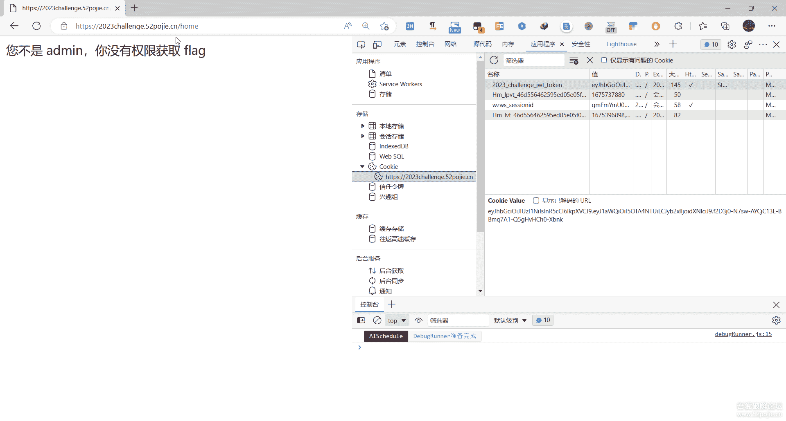
image-20230207150832598.png (136.96 KB, 下载次数: 0)
[href="forum.php?mod=attachment&aid=MjU4OTE3OXwwM2Y4MTRhYXwxNzkzNTc0MDM1fDE2ODA4NnwxNzQzMDgw&nothumb=yes" target="_blank"](https://www.52pojie.cn/forum.php?mod=attachment&aid=MjU4OTE3OXwwM2Y4MTRhYXwxNzkzNTc0MDM1fDE2ODA4NnwxNzQzMDgw&nothumb=yes)
2023-2-7 17:10 上传

### 将右侧栏中发现的`JWT`字符串复制出来，进入`jwt.io`这个网站中，很快啊，就可以看到字符串原本的内容，我们重点关注第二栏，里面有`uid`和`role`两个参数，这里我已经将`user`修改成了`admin`，这样的话如果服务器忽略了签名校验错误，那么我们`role`将从`user`变为`admin`(出题人说是服务器忽略了签名校验错误，之前表述不准确，这里作以修改)，至此我们已经完成了对密钥的伪造，下一步就是尝试骗过服务器了。

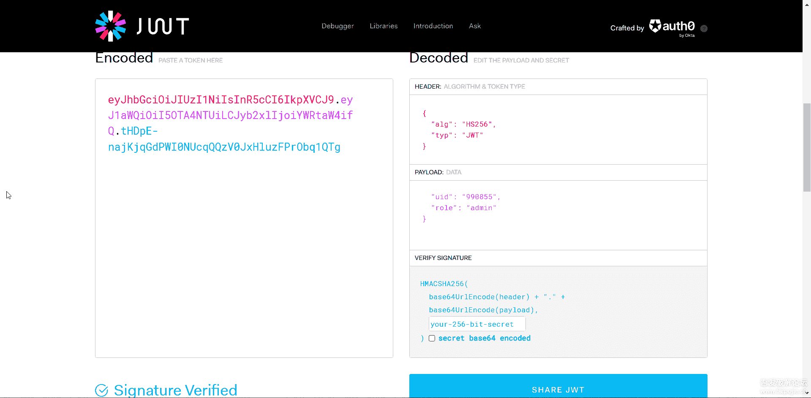
image-20230207152733620.png (105.25 KB, 下载次数: 1)
[href="forum.php?mod=attachment&aid=MjU4OTE4MHxmNzE1M2Q4ZHwxNzkzNTc0MDM1fDE2ODA4NnwxNzQzMDgw&nothumb=yes" target="_blank"](https://www.52pojie.cn/forum.php?mod=attachment&aid=MjU4OTE4MHxmNzE1M2Q4ZHwxNzkzNTc0MDM1fDE2ODA4NnwxNzQzMDgw&nothumb=yes)
2023-2-7 17:10 上传

### 这里依然是在我们的`F12`窗口中，在我们选择的第一栏`2023_challenge_jwt_token`对应的值上双击，然后粘贴上一步生成的密钥，然后最重要的一步来了，在当前页面的`URL`网址后回车，或者刷新页面，可以看到`flagC`获取成功(截至发文前网站居然还未下线，i了i了)。

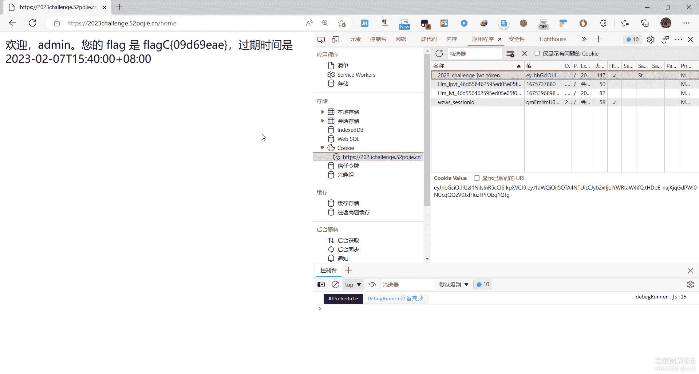
image-20230207153915662.png (145.33 KB, 下载次数: 1)
[href="forum.php?mod=attachment&aid=MjU4OTE4MXw3ZGI0YTI5M3wxNzkzNTc0MDM1fDE2ODA4NnwxNzQzMDgw&nothumb=yes" target="_blank"](https://www.52pojie.cn/forum.php?mod=attachment&aid=MjU4OTE4MXw3ZGI0YTI5M3wxNzkzNTc0MDM1fDE2ODA4NnwxNzQzMDgw&nothumb=yes)
2023-2-7 17:10 上传

### 千万不要像我一样又去`login`页面重新登录，然后以为自己能够从`login`到`home`，然而只能得到一个`302`(临时重定向，以为还有机会)响应，哪怕后边变成了`admin`，也只不过是`302`，只有`home`页面，不管你是`user`还是`admin`，每次响应都是`200`。像极了满世界找爱你的人，以为变成了`admin`后，`login`就会给你结果，结果连个`200`都没有，你要的找爱你的人在`home`呀，`home`，不是别人给的`home`，在你的`home`呀(官方他真的，我哭死)，程序都懂得的事，你不懂吗(恼火)？这段话当个乐呵就行了哈哈哈哈哈哈。

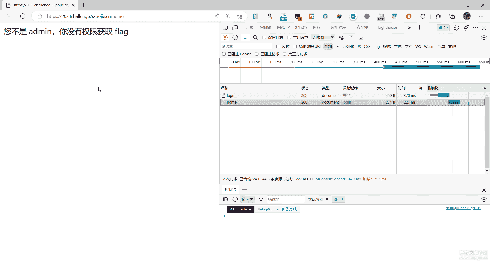
image-20230207154704671.png (121.31 KB, 下载次数: 1)
[href="forum.php?mod=attachment&aid=MjU4OTE4Mnw4ZWRhZTI2OXwxNzkzNTc0MDM1fDE2ODA4NnwxNzQzMDgw&nothumb=yes" target="_blank"](https://www.52pojie.cn/forum.php?mod=attachment&aid=MjU4OTE4Mnw4ZWRhZTI2OXwxNzkzNTc0MDM1fDE2ODA4NnwxNzQzMDgw&nothumb=yes)
2023-2-7 17:10 上传

## 些许尝试

### 除了以上的操作外，其实也进行了许多的其它尝试，对视频分割成帧，试图寻找其中的奥秘，将视频上方的`01`字符串构造出一个条形码，结果扫不出来。对背景音乐尝试提取隐写，一无所获。在网站的`CSS`样式表中，找到了一张附着在图片末尾的`pwd`，却不知道该放到哪里。。。

# 总结

### 不出意外的话，这应该是题解的最后一篇了，以前有觉得每天坐电脑前写写文章多好的，这几天的写题解改变了我的看法，让我感受到美好的事物总藏于幻想之中，一旦进入现实便会落得一地鸡毛。想起上个月22日零点整等待题目出现，结果才发现白天题目才出来哈哈哈哈，从19年第一次参加吾爱的活动，第一题磕磕绊绊、连蒙带猜，到现在能够顺利解出一两题也算是一种进步吧。不过还是有遗憾的，今年`Windows`中级题目变成了`64`位，然后也增加了反调试，难度一下子就上去了，学习`x64dbg`使用，脱掉了`upx`壳(不脱也行，在某篇帖子的评论区学到了大佬的`000000`的手法，非常滴妙啊)，期间读了《逆向工程核心原理》后边也想办法过掉了反调试，找了好久终于找到了关键`call`，只能爆破`success`，却没获取到`flag`。遗憾年年有，今年特别多，也暴露出一些问题，汇编语言的不熟练，导致分析进度缓慢。由于平时主要忙于学`Java`，分给其它的时间就所剩无几了，好在今年的`Web`有所收获哈哈哈。想起刚开始做今年的题的时候，有坛友评论了去年的题解帖子，问我一些问题，仿佛看到了当年刚开始学习的自己，从什么都不知道到现在知道一点点，一想到这就不再敢犯懒了，新的一年，继续加油！

# 其它题解

### 【2023】春节解题领红包之二`https://www.52pojie.cn/thread-1742329-1-1.html`

### 【2023】春节解题领红包之三`https://www.52pojie.cn/thread-1742449-1-1.html`

### 【2023】春节解题领红包之四`https://www.52pojie.cn/thread-1742785-1-1.html`
