# [Web逆向] 人均瑞数系列，瑞数 5 代 JS 逆向分析

- 原帖: https://www.52pojie.cn/forum.php?mod=viewthread&tid=1743411
- 抓取时间: 2026-11-01T23:00:29


## 声明

本文章中所有内容仅供学习交流使用，不用于其他任何目的，不提供完整代码，抓包内容、敏感网址、数据接口等均已做脱敏处理，严禁用于商业用途和非法用途，否则由此产生的一切后果均与作者无关！

本文章未经许可禁止转载，禁止任何修改后二次传播，擅自使用本文讲解的技术而导致的任何意外，作者均不负责，若有侵权，请联系作者立即删除！

## 前言

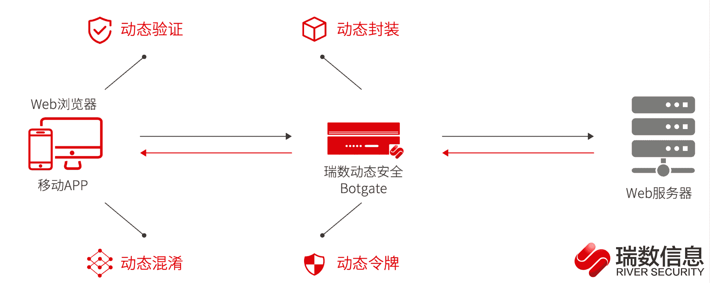

瑞数动态安全 Botgate（机器人防火墙）以“动态安全”技术为核心，通过动态封装、动态验证、动态混淆、动态令牌等技术对服务器网页底层代码持续动态变换，增加服务器行为的“不可预测性”，实现了从用户端到服务器端的全方位“主动防护”，为各类 Web、HTML5 提供强大的安全保护。

在 K 哥往期的文章[//mp.weixin.qq.com/s/0uzPRiPdSargFlDM-TwAWw](https://mp.weixin.qq.com/s/0uzPRiPdSargFlDM-TwAWw)中，详细介绍了瑞数的特征、如何区分不同版本、瑞数的代码结构以及各自的作用，本文就不再赘述了，不了解的同志可以先去看看之前的文章。

## Cookie 入口定位

本文案例中瑞数 5 代网站为：aHR0cHM6Ly93d3cubm1wYS5nb3YuY24vZGF0YXNlYXJjaC9ob21lLWluZGV4Lmh0bWw=

定位 Cookie，首选 Hook 来的最快，通过 Fiddler 插件、油猴脚本、浏览器插件等方式注入以下 Hook 代码：

```
(function() {
    // 严谨模式 检查所有错误
    'use strict';
    // document 为要hook的对象 这里是hook的cookie
    var cookieTemp = "";
    Object.defineProperty(document, 'cookie', {
        // hook set方法也就是赋值的方法
        set: function(val) {
            // 这样就可以快速给下面这个代码行下断点
            // 从而快速定位设置cookie的代码
            console.log('Hook捕获到cookie设置->', val);
            debugger;
            cookieTemp = val;
            return val;
        },
        // hook get 方法也就是取值的方法
        get: function() {
            return cookieTemp;
        }
    });
})();
```

断下之后往上跟栈，可以看到组装 Cookie 后赋值给 `document.cookie` 的代码，类似如下结构：

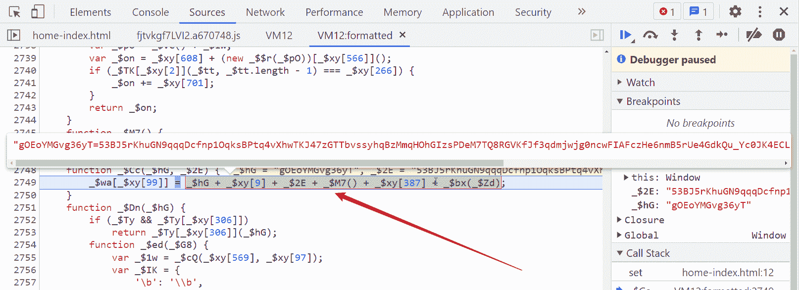

继续往上跟栈，和4代瑞数类似，`(772, 1)` 的位置是入口，4代有一次生成假 cookie 的过程，5代就没有了，如下图所示：

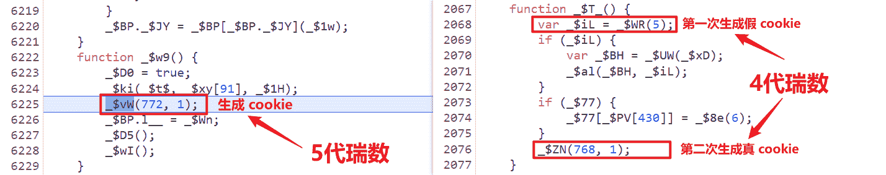

再往前跟栈，来到首页代码，这里就是我们熟悉的 call 位置了，图中 `_$ug` 实际上是 `eval` 方法，传入的第一个参数 `_$Cs` 是 `Window` 对象，第二个对象 `_$Dm` 是我们前面看到的 VM 虚拟机中的 IIFE 自执行代码。

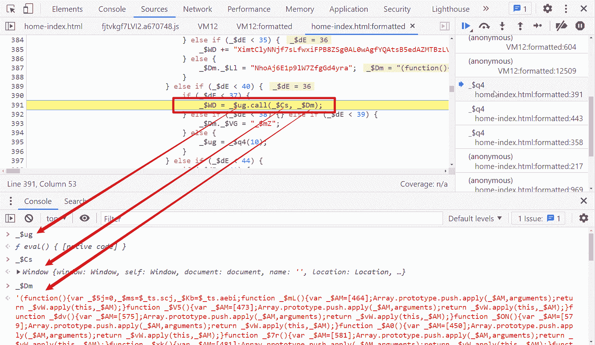

## VM 代码以及 `$_ts` 变量获取

获取 VM 代码和 `$_ts` 变量是第一步，和4代类似，复制外链 JS（例如 `fjtvkgf7LVI2.a670748.js`）的代码和 412 页面的自执行代码到文件，本地直接运行即可，需要轻度补一下环境，缺啥补啥，大致补一下 `window`、`location`、`document` 就行了，补的具体内容可以直接在浏览器控制台使用 `copy()` 命令复制过来，然后 VM 代码我们就可以直接 Hook `eval` 的方式得到，这里 `$_ts` 变量的获取和4代有点儿区别，4代我们的做法是运行完代码后直接取 `window.$_ts` 就行了，5代运行完代码后会有一个清空 `$_ts` 的操作，可以自己跟栈看一下逻辑，要么把清空的逻辑删了，要么定义一个全局变量，然后直接在 call 的地方将 `$_ts` 的值导出来：

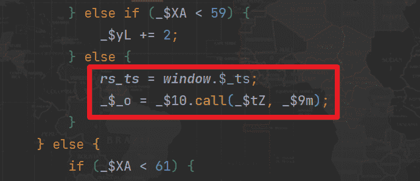

大致的补环境代码如下：

```
var eval_js = ""

var rs_ts = ""

window = {

    $_ts: {},

    eval: function (data) {

        eval_js = data

    }

}

location = {

    "ancestorOrigins": {},

    "href": "https://脱敏处理/datasearch/home-index.html",

    "origin": "https://脱敏处理",

    "protocol": "https:",

    "host": "www.脱敏处理.cn",

    "hostname": "www.脱敏处理.cn",

    "port": "",

    "pathname": "/datasearch/home-index.html",

    "search": "",

    "hash": ""

}

document = {

    "scripts": ["script", "script"]

}
```

获取 VM 代码以及 `$_ts` 变量：

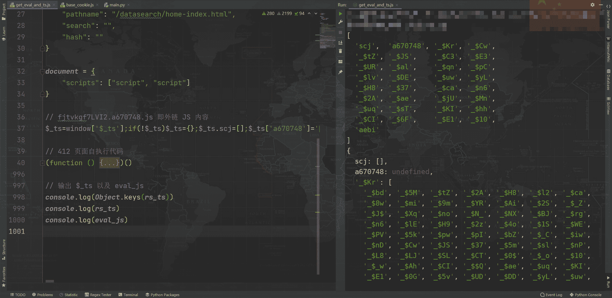

## 善用 Watch 跟踪功能

在跟栈分析之前，有必要了解一下浏览器开发者工具的 Watch 功能，它能够持续跟踪某个变量的值，对于瑞数这种控制流很多的情况，设置相应的变量跟踪，能够让你知道你现在处于哪个控制流中，以及生成的数组的变化，不至于跟着跟着不知道到哪一步了。如下图所示，`_$S8` 表示目前正处于第 279 号大控制流，`_$5x` 表示大控制流下的哪个分支，`_$mz` 表示 128 位大数组。

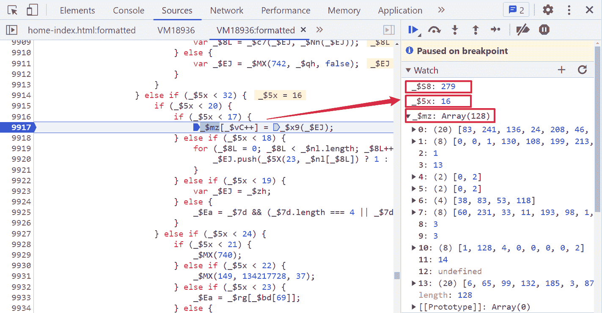

## 跟栈分析

老样子，本地替换一套 412 页面的代码，固定下来，然后开始跟栈分析。直接从 `(772, 1)` 开始跟（文中说的第多少号控制流、第几步均为作者自己的叫法，第多少步并不代表实际上的步骤，仅表示关键步骤）：

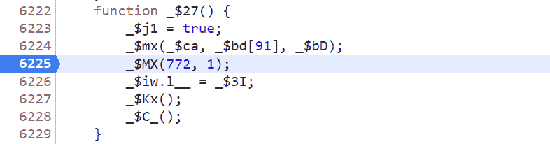

单步进来，`_$qh` 是传进来的参数 1，即将进入 742 号控制流：

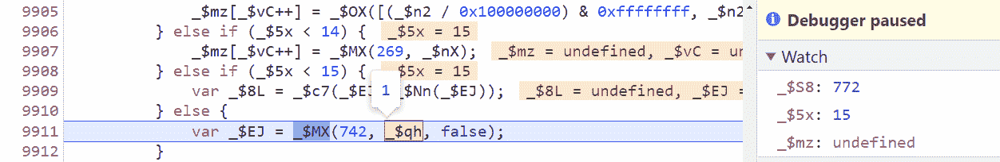

进入 742 号控制流，第 1 步通过一个方法获取了一个时间戳，进入这个方法内部，对时间戳进行了差值计算，会发现有两个变量 `_$tb` 和 `_$t1` 已经生成了值：

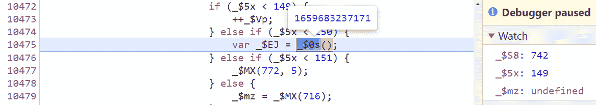

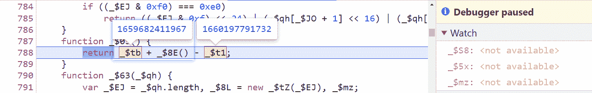

这两个值也是时间戳，怎么来的？直接搜索这两个变量，搜索结果有几个全部打上断点，刷新断下后往前跟栈，会发现是最开始走了一遍 703 号控制流：

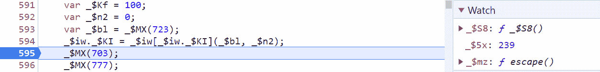

先单步跟一遍 703 号控制流，703 号控制流第 1 步是进入 699 号控制流，返回一个数组，没有特别的，直接扣代码即可：

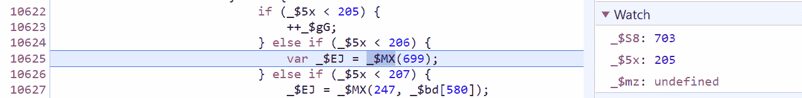

703 号控制流第 2、3 步分别取数组的值：

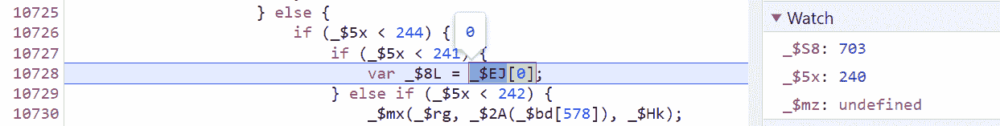

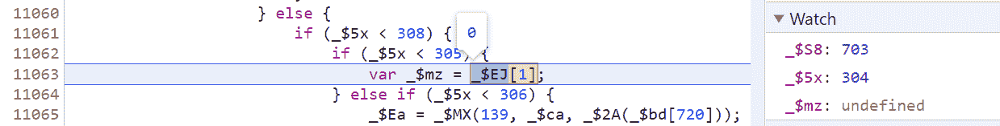

703 号控制流第 4、5、6 步生成两个时间戳并赋值给前面提到的 `_$tb`、`_$t1` 变量，涉及到的方法也没有什么特别的，缺啥搜啥补啥即可：

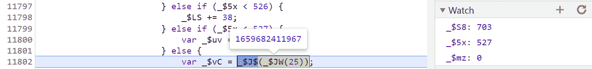

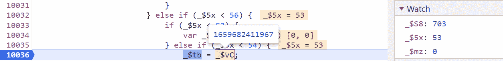

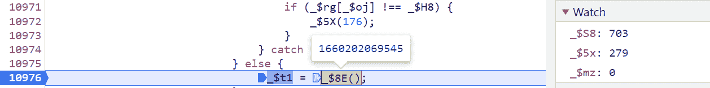

703 号控制流第 7 步，这里修改了 `$_ts` 的某个值（VM 代码中，`$_ts` 被赋值给了另一个变量，下图中是 `_$iw`），`_$iw._$uq` 原本的值是 `_$ou`，修改后的值是 `181`，这个值也是后面关键 4 位数组中的其中一个，具体逻辑后面再讲。

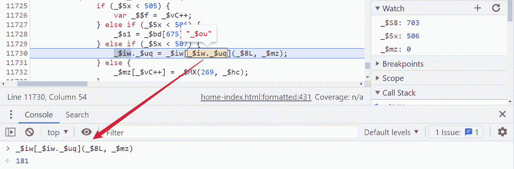

703 号控制流结束，我们继续前面的 742 号控制流，742 号控制流第 2 步，将前面生成的时间戳赋值给另一个变量。

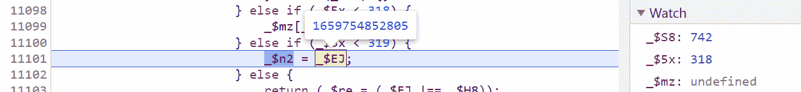

742 号控制流第 3 步，进入 279 号控制流，279 号控制流是生成 128 位数组的关键。

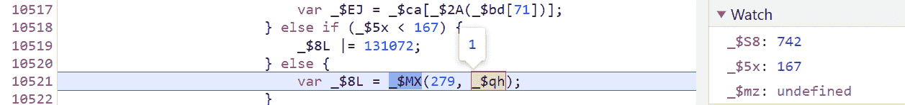

进入 279 号控制流，第 1 步定义了一个变量：

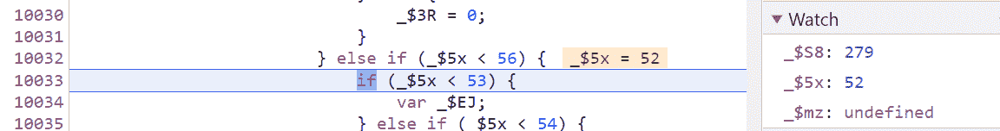

279 号控制流，第 2 步，进入 157 号控制流，157 号控制流主要是做自动化检测

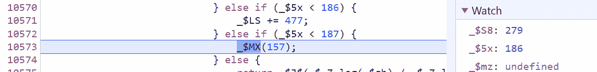

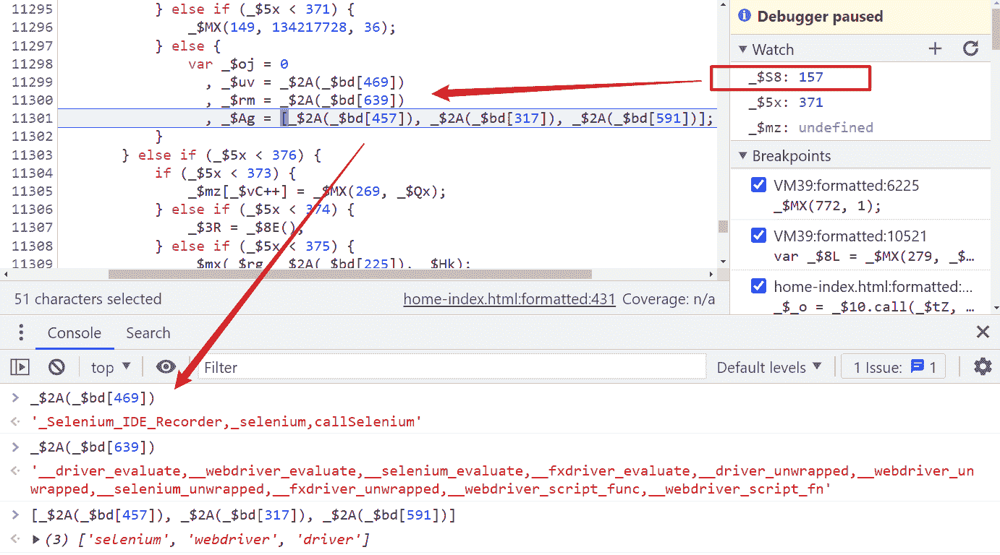

279 号控制流，第 3、4、5 步，做了一些运算，一些全局变量的值会改变，后续的数组里会用到。

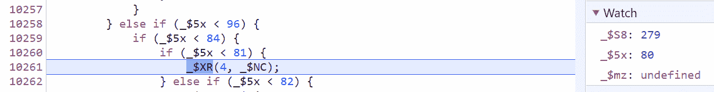

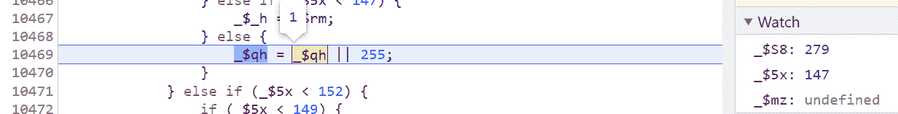

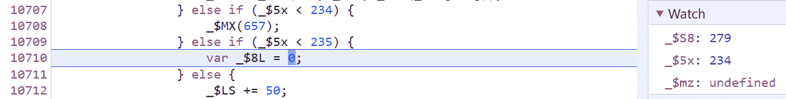

279 号控制流，第 6 步，初始化了一个 128 位的空数组，后续的操作都是为了往这个数组里面填充值。

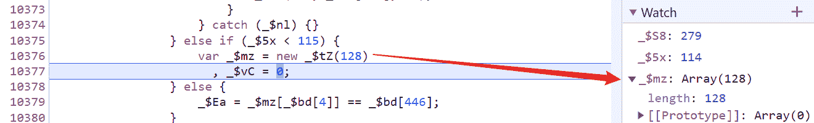

279 号控制流，第 7 步，进入 695 号控制流，生成一个 20 位的数组。

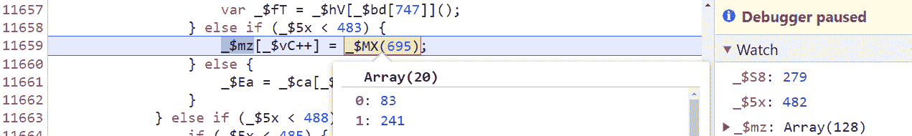

进入 695 号控制流看一下，第 1 步，取 `$_ts` 的一个值，生成 16 位数组。

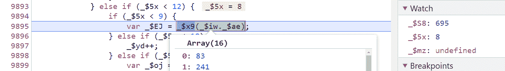

695 号控制流，第 2 步，取 `$_ts` 里的四个值，与前面的 16 位数组一起组成 20 位数组。

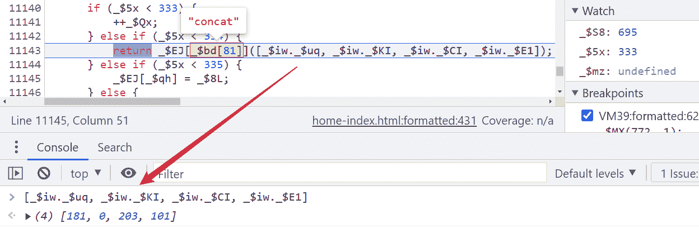

这里注意这四个值怎么来的，以第二个值 `_$iw._$KI` 为例，搜索发现有一条语句 `_$iw._$KI = _$iw[_$iw._$KI](_$bl, _$n2);`，首先等号右边取 `_$iw._$KI` 的值为 `_$Mo`，然后 `_$iw["_$Mo"]` 实际上就是 `_$iw._$Mo`，前面的定义 `_$iw._$Mo = _$1D`，`_$1D` 是个方法，所以原语句相当于 `_$iw._$KI = _$1D(_$bl, _$n2)`，其他三个值的来源也是类似的。

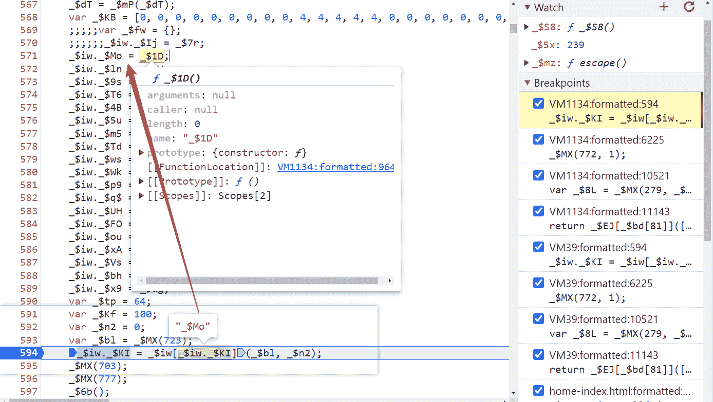

695 号控制流结束，回到 279 号控制流，第 8 步，将前面的时间戳转换成了一个 8 位数组。

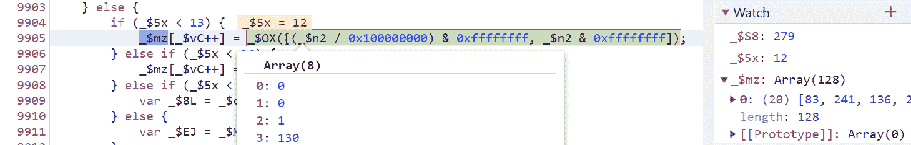

279 号控制流，第 9 步，往 128 位数组里面添加了一个值。

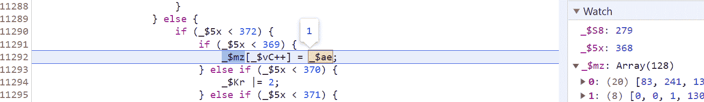

`_$ae` 这个值怎么来的？搜索下断点并跟栈，发现是开头走了第 178 号控制流得来的，跟着走一遍即可。

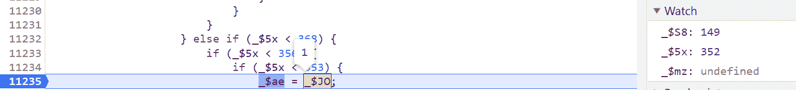

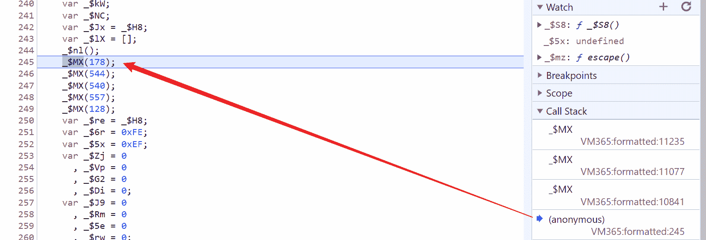

279 号控制流，第 10 步，又往 128 位数组里面添加了一个值，这个值是开始 279 号控制流传过来的。

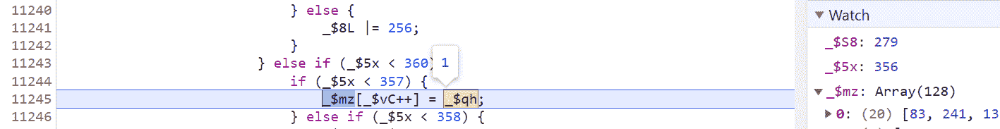

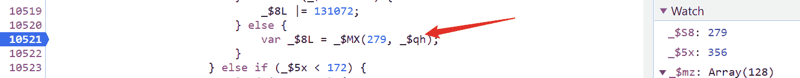

279 号控制流，第 11、12、13、14 步，时间戳相关计算，然后生成两个 2 位数组。注意这里面的两个变量，`_$ll` 和 `_$ed`，在刷新 cookie、生成后缀的时候可能是有值的，仅访问主页没有值不影响。

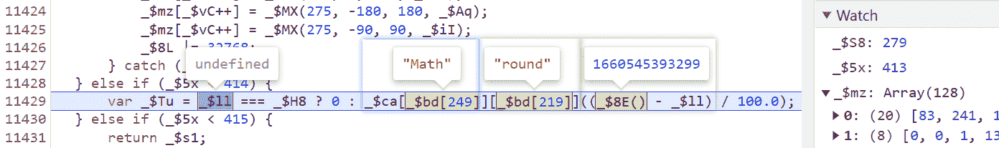

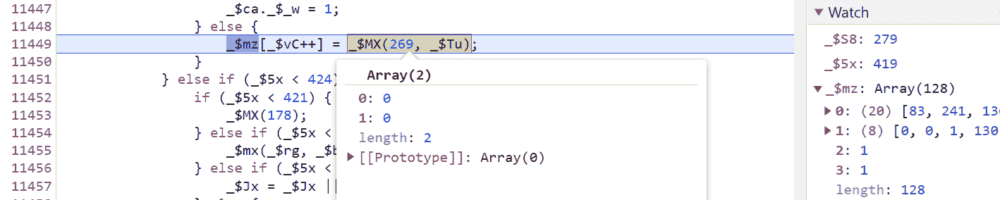

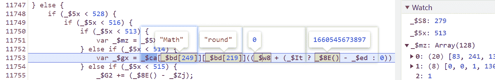

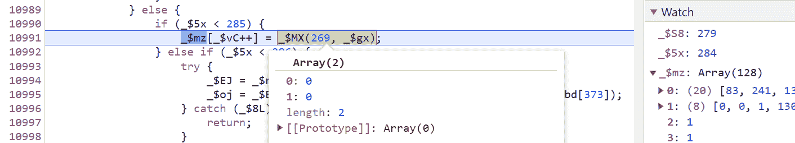

279 号控制流，第 15 步，往 128 位数组里面添加了一个 4 位数组 `_$bl`，搜索也可以找到是通过 723 号控制流得来的。

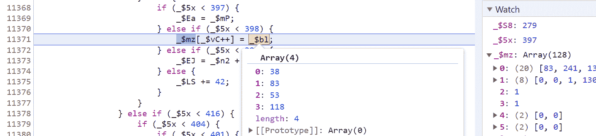

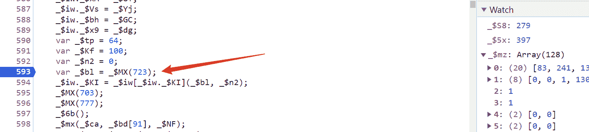

这里的 723 号控制流，实际上是取了 `$_ts` 某个值进行运算，生成 16 位数组，然后截取前 4 位数组返回的。

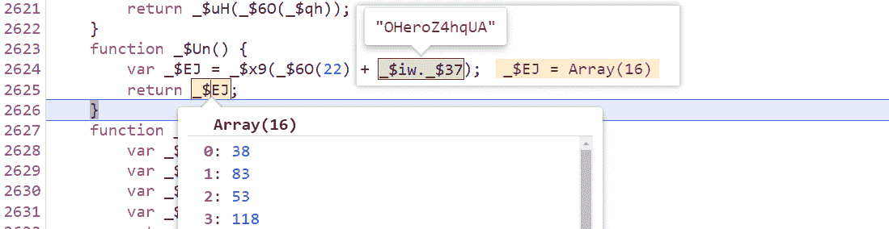

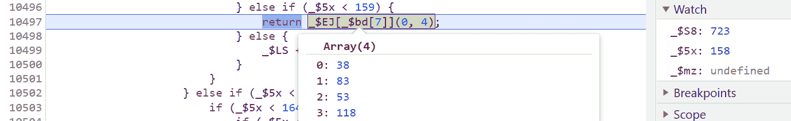

279 号控制流，第 16 步，往 128 位数组里面添加了一个 8 位数组 `_$Yb`。

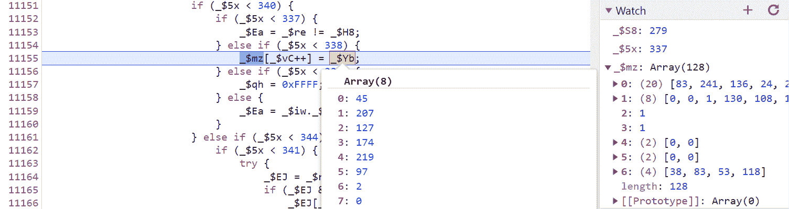

8 位数组 `_$Yb` 同样搜索打断点，可以在一个赋值语句断下：

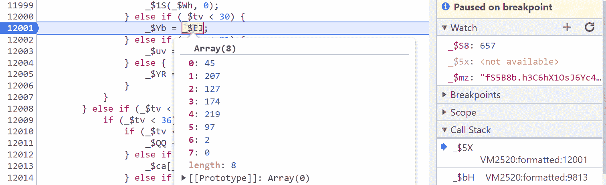

可以看到 `_$EJ` 的值就是 `_$Yb`，往前跟栈，会发现先后经过了 657 号、10 号、777 号控制流，其中 777 号控制流是入口：

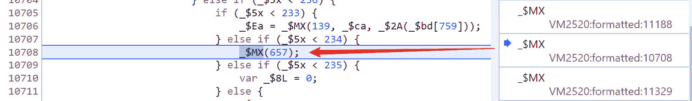

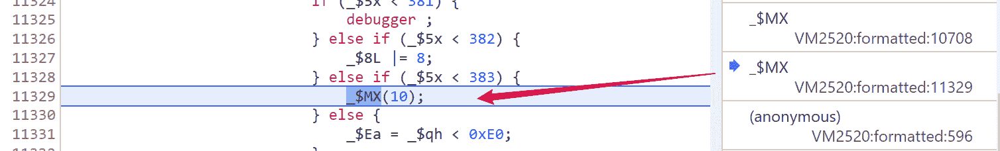


如果单步跟 777 号控制流，你会发现步骤较多，中间有些语句不好处理，且容易跟丢，所以我们这里就直接关注 657 号控制流就行了，777 号控制流直接到 10 号控制流，再到 657 号控制流，中间的一些过程暂时不管，跟到缺什么的时候再说（后续有很多取值赋值等操作都是在 777 号控制流里实现的，可以注意一下），这段逻辑在本地表现的代码如下图所示：


## 控制流跟踪

### 657 号控制流

这里直接单步跟一下 657 号控制流，第 1、2 步 `new` 了一个方法。


这里就要注意了，容易跟丢，先进入 `_$bH` 方法打上断点，然后下一个断点就走到里面了，接着在单步调试，会进到另一个小的控制流里面，如下图所示：


### 96 号小控制流

开始单步跟第 96 号小控制流，第 1 步定义了一个变量。


96 号小控制流，第 2 步将 `_$PI` 的值赋值给了 `_$fT`，而 `_$PI` 的值其实是 `window.localStorage.$_YWTU`，`window.localStorage` 里面有很多值，这个东西我们文章最后再讲，其中一些值与浏览器指纹相关，这里先知道他是取值就行了。


96 号小控制流，第 3 步，进入第 94 号小控制流，最终生成的是一个 8 位数组，这个其实就是前面我们想要的 `_$Yb` 的值了。


后面没有什么特别的，中间几步我就省略了，照着扣代码就行了，然后 96 号小控制流，第 4 步，就将 `_$EJ` 的值赋值给 `_$Yb` 了。


到这里先别急着结束，后面还有关键的几步，96 号小控制流，第 5 步，又遇到了和前面类似的写法。


同样的，先进 `_$pu` 打断点，再单步跟。


来到另一个小控制流，如下图所示：


10 号小控制流第 1 步，取 `window.localStorage.$_cDro` 的值，转为 `int` 类型，赋值给 `_$5s`，这个 `_$5s` 后续也会加到 128 位大数组里面。


10 号小控制流后续还有几步，没啥用可以省略，最后一步返回 96 号小控制流。


然后 96 号小控制流后续也没啥了，返回 657 号控制流。


### 279 号控制流

此时我们已经拿到 `_$Yb` 了，777 号控制流就先不管了，后续还有些代码先不管不用扣，等用到的时候再说，返回 279 号控制流，接着前面的步骤，来到第 17 步，变量 `_$5s` 经过 264 号控制流后，生成了一个值并添加到 128 位大数组里面，而 `_$5s` 的值正是前面我们跟 `_$Yb` 时，通过 777 号控制流拿到的，实际上也就是取 `window.localStorage.$_cDro` 的值，转为了 `int` 类型。


279 号控制流，第 18、19、20 步，往 128 位数组里面添加了两个定值、一个 8 位数组。


279 号控制流，第 21 步，往 128 位数组里面添加了一个 `undefined` 占位，后续会有操作将其填充值。


279 号控制流，第 22 步，进入 58 号控制流，58 号控制流与 `window.localStorage.$_fb` 的值有关，如果有这个值，就会生成 20 位数组，如果没有就是 `undefined`。58 号控制流就只有一步，返回一个变量，本文中是 `_$0g`。


这个 `_$0g` 是咋来的呢？同样的直接搜索，下断点，发现是通过 112 号控制流得来的，往前跟栈，同样是先经过了 777 号控制流，和之前的情况类似，中间的过程就不看了，直接看这个 112 号控制流。


本文中，112 号控制流传的参是 `_$bd[279]` 即 `$_fb`，112 号控制流第 1 步，进入 247 号控制流。


247 号控制流就 3 步，先将 `window.localStorage` 赋值给一个变量，然后取其中 `$_fb` 的值再返回。


112 号控制流第 2、3 步，一个 `try-catch` 语句，取 `window.localStorage.$_fb` 计算得到 25 位数组，然后取前 20 位并返回，这就是前面我们需要的 `_$0g` 的值了。


279 号控制流，第 23 步，将前面 `window.localStorage.$_fb` 计算得到的 20 位数组添加到 128 位大数组里面，注意这一步如果没有 `window.localStorage.$_fb` 值的话，是不会添加的。


279 号控制流，第 24 步，对一个变量进行位运算，然后取 `window.localStorage.$_f0` 进行运算，如果 `$_f0` 为空的话是不会往 128 位大数组里添加值的。


279 号控制流，第 25 步，对一个变量进行位运算，然后取 `window.localStorage.$_fh0` 进行运算，如果 `$_fh0` 为空的话是不会往 128 位大数组里添加值的。


279 号控制流，第 26 步，对一个变量进行位运算，然后取 `window.localStorage.$_f1` 进行运算，如果 `$_f1` 为空的话是不会往 128 位大数组里添加值的。


279 号控制流，第 27 步，进入 611 号控制流，611 号控制流主要是检测 `window.navigator.connection.type`，即 `NetworkInformation` 网络相关信息，里面判断了 `type` 是不是 `bluetooth`、`cellular`、`ethernet`、`wifi`、`wimax`，正常的话应该返回 0。


279 号控制流，接下来几步都是类似的，这里就直接统称第 28 步了，首先对一个变量进行位运算，然后分别取 `window.localStorage.$_fr`、`window.localStorage.$_fpn1`、`window.localStorage.$_vvCI`、`window.localStorage.$_JQnh` 进行运算，同样如果这些变量为空的话，也是不会往 128 位大数组里添加值的。


279 号控制流，第 29 步，往 128 位大数组里添加了一个定值 4，本文中该变量名是 `_$kW`。


`_$kW` 这个变量是咋来的，和前面的套路类似，直接搜索下断，同样是经过开头的 777 号控制流得来的，如下图所示：


继续 279 号控制流，中间有一些变量位运算之类的就省略了，第 30、31 步，取了一个 `https:443` 的长度进行计算，先后往 128 位大数组里添加了一个定值和一个 9 位数组。


279 号控制流，接下来几步都是在取值，都差不多，就统称为第 32 步了。


279 号控制流，第 33 步，之前 128 位大数组第 12 位是个 `undefined`，这里就将第 12 位填充上了一个 4 位数组，其中有个变量 `_$8L`，前面我们跟步骤的时候就有一个变量一直在做位运算，此处的 `_$8L` 就是这么来的。


279 号控制流，最后两步，原来的 128 位大数组，只取有值的前 21 位，一共有多少位与 `window.localStorage` 的某些值有关，有值的话就长一些，没有就短一些，然后再将数组的每个元素合并成最终的一个大数组并返回，279 号控制流就结束了。


### 742 号控制流

返回到文章开头的逻辑，279 号控制流结束，返回到 742 号控制流，第 2 步，定义了一个变量并生成了一个 32 位数组。


742 号控制流，第 3 步，取 `$_ts` 里面的某个值并赋值给一个变量。


742 号控制流，第 4 步，将前面 279 号控制流得到的大数组与上一步 `$_ts` 里面的某个值进行合并，合并后计算得到一个值。


742 号控制流，第 4 步，将上一步得到的值进一步计算得到一个 4 位数组，再将其和大数组合并。


742 号控制流，接下来几步是对时间戳进行各种操作，这里统称为第 5 步。


742 号控制流，第 6 步，将上一步得到的 4 个时间戳进行计算，得到一个 16 位数组。


742 号控制流，第 7 步，将上一步得到的 16 位数组进行异或运算。


742 号控制流，第 8 步，将上一步的 16 位数组进行计算，得到一个字符串。


742 号控制流，第 9 步，正式生成 `cookie` 值，其中 `_$bd[274]` 定值，一般视为版本号，将上一步得到的字符串、之前得到的大数组和一个 32 位数组进行计算、组合，得到最终结果。


742 号控制流结束，返回 772 号控制流，利用了一个方法，组装 `cookie`，然后赋值给 `document.cookie`，整个流程就结束了。


代码中用到的 `$_ts` 的值需要我们自己去匹配出来，动态替换，这些步骤和 4 代是类似的，本文就不再重复叙述，可以参考 K 哥 4 代的那篇文章进行处理即可。


## 后缀生成

本例中，请求头中有个 `sign` 参数，`Query String Parameters` 有两个后缀参数，这两个后缀和 4 代类似，都是瑞数生成的。


和 4 代的处理方法一样，我们下一个 `XHR` 断点，先让网页加载完毕，然后打开开发者工具，过掉无限 `debugger` 后，点击搜索就会断下，如下图所示：


往上跟栈到 `hasTokenGet`，是一个 sojson 旗下的 `jsjiami v6` 混淆，不值一提，重点是 `jsonMD5ToStr` 方法，先对传进去的参数做了一些编码处理，最后返回的是 `hex_md5`，和在线 MD5 加密的结果是一样的，说明是标准的 MD5。


重点来看瑞数的两个后缀生成方式，和 4 代一样，`XMLHttpRequest.send` 和 `XMLHttpRequest.open` 被重写了，如下图所示，在 `XMLHttpRequest.open` 下个断点，也就是图中的 `_$RQ` 方法，`arguments[1]` 就是原始 URL，经过图中的 `_$tB` 方法处理后就能拿到后缀。


跟进图中的 `_$tB` 方法，`_$tB` 方法里嵌套了一些其他方法，走一遍逻辑，到图中的 `_$5j` 方法里，前面的一部分都是在对传入的 URL 做处理。


接下来是生成了一个 16 位数组：


然后这个 16 位数组经过一个方法后就生成了第一个后缀，如下图所示，本文中这个方法是 `_$ZO`。


跟进 `_$ZO` 方法，主要有以下 5 步：

- 第 1 步：生成了一个 32 位数组；
- 第 2 步：将之前的 16 位数组以及两个变量拼接生成一个 50 位的数组；
- 第 3 步：进入 744 控制流，这里你会发现和之前我们跟 `cookie` 时的 742 号控制流是一样的，重复走了一遍，所以这里就不再跟了；
- 第 4 步：将生成的第一个后缀值进行处理，得到一个两位的字符串，这个字符串在获取第二个后缀的时候会用到；
- 第 5 步：将第一个后缀名称和值进行拼接并返回，此时，第一个后缀 `hKHnQfLv` 就生成了。


接着前面的 `_$5j` 方法，图中的 `_$5j` 这一步，就是获取第二个后缀 `8X7Yi61c` 的值：


主要是看一下图中的 `_$UM` 方法，先将前面生成的两位的字符串与 URL 参数进行拼接，然后会经过一个 `_$Nr` 方法就能得到第二个后缀的值了。


再来看一下 `_$Nr` 方法，先生成一个类似 53924 的值，然后一个 `try` 语句，注意这里有个方法，图中的 `_$Js` 方法，里面用到了 `$_ts` 里面的某个值，后面又生成了一个由数字组成的字符串，再次经过组合、计算后得到最终的值。


回到前面的 `_$UM` 方法，前缀 `8X7Yi61c` 与值组合，自此，两个后缀都拿到了：


### 3. 指纹生成

我们前面已经分析了，在往 128 位数组里添加值的时候，会有取 `window.localStorage` 里面的某些值进行计算的步骤，这些值就是取浏览器 `canvas` 等指纹生成的，指纹随机就能并发，通常访问单独的一个 `html` 页面是不校验指纹的，生成的短 `cookie` 就能通过，但是一些查询数据接口会校验指纹，通过触发 `load` 事件来向 `cookie` 里添加指纹，使得 `cookie` 长度变长，怎么查找指纹在哪里生成的，这里推荐直接看视频资料，已经讲得很清楚了，篇幅太长，本文就不再赘述了。
