# [Web逆向] 某登录表单参数逆向分析

- 原帖: https://www.52pojie.cn/forum.php?mod=viewthread&tid=1743808
- 抓取时间: 2026-11-01T22:59:40

## 一、前言

一个网站登录表单参数逆向分析（新手向，超级简单的啦），最近在挖逻辑漏洞，但是有些接口有加密参数，需要对其逆向还原。由于漏洞并没有挖到(网站安全还是及其给力的，点个赞。或许是我太菜了，哈哈哈)，但是对这个网站做了逆向，便分享出来

## 二、网址

aHR0cHM6Ly91LnlvdWRpYW5zb2Z0LmNuLz91cmw9aHR0cDovL3d3dy55b3VkaWFuY21zLmNvbQ==

## 三、正文

提交表单之后，有两个加密参数

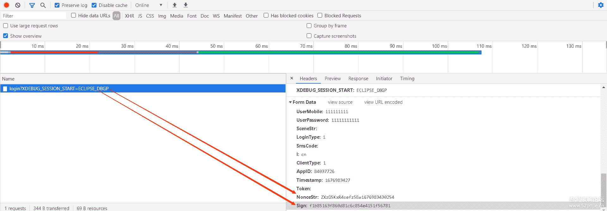

`1.png` (72.97 KB, 下载次数: 3)；[附件下载](https://www.52pojie.cn/forum.php?mod=attachment&aid=MjU5MjAwOHwwZjMyM2QzYXwxNzkzNTczOTc3fDE2ODA4NnwxNzQzODA4&nothumb=yes)；1；2023-2-21 20:51 上传

通过initiator进入下断点

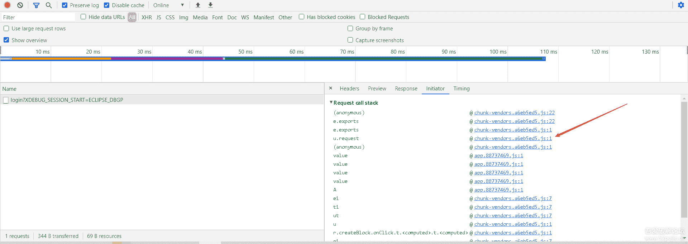

`2.png` (61.71 KB, 下载次数: 3)；[附件下载](https://www.52pojie.cn/forum.php?mod=attachment&aid=MjU5MjAwOXwzOWQ2OTcxN3wxNzkzNTczOTc3fDE2ODA4NnwxNzQzODA4&nothumb=yes)；2；2023-2-21 20:51 上传

在693行下断点，提交表单之后断点断了下来，查看scope里面并没有想要的参数出来。

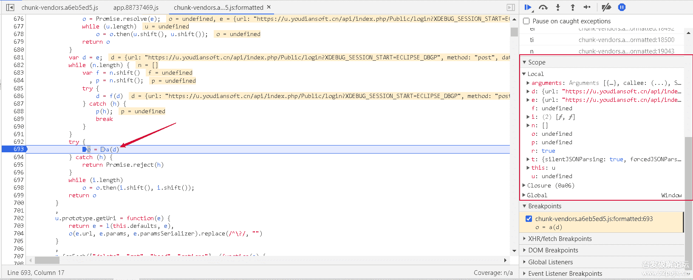

`3.png` (72.17 KB, 下载次数: 3)；[附件下载](https://www.52pojie.cn/forum.php?mod=attachment&aid=MjU5MjAxMHw3MTdjNzMwMXwxNzkzNTczOTc3fDE2ODA4NnwxNzQzODA4&nothumb=yes)；3；2023-2-21 20:53 上传

在堆栈回溯，可以看到`t`是接口里面的数据

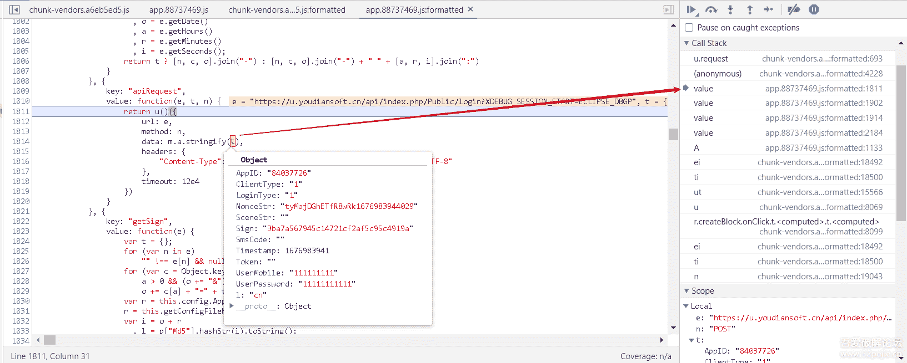

`4.png` (95.52 KB, 下载次数: 1)；[附件下载](https://www.52pojie.cn/forum.php?mod=attachment&aid=MjU5MjAxMXxjODQ3MzAwMHwxNzkzNTczOTc3fDE2ODA4NnwxNzQzODA4&nothumb=yes)；4；2023-2-21 20:56 上传

分析一下代码，看看`t`是从哪里传过来的，可以看到1824行声明了变量`t`。

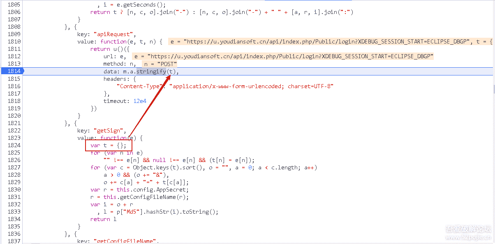

`5.png` (33.51 KB, 下载次数: 2)；[附件下载](https://www.52pojie.cn/forum.php?mod=attachment&aid=MjU5MjAxM3w2OWVlNmFiZnwxNzkzNTczOTc3fDE2ODA4NnwxNzQzODA4&nothumb=yes)；5；2023-2-21 20:59 上传

从代码可以看出变量`l`那一行有个很明显的`md5`，这肯定是加密关键位置。对比一下表单参数看看是哪个参数

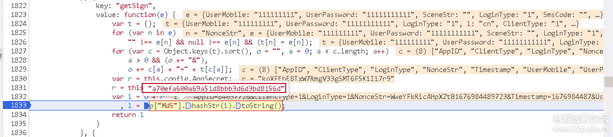

`6.png` (28.7 KB, 下载次数: 3)；[附件下载](https://www.52pojie.cn/forum.php?mod=attachment&aid=MjU5MjAxNnwxZjQ4MGE2N3wxNzkzNTczOTc3fDE2ODA4NnwxNzQzODA4&nothumb=yes)；6；2023-2-21 21:03 上传

`l`就是`Sign`参数

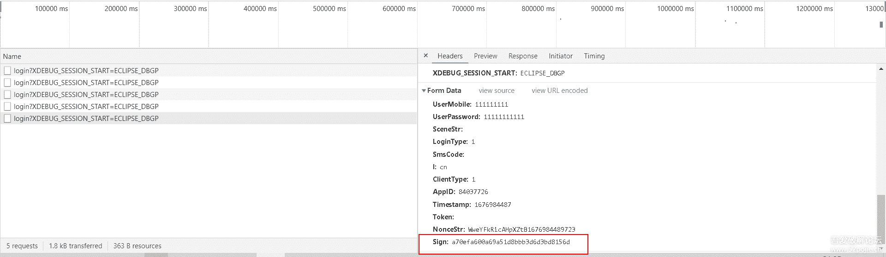

`7.png` (47.02 KB, 下载次数: 2)；[附件下载](https://www.52pojie.cn/forum.php?mod=attachment&aid=MjU5MjAxN3w1N2Y5ZjkxY3wxNzkzNTczOTc3fDE2ODA4NnwxNzQzODA4&nothumb=yes)；7；2023-2-21 21:06 上传

接下来便是把关键函数扣下来了。

报错了，`r`未定义

`8.png` (26.54 KB, 下载次数: 3)；[附件下载](https://www.52pojie.cn/forum.php?mod=attachment&aid=MjU5MjAxOHxlMWNiYjFjM3wxNzkzNTczOTc3fDE2ODA4NnwxNzQzODA4&nothumb=yes)；8；2023-2-21 21:10 上传

在控制台打印`r`是一个字符串，修改`r`的值运行。

`9.png` (1.26 KB, 下载次数: 4)；[附件下载](https://www.52pojie.cn/forum.php?mod=attachment&aid=MjU5MjAxOXw0NzdkYTZiMXwxNzkzNTczOTc3fDE2ODA4NnwxNzQzODA4&nothumb=yes)；9；2023-2-21 21:12 上传

报错了，去浏览器查看这个函数

`10.png` (28.77 KB, 下载次数: 4)；[附件下载](https://www.52pojie.cn/forum.php?mod=attachment&aid=MjU5MjAyMHxkY2Y4MjZkMHwxNzkzNTczOTc3fDE2ODA4NnwxNzQzODA4&nothumb=yes)；10；2023-2-21 21:14 上传

函数在1838行，硬扣就完事了。

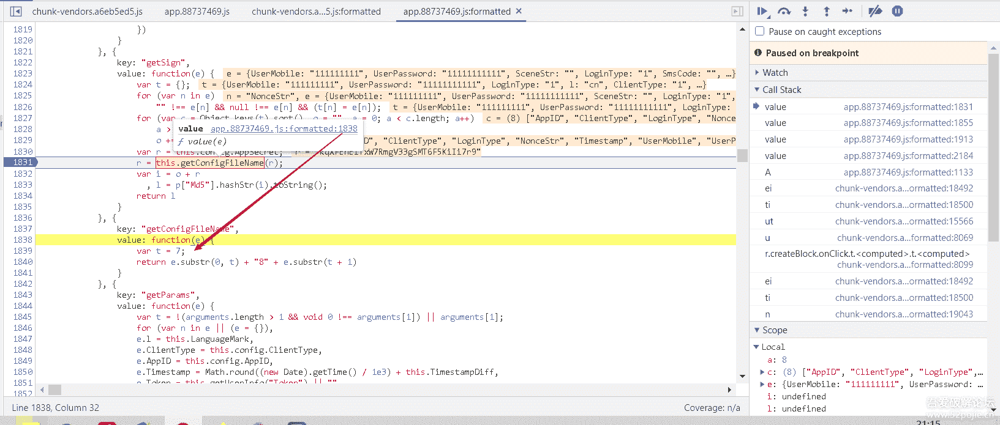

`11.png` (106.35 KB, 下载次数: 2)；[附件下载](https://www.52pojie.cn/forum.php?mod=attachment&aid=MjU5MjAyMXxkYjg2M2Q5Y3wxNzkzNTczOTc3fDE2ODA4NnwxNzQzODA4&nothumb=yes)；11；2023-2-21 21:15 上传

报错了，但是这个可以看的出是对`i`参数进行`md5`加密，

`12.png` (31.47 KB, 下载次数: 1)；[附件下载](https://www.52pojie.cn/forum.php?mod=attachment&aid=MjU5MjAyMnxjM2IwYzU5OXwxNzkzNTczOTc3fDE2ODA4NnwxNzQzODA4&nothumb=yes)；12；2023-2-21 21:18 上传

懒得扣了，直接用加密库加密了。

`13.png` (9.33 KB, 下载次数: 3)；[附件下载](https://www.52pojie.cn/forum.php?mod=attachment&aid=MjU5MjAyM3w2ZGRlOTEyMXwxNzkzNTczOTc3fDE2ODA4NnwxNzQzODA4&nothumb=yes)；13；2023-2-21 21:20 上传

运行成功了，但是发现不是动态的，才发现传下来的参数`e`有`nonce`和时间戳，不能写固定。

`14.png` (22.16 KB, 下载次数: 2)；[附件下载](https://www.52pojie.cn/forum.php?mod=attachment&aid=MjU5MjAyNHw1NmU4ZTEyNXwxNzkzNTczOTc3fDE2ODA4NnwxNzQzODA4&nothumb=yes)；14；2023-2-21 21:22 上传

时间戳用代码生成即可

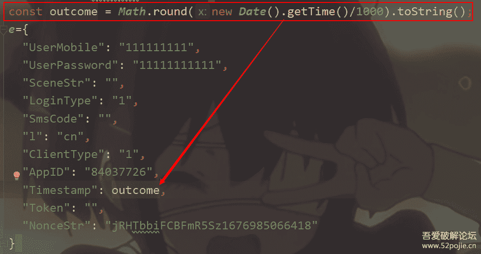

`15.png` (237.48 KB, 下载次数: 3)；[附件下载](https://www.52pojie.cn/forum.php?mod=attachment&aid=MjU5MjAyNXwwZWVjOWJmN3wxNzkzNTczOTc3fDE2ODA4NnwxNzQzODA4&nothumb=yes)；15；2023-2-21 21:24 上传

`nonce`直接搜索就能搜到关键位置。

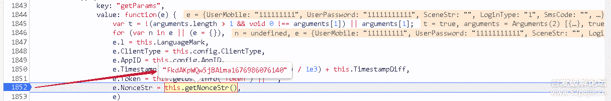

`16.png` (23.67 KB, 下载次数: 3)；[附件下载](https://www.52pojie.cn/forum.php?mod=attachment&aid=MjU5MjAyNnxhMTg1Mzk5OHwxNzkzNTczOTc3fDE2ODA4NnwxNzQzODA4&nothumb=yes)；16；2023-2-21 21:28 上传

直接进入函数进去扣代码就行了。

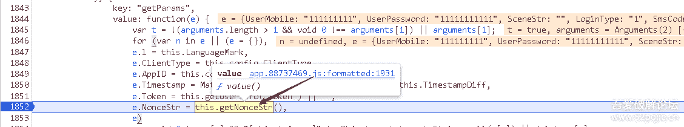

`17.png` (23.64 KB, 下载次数: 2)；[附件下载](https://www.52pojie.cn/forum.php?mod=attachment&aid=MjU5MjAyN3wxODc1NGQ5YnwxNzkzNTczOTc3fDE2ODA4NnwxNzQzODA4&nothumb=yes)；17；2023-2-21 21:29 上传

### 结尾

文章仅供学习交流使用，如有侵权，联系我删除。
