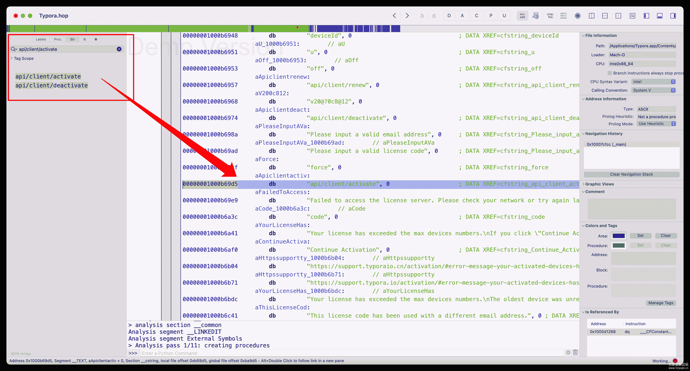
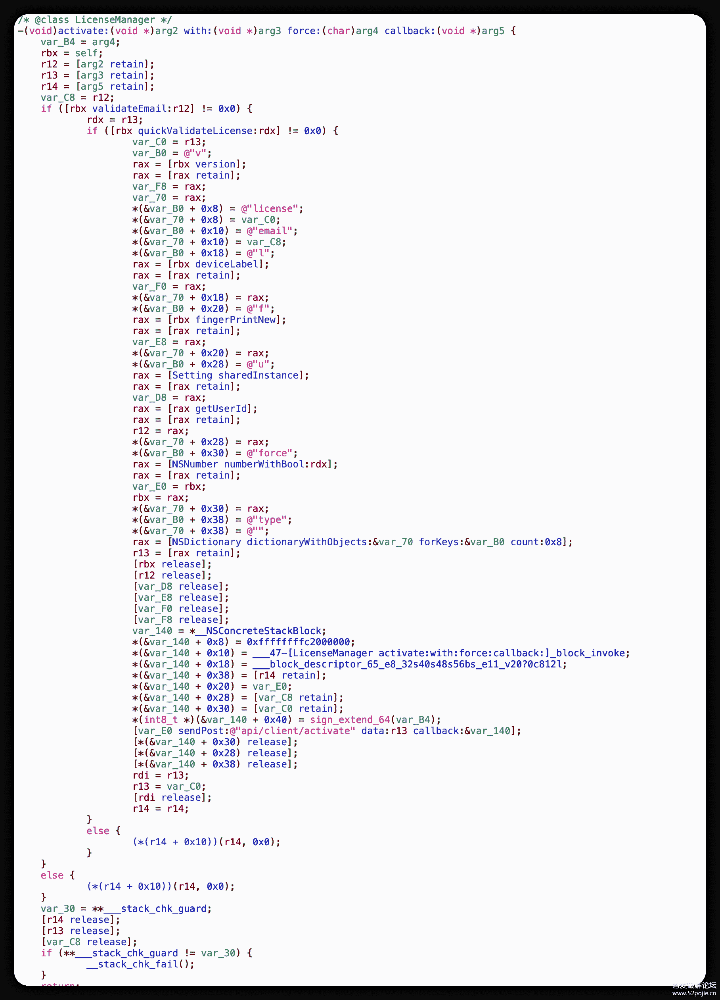
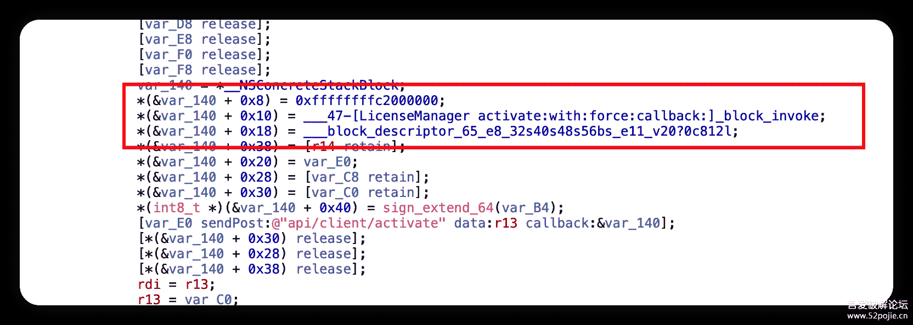
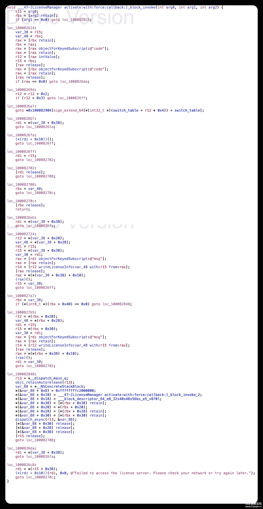
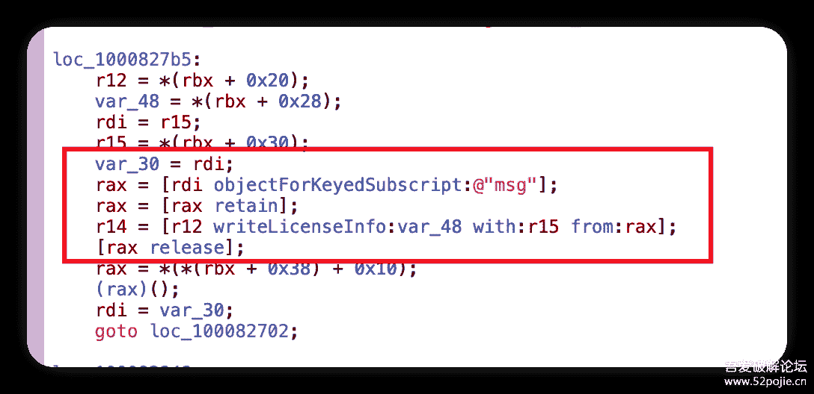
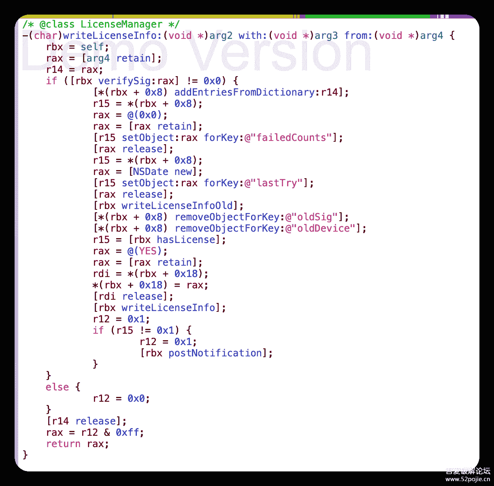
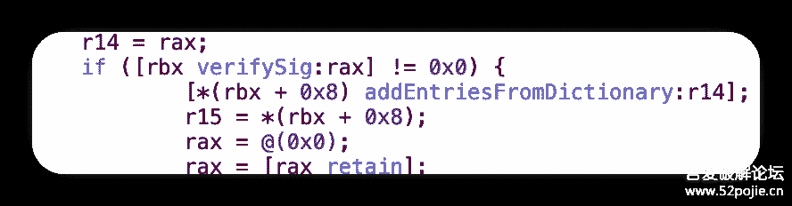
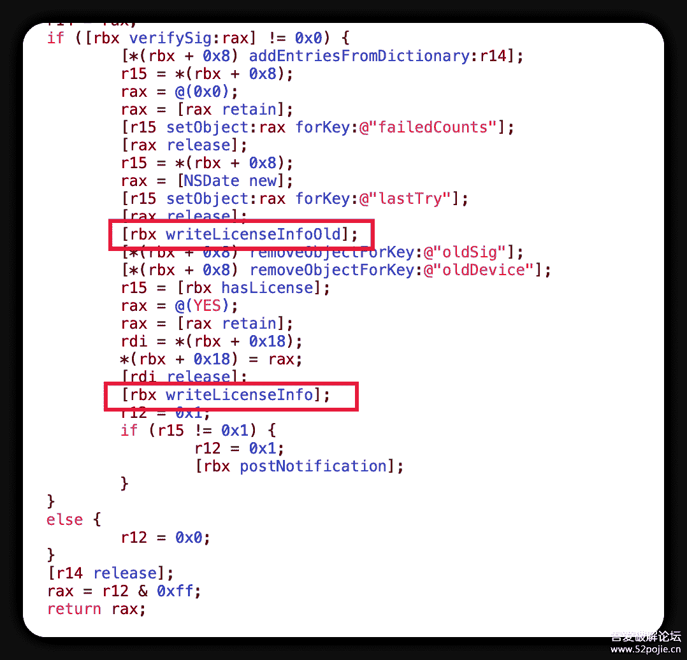
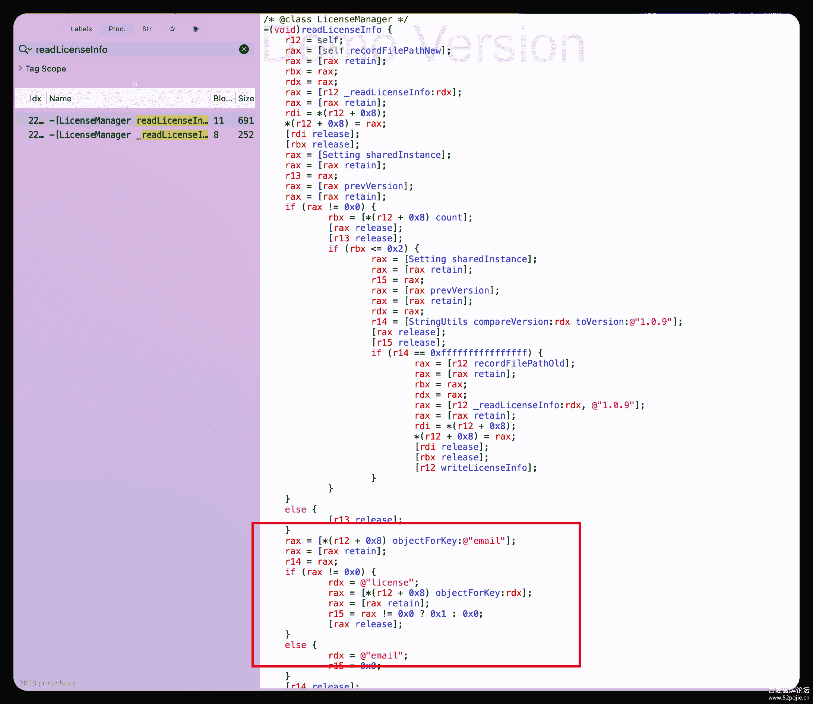

# [MacOS逆向] Typora For Mac Crack
- 原帖: https://www.52pojie.cn/forum.php?mod=viewthread&tid=1743902
- 抓取时间: 2026-11-01T23:00:24

## Typora For Mac Crack
Typora Mac版是用`Objective-C`写的，没有什么保护措施，直接反汇编逆向分析即可，这里记录在线激活的思路和方法。

### 0x01 定位关键点
使用`proxifier`或者其他代{过}{滤}理工具，将Typora流量转发到`burpsuite`中，之后去激活可以获取到关键请求，这里不过多描述，当然也可以自己猜关键字，在反汇编中查询。

关键请求：`api/client/activate`


image-20221212154056335.png (1.21 MB, 下载次数: 4)
[href="forum.php?mod=attachment&aid=MjU4OTYyM3xlNjczZWUyOXwxNzkzNTc0MDIxfDE2ODA4NnwxNzQzOTAy&nothumb=yes" target="_blank"](https://www.52pojie.cn/forum.php?mod=attachment&aid=MjU4OTYyM3xlNjczZWUyOXwxNzkzNTc0MDIxfDE2ODA4NnwxNzQzOTAy&nothumb=yes)
2023-2-9 15:28 上传

通过查看引用，逆向追踪到`LicenseManager` `activate`方法


image-20221212154240789.png (662.95 KB, 下载次数: 0)
[href="forum.php?mod=attachment&aid=MjU4OTYxNXw0MzFjZWI5OXwxNzkzNTc0MDIxfDE2ODA4NnwxNzQzOTAy&nothumb=yes" target="_blank"](https://www.52pojie.cn/forum.php?mod=attachment&aid=MjU4OTYxNXw0MzFjZWI5OXwxNzkzNTc0MDIxfDE2ODA4NnwxNzQzOTAy&nothumb=yes)
2023-2-9 15:28 上传

然后查看请求结束之后所调用的`callback`方法的执行内容，可以看到有`code`字样，如果你尝试去抓包，就能从这开始推断正确的返回值内容了


image-20221212154415488.png (216.63 KB, 下载次数: 1)
[href="forum.php?mod=attachment&aid=MjU4OTYxNnw1YWRhMDhhNnwxNzkzNTc0MDIxfDE2ODA4NnwxNzQzOTAy&nothumb=yes" target="_blank"](https://www.52pojie.cn/forum.php?mod=attachment&aid=MjU4OTYxNnw1YWRhMDhhNnwxNzkzNTc0MDIxfDE2ODA4NnwxNzQzOTAy&nothumb=yes)
2023-2-9 15:28 上传


image-20221212154500731.png (895.39 KB, 下载次数: 2)
[href="forum.php?mod=attachment&aid=MjU4OTYxN3xjODljOGE2M3wxNzkzNTc0MDIxfDE2ODA4NnwxNzQzOTAy&nothumb=yes" target="_blank"](https://www.52pojie.cn/forum.php?mod=attachment&aid=MjU4OTYxN3xjODljOGE2M3wxNzkzNTc0MDIxfDE2ODA4NnwxNzQzOTAy&nothumb=yes)
2023-2-9 15:28 上传

继续追踪，看处理函数`writeLicenseInfo`，见名知意，就是写授权信息的函数，这里也可以看出，激活请求返回值需要有`msg`字段


image-20221212154650569.png (110.91 KB, 下载次数: 1)
[href="forum.php?mod=attachment&aid=MjU4OTYxOHwyYWQ5NDNiMnwxNzkzNTc0MDIxfDE2ODA4NnwxNzQzOTAy&nothumb=yes" target="_blank"](https://www.52pojie.cn/forum.php?mod=attachment&aid=MjU4OTYxOHwyYWQ5NDNiMnwxNzkzNTc0MDIxfDE2ODA4NnwxNzQzOTAy&nothumb=yes)
2023-2-9 15:28 上传


image-20221212154701674.png (235.03 KB, 下载次数: 0)
[href="forum.php?mod=attachment&aid=MjU4OTYxOXwyM2Y2NWI3NnwxNzkzNTc0MDIxfDE2ODA4NnwxNzQzOTAy&nothumb=yes" target="_blank"](https://www.52pojie.cn/forum.php?mod=attachment&aid=MjU4OTYxOXwyM2Y2NWI3NnwxNzkzNTc0MDIxfDE2ODA4NnwxNzQzOTAy&nothumb=yes)
2023-2-9 15:28 上传

然后我们发现关键的判断函数`verifySig`，实际破解直接返回`0x1`即可，如果感兴趣，可以自行继续追踪，可以找到公钥信息


image-20221212154909414.png (50.36 KB, 下载次数: 2)
[href="forum.php?mod=attachment&aid=MjU4OTYyMHw1NTI3NDY0ZHwxNzkzNTc0MDIxfDE2ODA4NnwxNzQzOTAy&nothumb=yes" target="_blank"](https://www.52pojie.cn/forum.php?mod=attachment&aid=MjU4OTYyMHw1NTI3NDY0ZHwxNzkzNTc0MDIxfDE2ODA4NnwxNzQzOTAy&nothumb=yes)
2023-2-9 15:28 上传

`writeLicenseInfoOld`和`writeLicenseInfo`对应旧版和新版的授权信息写入，但是后面追踪并没有具体的字段信息，所以我们要换个思路，从读取`license`信息的地方查看读取了哪些字段


image-20221212155140137.png (187.3 KB, 下载次数: 3)
[href="forum.php?mod=attachment&aid=MjU4OTYyMXxmZDYwZDcyZnwxNzkzNTc0MDIxfDE2ODA4NnwxNzQzOTAy&nothumb=yes" target="_blank"](https://www.52pojie.cn/forum.php?mod=attachment&aid=MjU4OTYyMXxmZDYwZDcyZnwxNzkzNTc0MDIxfDE2ODA4NnwxNzQzOTAy&nothumb=yes)
2023-2-9 15:28 上传

直接搜索`readLicenseInfo`，找到方法实现，可以看到关键的关键字`email`和`license`


image-20221212155603651.png (398.77 KB, 下载次数: 0)
[href="forum.php?mod=attachment&aid=MjU4OTYyMnw0Nzk5MmZiMXwxNzkzNTc0MDIxfDE2ODA4NnwxNzQzOTAy&nothumb=yes" target="_blank"](https://www.52pojie.cn/forum.php?mod=attachment&aid=MjU4OTYyMnw0Nzk5MmZiMXwxNzkzNTc0MDIxfDE2ODA4NnwxNzQzOTAy&nothumb=yes)
2023-2-9 15:28 上传

最后确定激活请求返回值的必须内容：
```
{
  "code":0,
  "msg":{
    "email":"xxx@xxx.com",
    "license":"xxxxxx-xxxxxx-xxxxxx-xxxxxx"
  }
}
```

### 0x02 hook思路
- `hook` `verifySig`函数，让其永远返回真
- `hook`请求函数，让其在请求激活时返回符合条件的`json`数据
- `json`数据需要转换为`Objective-C`格式的对象
- Typora是有请求函数的，函数自动将`json`数据转换
- 两种方法
- 直接`hook`请求函数的返回值，返回自定义数据即可
- 代{过}{滤}理Typora，修改请求包返回值
- 输入激活码时本地有校验激活码是否符合要求
- 去网上找符合要求的激活码
- `hook`本地校验函数，这里就不展开了，自己追一下，很好找到，看谁调用了`activate`函数就行了

### 0x03 Frida hook
```
var NSString = ObjC.classes.NSString;

var NSJSONSerialization = ObjC.classes.NSJSONSerialization;

function json_to_objc(data){

    let strData = NSString.stringWithString_(data).dataUsingEncoding_(0x4);

    return NSJSONSerialization.JSONObjectWithData_options_error_(strData,0x1,ptr(0x0));

}

const LicenseManager = ObjC.classes.LicenseManager;

let verifySig = "- verifySig:";

Interceptor.attach(LicenseManager[verifySig].implementation, {

    onLeave(retval) {

        retval.replace(ptr(0x1));

    }

});

var email = "admin@admin.com";

var license = "XXXXXX-XXXXXX-XXXXXX-XXXXXX";

let validateEmail = "- validateEmail:";

Interceptor.attach(LicenseManager[validateEmail].implementation, {

    onEnter(args){

        let input = ObjC.Object(args[2]).toString();

        if (input != "" && input != undefined){

            email = input;

        }

    },

    onLeave(retval) {

        retval.replace(ptr(0x1));

    }

});

let quickValidateLicense = "- quickValidateLicense:";

Interceptor.attach(LicenseManager[quickValidateLicense].implementation, {

    onEnter(args){

        let input = ObjC.Object(args[2]).toString();

        if (input != "" && input != undefined){

            license = input;

        }

    },

    onLeave(retval) {

        retval.replace(ptr(0x1));

    }

});

const Utils = ObjC.classes.Utils;

let jsonStringToObject = "+ jsonStringToObject:";

Interceptor.attach(Utils[jsonStringToObject].implementation, {

    onLeave(retval) {

        let jsonData = `{

            "code":0,

            "retry":true,

            "msg":{

                "email":"${email}",

                "license":"${license}"

            }

        }`;

        retval.replace(json_to_objc(jsonData));

    }

});
```

### 0x04 参考
- 
[//www.soft98.top/2000@%e9%80%86%e5%90%91%e7%a0%b4%e8%a7%a3/2001@%e6%b5%85%e8%b0%88Mac%e5%ba%94%e7%94%a8%e9%80%86%e5%90%91%e7%a0%b4%e8%a7%a3" target="_blank" rel="noopener noreferrer nofollow"](https://www.soft98.top/2000@%e9%80%86%e5%90%91%e7%a0%b4%e8%a7%a3/2001@%e6%b5%85%e8%b0%88Mac%e5%ba%94%e7%94%a8%e9%80%86%e5%90%91%e7%a0%b4%e8%a7%a3:rel="nofollow noopener" href="https)
- 
[//www.wolai.com/cdMBuRYaqGJ7bMa59rXxjK" target="_blank" rel="noopener noreferrer nofollow"](https://www.wolai.com/cdMBuRYaqGJ7bMa59rXxjK:rel="nofollow noopener" href="https)
- 
[//developer.apple.com/cn/search/?type=Documentation&q" target="_blank" rel="noopener noreferrer nofollow"](https://developer.apple.com/cn/search/?type=Documentation&q:rel="nofollow noopener" href="https)=
- 
[//blog.csdn.net/boildoctor/article/details/121997000" target="_blank" rel="noopener noreferrer nofollow"](https://blog.csdn.net/boildoctor/article/details/121997000:rel="nofollow noopener" href="https)
