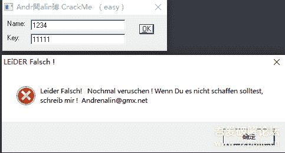
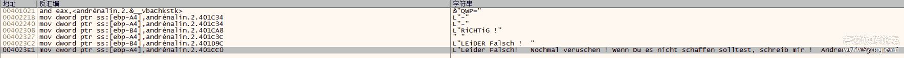
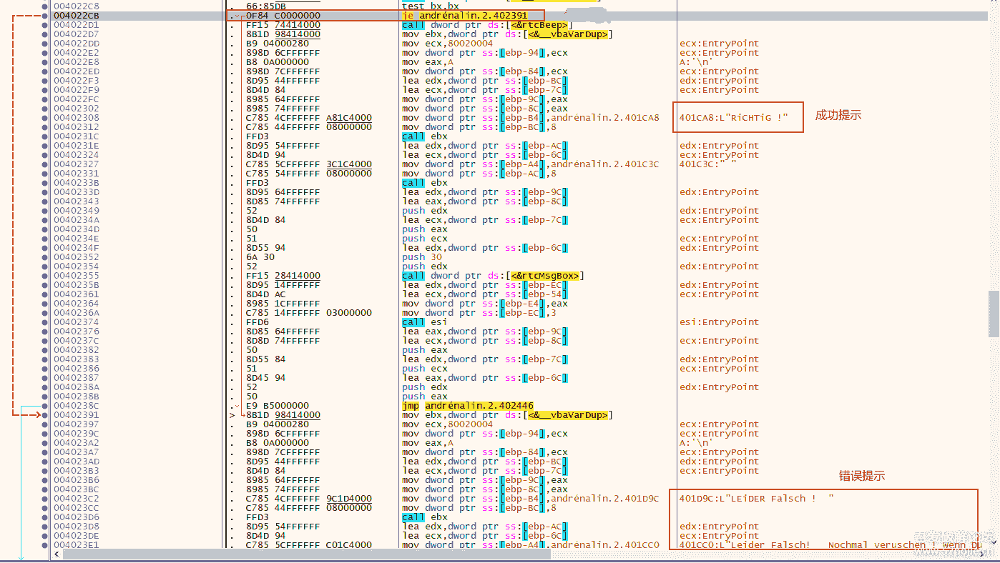
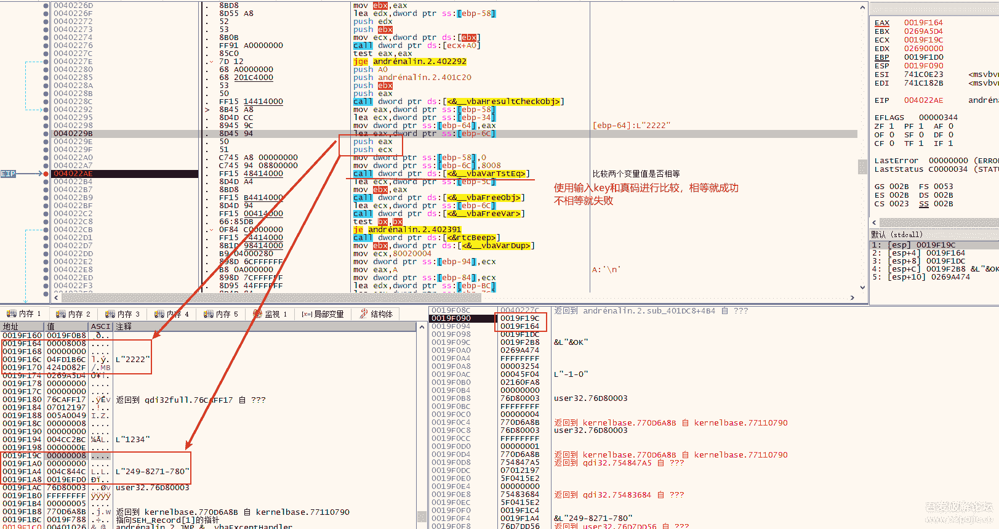
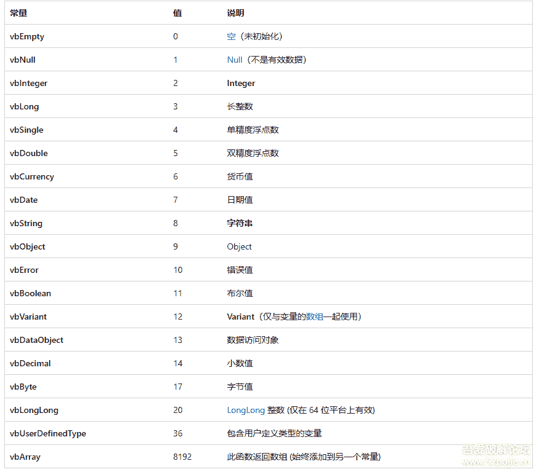
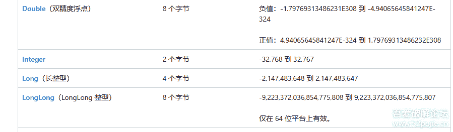
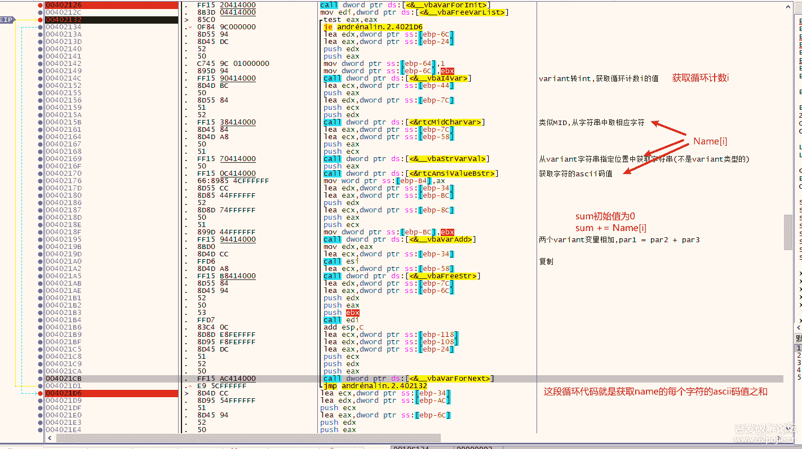
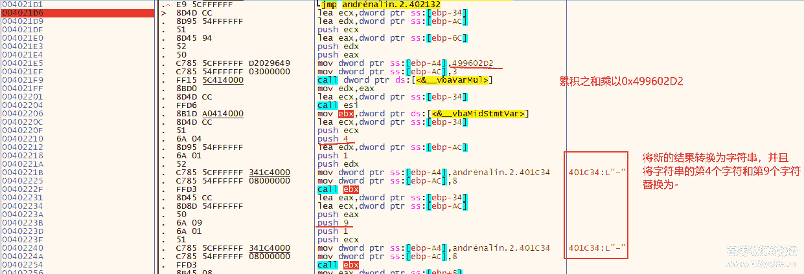

# [原创] 破解练习-CRACKME009

- 原帖: https://www.52pojie.cn/forum.php?mod=viewthread&tid=1744107
- 抓取时间: 2026-11-01T23:00:20

## 009-注册算法分析

### 一、工具和调试环境

- PE信息查看工具：`Die`
- 动态调试工具：`x64dbg`
- 系统环境：`win10 1909`

### 二、分析用户名/注册码的算法

#### 2.1运行程序

输入`Name`和`Key`后，直接点击`ok`按钮会报错



009-01.png (18.12 KB, 下载次数: 3)

[href="forum.php?mod=attachment&aid=MjU4OTcyMXw1M2FhMTMyNnwxNzkzNTc0MDE4fDE2ODA4NnwxNzQ0MTA3&nothumb=yes" target="_blank"](https://www.52pojie.cn/forum.php?mod=attachment&aid=MjU4OTcyMXw1M2FhMTMyNnwxNzkzNTc0MDE4fDE2ODA4NnwxNzQ0MTA3&nothumb=yes)

2023-2-9 23:40 上传

#### 2.2查壳

用`Die`查壳，无壳，vb程序

#### 2.3详细分析

既然有提示字符串，直接上`x64dbg`搜索字符串。和008一样，基本都是关键字符串



009-02.png (33.55 KB, 下载次数: 2)

[href="forum.php?mod=attachment&aid=MjU4OTcyMnwxNjU5NzQyY3wxNzkzNTc0MDE4fDE2ODA4NnwxNzQ0MTA3&nothumb=yes" target="_blank"](https://www.52pojie.cn/forum.php?mod=attachment&aid=MjU4OTcyMnwxNjU5NzQyY3wxNzkzNTc0MDE4fDE2ODA4NnwxNzQ0MTA3&nothumb=yes)

2023-2-9 23:40 上传

直接选中失败提示字符串双击跟过去看看，和008基本类型，向上很快就能找到关键跳转



009-03.png (245.25 KB, 下载次数: 1)

[href="forum.php?mod=attachment&aid=MjU4OTcyOHxlYzA2YzA1MnwxNzkzNTc0MDE4fDE2ODA4NnwxNzQ0MTA3&nothumb=yes" target="_blank"](https://www.52pojie.cn/forum.php?mod=attachment&aid=MjU4OTcyOHxlYzA2YzA1MnwxNzkzNTc0MDE4fDE2ODA4NnwxNzQ0MTA3&nothumb=yes)

2023-2-9 23:51 上传

向上继续找，可以发现`vbaVarTstEq`函数的返回值来确定是否跳转。该函数是比较两个`Variant`变量值是否相等。我们在该函数下个断点，然后随便输入`name`和`key`，点击`ok`。成功断在该断点



009-04.png (256.83 KB, 下载次数: 2)

[href="forum.php?mod=attachment&aid=MjU4OTcyM3w3ZmIyM2UyY3wxNzkzNTc0MDE4fDE2ODA4NnwxNzQ0MTA3&nothumb=yes" target="_blank"](https://www.52pojie.cn/forum.php?mod=attachment&aid=MjU4OTcyM3w3ZmIyM2UyY3wxNzkzNTc0MDE4fDE2ODA4NnwxNzQ0MTA3&nothumb=yes)

2023-2-9 23:40 上传

分析该函数参数，可以看到一个是我们输入的`key`，另一个就是计算后的真码（也就是我们需要输入的正确的`key`）。

`vbaVarTstEq`函数的两个参数是两个指向`Variant`类型的指针，`Variant`类型的结构如下

```
struct Variant
{
    short varType;      // 说明data数据的真实类型
    short res1;
    short res2;
    short res3;
    long long data;     // 8个字节，具体数据使用几个字节根据varType的值决定，为字符串时使用4个字节存储保存字符串的缓冲区的首地址
}
```

类型如下，来自[//learn.microsoft.com/zh-cn/office/vba/language/concepts/getting-started/vartype-constants" target="_blank" rel="noopener noreferrer nofollow"](https://learn.microsoft.com/zh-cn/office/vba/language/concepts/getting-started/vartype-constants:rel="nofollow noopener" href="https)



009-05.png (58.09 KB, 下载次数: 0)

[href="forum.php?mod=attachment&aid=MjU4OTcyNHwwZjU2NjI0OXwxNzkzNTc0MDE4fDE2ODA4NnwxNzQ0MTA3&nothumb=yes" target="_blank"](https://www.52pojie.cn/forum.php?mod=attachment&aid=MjU4OTcyNHwwZjU2NjI0OXwxNzkzNTc0MDE4fDE2ODA4NnwxNzQ0MTA3&nothumb=yes)

2023-2-9 23:40 上传

其中注意为`vbEmpty`类型时表示尚未被初始化的 `Variant` 变量（已分配初始值）。 包含 `vbEmpty` 的 `Variant` 用于数值上下文时为 0；用于字符串上下文时为零长度字符串 ("")。

长整型是占4个字节，如下



009-06.png (27.23 KB, 下载次数: 1)

[href="forum.php?mod=attachment&aid=MjU4OTcyNXwwOTZmNmQ4YnwxNzkzNTc0MDE4fDE2ODA4NnwxNzQ0MTA3&nothumb=yes" target="_blank"](https://www.52pojie.cn/forum.php?mod=attachment&aid=MjU4OTcyNXwwOTZmNmQ4YnwxNzkzNTc0MDE4fDE2ODA4NnwxNzQ0MTA3&nothumb=yes)

2023-2-9 23:40 上传

搞清楚了`Variant`类型结构下面的分析就好分析了。

通过不断的回溯找到算法位置如下，由于大部分使用`Variant`变量进行运算，所以单步调试的时候无法直接看到变量数据，每次还需要自己在内存中查看



009-07.png (223.38 KB, 下载次数: 2)

[href="forum.php?mod=attachment&aid=MjU4OTcyNnxhMTdhZTJkZXwxNzkzNTc0MDE4fDE2ODA4NnwxNzQ0MTA3&nothumb=yes" target="_blank"](https://www.52pojie.cn/forum.php?mod=attachment&aid=MjU4OTcyNnxhMTdhZTJkZXwxNzkzNTc0MDE4fDE2ODA4NnwxNzQ0MTA3&nothumb=yes)

2023-2-9 23:41 上传



009-08.png (120.81 KB, 下载次数: 2)

[href="forum.php?mod=attachment&aid=MjU4OTcyN3xhNDViMGNiN3wxNzkzNTc0MDE4fDE2ODA4NnwxNzQ0MTA3&nothumb=yes" target="_blank"](https://www.52pojie.cn/forum.php?mod=attachment&aid=MjU4OTcyN3xhNDViMGNiN3wxNzkzNTc0MDE4fDE2ODA4NnwxNzQ0MTA3&nothumb=yes)

2023-2-9 23:41 上传

`key`的算法：`name`的每个字符的`ascii`码值相加之和的结果乘以`1234567890`(`0x499602D2`)获得的新结果转换为字符串，然后将其中的第4个字符和第9个字符替换为`'-'`。

### 三、算法核心代码模拟

```
char* GetKey8(char* szName)
{
    static char szKey[60] = {};
    int nSum = 0;
    for (int i = 0; i 
```

### 四、API总结

#### `vbaVarMove`

```
// 移动(可以理解成剪切)，pVariant2 移动到 pVariant1
// 移动之后 pVariant2 就不可用了, 其类型会变为vbEmpty，数据没变
// 参数一通过 ecx 传递，参数二通过 edx 传递
// 返回移动后的地址, 即 pVariant1
Variant* vbaVarMove(Variant* pVariant1, Variant* pVariant2);
```

#### `vbaLenVar`

```
// 获取变体字符串(变体类型为字符串)长度
// 获取 pVariant2 中字符串的长度，结构保存到 pVariant1 中
// 通过栈传递参数
// 返回获取的长度，也是变体指针，即 pVariant1
Variant* vbaLenVar(Variant* pVariant1, Variant* pVariant2);
```

#### `vbaVarForInit`

```
// for循环的初始化(循环计数初值(i = start)，循环结束边界(i 
```

#### `vbaVarForNext`

```
// 循环下一个(会检查是否还能继续循环，如果不能就返回0，能就返回1)
// 如果还能循环就会修改循环计数, 即 pForI 指向的变体的值
// 通过栈传递参数
// 成功返回1，失败返回0
int vbaVarForNext(Variant* pForI, Variant* pForEnd, Variant* pForStep);
```

#### `vbaI4Var`

```
// 将变体(需要是长整型变体或Integer变体)转换为4个字节的整型数值
// 通过栈传递参数
int vbaI4Var(Variant* pVariant1);
```

#### `rtcMidCharVar`

```
// 从变体(字符串类型)字符串中指定位置开始获取指定个字符组成的新字符串
// Variant* pSubStr 接收获取的字符串
// Variant* pSrcStr 源字符串
// int nIdx         开始的位置(从1开始计算)
// Variant* pCnt    取多少个字符
// 通过栈传递参数
// 返回新的字符串(变体), 即 pSubStr
Variant* rtcMidCharVar(Variant* pSubStr, Variant* pSrcStr, int nIdx, Variant* pCnt);
```

#### `vbaStrVarVal`

```
// 将变体转换为字符串
// wchar** pStr 如果变体类型为整型，浮点型等数值型就先将其转换为字符串，该参数就是接收转换后的字符串的首地址
//             如果变体类型为字符串类型，则该参数忽略
// Variant* pVariant1   待转换的变体指针
// 通过栈传递参数
// 返回转换后的字符串首地址
wchar* vbaStrVarVal(wchar** pStr, Variant* pVariant1);
```

#### `rtcAnsiValueBstr`

```
// 获取字符串第一个字符的ascii码值
// wchar* pStr 字符串首地址
// 通过栈传递参数
// 返回转换后的字符串首地址
short rtcAnsiValueBstr(wchar* pStr);
```

#### `vbaVarAdd`

```
// 两个变体相加
// pVariant1 = pVariant2 + pVariant3
// 通过栈传递参数
// 返回存储结果的变体的地址, 即 pVariant1
Variant* vbaVarAdd(Variant* pVariant1, Variant* pVariant2, Variant* pVariant3);
```

#### `vbaVarMul`

```
// 两个变体相乘
// pVariant1 = pVariant2 * pVariant3
// 通过栈传递参数
// 返回存储结果的变体的地址, 即 pVariant1
Variant* vbaVarMul(Variant* pVariant1, Variant* pVariant2, Variant* pVariant3);
```

#### `vbaMidStmtVar`

```
// 修改字符串指定位置指定长度的字符
// Variant* pReplaceStr 用于替换的字符串
// int pCnt 替换的个数
// int nIdx 开始的位置(从1开始计算)
// Variant* pSrcStr  源字符串
// 通过栈传递参数
// 返回值未知
void vbaMidStmtVar(Variant* pReplaceStr, int nCnt, int nIdx, Variant* pSrcStr);
```

#### `vbaVarTstEq`

```
// 比较两个变体是否相等(类型和数据都要一致)
// 通过栈传递参数
// 相等返回-1，不相等返回0
int vbaVarTstEq(Variant* pVariant1, Variant* pVariant2);
```
