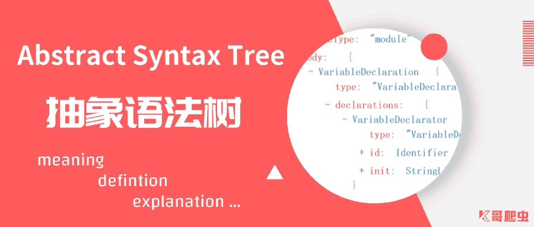
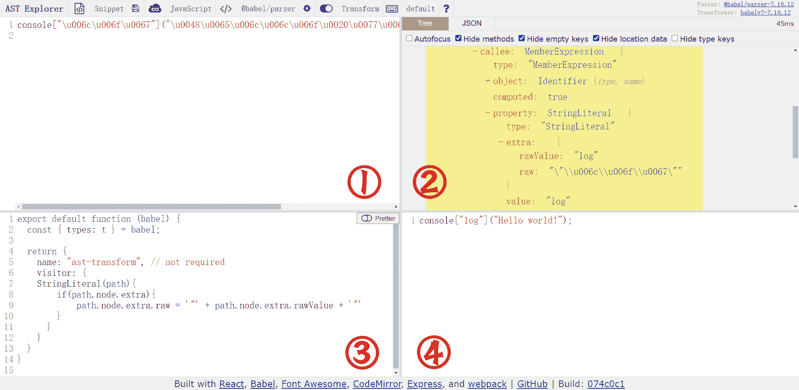
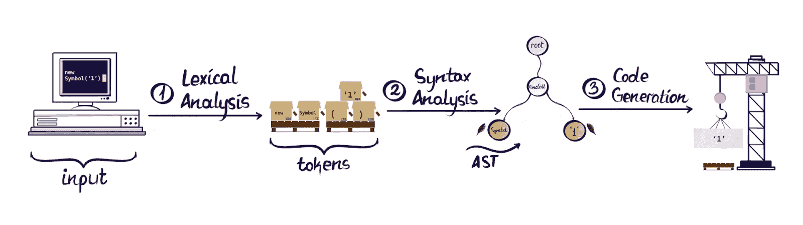
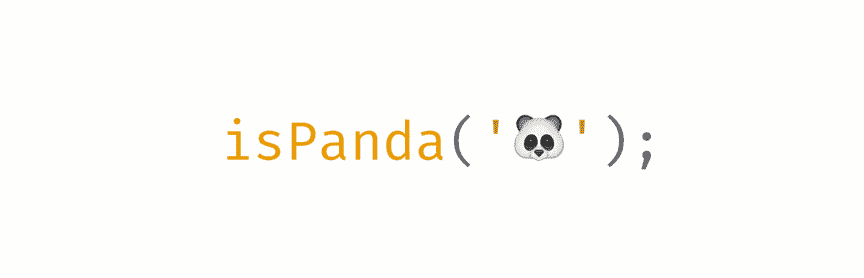
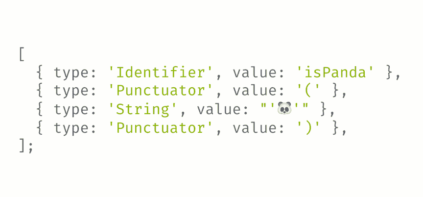
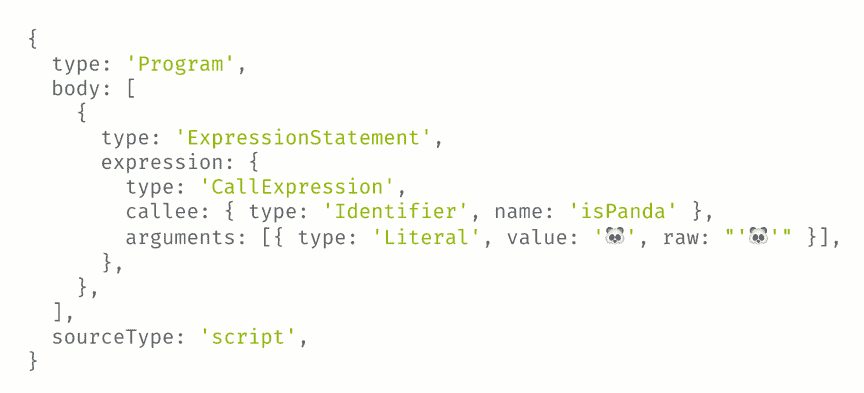
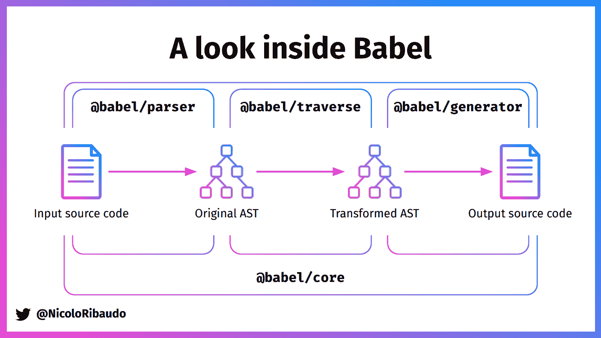

# [Web逆向] 逆向进阶，利用 AST 技术还原 JavaScript 混淆代码

- 原帖: https://www.52pojie.cn/forum.php?mod=viewthread&tid=1744206
- 抓取时间: 2026-11-01T23:00:16



## 什么是 AST

`AST`（Abstract Syntax Tree），中文抽象语法树，简称语法树（Syntax Tree），是源代码的抽象语法结构的树状表现形式，树上的每个节点都表示源代码中的一种结构。语法树不是某一种编程语言独有的，`JavaScript`、`Python`、`Java`、`Golang` 等几乎所有编程语言都有语法树。

小时候我们得到一个玩具，总喜欢把玩具拆解成一个一个小零件，然后按照我们自己的想法，把零件重新组装起来，一个新玩具就诞生了。而 `JavaScript` 就像一台精妙运作的机器，通过 `AST` 解析，我们也可以像童年时拆解玩具一样，深入了解 `JavaScript` 这台机器的各个零部件，然后重新按照我们自己的意愿来组装。

`AST` 的用途很广，IDE 的语法高亮、代码检查、格式化、压缩、转译等，都需要先将代码转化成 `AST` 再进行后续的操作，`ES5` 和 `ES6` 语法差异，为了向后兼容，在实际应用中需要进行语法的转换，也会用到 `AST`。`AST` 并不是为了逆向而生，但做逆向学会了 `AST`，在解混淆时可以如鱼得水。

`AST` 有一个在线解析网站：[//astexplorer.net/" target="_blank" rel="noopener noreferrer nofollow"](https://astexplorer.net/:rel="nofollow noopener" href="https) ，顶部可以选择语言、编译器、是否开启转化等，如下图所示，区域①是源代码，区域②是对应的 `AST` 语法树，区域③是转换代码，可以对语法树进行各种操作，区域④是转换后生成的新代码。图中原来的 Unicode 字符经过操作之后就变成了正常字符。

语法树没有单一的格式，选择不同的语言、不同的编译器，得到的结果也是不一样的，在 `JavaScript` 中，编译器有 `Acorn`、`Espree`、`Esprima`、`Recast`、`Uglify-JS` 等，使用最多的是 `Babel`，后续的学习也是以 `Babel` 为例。



## AST 在编译中的位置

在编译原理中，编译器转换代码通常要经过三个步骤：词法分析（Lexical Analysis）、语法分析（Syntax Analysis）、代码生成（Code Generation），下图生动展示了这一过程：



### 词法分析

词法分析阶段是编译过程的第一个阶段，这个阶段的任务是从左到右一个字符一个字符地读入源程序，然后根据构词规则识别单词，生成 `token` 符号流，比如 `isPanda('🐼')`，会被拆分成 `isPanda`，`(`，`'🐼'`，`)` 四部分，每部分都有不同的含义，可以将词法分析过程想象为不同类型标记的列表或数组。



### 语法分析

语法分析是编译过程的一个逻辑阶段，语法分析的任务是在词法分析的基础上将单词序列组合成各类语法短语，比如“程序”，“语句”，“表达式”等，前面的例子中，`isPanda('🐼')` 就会被分析为一条表达语句 `ExpressionStatement`，`isPanda()` 就会被分析成一个函数表达式 `CallExpression`，`🐼` 就会被分析成一个变量 `Literal` 等，众多语法之间的依赖、嵌套关系，就构成了一个树状结构，即 `AST` 语法树。



### 代码生成

代码生成是最后一步，将 `AST` 语法树转换成可执行代码即可，在转换之前，我们可以直接操作语法树，进行增删改查等操作，例如，我们可以确定变量的声明位置、更改变量的值、删除某些节点等，我们将语句 `isPanda('🐼')` 修改为一个布尔类型的 `Literal`：`true`，语法树就有如下变化：



## Babel 简介

`Babel` 是一个 `JavaScript` 编译器，也可以说是一个解析库，`Babel` 中文网：[//www.babeljs.cn/" target="_blank" rel="noopener noreferrer nofollow"](https://www.babeljs.cn/:rel="nofollow noopener" href="https) ，`Babel` 英文官网：[//babeljs.io/" target="_blank" rel="noopener noreferrer nofollow"](https://babeljs.io/:rel="nofollow noopener" href="https) ，`Babel` 内置了很多分析 `JavaScript` 代码的方法，我们可以利用 `Babel` 将 `JavaScript` 代码转换成 `AST` 语法树，然后增删改查等操作之后，再转换成 `JavaScript` 代码。

`Babel` 包含的各种功能包、API、各方法可选参数等，都非常多，本文不一一列举，在实际使用过程中，应当多查询官方文档，或者参考文末给出的一些学习资料。`Babel` 的安装和其他 Node 包一样，需要哪个安装哪个即可，比如 `npm install @babel/core @babel/parser @babel/traverse @babel/generator`

在做逆向解混淆中，主要用到了 `Babel` 的以下几个功能包，本文也仅介绍以下几个功能包：

- `@babel/core`：`Babel` 编译器本身，提供了 `babel` 的编译 API；
- `@babel/parser`：将 `JavaScript` 代码解析成 `AST` 语法树；
- `@babel/traverse`：遍历、修改 `AST` 语法树的各个节点；
- `@babel/generator`：将 `AST` 还原成 `JavaScript` 代码；
- `@babel/types`：判断、验证节点的类型、构建新 `AST` 节点等。



### @babel/core

`Babel` 编译器本身，被拆分成了三个模块：`@babel/parser`、`@babel/traverse`、`@babel/generator`，比如以下方法的导入效果都是一样的：

```
const parse = require("@babel/parser").parse;
const parse = require("@babel/core").parse;

const traverse = require("@babel/traverse").default
const traverse = require("@babel/core").traverse
```

### @babel/parser

`@babel/parser` 可以将 `JavaScript` 代码解析成 `AST` 语法树，其中主要提供了两个方法：

- `parser.parse(code, [{options}])`：解析一段 `JavaScript` 代码；
- `parser.parseExpression(code, [{options}])`：考虑到了性能问题，解析单个 `JavaScript` 表达式。

部分可选参数 `options`：

参数 | 
描述 | 

allowImportExportEverywhere

```
