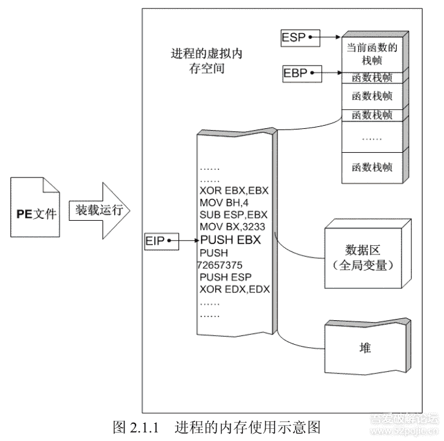
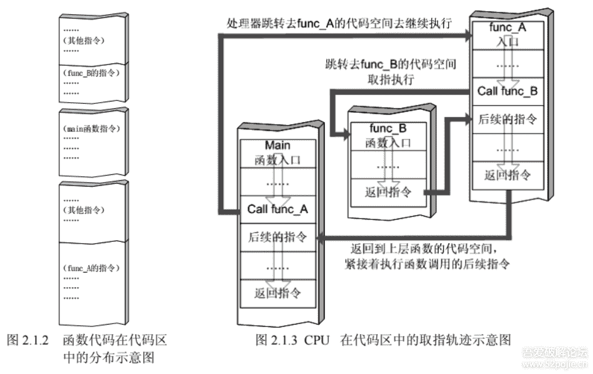
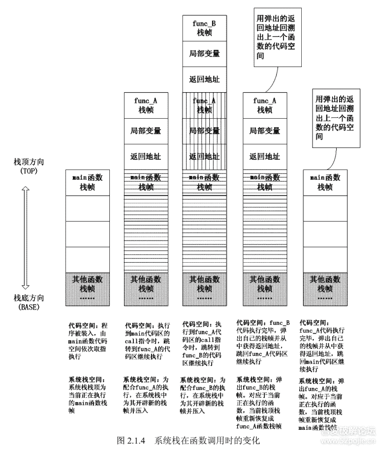
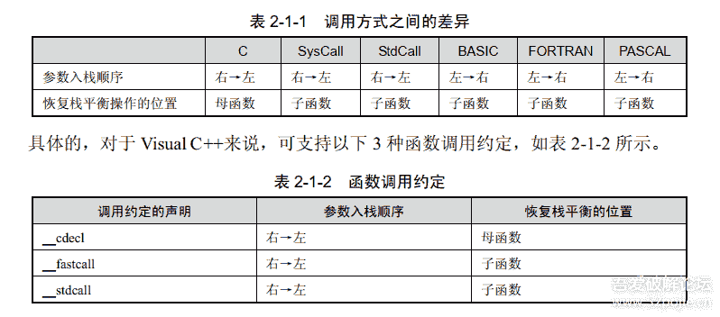
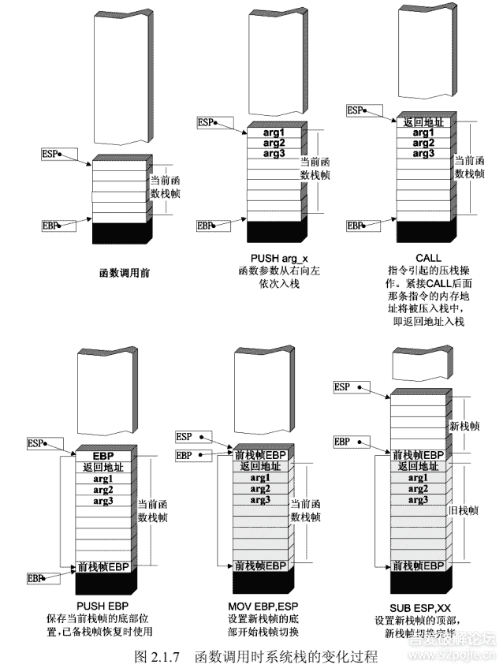
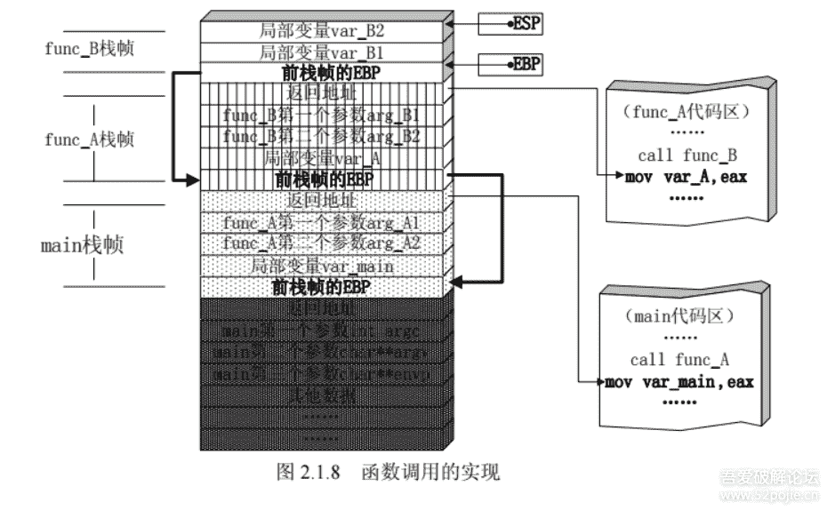
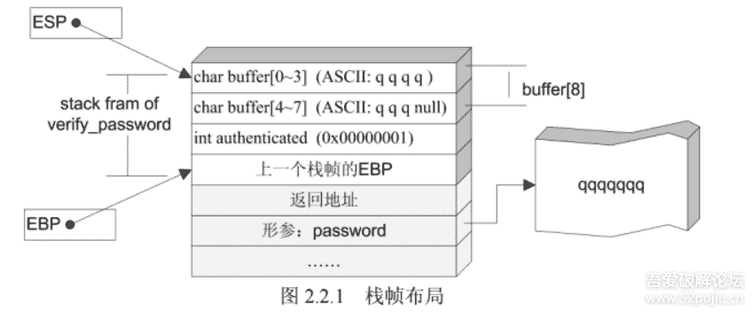

# [分享] 栈溢出---《0day2安全》

- 原帖：https://www.52pojie.cn/forum.php?mod=viewthread&tid=1746569
- 抓取时间：2026-11-01T22:59:55

## 基础知识

### 二进制文件概述

#### PE文件格式

PE（Portable Executable）是 Win32 平台下的可执行文件（如：`*.exe`、`*.dll`），PE 文件规定了所有信息（二进制机器代码、字符串、菜单、图标、位图、字体等）在可执行文件中如何组织。

PE 文件格式把可执行文件分成若干个数据节（section）：

- `.text` 二进制的机器代码
- `.data` 初始化的数据块
- `.idata` 动态链接库
- `.rsrc` 程序的资源

## 系统栈的工作原理

### 内存的不同用途

缓冲区溢出：大缓冲区向小缓冲区复制，撑爆了小缓冲区，从而冲掉了和小缓冲区相邻内存区域的其它数据而引起的内存问题。

进程使用的内存划分：

- 代码区
- 数据区
- 堆区
- 栈区


`image-20220519164948399.png` (132.19 KB, 下载次数: 0)
[附件链接](https://www.52pojie.cn/forum.php?mod=attachment&aid=MjU5MDkzMXxkZDkyOTYyZnwxNzkzNTczOTkyfDE2ODA4NnwxNzQ2NTY5&nothumb=yes)
2023-2-15 22:52 上传

### 函数调用过程

同一文件不同函数的代码在内存代码区中是散乱无关的，但都在同一个 PE 文件的代码所映射的一个 “节” 里。

```
int func_B(int arg_B1, int arg_B2)
{
    int var_B1, var_B2;
    var_B1 = arg_B1 + arg_B2;
    var_B2 = arg_B1 - arg_B2;
    return var_B1 * var_B2;
}
int func_A(int arg_A1, int arg_A2)
{
    int var_A;
    var_A = func_B(arg_A1, arg_A2) + arg_A1;
    return var_A;
}
int main(int argc, char **argv, char **envp)
{
    int var_main;
    var_main = func_A(4, 3);
    return var_main;
}
```

当函数被调用时，系统栈会为这个函数开辟一个新的栈帧，并把它压入栈中。这个栈帧的内存空间被它所属的函数独占。当函数返回时，系统栈会弹出该函数所对应的栈帧。


`image-20220221193711651.png` (190.39 KB, 下载次数: 2)
[附件链接](https://www.52pojie.cn/forum.php?mod=attachment&aid=MjU5MDkzMnxlYzBkM2M0NnwxNzkzNTczOTkyfDE2ODA4NnwxNzQ2NTY5&nothumb=yes)
2023-2-15 22:54 上传

函数调用时，栈中的变化：


`image-20220519170737556.png` (324.18 KB, 下载次数: 1)
[附件链接](https://www.52pojie.cn/forum.php?mod=attachment&aid=MjU5MDkzNHw2MTA0ZjFmZnwxNzkzNTczOTkyfDE2ODA4NnwxNzQ2NTY5&nothumb=yes)
2023-2-15 22:55 上传

#### 函数调用相关约定


`image-20220519171050801.png` (75.84 KB, 下载次数: 1)
[附件链接](https://www.52pojie.cn/forum.php?mod=attachment&aid=MjU5MDkzNXxmZGZhZTFkMHwxNzkzNTczOTkyfDE2ODA4NnwxNzQ2NTY5&nothumb=yes)
2023-2-15 22:55 上传

如果要明确使用某一种调用约定，在函数前加上调用约定的声名即可。默认调用是 `__stdcall` 调用方式，从右向左将参数入栈。

> 特例：C++ 类成员中的 `this` 指针，一般用 `ECX` 寄存器传递。用 `GCC` 编译器编译，他会作为最后一个参数压栈。

函数调用步骤：

- 参数入栈
- 返回地址入栈
- 代码区跳转
- 栈帧调整：
  - 保存当前栈帧状态值，已备后面恢复本栈帧时使用（`EBP` 入栈）；
  - 将当前栈帧切换到新栈帧（将 `ESP` 值装入 `EBP`，更新栈帧底部）；
  - 给新栈帧分配空间（把 `ESP` 减去所需空间的大小，抬高栈顶）；

`__stdcall` 调用约定，函数调用指令：

```
                ;调用前
push 参数 3 ;假设该函数有 3 个参数，将从右向左依次入栈
push 参数 2
push 参数 1
call 函数地址;call 指令将同时完成两项工作： 
;a）向栈中压入当前指令在内存中的位置，即保存返回地址。 
;b）跳转到所调用函数的入口地址函数入口处
push ebp ;保存旧栈帧的底部
mov ebp, esp ;设置新栈帧的底部（栈帧切换）
sub esp, xxx ;设置新栈帧的顶部（抬高栈顶，为新栈帧开辟空间）
```

函数返回的步骤：

- 保存返回值：通常保存在 `EAX` 中。
- 弹出当前栈帧，恢复上一个栈帧。

具体操作：

- 在堆栈平衡的基础上，给 `ESP` 加上栈帧的大小，降低栈顶，回收当前栈帧的空间
- 将当前栈帧底部保存的前栈帧 `EBP` 值弹入 `EBP` 寄存器，恢复出上一个栈帧。
- 将函数返回地址弹给 `EIP` 寄存器。


`image-20220519172202601.png` (166.21 KB, 下载次数: 1)
[附件链接](https://www.52pojie.cn/forum.php?mod=attachment&aid=MjU5MDkzNnwzODEzYTFiOXwxNzkzNTczOTkyfDE2ODA4NnwxNzQ2NTY5&nothumb=yes)
2023-2-15 22:57 上传

- 跳转

函数返回时，相关指令：

```
add esp, xxx ;降低栈顶，回收当前的栈帧
pop ebp;将上一个栈帧底部位置恢复到 ebp，
retn;这条指令有两个功能： 
;a)弹出当前栈顶元素，即弹出栈帧中的返回地址。
;至此，栈帧恢复工作完成。 
;b)让处理器跳转到弹出的返回地址，恢复调用前的代码区
```


`image-20220221170612199.png` (326.91 KB, 下载次数: 0)
[附件链接](https://www.52pojie.cn/forum.php?mod=attachment&aid=MjU5MDkzN3xlZTZjNzdjYXwxNzkzNTczOTkyfDE2ODA4NnwxNzQ2NTY5&nothumb=yes)
2023-2-15 22:58 上传

### 修改邻接变量

#### 修改邻接变量原理

函数的局部变量在栈中相邻排列。如果局部变量有数组之类的缓冲区，并且程序中存在数组越界缺陷，那么越界的数组就能破坏相邻变量，甚至能破坏 `EBP`、返回地址。

```
#include 

#define PASSWORD "1234567"

int verify_password (char *password)
{
    int authenticated;
    char buffer[8];// add local buffto be overflowed
    authenticated = strcmp(password, PASSWORD);
    strcpy(buffer, password);//over flowed here!
    return authenticated;
}

main()
{
    int valid_flag = 0;
    char password[1024];
    while(1)
    {
        printf("please input password: ");
        scanf("%s", password);
        valid_flag = verify_password(password);
        if(valid_flag)
        {
            printf("incorrect password!\n\n");
        }
        else
        {
            printf("Congratulation! You have passed the verification!\n");
            break;
        }
    }
}
```

当程序执行到 `int verify_password(char *password)` 时，栈帧状态如下图：


`image-20220221170630782.png` (98.48 KB, 下载次数: 1)
[附件链接](https://www.52pojie.cn/forum.php?mod=attachment&aid=MjU5MDkzOHxkZmZhM2VhYnwxNzkzNTczOTkyfDE2ODA4NnwxNzQ2NTY5&nothumb=yes)
2023-2-15 22:59 上传

改变程序流程思路：

可以发现，`authenticated` 变量来源于 `strcmp()` 函数的返回值，它被返回给 `main()` 函数作为验证标志。当 `authenticated` 为 `0` 时，标识验证成功；反之，验证不成功。

当我们输入超过 7 个字符的密码（注意：字符截断符 `NULL` 将占用一个字节），就有机会把 `authenticated` 覆盖为 `0`，从而绕过密码验证。

#### 突破密码验证程序

| 推荐使用的环境 | 备 注 |
| --- | --- |
| 操作系统 |  |
