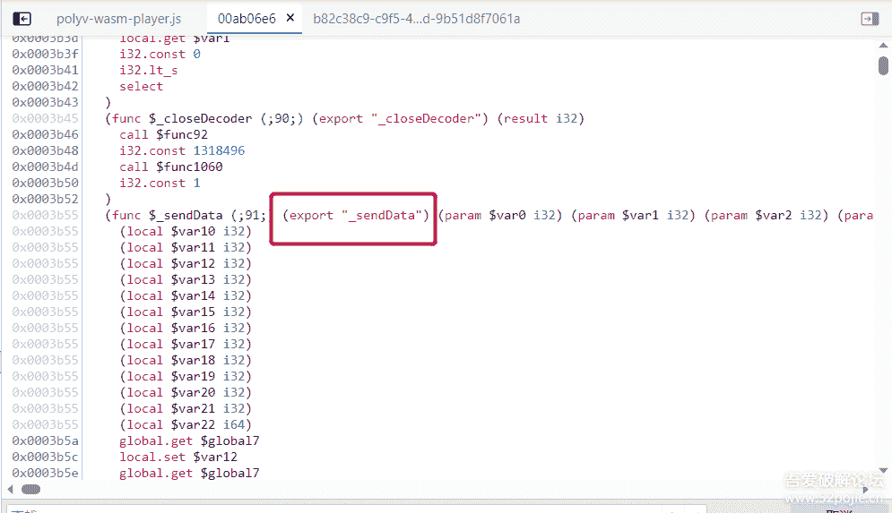
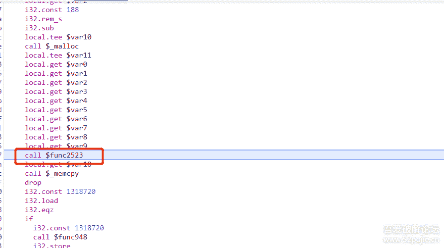
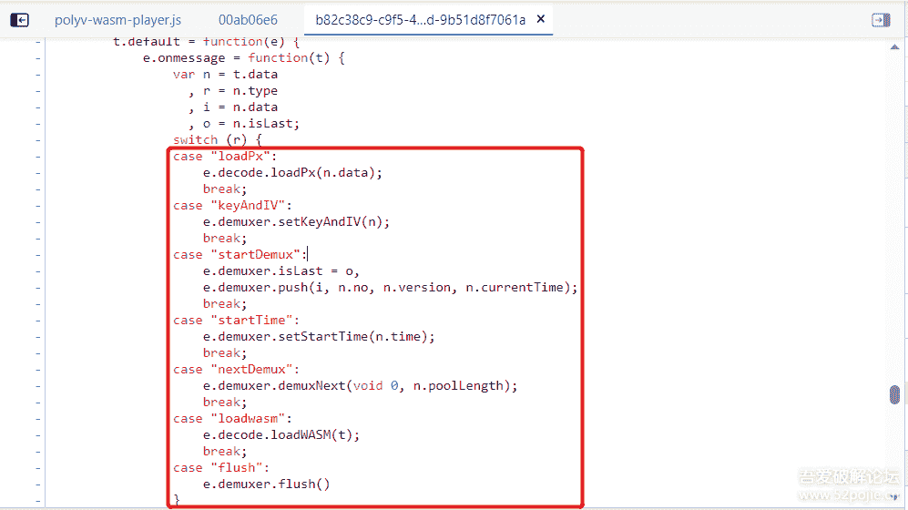
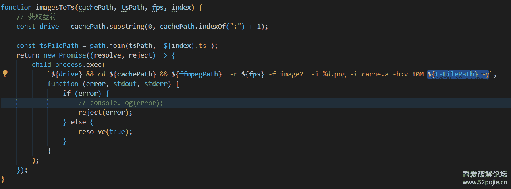

# [Web逆向] 某威13版本低效率思路

- 原帖: https://www.52pojie.cn/forum.php?mod=viewthread&tid=1746743
- 抓取时间: 2026-11-01T22:59:52

## 开始

最近发现某威更新版本了，12版本才搞出来就过时了:'(weeqw ，基于对新技术的热情，迫不及待的开始了13版本的分析之路

1. 首先当然是先按照12版本的思路分析，12版本的`wasm`解密函数为`_get`，发现13版本改为了`_sendData`。



微信截图_20230216111716.png (88.1 KB, 下载次数: 1)

[href="forum.php?mod=attachment&aid=MjU5MTAwN3wyYjNkYTVlMHwxNzkzNTczOTkwfDE2ODA4NnwxNzQ2NzQz&nothumb=yes" target="_blank"](https://www.52pojie.cn/forum.php?mod=attachment&aid=MjU5MTAwN3wyYjNkYTVlMHwxNzkzNTczOTkwfDE2ODA4NnwxNzQ2NzQz&nothumb=yes)

2023-2-16 11:17 上传

2. 之后就是对`_sendData`一顿分析，发现在`$func2523`函数中解密了`pts`；然后就懵逼了，解密后的数据播放只有音频，没有画面，道听途说是加密了`es`流，一顿废寝忘食的分析后还是一无所获，只能大概猜测`ts`解复用是直接用的`ffmpeg`（原来是`js`解复用），这下就难倒了小白我了。



微信截图_20230216112013.png (40.92 KB, 下载次数: 0)

[href="forum.php?mod=attachment&aid=MjU5MTAxOHw2ZTZhMDQwOHwxNzkzNTczOTkwfDE2ODA4NnwxNzQ2NzQz&nothumb=yes" target="_blank"](https://www.52pojie.cn/forum.php?mod=attachment&aid=MjU5MTAxOHw2ZTZhMDQwOHwxNzkzNTczOTkwfDE2ODA4NnwxNzQ2NzQz&nothumb=yes)

2023-2-16 11:45 上传

3. 一条路走不通只能另辟蹊径了，12版本就知道是`wasm`解码视频为一帧一帧的图片后，再用`canvas`绘制播放。那么我们能不能也这样做，把一帧一帧的图片保存下来，再合成为视频。有了这个思路，实现就比较简单了。



微信截图_20230216113051.png (52.52 KB, 下载次数: 3)

[href="forum.php?mod=attachment&aid=MjU5MTAxN3wzZWE3MTJmMXwxNzkzNTczOTkwfDE2ODA4NnwxNzQ2NzQz&nothumb=yes" target="_blank"](https://www.52pojie.cn/forum.php?mod=attachment&aid=MjU5MTAxN3wzZWE3MTJmMXwxNzkzNTczOTkwfDE2ODA4NnwxNzQ2NzQz&nothumb=yes)

2023-2-16 11:45 上传

4. 选择使用`electron`来实现，直接`new Worker`加载官方`js`，`postMessage`发送所需参数来获取每一帧图片的`yuv`数据及音频数据，通过`yuv-canvas`绘制图片并调用`nodejs`的`fs`库保存图片，通过`ffmpeg`命令合并图片为`ts`，最后合并`ts`为`mp4`即可



微信截图_20230216114547.png (54.66 KB, 下载次数: 1)

[href="forum.php?mod=attachment&aid=MjU5MTAxOXw2ZDZhYTZiYXwxNzkzNTczOTkwfDE2ODA4NnwxNzQ2NzQz&nothumb=yes" target="_blank"](https://www.52pojie.cn/forum.php?mod=attachment&aid=MjU5MTAxOXw2ZDZhYTZiYXwxNzkzNTczOTkwfDE2ODA4NnwxNzQ2NzQz&nothumb=yes)

2023-2-16 11:46 上传

`ffmpeg`图片转视频命令：

```
ffmpeg -r 视频帧率 -f image2 -i %d.png -i 音频数据 -b:v 码率（我设置的10M） 0.ts -y
```

### 存在的问题

1. 效率很差，特别是分辨率较大的视频（`wasm`解码视频很耗时）
2. 合成视频较大，因为视频码率设置的高（低了视频就模糊了），暂时不知道咋办

### 总结

该方案只能算投机取巧的方式了，且视频质量较差，无非是没有办法的办法了。听说有巨佬还原出算法了，只能怪自己太菜。

### 20230220更新

1. `yuv`绘制为图片再转视频效率太差了，可以直接保存`yuv`流数据，再用`ffmpeg`命令转为`ts`，可以提升一点点效率
