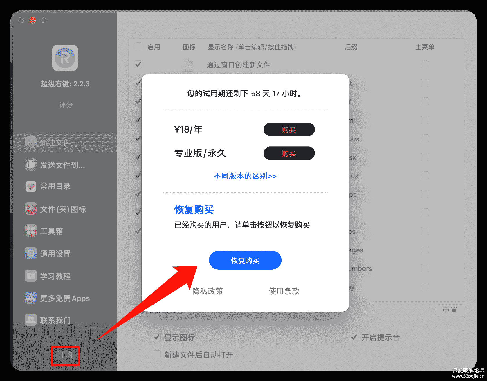
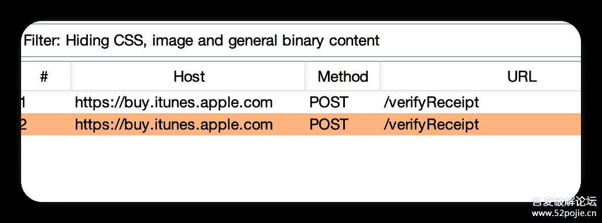
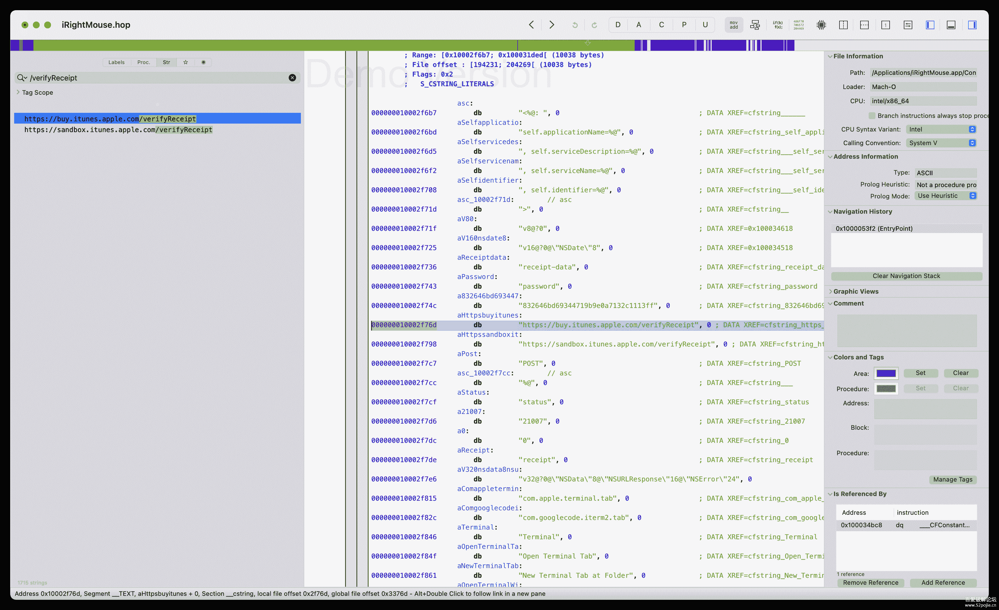
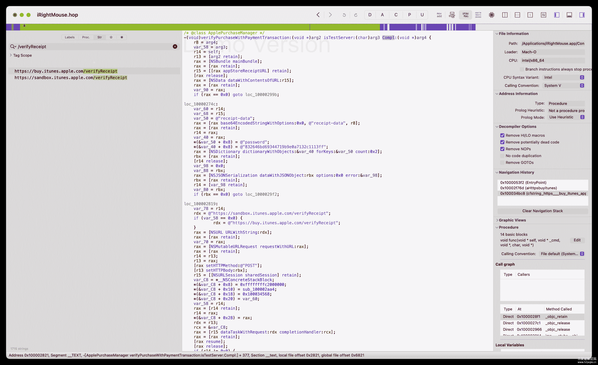
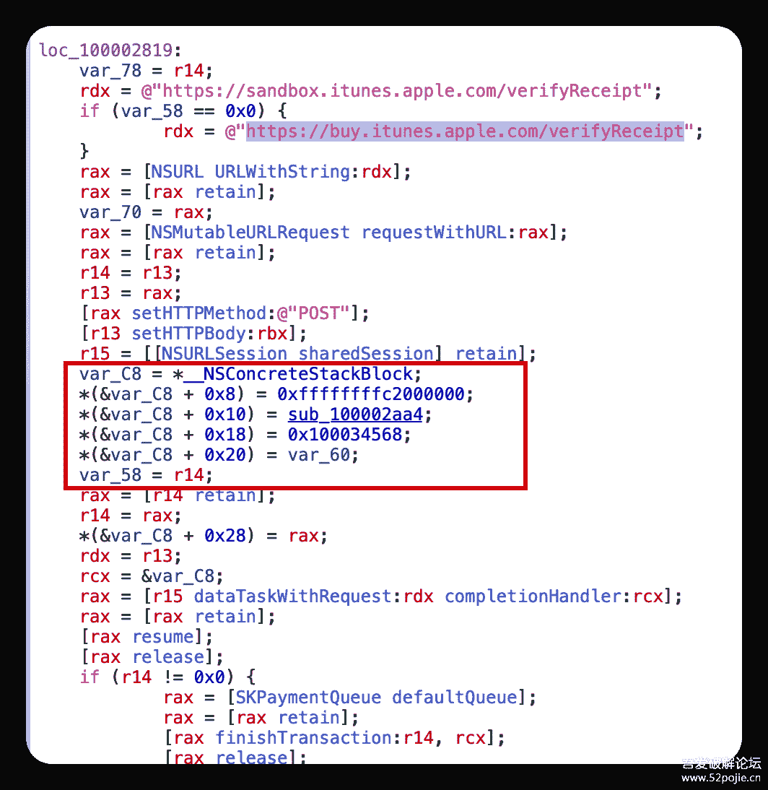
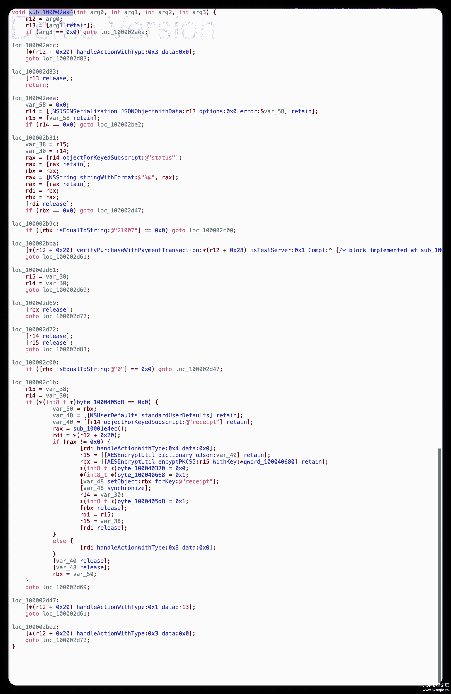
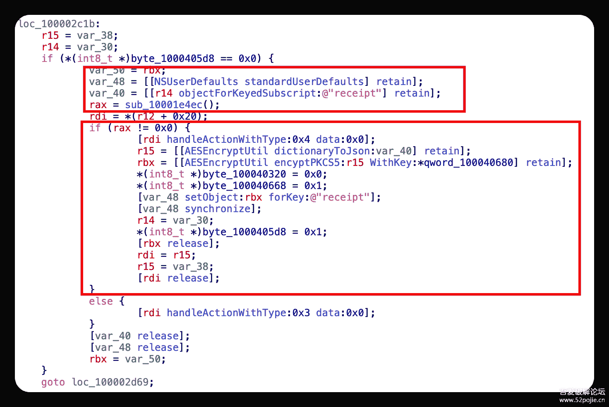
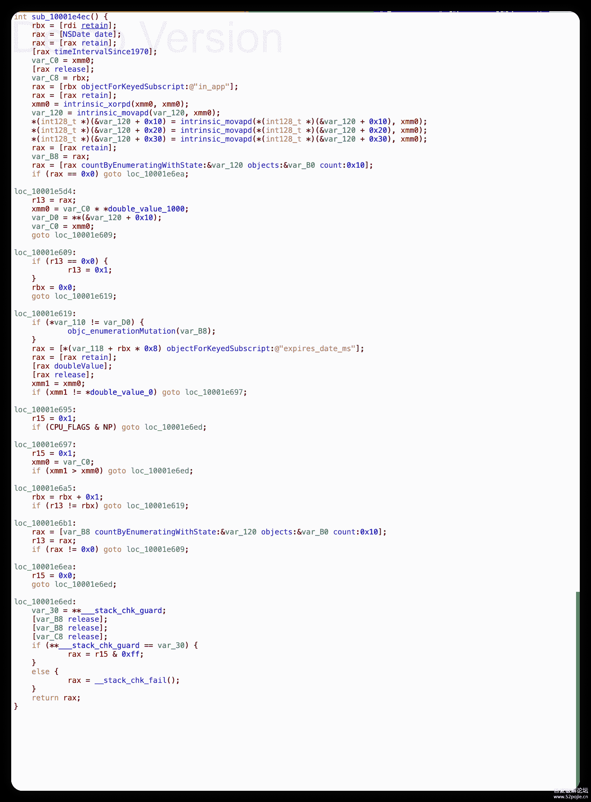
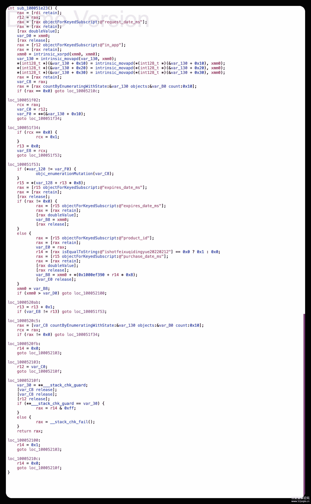

# [MacOS逆向] 超级右键家族系列软件激活（iRightMouse、iShot）

- 原帖：[https://www.52pojie.cn/forum.php?mod=viewthread&tid=1748015](https://www.52pojie.cn/forum.php?mod=viewthread&tid=1748015)
- 抓取时间：2026-11-01T22:59:44

## 超级右键家族系列软件激活

### 0x00 前言

Better365官网：[https://www.better365.cn/](https://www.better365.cn/)

该系列软件目前有两个付费软件是超级右键（iRightMouse）和 iShot，两款软件都很好用，希望大家有条件的可以去支持正版。

### 0x01 定位关键点

软件默认会在界面有订购的字样，已经购买的用户可以进行恢复购买，我们可以通过这个地方抓取恢复购买的链接，也就是关键请求。



`image-20230216174740996.png`（434.22 KB，下载次数：4）

[查看附件](https://www.52pojie.cn/forum.php?mod=attachment&aid=MjU5MTYzMHwyNGI5NTI0N3wxNzkzNTczOTgyfDE2ODA4NnwxNzQ4MDE1&nothumb=yes)

2023-2-19 16:46 上传



`image-20230216175322483.png`（45.98 KB，下载次数：3）

[查看附件](https://www.52pojie.cn/forum.php?mod=attachment&aid=MjU5MTYzMXxjZjhiY2RmNnwxNzkzNTczOTgyfDE2ODA4NnwxNzQ4MDE1&nothumb=yes)

2023-2-19 16:47 上传

获取到关键请求之后就用 `hopper` 打开 iRightMouse，在字符串中搜索。



`image-20230216175505724.png`（1.16 MB，下载次数：5）

[查看附件](https://www.52pojie.cn/forum.php?mod=attachment&aid=MjU5MTYzMnw1ODY3NGZiYnwxNzkzNTczOTgyfDE2ODA4NnwxNzQ4MDE1&nothumb=yes)

2023-2-19 16:47 上传

查看引用，可以定位到 `ApplePurchaseManager verifyPurchaseWithPaymentTransaction:isTestServer:Compl:` 方法。



`image-20230216175655283.png`（950.66 KB，下载次数：5）

[查看附件](https://www.52pojie.cn/forum.php?mod=attachment&aid=MjU5MTYzM3w0YzZmMjc5NXwxNzkzNTczOTgyfDE2ODA4NnwxNzQ4MDE1&nothumb=yes)

2023-2-19 16:47 上传

这个里面就是发送请求验证的逻辑了，一般下面这种情况，红框中的就是对请求返回值处理的回调函数，这里是函数名符号应该是被去掉了，所以是 `sub_100002aa4`。



`image-20230216175952062.png`（292.62 KB，下载次数：3）

[查看附件](https://www.52pojie.cn/forum.php?mod=attachment&aid=MjU5MTYzNHxlZjU2OTllNHwxNzkzNTczOTgyfDE2ODA4NnwxNzQ4MDE1&nothumb=yes)

2023-2-19 16:47 上传

双击进去之后看到函数内容，就可以看到重点，一个是对 `status` 进行判断，一个是取 `receipt` 的内容进行了一些操作和判断。



`image-20230216180143424.png`（710.66 KB，下载次数：5）

[查看附件](https://www.52pojie.cn/forum.php?mod=attachment&aid=MjU5MTYzNXw2ZmRkOWIxY3wxNzkzNTczOTgyfDE2ODA4NnwxNzQ4MDE1&nothumb=yes)

2023-2-19 16:47 上传

关键就在于 `receipt` 的内容，而判断的关键在于 `rax` 的值，可以看到 `rax` 判断过了之后直接就加密写入本地了，那么关键就在于 `sub_10001e4ec` 函数了。



`image-20230216180546928.png`（269.24 KB，下载次数：3）

[查看附件](https://www.52pojie.cn/forum.php?mod=attachment&aid=MjU5MTYzNnxiZTliNzU4MXwxNzkzNTczOTgyfDE2ODA4NnwxNzQ4MDE1&nothumb=yes)

2023-2-19 16:47 上传

双击进去可以看到这个函数又取了 `in_app` 和 `expires_date_ms`。



`image-20230216180923939.png`（608.77 KB，下载次数：2）

[查看附件](https://www.52pojie.cn/forum.php?mod=attachment&aid=MjU5MTYzN3wwODE3MGQwNnwxNzkzNTczOTgyfDE2ODA4NnwxNzQ4MDE1&nothumb=yes)

2023-2-19 16:47 上传

结合请求的返回值看，可以得出上面的关键字的所属位置关系，当然你要是从逆向伪代码中分析也能分析出来.

```
{
  "status":0,
  "receipt":{
    "in_app":[
      "expires_date_ms":"1672000000000"
    ]
  }
}
```

### 0x02 激活思路

- 直接在抓包时修改返回值，将 `expires_date_ms` 修改为你想要的到期时间戳即可
- `hook` 软件将 `json` 数据转换为 `Objective-C` 对象的函数，对返回数据进行修改
- 直接将自己的 `json` 数据转换为 `objc` 对象返回（可以参考 Typora Crack 中的 `hook` 代码）
- 或者修改部分关键值（此文章采取该方法）

### 0x03 iShot不同点

iShot 在激活判断时有一些不同，可能是加了新老软件的兼容，如果 `expires_date_ms` 不存在时，会去判断 `product_id` 和 `purchase_date_ms`。



`image-20230216182810394.png`（757.92 KB，下载次数：2）

[查看附件](https://www.52pojie.cn/forum.php?mod=attachment&aid=MjU5MTYzOHwxMDNiOGEwOXwxNzkzNTczOTgyfDE2ODA4NnwxNzQ4MDE1&nothumb=yes)

2023-2-19 16:47 上传

iShot 的关键参数如下：

```
{
  "status":0,
  "receipt":{
    "in_app":[
      "expires_date_ms":"1672000000000",
      "product_id":"ishotfeixuqidingyue20220212",
      "purchase_date_ms":"1672000000000"
    ]
  }
}
```

### 0x04 `hook`

这里有一些坑就是 Objective-C 中有些对象是只读形式，需要先转换为可读写的对象，才能进行替换，大家在编写时可以通过在网上搜索找到答案。

```
const objectForKeyedSubscript1 = ObjC.classes.NSJSONSerialization['+ JSONObjectWithData:options:error:'];
var flag1;
Interceptor.attach(objectForKeyedSubscript1.implementation,{
    onLeave(retval){
        let data = ObjC.Object(retval);
        let key_receipt = ObjC.classes.NSString.stringWithString_('receipt'); 
        let receipt = data.objectForKeyedSubscript_(key_receipt);
        let key_in_app = ObjC.classes.NSString.stringWithString_('in_app'); 
        let key_expires_date_ms = ObjC.classes.NSString.stringWithString_('expires_date_ms');
        let key_product_id = ObjC.classes.NSString.stringWithString_('product_id');
        let data_product_id = ObjC.classes.NSString.stringWithString_('ishotfeixuqidingyue20220212');
        let key_purchase_date_ms = ObjC.classes.NSString.stringWithString_('purchase_date_ms');
        let dict = ObjC.classes.NSMutableDictionary.alloc().init();
        dict.setObject_forKey_(9999999999999,key_expires_date_ms);
        dict.setObject_forKey_(9999999999999,key_purchase_date_ms);
        dict.setObject_forKey_(data_product_id,key_product_id);
        let info_array = ObjC.classes.NSMutableArray.alloc().init();
        info_array.addObject_(dict);
        let receipt1 = receipt.mutableCopy();
        receipt1.setObject_forKey_(info_array,key_in_app);
        let replace_data = data.mutableCopy();
        replace_data.setObject_forKey_(receipt1,key_receipt);
        retval.replace(replace_data);
        console.log("Crack Success!")
    }
})
```

### 0x05 参考

- [浅谈 Mac 应用逆向破解](https://www.soft98.top/2000@%e9%80%86%e5%90%91%e7%a0%b4%e8%a7%a3/2001@%e6%b5%85%e8%b0%88Mac%e5%ba%94%e7%94%a8%e9%80%86%e5%90%91%e7%a0%b4%e8%a7%a3)
- [Typora For Mac Crack](https://www.soft98.top/2000@%e9%80%86%e5%90%91%e7%a0%b4%e8%a7%a3/2002@Typora%20For%20Mac%20Crack)
