# [Web逆向] 【验证码逆向专栏】某验“初代”滑块验证码逆向分析

- 原帖: https://www.52pojie.cn/forum.php?mod=viewthread&tid=1749799
- 抓取时间: 2026-11-01T22:59:33


## 声明

本文章中所有内容仅供学习交流，抓包内容、敏感网址、数据接口均已做脱敏处理，严禁用于商业用途和非法用途，否则由此产生的一切后果均与作者无关，若有侵权，请联系我立即删除！

本文章未经许可禁止转载，禁止任何修改后二次传播，擅自使用本文讲解的技术而导致的任何意外，作者均不负责，若有侵权，请联系作者立即删除！

## 逆向目标

- 目标：某验“初代”滑块验证码，实为二代离线模式，`validate`参数逆向，底图获取及还原
- 主页：`aHR0cHM6Ly9mdy5zY2dqai5zaC5nb3YuY24vbm90aWNlc2gvaG9tZQ==`
- 加密算法：MD5

## 前世溯源

众所周知某验是首家”行为式验证“安全技术服务提供商，其摒弃了扭曲复杂的字符图片验证码，大大增强了用户的体验感。某验最初代的验证码，是在2012年年底完成的，产品还在内测时，最早的种子用户，大都来自于创始人吴渊母校武汉大学的珞珈山水BBS站：

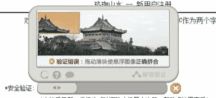

2014年年中，极验正式开放服务，武汉本土互联网企业尤其是游戏类企业给予了“力挺”。武汉265G是全国最大的网页游戏资讯网站，率先使用了极验“点一下拖一下就能完成验证”的全新验证方式。后来，通过口口相传，武汉17173、电玩巴士等游戏门户网站，也陆续使用其产品。“行为式验证”上线后从游戏行业开始，逐步取代互联网上各种形式的传统验证码，推广到全国各地。

下图为早年市面上的初代产品，时过境迁，是否还存在网站使用无从得知，如果有了解的欢迎私聊 K 哥：

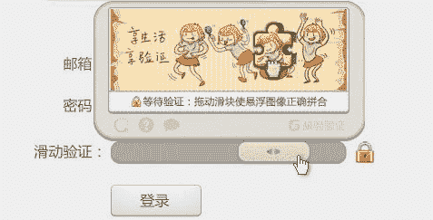

## 抓包情况

真正的初代产品无从分析，上一篇 K 哥写的为二代滑块在线模式，可以阅读：[https://mp.weixin.qq.com/s/O2oPqmyvRU9s07bC_XqZAQ](https://mp.weixin.qq.com/s/O2oPqmyvRU9s07bC_XqZAQ)，本案例为二代滑块离线模式分析，与常规的某验产品还是有较大区别的，主页输入企业名称点击搜索会弹出滑块验证码，`register`接口返回熟悉的`challenge`和`gt`参数：

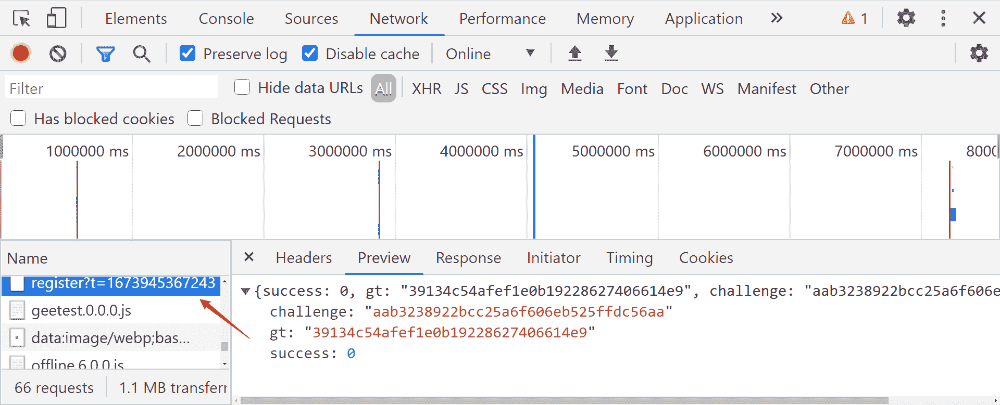

如果对某验其他产品了解的话，图片下载路径及加密参数是通过类似`get.php`接口返回的，并且`validate`参数是校验`w`参数后得到的，而当前过掉滑块后，`validate`参数直接生成并完成校验了，所有流程都是在本地直接执行的：

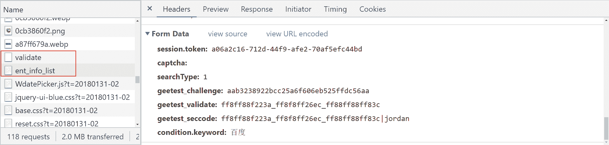

- `validate`接口：校验滑块是否通过；
- `ent_info_list`接口：校验`session.token`及`validate`，未通过则和一开始的`home`接口返回内容一致，通过则会多出相关企业信息。

## 逆向分析

主页搜索生成验证码后，从验证接口`validate`处跟栈，跟进到`u1G.`中：

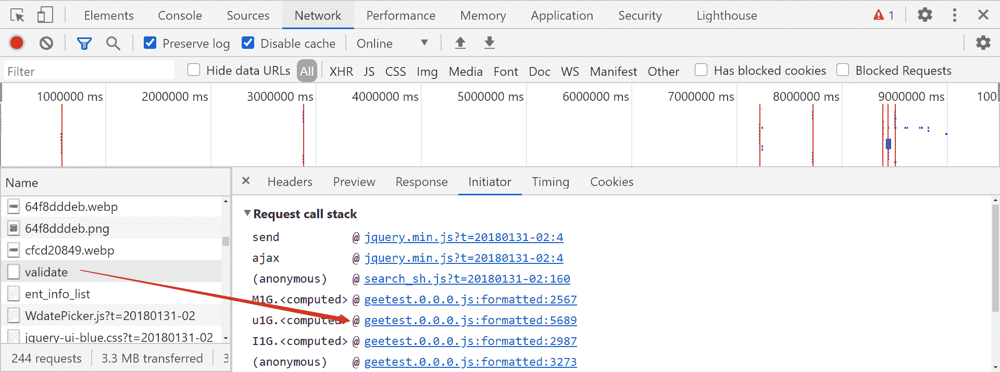

格式化，进入到`geetest.0.0.0.js`文件的第 5689 行，该行打下断点滑动滑块即会断住，可以看到`H2Y`为`fail`，此时已经校验完成，并显示失败了：

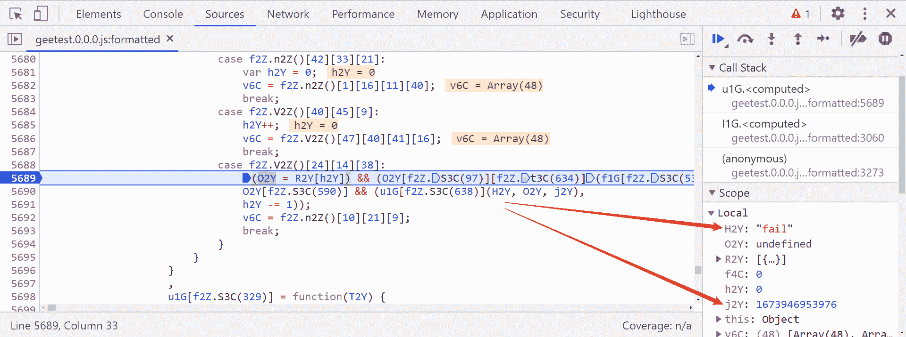

继续向上跟栈，在第 3273 行打下断点，这里即为校验的位置：

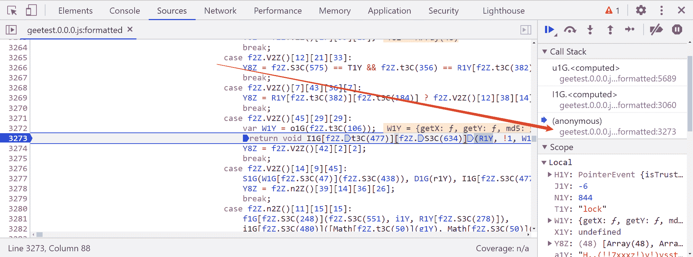

关键部分如下：

```
W1Y[f2Z.S3C(60)](m1Y, f1G[f2Z.t3C(537)](f2Z.t3C(551), R1Y[f2Z.S3C(278)])[f2Z.t3C(155)]() - f1G[f2Z.S3C(537)](f2Z.S3C(633), R1Y[f2Z.S3C(278)]), R1Y)
```

于控制台打印一下，初步推测`W1Y[f2Z.S3C(60)]`方法校验了滑动距离、滑动时间及其他的一些参数：

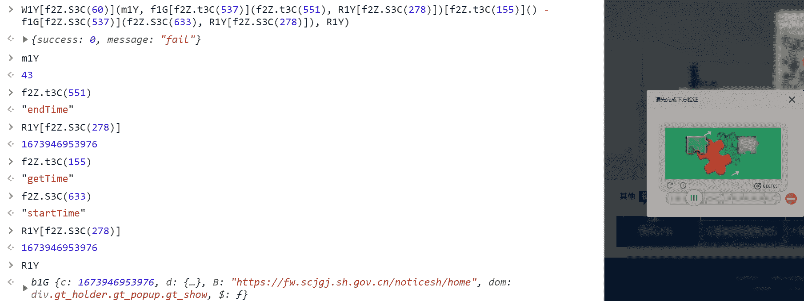

跟进`W1Y[f2Z.S3C(60)]`，跳转到`offline.6.0.0.js`文件中，格式化后，打断点会发现这里就是`validate`参数的加密位置：

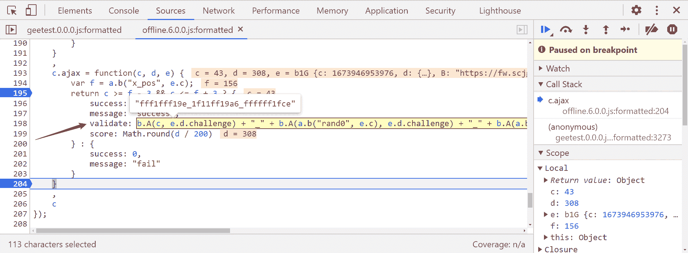

```
validate: b.A(c, e.d.challenge) + "_" + b.A(a.b("rand0", e.c), e.d.challenge) + "_" + b.A(a.b("rand1", e.c), e.d.challenge)
```

`c`为滑动距离，`e.d.challenge`为`challenge`参数的值，`e.c`为13位时间戳，加密方式为`b.A`及`a.b`，扣下来即可，不过经测试`a.b("rand0", e.c)`即`d`，`a.b("rand1", e.c)`为`e`的值，分别定义在下图第 173、174 行，分析过程中发现采集了滑块轨迹，不过并没有校验，`validate`参数分析完了，那图片路径在哪呢，就在这部分的上面，`f`、`g`经过了 MD5 加密，同样直接扣下来：

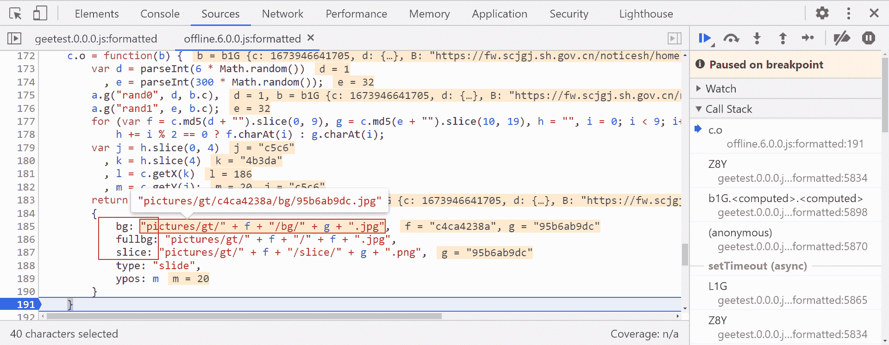

不过直接这样下载的图片是乱序的，还原代码同三代滑块及二代滑块在线模式基本一致，宽度需要改动，可参考 [https://mp.weixin.qq.com/s/KmjGX_4LHRzceZjgsPPugw](https://mp.weixin.qq.com/s/KmjGX_4LHRzceZjgsPPugw)：

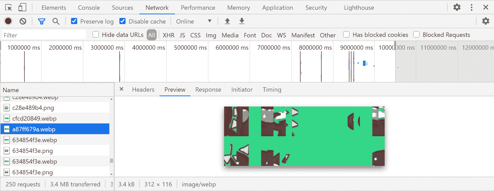

还原后如下：


## 结果验证

滑块验证：

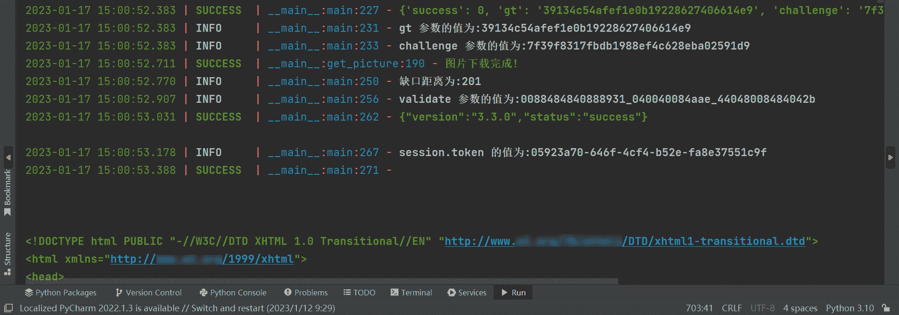

搜索结果验证，需要先从`home`接口中获取到`session.token`，再加上`validate`等参数即可：

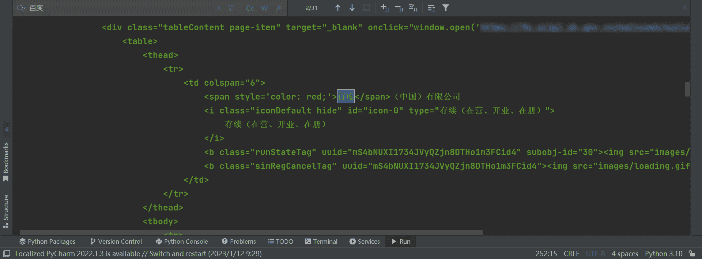
