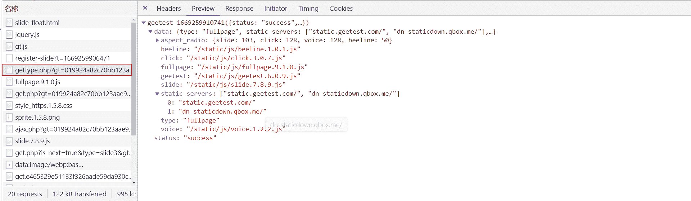
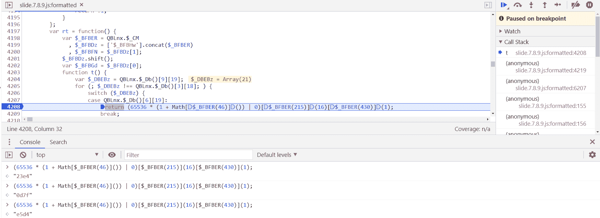
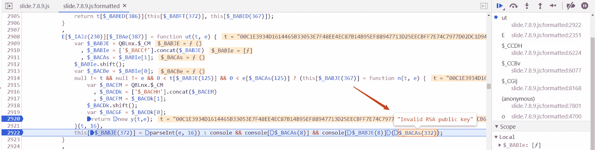
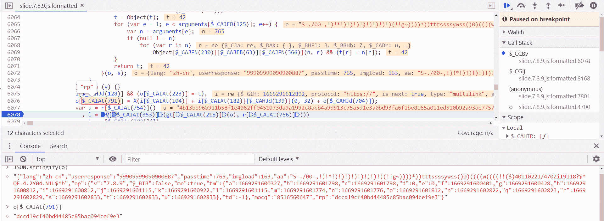
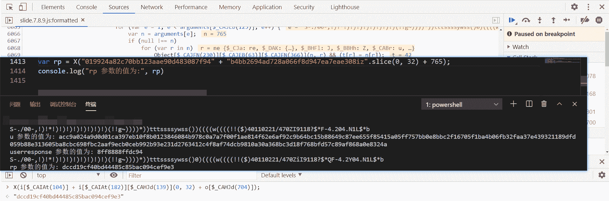
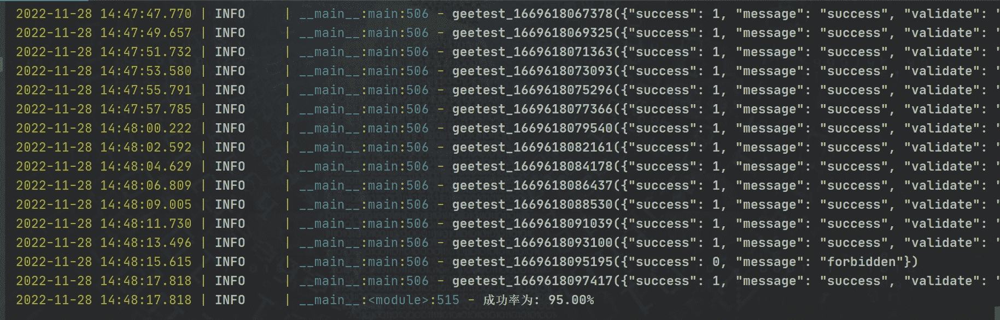

# [Web逆向] 【验证码逆向专栏】某验三代滑块验证码逆向分析

- 原帖: https://www.52pojie.cn/forum.php?mod=viewthread&tid=1749808
- 抓取时间: 2026-11-01T22:59:29


## 声明

本文章中所有内容仅供学习交流，抓包内容、敏感网址、数据接口均已做脱敏处理，严禁用于商业用途和非法用途，否则由此产生的一切后果均与作者无关，若有侵权，请联系我立即删除！

本文章未经许可禁止转载，禁止任何修改后二次传播，擅自使用本文讲解的技术而导致的任何意外，作者均不负责，若有侵权，请联系作者立即删除！

## 逆向目标

- 目标：某验三代滑块验证码，底图还原及 `w` 参数逆向
- 验证码 demo 列表：`aHR0cHM6Ly93d3cuZ2VldGVzdC5jb20vZGVtby8=`
- 滑块验证码：`aHR0cHM6Ly93d3cuZ2VldGVzdC5jb20vZGVtby9zbGlkZS1mbG9hdC5odG1s`
- 加密算法：RSA、AES、MD5

## 验证码流程分析

进入网页后，打开开发者人员工具进行抓包。

1. 未点击按钮进行验证之前，Network 中抓包到了以下信息：

   

   - `register-slide?t=xxx`：注册滑块请求，响应预览中返回的信息中重要的是 `gt` 和 `challenge`，`gt` 是固定值，不同网页对应不同的 `gt` 值，类似于特征码，`challenge` 的值每次刷新页面都会变化，`gt` 参数会通过 url string 的形式传递给 `gettype.php`：

     

   - `gettype.php?gt=xxx&callback=xxx`：获取验证码，HTTP 请求中不同的请求方式和设置不同的 `Content-Type` 时，参数传递的方式会不一样，一般为 Query String Parameters、Form Data、Request Payload，这里是 Query String Parameters，在 GET 请求时，参数会以 url string 的形式进行传递，即 `?` 后的字符串则为其请求参数，并以 `&` 作为分隔符，这里传递了 `gt` 参数的值以及 `callback`，`callback` 为 `geetest_ + 时间戳`：

     

   响应预览中返回了一些 js 文件及对应的版本号：

   

   - 第一个 `get.php?xxx`，url 中传递了一些参数，关键部分如下：

     - `gt`：`register-slide` 响应返回的 `gt` 值
     - `challenge`：`register-slide` 响应返回的 `challenge` 值
     - `w`：对轨迹、滑动时间等进行加密后的参数，该网站第一个 `w` 值可以直接置空
     - `callback`：`geetest_ + 时间戳`

     

   响应内容如下，这里没什么需要注意的，`feedback` 就是某验的帮助中心：

   

2. 点击按钮进行验证之后，Network 中抓包到了以下信息：

   

   - 第一个 `ajax.php?xxx`，url 中传递了一些参数，关键部分如下：

     - `gt`：`register-slide` 响应返回的 `gt` 值
     - `challenge`：`register-slide` 响应返回的 `challenge` 值
     - `w`：对轨迹、滑动时间等进行加密后的参数，该网站第二个 `w` 值也可以直接置空
     - `callback`：`geetest_ + 时间戳`

     

   响应返回验证码模式，滑块验证码为 `slide`，点选验证码为 `click`：

   

   - 第二个 `get.php?xxx`，url 中传递了一些参数，关键部分如下：

     - `gt`：`register-slide` 响应返回的 `gt` 值
     - `challenge`：`register-slide` 响应返回的 `challenge` 值
     - `callback`：`geetest_ + 时间戳`

     

   这个响应返回了很多关键内容：

   - `bg`：被打乱的带缺口背景图，需要还原，`372fe236d.webp`

     

   - `fullbg`：被打乱的完整背景图，需要还原，`7bfaaa72b.webp`

     

   - `slice`：滑块图片，不需要还原，`372fe236d.png`

     

   - `c`：关键参数，与后面 `aa` 参数的值有关，固定值
   - `s`：关键参数，与后面 `aa` 参数的值有关

     

   - 第二个 `ajax.php?xxx`，url 中传递了一些参数，关键部分如下：

     - `gt`：`register-slide` 响应返回的 `gt` 值
     - `challenge`：`register-slide` 响应返回的 `challenge` 值 + 两位字符串，注意多了两位，是第二个 `get.php?xxx` 返回值中得到的
     - `w`：对轨迹、滑动时间等进行加密后的参数，需要通过逆向得到
     - `callback`：`geetest_ + 时间戳`

     

   滑动滑块验证通过即会返回以下内容：

   

   失败则会返回：

   

## 逆向分析

### `w` 参数

跟到 `w` 参数的值方法很多，以下讲两种：

1. 很简便，`w` 参数在 js 文件中有特征码，点击按钮进行验证之后，`ctrl + shift + f` 全局搜索 `"\u0077"`，然后点击进入 `slide.7.8.9.js` 文件中，7.8.9 为当前版本，注意没点击验证的话是不会有这个 js 文件的：

   

   进入后点击左下角 `{ }` 大括号，格式化文件，再 `ctrl + f` 局部搜索 `"\u0077"`，只有一个结果，在第 6086 行，在第 6088 行打下断点，滑动滑块即会断住，`h + u` 即为 `w` 参数的值：

   

2. 通过 `Initiator` 跟栈，跟进到 `$_CId` 中：

   

   进去同样格式化后，会跳转到第 4583 行，在该行打下断点：

   

   向上跟栈到 `$_CCBv` 中同样会找到刚刚的位置：

   

由以上分析可知，`w` 参数是 `h` 和 `u` 相加得到的，所以找到定义的位置，看看是怎么构造生成的，`u` 参数定义在第 6077 行，`h` 参数定义在第 6079 行，内容如下：

```
 var u = r[$_CAIAt(754)]()
 , l = V[$_CAIAt(353)](gt[$_CAIAt(218)](o), r[$_CAIAt(756)]())
 , h = m[$_CAIAt(782)](l)
```

可以看到，`h` 参数是传入了 `l` 参数后经过 `m[$_CAIAt(782)]` 方法处理后得到的，所以依次往下分析，现在看看 `u` 参数是怎么生成的：

#### `u` 参数

`u` 参数通过 `r[$_CAIAt(754)]` 方法生成，选中后跟进到方法定义位置：


会跳转到第 6218 行，在 6227 行 `return` 处打下断点，重新拖动滑块，即会断住：


`e` 为 `u` 参数的值，其定义在第 6266 行：

```
e = new U()[$_CBGAZ(353)](this[$_CBGAZ(756)](!0));
```

在控制台中打印输出一下各部分内容：


```
e = new U()["encrypt"](this["$_CCEc"](!0));
```

从打印出来的结果可以看出，`e` 参数的值可能是将 16 位的随机字符串加密后得到的，跟进到 `this[$_CBGAZ(756)]` 中验证一下：


跳转到第 6208 行，在第 6214 行 `return` 处打下断点：


`Ot` 即 16 为字符串，`Ot = rt()`，跟进到 `rt` 函数中，在第 4213 行，于第 4219 行打下断点后会发现，16 位字符串是由四个 `t()` 方法的结果相加得到的：


跟进到 `t()` 方法的定义位置，在第 4203 行，第 4208 行即为随机字符串算法：



还原混淆后内容如下，`Math.random()` 是随机选取大于等于 0.0 且小于 1.0 的伪随机 double 值，`toString(16)` 为十六进制字符串：

```
(65536 * (1 + Math["random"]()) | 0)["toString"](16)["substring"](1)
```

JavaScript 复现：

```
function random() {
    var random_str = "";
    for (var index = 0; index 
```

`this["$_CCEc"]` 分析完了，那 `new U()["encrypt"]` 是什么呢，选中 `new U()` 后，从原型链中可以看到 `setPublic`，根据经验很有可能就是 RSA 加密设置公钥，加解密相关算法可以查看 [K 哥往期文章](https://mp.weixin.qq.com/s/4QTee0M9ukN6olgoR_LMug)：


跟进去查看一下：


跳转到第 2908 行，在第 2922 行断住后，`$_BACAs(332)` 的值为 `"Invalid RSA public key"`：



第 2908 行，`ut` 函数传入了两个值，`t` 为公钥值，`e` 为公钥模数，都是固定值：

- `t`：`"00C1E3934D1614465B33053E7F48EE4EC87B14B95EF88947713D25EECBFF7E74C7977D02DC1D9451F79DD5D1C10C29ACB6A9B4D6FB7D0A0279B6719E1772565F09AF627715919221AEF91899CAE08C0D686D748B20A3603BE2318CA6BC2B59706592A9219D0BF05C9F65023A21D2330807252AE0066D59CEEFA5F2748EA80BAB81"`
- `e`：`"10001"`

这里可以直接引库复现，也可以选择将算法部分扣下来，局部搜索 `var U = function`，在第 2043 行，将整个自执行函数扣下来，这里随机数后期写成固定值，后面也有随机数，不然会造成传参不匹配：

```
var U = function () {

        // 此处过长，省略

}();

// 随机数, 一组四个数

function t() {

    random_str = (65536 * (1 + Math["random"]()) | 0)["toString"](16)["substring"](1);

    return random_str;

}

// 随机数, 四个数一组, 四组

function getRandomStr() {

    return t() + t() + t() + t();

}

// u 值

var u = new U()['encrypt'](getRandomStr());

console.log('u 参数的值为:', u);
```

运行后报错提示，`QBLnx is not defined`：


其定义在第 136 行，是个函数对象，补上即可：

```
function QBLnx() {};
```

运行后报错提示，`$_IBAe is not a function`：


搜索后可知，其定义在第 128 行：


跟进过去将该部分扣下来：

```
QBLnx.$_CM = function() {

    return typeof QBLnx.$_Ak.$_DBGGT === 'function' ? QBLnx.$_Ak.$_DBGGT.apply(QBLnx.$_Ak, arguments) : QBLnx.$_Ak.$_DBGGT;

};
```

接着报错提示，`Cannot read property '$_DBGGT' of undefined`：


定义在第 7 行，直接将 `QBLnx.$_Ak` 整个扣下来即可，然后会报错提示，`window` 和 `ht` 未定义，`ht` 为 `navigator`：


```
var window = {
    "navigator": {
        "appName": "Netscape",
    },
}

ht = window["navigator"];
```

又报错提示，`QBLnx.$_Db is not a function`：


其定义在第 132 行，扣下来补上：

```
QBLnx.$_Db = function() {

    return typeof QBLnx.$_BP.$_DBHGJ === 'function' ? QBLnx.$_BP.$_DBHGJ.apply(QBLnx.$_BP, arguments) : QBLnx.$_BP.$_DBHGJ;

};
```

报错提示，`Cannot read property '$_DBHGJ' of undefined`：


通过搜索，其定义在第 68 行，将 `QBLnx.$_BP` 整个扣下来即可，至此，`u` 参数成功复现：


#### `l` 参数

`u` 参数解决后，接着需要分析 `l` 参数，内容如下：


### l 参数分析

```
// 混淆
l = V[$_CAIAt(353)](gt[$_CAIAt(218)](o), r[$_CAIAt(756)]());
// 未混淆
l = V["encrypt"](gt["stringify"](o), r["$_CCEc"]());
```

可以知道，`l` 参数的结果是将 `gt["stringify"](o)` 和 `r["$_CCEc"]()` 加密后得到的，先来分析 `r["$_CCEc"]()`，选中后跟进进去，跳转到了熟悉的第 6208 行，就是之前的 16 位随机字符串：


将这里写成跟之前一样的固定值，`gt["stringify"](o)` 返回的是 JSON 格式的数据，由 `o` 参数生成：


对比分析以下 `o` 参数中，哪些是定值，哪些是动态变化的，可以看到箭头所指的值都不一样了：


- `userresponse`：滑动距离 + `challenge` 的值
- `passtime`：滑块滑动时间
- `imgload`：图片加载时间
- `aa`：轨迹加密
- `ep-tm`：`window["performance"]["timing"]` 相关
- `mocq`：每天 `key`、`value` 会变
- `rp`：`gt` + 32 位 `challenge` + `passtime`，再经过 `MD5` 加密

### userresponse 参数分析

接下来对关键值进行分析，先来分析下 `userresponse`，`o` 定义在第 6012 行：


```
var o = {
    "lang": i[$_CAIAt(116)] || $_CAHJd(103),
    "userresponse": H(t, i[$_CAHJd(182)]),
    "passtime": n,
    "imgload": r[$_CAIAt(750)],
    "aa": e,
    "ep": r[$_CAHJd(714)]()
};
```

`userresponse` 定义在第 6014 行，需要分析 `H(t, i[$_CAHJd(182)])`，控制台打印一下：


`t` 为滑动滑块的距离，需要注意的是 `i[$_CAHJd(182)]` 为第二个 `ajax.php?xxx` 传递的 `challenge`，比注册请求时的 `challenge` 长两位，再将 `H` 参数扣下来即可，其定义在第 704 行，报错提示，`$_CJFA is not defined`：


定义在第 159 行：

```
var $_CJEl = QBLnx.$_CM
, $_CJDa = ['$_CJHo'].concat($_CJEl)
, $_CJFA = $_CJDa[1];
```

### passtime 参数分析

至此，`userresponse` 成功复现，接下来看 `passtime`，`n` 值此时已经生成了，为 1010，向上跟栈到 `$_CGlj` 中：


`n[$_DAAAV(871)]` 为 `passtime` 值，定义在第 8164 行，为滑动结束时间 - 开始时间：


### aa 参数分析

接下来分析下 `aa` 参数，其定义在第 6017 行，值由参数 `e` 传递，同样向上跟栈到 `$_CGlj` 中，为第 8168 行的 `l` 值，`l` 定义在第 8167 行，三个参数加密后得到：


- `n[$_DAAAV(913)][$_CJJJb(1066)]()`：轨迹加密后的结果
- `n[$_DAAAV(69)][$_CJJJb(1097)]`：`c` 值，在第二个 `get.php?xxx` 返回的响应中得到
- `n[$_DAAAV(69)][$_CJJJb(319)]`：`s` 值，在第二个 `get.php?xxx` 返回的响应中得到


接下来跟进到 `n[$_DAAAV(913)][$_CJJJb(1066)]` 中，分析下轨迹是如何加密的，在第 4065 行，于第 4133 行打下断点，第 4108 行的 `this[$_BEHAL(343)]` 即为轨迹值，关于轨迹算法后面会专门出一期文章：


将整个算法部分抠出来，先将轨迹值固定，写成参数传递进去，不然会报错提示，`Cannot read property 'length' of undefined`，因为轨迹值是别的算法生成的，不传值即为空，运行程序，会报错提示，`ct is not defined`：


`ct` 定义在第 4223 行，扣下来，报错提示，`(intermediate value)[$_BEHAL(...)] is not a function`：


定义在第 4326 行，补上以下内容，即可复现：

```
ct["prototype"] = {
    "\u0024\u005f\u0043\u0041\u0051": function(t) {
        var $_BFFJi = QBLnx.$_CM
            , $_BFFIX = ['$_BFGCq'].concat($_BFFJi)
            , $_BFGAT = $_BFFIX[1];
        $_BFFIX.shift();
        var $_BFGBV = $_BFFIX[0];
        var e = this[$_BFFJi(461)];
        if (e[$_BFGAT(419)])
            return new ct(e[$_BFFJi(419)](t));
        for (var n = [], r = 0, i = e[$_BFGAT(125)]; r 
```

结果对比一致：


后面三个参数的值都分析完了，回到第 8167 行 `l` 处，跟进到 `n[$_DAAAV(913)][$_DAAAV(1059)]` 中，在第 4135 行，扣下来即可：

```
function getAA(t, e, n) {
    var $_BEIJl = QBLnx.$_CM
      , $_BEIIt = ['$_BEJC_'].concat($_BEIJl)
      , $_BEJAy = $_BEIIt[1];
    $_BEIIt.shift();
    var $_BEJBr = $_BEIIt[0];
    if (!e || !n)
        return t;
    var r, i = 0, o = t, s = e[0], a = e[2], _ = e[4];
    while (r = n[$_BEIJl(229)](i, 2)) {
        i += 2;
        var c = parseInt(r, 16)
          , u = String[$_BEJAy(237)](c)
          , l = (s * c * c + a * c + _) % t[$_BEJAy(125)];
        o = o[$_BEJAy(229)](0, l) + u + o[$_BEJAy(229)](l);
    }
    return o;
};
```

将 `c` 和 `s` 写为固定值，对比结果一致：


### rp 参数分析

`aa` 参数分析完成，接下来分析 `rp` 参数，定义在第 6076 行：



```
// 混淆
o[$_CAIAt(791)] = X(i[$_CAIAt(104)] + i[$_CAIAt(182)][$_CAHJd(139)](0, 32) + o[$_CAHJd(704)]);

// 未混淆
o["rp"] = X(i["gt"] + i["challenge"]["slice"](0, 32) + o["passtime"]);
```

后面三个参数都很明显了，跟进到 `X` 函数中，在第 1876 行，扣下来即可，对比结果一致：



这里是 MD5 加密，也可以直接通过引库复现：


### ep 参数分析

`ep` 定义在第 6018 行，跟进到 `r[$_CAHJd(714)]` 中，`tm` 参数定义在第 6239 行：


跟进 `new bt()[$_CBGEC(760)]` 中，在第 5268 行打下断点，`tm` 结果如下：


至此，参数 `o` 复现完毕，回到第 6078 行，分析完 `V[$_CAIAt(353)]` `l` 即完成，跟进，定义在第 3218 行，在第 3230 行打下断点，这里为 AES 加密，初始向量 `iv` 值为 `"0000000000000000"`：


直接引库复现：

```
function aesV(o_text, random_str) {
    var key = CryptoJS.enc.Utf8.parse(random_str);
    var iv = CryptoJS.enc.Utf8.parse("0000000000000000");
    var srcs = CryptoJS.enc.Utf8.parse(o_text);
    var encrypted = CryptoJS.AES.encrypt(srcs, key, {
        iv: iv,
        mode: CryptoJS.mode.CBC,
        padding: CryptoJS.pad.Pkcs7
    });
    for (var r = encrypted, o = r.ciphertext.words, i = r.ciphertext.sigBytes, s = [], a = 0; a >> 2] >>> 24 - a % 4 * 8 & 255;
        s.push(c);
    }
    return s;
};
```

对比结果一致：


### h 参数分析

`l` 参数分析完毕，终于只剩下一个 `h` 了，`m[$_CAIAt(782)](l)` 即将 `l` 加密后得到的，跟进 `m[$_CAIAt(782)]`，定义在第 1568 行，在第 1575 行打下断点，为 `e` 中两个 `value` 值相加：


`e` 定义在第 1574 行，`t` 为传入的 `l` 参数，跟进到 `this[$_GFJn(264)]` 中，在第 1523 行，复现如下：


校验结果一致：


`w` 参数至此终于全部复现完成！

### 底图还原

前文说过，拿到的完整背景图以及带缺口背景图都是被打乱了的，这里需要还原才能计算滑动距离以及轨迹等，极验的底图是通过 Canvas 绘制出来的，直接打下事件断点：


点击按钮进行验证即会断住，格式化后跳转到第 295 行，


简单解一波混淆，会清晰一些：

```
function $_BEG(t, e) {
    var $_DAHHo = QBLnx.$_Db()[12][19];
    for (; $_DAHHo !== QBLnx.$_Db()[15][16];) {
        switch ($_DAHHo) {
            case QBLnx.$_Db()[15][19]:
                t = t["$_CGz"],
                e = e["$_CGz"];
                var n = t["width"]
                    , r = t["height"]
                    , i = h["createElement"]("canvas");
                i["width"] = n,
                i["height"] = r;
                $_DAHHo = QBLnx.$_Db()[3][18];
                break;
            case QBLnx.$_Db()[0][18]:
                var o = i["getContext"]("2d");
                o["drawImage"](t, 0, 0);
                var s = e["getContext"]("2d");
                $_DAHHo = QBLnx.$_Db()[0][17];
                break;
            case QBLnx.$_Db()[12][17]:
                e["height"] = 160,
                e["width"] = 260;
                for (var a = r / 2, _ = 0; _ 
```

控制流平坦化混淆，可以通过 AST 技术解混淆，AST 相关可以看 K 哥往期文章：[K 哥往期文章](https://mp.weixin.qq.com/s/fIbPuNMs5FRADJE5MOZXgA)，这里就不对此进行讲解了，这里就是 Canvas 绘图的过程，关键乱序算法部分在 `QBLnx.$_Db()[12][17]` 中：

```
e["height"] = 160,
e["width"] = 260;
for (var a = r / 2, _ = 0; _ 
```

原图比例为 312 x 160，宽为 320，长为 160：


`e["height"] = 160`、`e["width"] = 260` 指还原后的图片比例为 `260 x 160`，`a` 的值为 `r / 2` 即 80，就是将整张图片分为了上下两等分，再将图片纵向切割为了 26 等份，`Ut` 数组的长度为 52，`Ut[]` 即依次取数组中的元素，`Ut` 数组即为图片还原的顺序，是固定的，`25 ] ? a : 0` 判断图片是上半部分还是下半部分，`_ % 26 * 10` 表示每个小块取 10 px 像素，正确图片的顺序为：


```
[39,38,48,49,41,40,46,47,35,34,50,51,33,32,28,29,27,26,36,37,31,30,44,45,43,42,12,13,23,22,14,15,21,20,8,9,25,24,6,7,3,2,0,1,11,10,4,5,19,18,16,17]
```

示例：


Python 复现：


```python
def restore_picture():
    img_list = ["./乱序缺口背景图.png", "./乱序背景图.png"]
    for index, img in enumerate(img_list):
        image = Image.open(img)
        s = Image.new("RGBA", (260, 160))
        ut = [39, 38, 48, 49, 41, 40, 46, 47, 35, 34, 50, 51, 33, 32, 28, 29, 27, 26, 36, 37, 31, 30, 44, 45, 43,42,12, 13, 23, 22, 14, 15, 21, 20, 8, 9, 25, 24, 6, 7, 3, 2, 0, 1, 11, 10, 4, 5, 19, 18, 16, 17]
        height_half = 80
        for inx in range(52):
            c = ut[inx] % 26 * 12 + 1
            u = height_half if ut[inx] > 25 else 0
            l_ = image.crop(box=(c, u, c + 10, u + 80))
            s.paste(l_, box=(inx % 26 * 10, 80 if inx > 25 else 0))
        if index == 0:
            s.save("./缺口背景图片.png")
        else:
            s.save("./背景图片.png")
```

还原后如下：


## 错误结果

```javascript
// challenge 不对

geetest_xxxxxxxxxxxxx({"status": "error", "error": "illegal challenge", "user_error": "\u7f51\u7edc\u4e0d\u7ed9\u529b", "error_code": "error_23"})

// w 不对

geetest_xxxxxxxxxxxxx({"status": "error", "error": "param decrypt error", "user_error": "\u7f51\u7edc\u4e0d\u7ed9\u529b", "error_code": "error_03"})

// 无轨迹

geetest_xxxxxxxxxxxxx({"status": "error", "error": "not proof", "user_error": "\u7f51\u7edc\u4e0d\u7ed9\u529b", "error_code": "error_21"})

// 轨迹、缺口距离、参数问题

geetest_xxxxxxxxxxxxx({"success": 0, "message": "fail"})

geetest_xxxxxxxxxxxxx({"success": 0, "message": "forbidden"})
```

## 结果验证

100 次大概 95% 的成功率：


