# [Web逆向] 【验证码逆向专栏】某验四代滑块验证码逆向分析

- 原帖: https://www.52pojie.cn/forum.php?mod=viewthread&tid=1749842
- 抓取时间: 2026-11-01T22:59:27


## 声明

本文章中所有内容仅供学习交流，抓包内容、敏感网址、数据接口均已做脱敏处理，严禁用于商业用途和非法用途，否则由此产生的一切后果均与作者无关，若有侵权，请联系我立即删除！
本文章未经许可禁止转载，禁止任何修改后二次传播，擅自使用本文讲解的技术而导致的任何意外，作者均不负责，若有侵权，请联系作者立即删除！

## 逆向目标

- 目标：某验四代滑块验证码，`w` 参数逆向
- 主页：`aHR0cHM6Ly9ndDQuZ2VldGVzdC5jb20v`
- 加密算法：RSA、AES

## 通讯流程

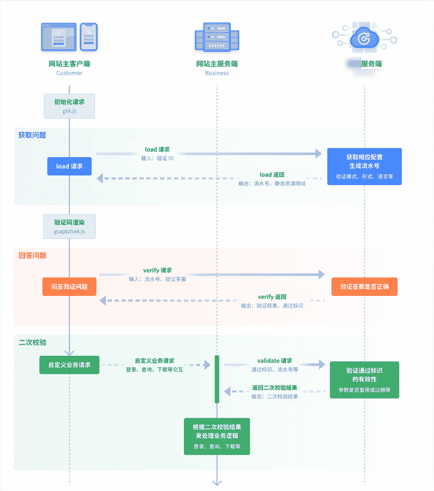

## 验证码流程分析

进入网页后，打开开发者人员工具进行抓包，点击滑动拼图验证，此时还未点击按钮开始验证，抓到了一个名为 `load?captcha_id=xxx` 的包，Query String Parameters 包含了一些参数：
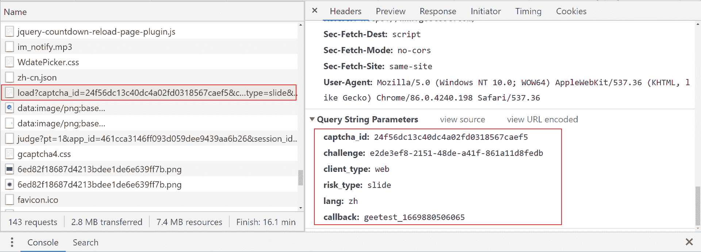
- `captcha_id`：验证码 id，固定值，由 `adaptive-captcha-demo.js` 文件生成，后文分析；
- `challenge`：动态变化，由 `gtc4.js` 文件生成，后文分析；
- `client_type`：表示 web 端；
- `risk_type`：验证码类型，例如滑块为 `slide`，无感为 `ai`；
- `lang`：语言；
- `callback`：`geetest_` + 时间戳，主要作用是防止缓存。

响应预览中返回的关键内容如下，相较于三代，底图未做混淆：
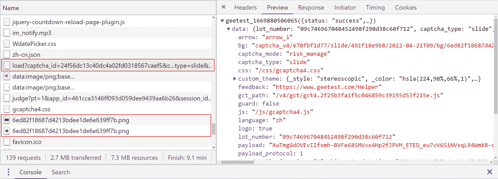
- `bg`：背景图片地址；
- `captcha_type`：验证码类型；
- `gct_path`：`gct4` 文件路径；
- `lot_number`：后续生成 `pow_msg`、`w` 的关键参数；
- `payload`：后续 `verify` 请求接口需要的参数；
- `datetime`：ISO 8601扩展格式的日期，后续生成 `pow_msg` 的关键参数；
- `process_token`：后续 `verify` 请求接口需要的参数；
- `slice`：滑块图片地址。

点击按钮开始验证，弹出滑块验证码，滑动滑块，抓包到 `verify?captcha_id=xxx`，Query String Parameters 同样包含了一些参数：
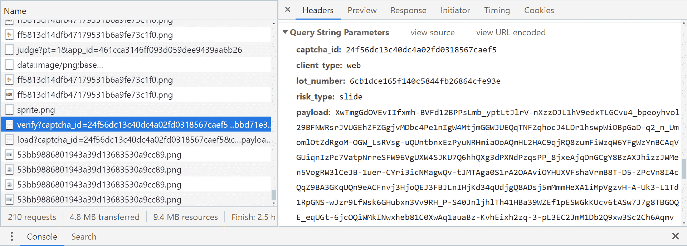
- `captcha_id`：与 `load` 接口请求头中的 `captcha_id` 一致；
- `client_type`：表示 web 端；
- `lot_number`：`load` 接口返回的；
- `risk_type`：与 `load` 接口中的一致，表示验证码类型；
- `payload`：`load` 接口返回的；
- `process_token`：`load` 接口返回的；
- `w`：加密参数，由轨迹、滑动时间、滑动距离、`userresponse`、`device_id`、`pow_msg` 等参数加密得到；
- `callback`：`geetest_` + 时间戳，主要作用是防止缓存。

响应预览中返回的内容如下，`result` 值为 `fail` 即校验失败，`success` 为校验通过，通过后携带 `seccode` 下的参数进行后续业务请求：
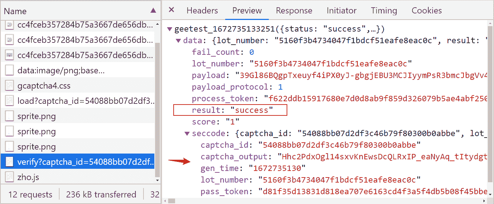

## 逆向分析

### captcha_id 参数

全局搜索 `captcha_id`，跟进到 `gt4.js` 文件中：
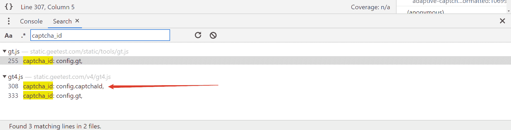
进去后在第 307 行打上断点，刷新页面即会断住，此时 `captcha_id` 参数的值已经生成，同时 `challenge` 参数定义在下一行：
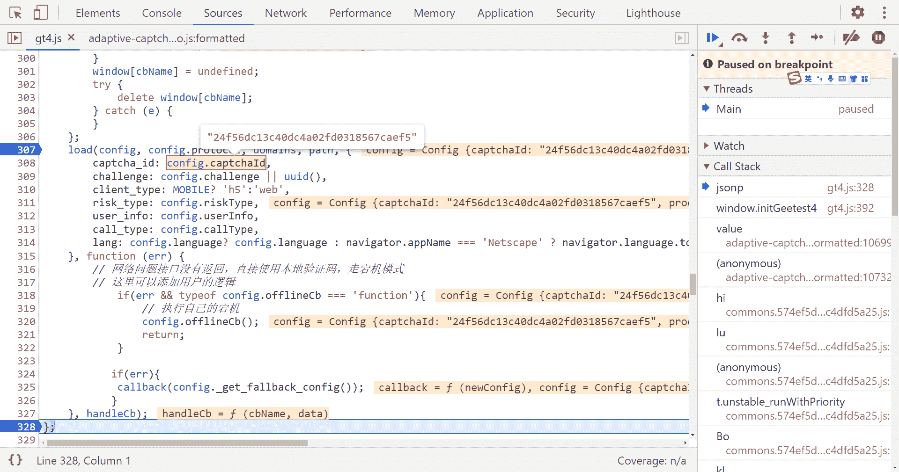
向上跟栈到 `value`，即 `adaptive-captcha-demo.js` 文件中，会发现其是个固定值，实际上这个值是每个网站不一样，是管理员在极验后台申请得到的：
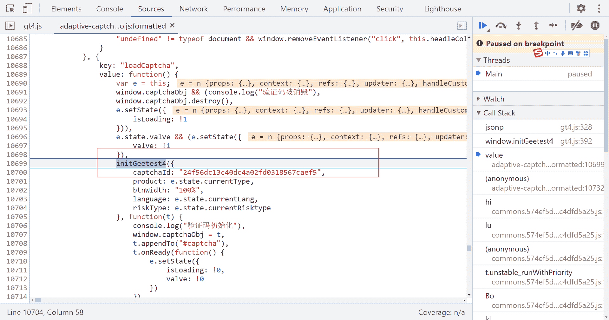

### challenge 参数

前面提到，`challenge` 参数定义在 `captcha_id` 参数的下一行，在 `gt4.js` 文件的第 309 行打下断点：
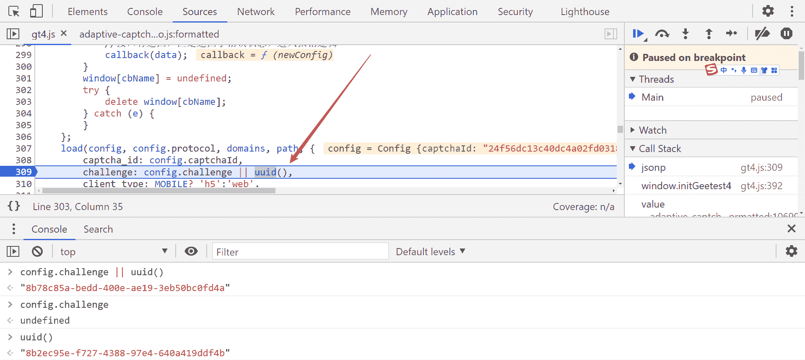
可以看到，`challenge` 参数的值由 `uuid` 函数生成，扣出即可。

### w 参数

从 `verify?captcha_id=xxx` 接口的堆栈处跟栈进去：
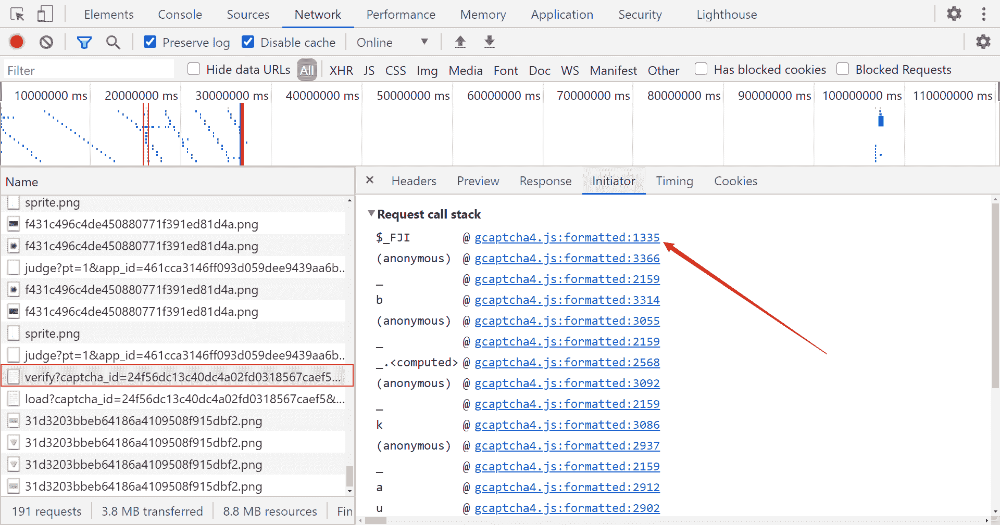
打下断点滑动滑块断住后，向上跟栈到 `s` 处，如果做过某验三代滑块的话，第 6249 行有个很熟悉的东西，`"\u0077"`：`r`，`"\u0077"` 即字母 `w` 的 Unicode 值，`r` 即 `w` 参数的值：
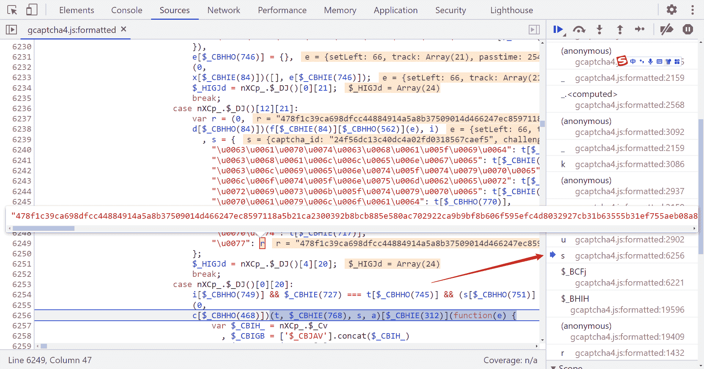
`r` 参数定义在第 6237 行，`e` 也是跟三代类似的参数，`r` 是将 `i` 参数和转为字符串的 `e` 参数加密得到的：
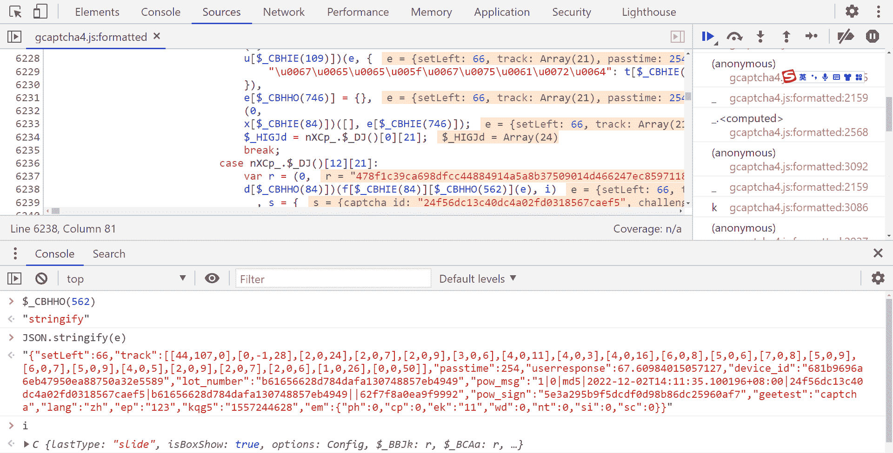
向上跟栈，找到 `e` 参数中各部分定义生成的位置，跟到 `$_BHIH` 中，`_` 中先生成了四个键值对：
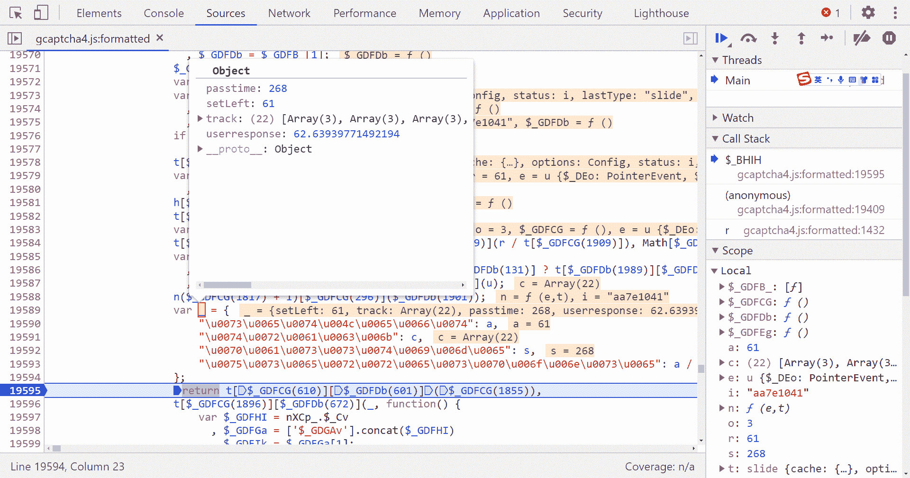
`passtime` 和 `track` 是熟悉的滑动时间和轨迹，`setLeft` 为识别出来的缺口距离，`userresponse` 定义在 19593 行， `a` 为 `setLeft` 参数的值，`t[$_GDFCG(1909)]` 为定值 `1.0059466666666665`：
```
a / t[$_GDFCG(1909)] + 2
```
接着跟到 `$_BCFj` 中，`e` 定义在第 6201 行，下面几行定义了 `e` 中的 `device_id`、`lot_number`、`pow_msg`、`pow_sign`：
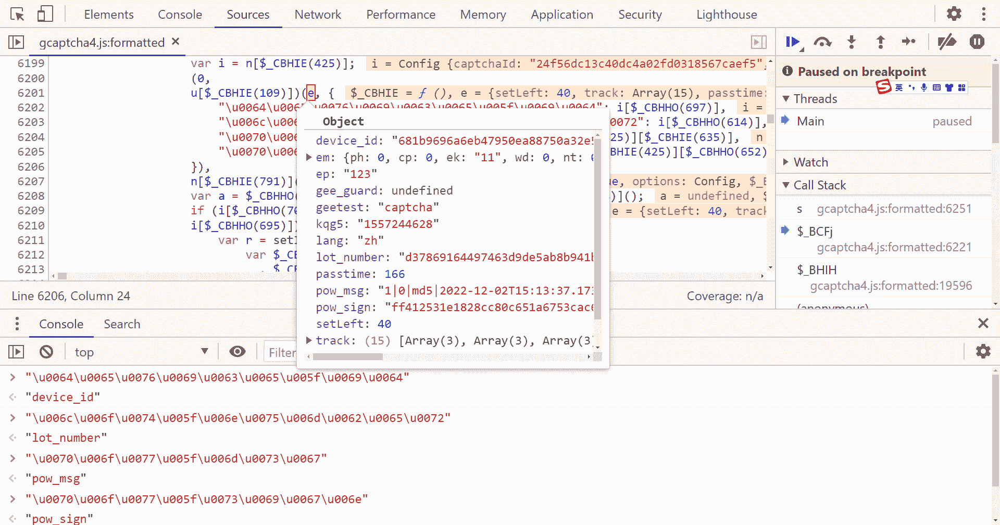
`device_id` 同一个网站是固定值，`lot_number` 是 `load` 响应返回的，控制台打印一下 `pow_msg`、`pow_sign` 的结果：
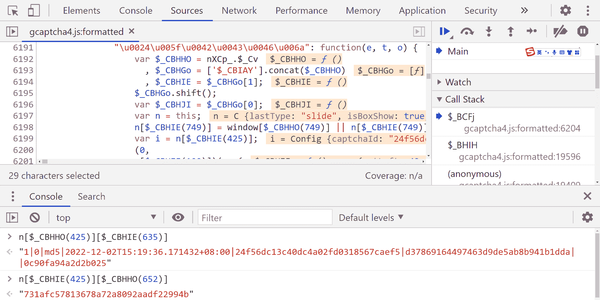
`pow_msg` 很明显是由几部分组成的，`pow_sign` 经过加密，向上跟栈到 `init` 中，分别定义在第 5837 行和第 5838 行，为 `d` 字典的键，根据键名取值：
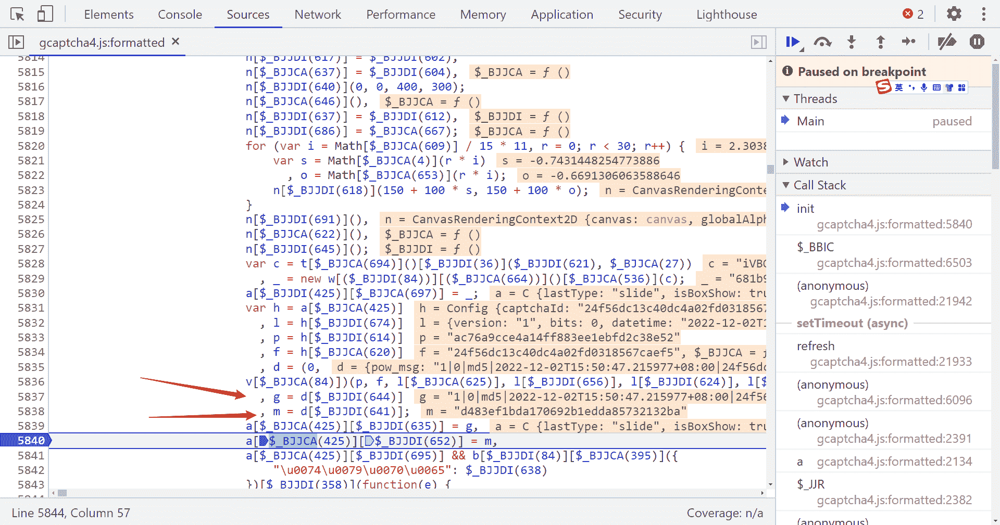
`d` 定义在第 5835 行，这部分还原一下就很明显了：
```
var c = t["toDataURL"]()["replace"]("data:image/png;base64,", "")

    , _ = new w["default"]["MD5"]()["hex"](c);

a["options"]["deviceId"] = _;

var h = a["options"]

    , l = h["powDetail"]

    , p = h["lotNumber"]

    , f = h["captchaId"]

    , d = v["default"](p, f, l["hashfunc"], l["version"], l["bits"], l["datetime"], "")
```
跟进到 `v["default"]` 中，函数定义在第 6945 行，于 6978 行打下断点：
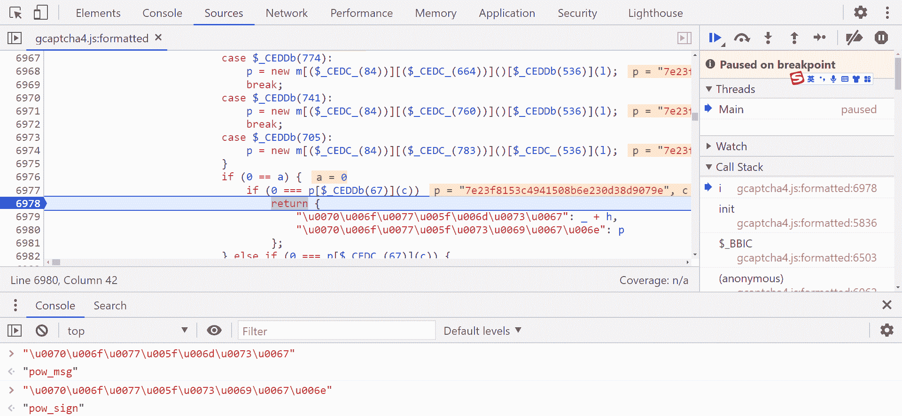
`pow_msg` 由 `_` + `h` 得到，`_` 定义在第 6960 行：
```
_ = i + "|" + r + "|" + n + "|" + s + "|" + t + "|" + e + "|" + o + "|";

- i：l["version"]
- r：l["bits"]
- n：l["hashfunc"]
- s：l["datetime"]
- t：f, h["captchaId"]
- e：p, h["lotNumber"]
- o：""
```
`h` 定义在第 6269 行，跟进去是 16 位随机数字符串，`pow_sign` 为 `p`，就是 `pow_msg` 经过 `MD5` 加密得到的：
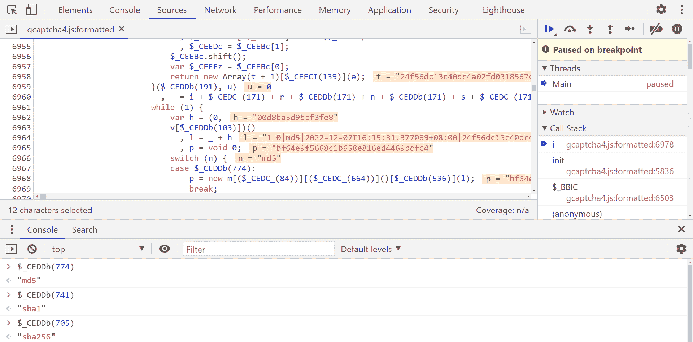
至此这四个也分析完了，还差以下这部分：
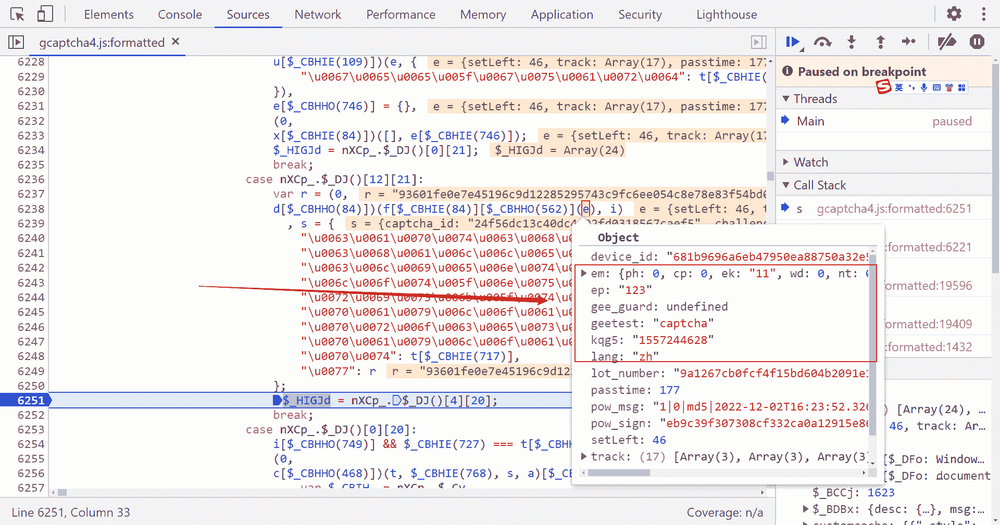
`em` 等定值就不分析了，注意 `kqg5`：`"1557244628"`，这个参数值和三代滑块中一样，每隔几个小时会改变，向上跟栈到 `$_BCFj` 中，在第 6207 行打下断点，此时 `e` 中这个值还未生成：
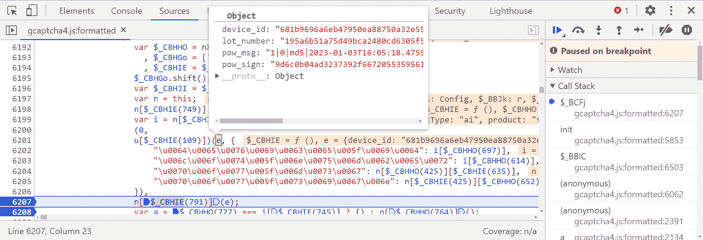
下一行打下断点，下步断点，即执行完 `n[$_CBHIE(791)](e);` 后，这个参数值就生成了，证明是 `n[$_CBHIE(791)]` 方法生成的，跟进去：
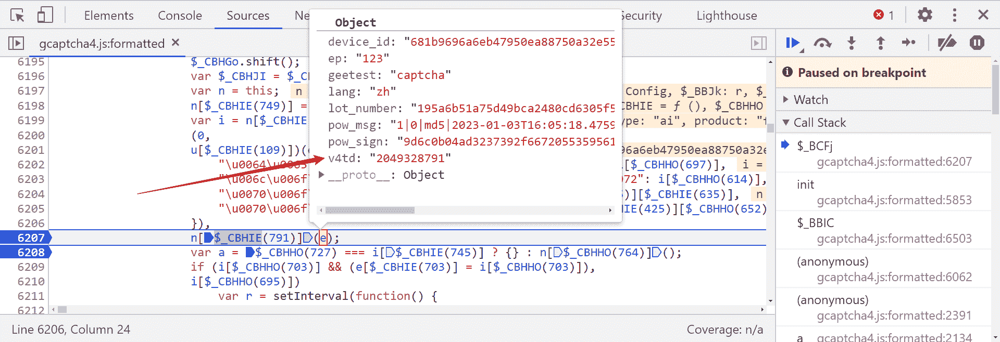
跳转到第 5766 行，在第 5779 行打下断点，此时的 `n` 中还未生成此参数：
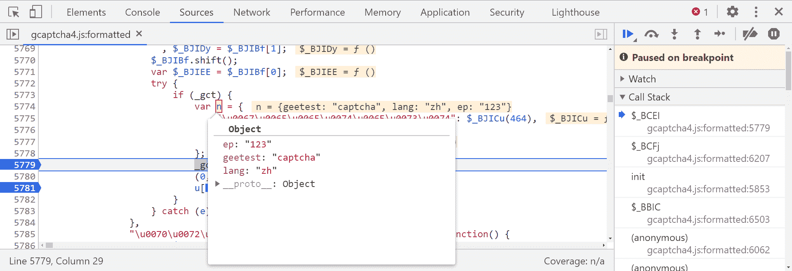
执行了 `_gct(n)` 后即生成：
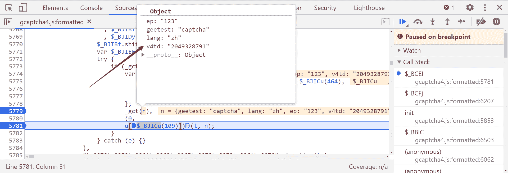
可见其生成位置在 `_gct` 方法中，跟进去后到 `gct4.js` 文件，和三代大差不差：
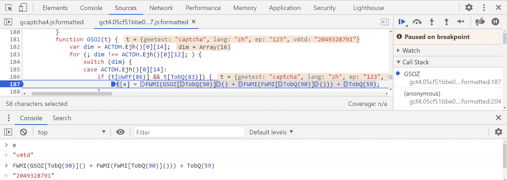
可以将值导出，至此 `e` 就分析完了，接着回到第 6238 行，跟进到加密函数 `d[$_CBHHO(84)]` 中，定义在第 11669 行，`d[$_DIEHS(177)](c)` + `u` 即 `r` 参数的值，`c` 为一个大数组，`u` 明显也经过加密了，所以 `r` 参数的值就是数组 `c` 加密后再加上 `u` 得到的：
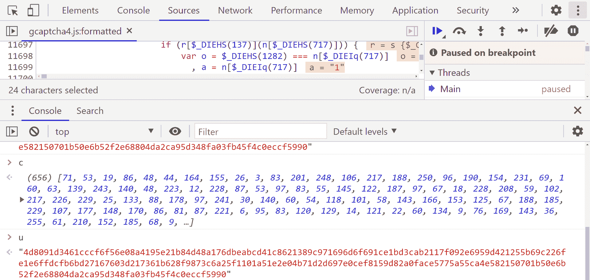
先跟进到 `u`，其定义在第 11705 行，解混淆后如下：
```
u = new l["default"]()["encrypt"](i);
```
所以 `u` 是 `i` 经过加密后得到的，`i` 定义在第 11702 行：
```
i = (0,d[$_DIEIq(103)])()
```
跟进到 `d[$_DIEIq(103)]` 中，定义在第 852 行，又是熟悉的 16 位随机数：
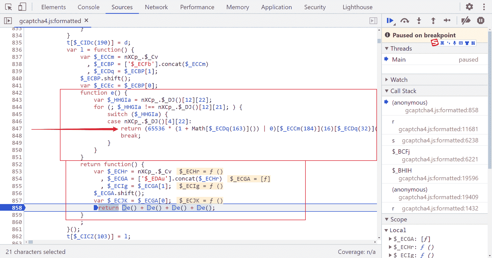
`i` 是随机数，跟进到加密函数 `l[($_DIEHS(84))]` 中，在第 12725 行，于 12741 行打下断点，可以看到这里就是个 `RSA` 加密，扣代码或者直接引库即可：
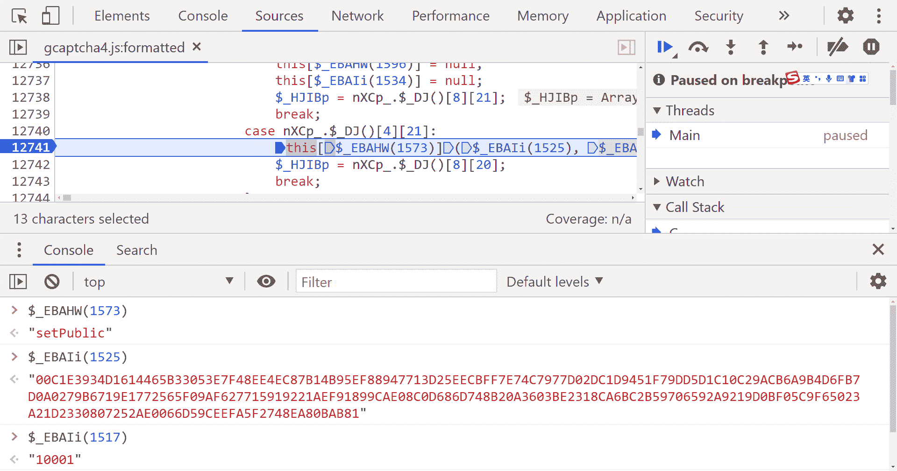
回到 `c` 参数，`c` 参数的值为一个大数组，其定义在第 11705 行，解混淆后内容如下：
```
var c = s[a]["symmetrical"]["encrypt"](e, i);
```
`e` 之前分析完了，`i` 为随机数，两个参数已经分析完了，跟进到加密方法中，在第 12174 行，于 12186 行打下断点，控制台打印一下混淆部分内容，很熟悉的东西，这里就是 `AES` 加密，`iv` 为初始向量，加密模式为 `CBC`，对各类加密算法不熟悉的，可以阅读 K 哥文章：
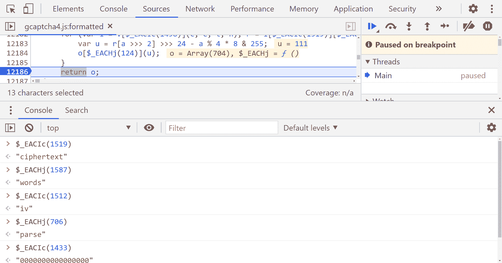
`c` 参数最后又被 `d[$_DIEHS(177)]` 函数加密，跟进后，定义在第 547 行，直接扣下来改改即可：
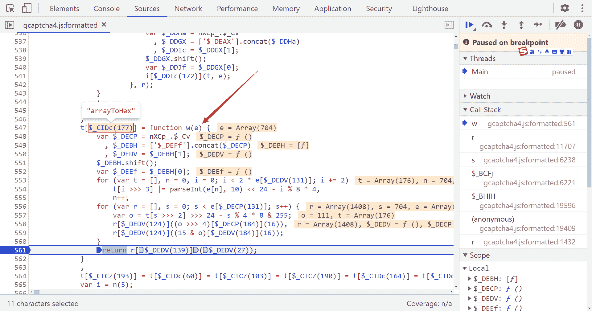

3> 结果验证


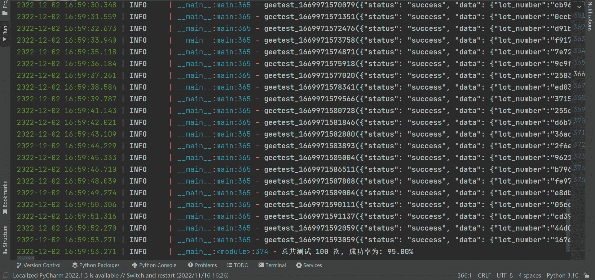
