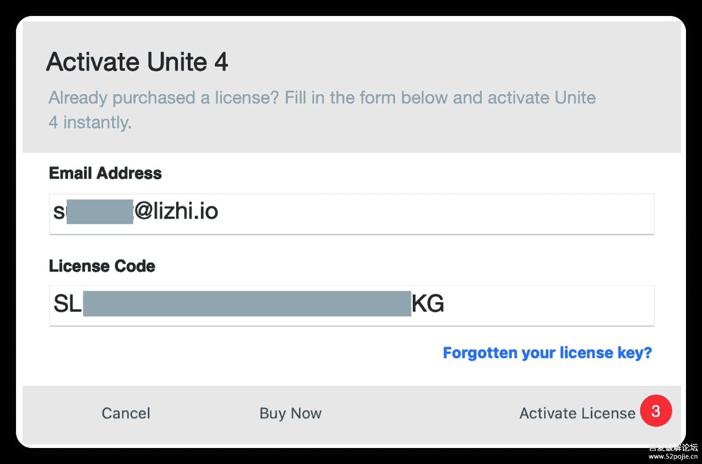
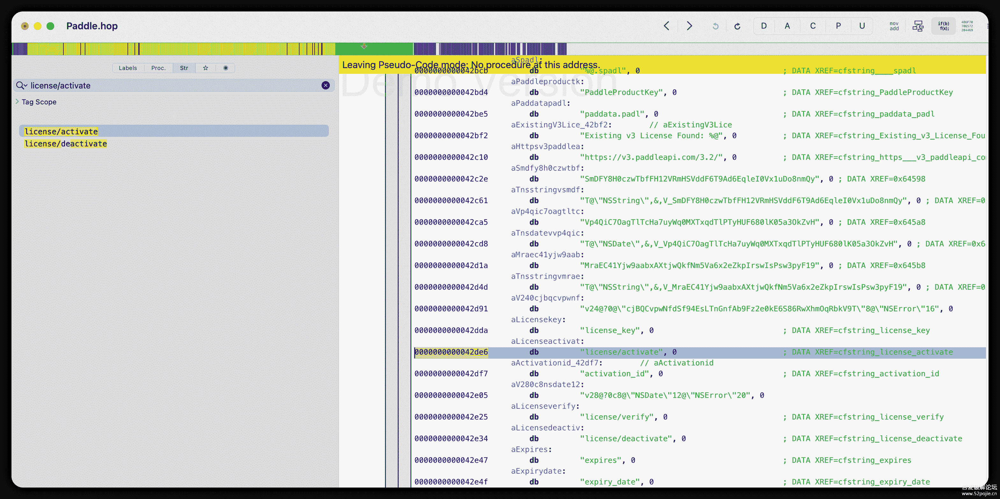
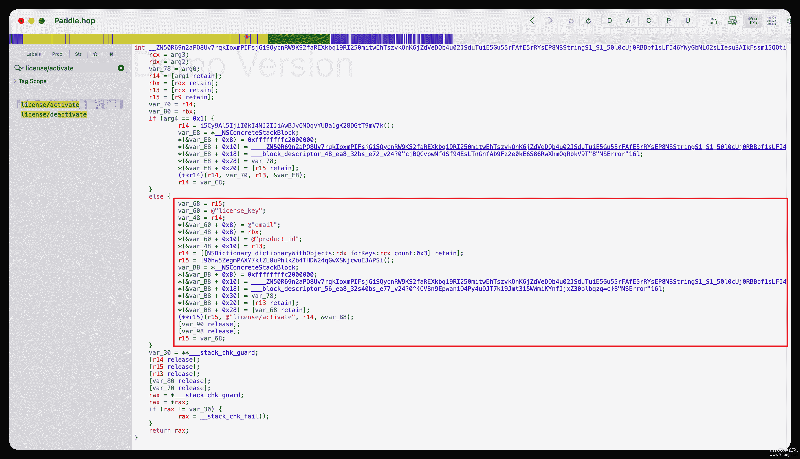
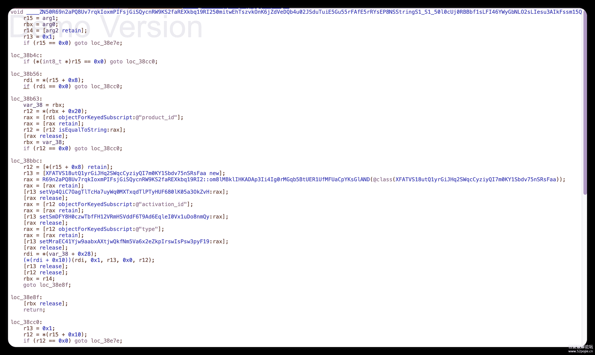
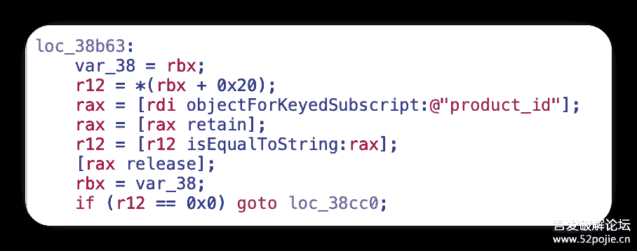
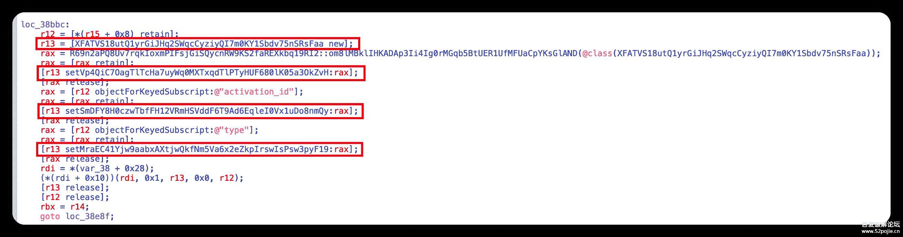
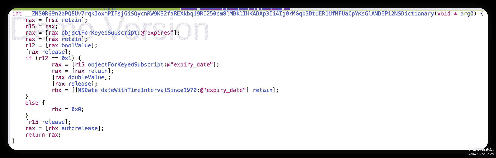

# [MacOS逆向] Paddle激活类Mac应用通杀（AirBuddy、Downie 4、Lunar、Unite 4）

- 原帖：`https://www.52pojie.cn/forum.php?mod=viewthread&tid=1751135`
- 抓取时间：2026-11-01T22:59:25
- 2023.3.7 增加已知应用：SideNotes

## Paddle激活类Mac应用通杀

### 0x00 原理

Paddle官网：[www.paddle.com](https://www.paddle.com/)

据官网描写的，就是他们提供了完整支付、税收和订阅的解决方案。目前有很多Mac应用也都在用这种方式去进行邮箱和授权码激活，但是它本身只是一种远端校验，通过篡改请求返回值可以达到校验成功的效果。

这里给出发文时通用的请求接口：`https://v3.paddleapi.com/3.2/license/activate`

具体的请求结果可以自己抓一下包，然后结合反编译`paddle`查看一下所需要的返回字段值。

### 0x01 如何判断是否使用Paddle激活

#### 1 查看激活界面

一般向类似如下的界面，就有可能是依赖`paddle`激活的，当然有的应用会美化激活界面。



`image-20221220183132254.png` (143.52 KB, 下载次数: 2) [附件链接](https://www.52pojie.cn/forum.php?mod=attachment&aid=MjU5Mjg5M3xjYWFhYzYwY3wxNzkzNTczOTYyfDE2ODA4NnwxNzUxMTM1&nothumb=yes)

2023-2-26 20:34 上传

#### 2 抓包

代{过}{滤}理应用流量后，查看激活请求是否是开头提到的链接或者相似的。

#### 3 查看包内容

在访达中右键应用程序显示包内容，在`Contents/Frameworks/`文件夹下，如果`Paddle.framework`的文件夹，就是用`paddle`进行激活的，如果要逆向分析`paddle`的返回值字段，需要用`Hopper`打开这个文件夹下的`Paddle`程序。

### 0x02 定位关键点

用`hopper`打开应用程序包下的`paddle`主程序，一般路径为`/Applications/应用程序.app/Contents/Frameworks/Paddle.framework/Paddle`，然后在字符串中搜索关键字`license/activate`。



`image-20230226161212287.png` (909.54 KB, 下载次数: 4) [附件链接](https://www.52pojie.cn/forum.php?mod=attachment&aid=MjU5Mjg5NHxiMzFhYjA0M3wxNzkzNTczOTYyfDE2ODA4NnwxNzUxMTM1&nothumb=yes)

2023-2-26 20:34 上传

反向追踪，找到调用函数，可以看出来名称是做了混淆的，但是结合抓包抓到的请求包，是可以判断出红框中的是请求逻辑，`*(&var_B8 + 0x10)`就是回调函数，继续追进去看一下。



`image-20230226161446697.png` (575.84 KB, 下载次数: 3) [附件链接](https://www.52pojie.cn/forum.php?mod=attachment&aid=MjU5Mjg5NXwzNjNjNDg3N3wxNzkzNTczOTYyfDE2ODA4NnwxNzUxMTM1&nothumb=yes)

2023-2-26 20:34 上传

点进去可以看到一些关键字符串，其中也是有执行一些方法，但是因为名称混淆了，所以只能靠猜。



`image-20230226161909622.png` (406.57 KB, 下载次数: 4) [附件链接](https://www.52pojie.cn/forum.php?mod=attachment&aid=MjU5Mjg5Nnw2OTdkMDhmN3wxNzkzNTczOTYyfDE2ODA4NnwxNzUxMTM1&nothumb=yes)

2023-2-26 20:34 上传

分析一下，首先是对返回值中的`product_id`进行判断，是否等于`*(rbx + 0x20)`的内容，这里是和本地的进行以下对比，确定是同一个产品。



`image-20230226162302898.png` (63.99 KB, 下载次数: 4) [附件链接](https://www.52pojie.cn/forum.php?mod=attachment&aid=MjU5Mjg5N3wyOTZlOTQ4YnwxNzkzNTczOTYyfDE2ODA4NnwxNzUxMTM1&nothumb=yes)

2023-2-26 20:35 上传

然后就是实例化一个不知道是干什么的对象，进行了赋值操作，当然根据取值的`key`值，可以推断出后两个赋值的内容是返回值中的`activation_id`和`type`。



`image-20230226162808487.png` (217.87 KB, 下载次数: 3) [附件链接](https://www.52pojie.cn/forum.php?mod=attachment&aid=MjU5Mjg5OHxiYjBmNDI0N3wxNzkzNTczOTYyfDE2ODA4NnwxNzUxMTM1&nothumb=yes)

2023-2-26 20:35 上传

第一个赋值的内容是从一个函数中返回的，点进去看一下，可以看到它的逻辑是取`expires`的布尔值，判断是不是1，猜测是判断激活是否在有效期内，在有效期就取`expiry_date`的内容，然后返回，否则就是返回0。



`image-20230226163110229.png` (202.11 KB, 下载次数: 1) [附件链接](https://www.52pojie.cn/forum.php?mod=attachment&aid=MjU5Mjg5OXw4MDc1Nzg4YnwxNzkzNTczOTYyfDE2ODA4NnwxNzUxMTM1&nothumb=yes)

2023-2-26 20:35 上传

结合请求返回值格式，就可以猜出以下关键字内容：

```json
{
    "success": true,
    "response": {
        "product_id": "585133",
        "activation_id": "admin",
        "type": "personal",
        "expires": 1,
        "expiry_date": 1999999999999
    }
}
```

`product_id`要根据程序进行变化，可以取激活请求的请求体中对应的`id`，`activation_id`我理解为被授权的用户名称，这个可以随意，`type`字段貌似也没有太多固定的值，此处的`personal`也是我在激活请求的请求体中看到的值，但是有些`paddle`激活请求又不带这个内容，有点迷惑，大家可以固定为`personal`即可。

### 0x03 如何激活

- 直接在抓包的时候修改返回包
- 编写抓包工具插件，自动化修改返回值
- 推荐使用`mitmproxy`（编写插件比较简单）
- `hook`的方式

### 0x04 mitmproxy-addon

`FuckPaddle.py`

```python
class FuckPaddle:

    def response(self, flow):
        '''返回值接收之前'''
        if flow.request.pretty_url.find('/3.2/license/activate') != -1:
            product_id = flow.request.urlencoded_form.get_all('product_id')[0]
            resp_str = '{"success":true,"response":{"product_id":"' + product_id + '","activation_id":"admin","type":"personal","expires":1,"expiry_date":9999999999999}}'
            flow.response.content = resp_str.encode("utf-8")

addons = [FuckPaddle()]
```

插件使用方法：`mitmdump -s FuckPaddle.py --listen-host 127.0.0.1 -p 10086 -k`

命令中的端口可以自己改，然后就将指定的应用转到对应的代{过}{滤}理端口上就可以了。

### 0x05 frida-hook

我能力有限，因为方法名称被混淆，所以没有找到合适的通用`hook`方式，所以找了一种另类的方式，通过重置试用的方式达到无限使用的目的，但是前提是该应用提供了试用功能。

灵感来源于`Paddle`官方提供的文档：[Paddle 官方文档：resetting and expiring trials](https://developer.paddle.com/reference/27f8aff6391a0-trial-access-mac#resetting-and-expiring-trials)

感兴趣的其实可以通过阅读文档进一步完善破解的方式

```javascript
// 此处hook trialDaysRemaining的目的是获取当前进程中的PADProduct，然后调用重置试用期的方法
// 以下代码在Downie 4中测试成功
const targetClass = ObjC.classes.PADProduct;
let methodName = "- trialDaysRemaining";
Interceptor.attach(targetClass[methodName].implementation, {
    onEnter(args) {
        const reciver = ObjC.Object(args[0]);
        reciver.resetTrial();
        console.log("Reset Trial Success!");
    }
});
```

### 0x06 已知Paddle激活应用

- AirBuddy
  - AirBuddy存在检验授权是否合格的请求，这个大家可以自己分析一下，但是代{过}{滤}理的方式可能就不太合适了，完美版可以参考QiuChenly大佬的`dylib`注入的方式进行修改，[参考链接](https://www.52pojie.cn/thread-1739112-1-1.html)
  - URL：`https://v3.paddleapi.com/3.2/license/verify`
- Downie 4
  - 存在激活码格式校验，这边给出一个可以通过校验的激活码示例
  - `B7EE3D3C-B7EE3D3C-B7EE3D3C-B7EE3D3C-B7EE3D3C`
- Lunar
- Unite 4

### 0x07 参考

- [mitmproxy 入门](https://www.soft98.top/4000@%e5%ad%a6%e4%b9%a0%e4%b8%93%e6%a0%8f/4002@Mitmproxy/4002.0001@mitmproxy%20%e5%85%a5%e9%97%a8)
- [Frida 入门](https://www.soft98.top/4000@%e5%ad%a6%e4%b9%a0%e4%b8%93%e6%a0%8f/4001@Frida/4001.0001@Frida%20%e5%85%a5%e9%97%a8)
- [Frida 脚本汇总](https://www.soft98.top/4000@%e5%ad%a6%e4%b9%a0%e4%b8%93%e6%a0%8f/4001@Frida/4001.0002@Frida%e8%84%9a%e6%9c%ac%e6%b1%87%e6%80%bb)
- [Paddle trial access mac](https://developer.paddle.com/reference/27f8aff6391a0-trial-access-mac)
