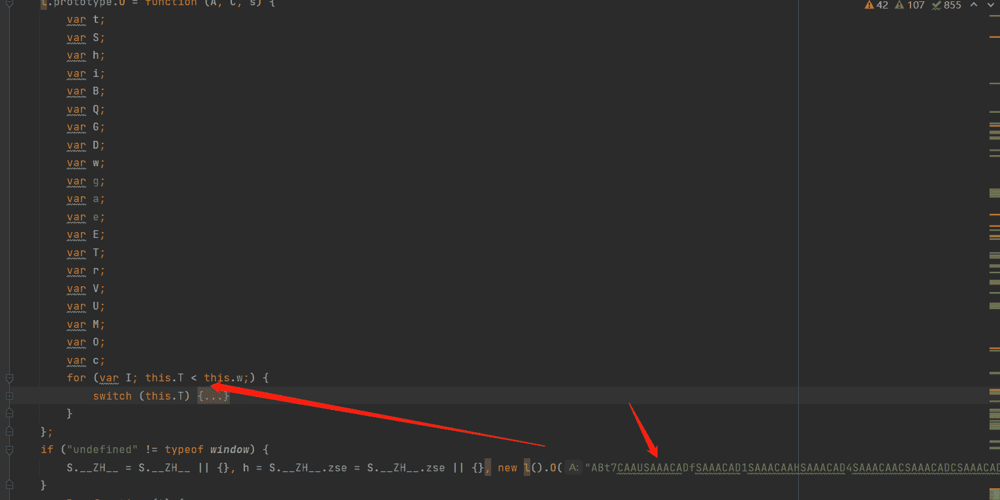
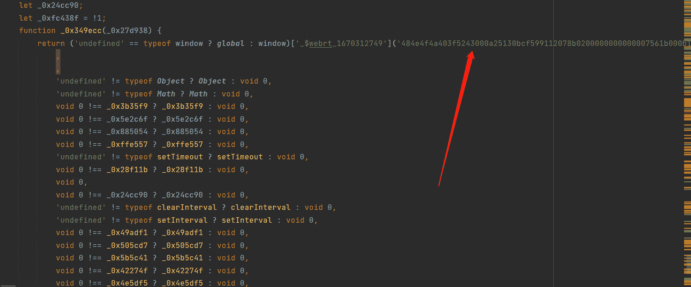
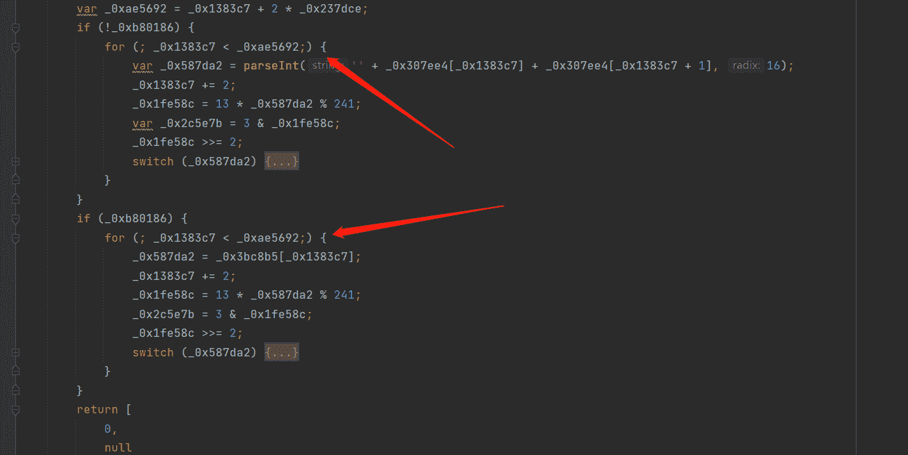
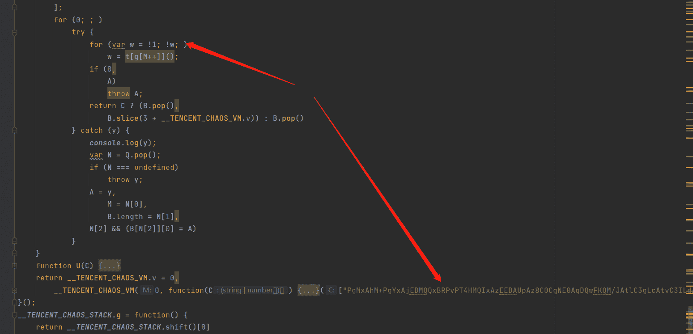
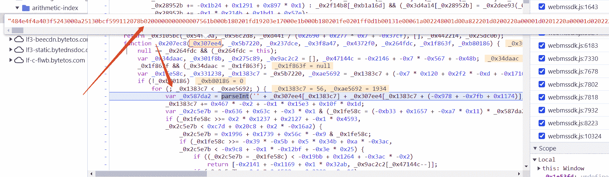
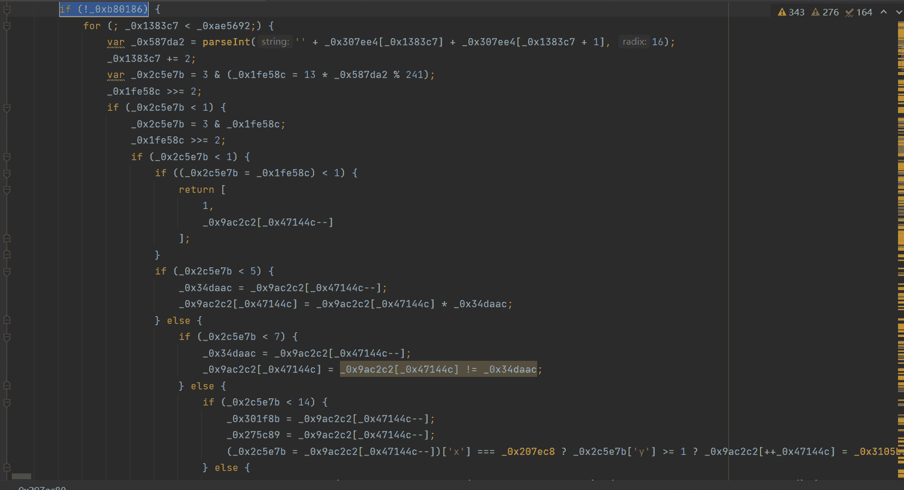
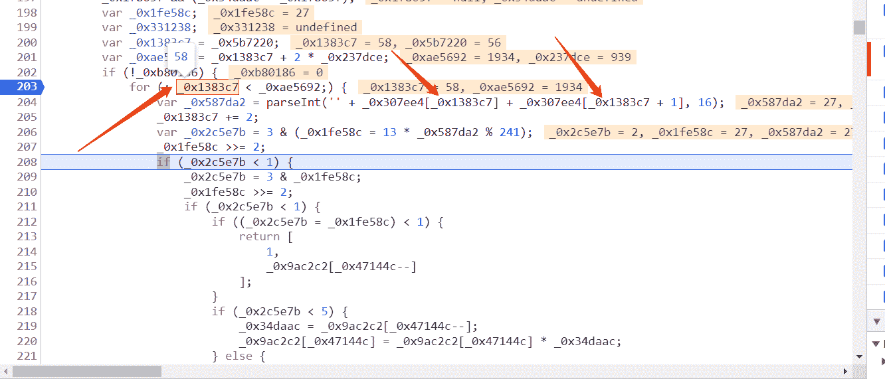
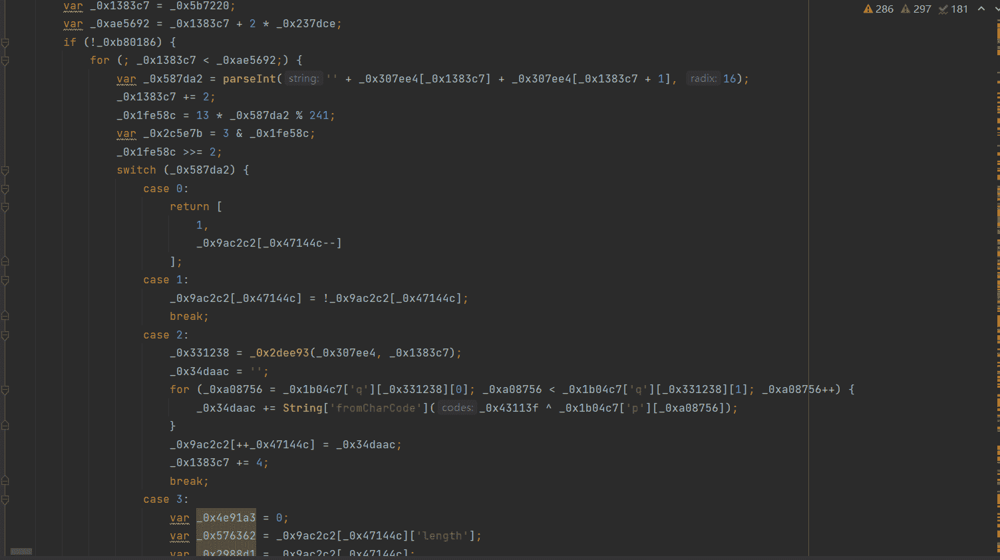
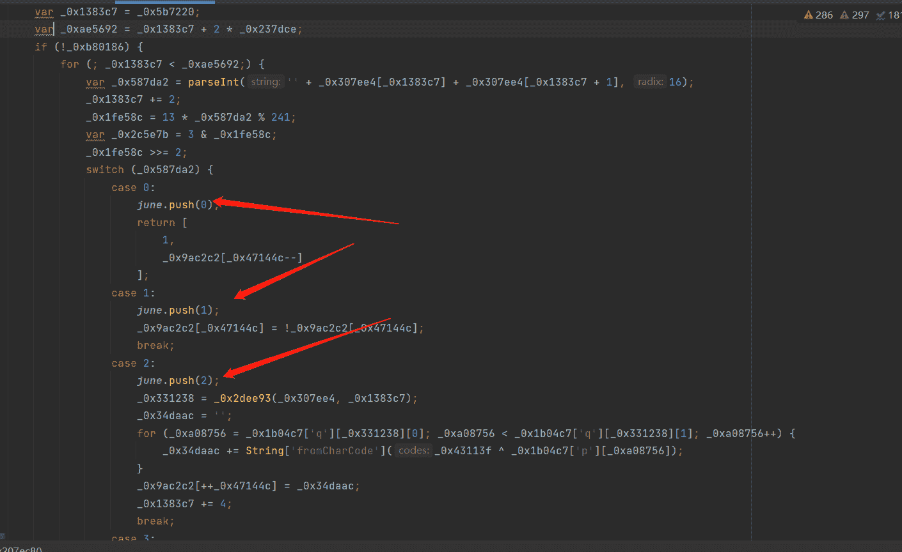

# [Web逆向] 如何使用 AST 还原某音的 jsvmp

- 原帖：https://www.52pojie.cn/forum.php?mod=viewthread&tid=1752755
- 抓取时间：2026-11-01T22:59:21

## 1. 什么是 JSVMP

vmp 简单来说就是将一些高级语言的代码通过自己实现的编译器进行编译得到字节码，这样就可以更有效的保护原有代码，而 jsvmp 自然就是对 JS 代码的编译保护，具体的可以看看[//blog.ntan520.com/article/11179](https://blog.ntan520.com/article/11179)。

如何区分是不是 jsvmp？看代码里面有没有很长的一串字符串或者是数组，并且代码里面没有具体的逻辑，还有就是有一个循环不断地在跑，里面的就是一些指令，比如 x乎，x音，x讯滑块等等都是 jsvmp，也都是基于堆栈的栈式虚拟机实现的。

这是某乎的：

这是某音的，还原了一些算术混淆、三目运算和 `if else` 控制流混淆的：

这是某讯滑块的：

## 2. 如何去还原 JSVMP

1. 调试 vmp 代码，分析循环代码里面每个操作数对应的代码的意义。
2. 修改源代码中的 vmp 解释器，添加 AST 的对应代码。
3. 运行代码，生成最终代码。

## 3. 分析具体网站

样品网站：aHR0cHM6Ly90cmVuZGluc2lnaHQub2NlYW5lbmdpbmUuY29tL2FyaXRobWV0aWMtaW5kZXgvYW5hbHlzaXM/a2V5d29yZD0lRTklODAlODYlRTUlOTAlOTEmc291cmNlPW9jZWFuZW5naW5lJmFwcE5hbWU9YXdlbWU=

这个网站要找的是 `X-Bogus` 和 `_signature` 这两个参数的生成，怎么定位的这里不说了，很容易就可以看到这个函数就是在通过操作码去运行逻辑。

所以我们要分析下这个函数，看到有算术混淆和一些逗号混淆，不方便调试，可以使用 AST 写个逻辑去掉，这个很简单，还原效果如下：

可以看到，逻辑清晰了很多，但是因为是 `if else` 混淆，里面还有一些中间变量，如果调试的话会需要点击多几次才能到目标语句，所以我们可以考虑将这个 `if else` 转换为 `switch` 语句，这样调试的时候直接一步到位。

上图可以看到每次都从操作码中读取两个字符，并且是十六进制的，所以 `_0x1383c7` 这个变量的范围就是 0-255，这样 `switch` 的条件就有了，可以编写代码从 0 迭代到 255，就可以得到每个指令对应的代码了。最后还原结果如下：

可以看到逻辑很清晰了，但是有个问题是 0-255 的 `case` 里面有些是重复的，需要删除，可以继续使用 AST，在每个 `case` 的第一行插入 `june.push(case_num)`，如这样：

然后映射文件到网站上，运行一次，获取 `june` 数组里面的值，保存到代码里，继续编写 AST 代码，读取 `case` 条件值，将不在数组中存在的 `case` 值全部删除掉，最后就可以愉快地分析了！

通过调试分析出，该函数的每个参数意义如下：

| 参数 | 意义 |
| --- | --- |
| `_0x307ee4` |  |
