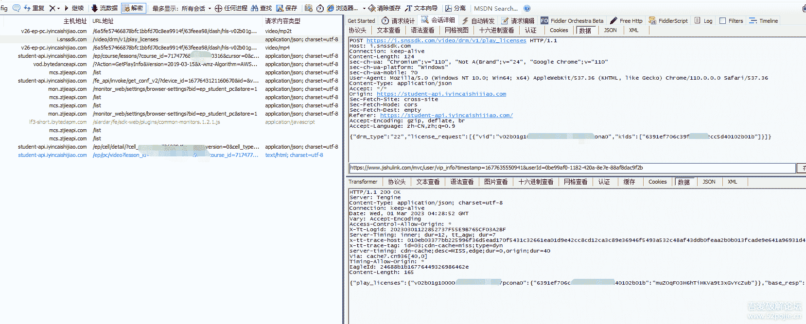
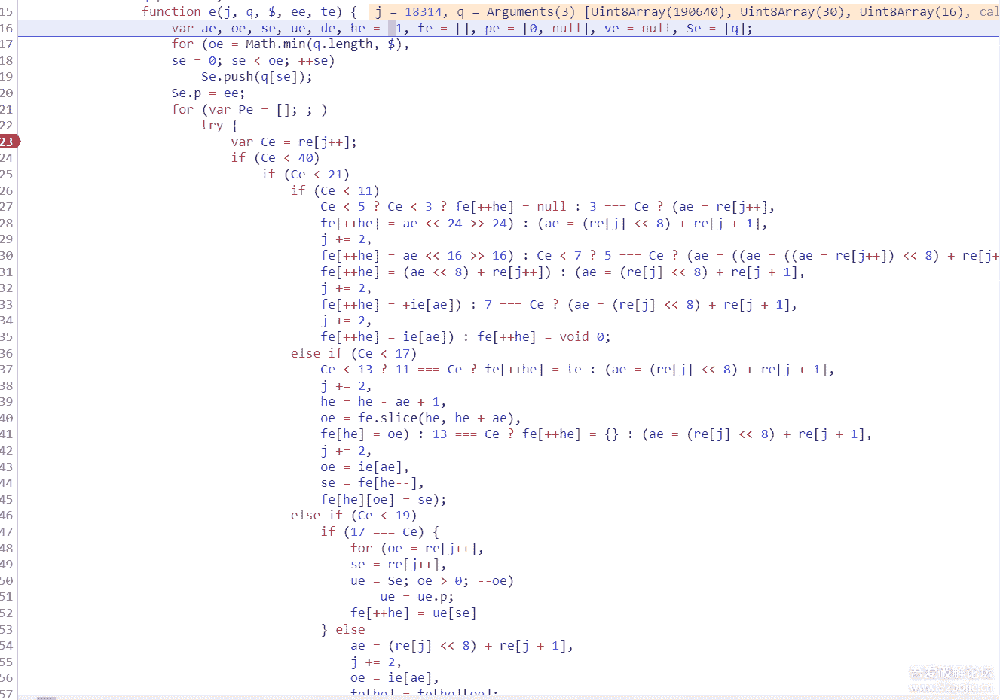

# [Web逆向] 某浪视频key解密分析

- 原帖: https://www.52pojie.cn/forum.php?mod=viewthread&tid=1753800
- 抓取时间: 2026-11-01T22:59:16

[md]@[rel="nofollow noopener" href="某浪视频key解密分析" target="_blank" rel="noopener noreferrer nofollow"](https://www.52pojie.cn/某浪视频key解密分析)

最近坛内出现不少关于某浪的逆向分析教学教学贴
1.[//www.52pojie.cn/thread-1741682-1-1.html" target="_blank" rel="noopener noreferrer nofollow"](https://www.52pojie.cn/thread-1741682-1-1.html:href="https)
2.[//www.52pojie.cn/thread-1617087-1-1.html" target="_blank" rel="noopener noreferrer nofollow"](https://www.52pojie.cn/thread-1617087-1-1.html:href="https)
3.[//www.52pojie.cn/thread-1749758-1-1.html" target="_blank" rel="noopener noreferrer nofollow"](https://www.52pojie.cn/thread-1749758-1-1.html:href="https)
4.[//www.52pojie.cn/thread-1752497-1-1.html" target="_blank" rel="noopener noreferrer nofollow"](https://www.52pojie.cn/thread-1752497-1-1.html:href="https)

某浪视频的`key`并不在`m3u8`内，现在请求到`m3u8`以后，还需要请求一个`play_licenses`的接口，请求到之后返回的是加密的`key`



跟踪堆栈调试时，会发现进行了一个大循环



解密过程涉及`jsvmp`，为了方便使用，封装成`dll`进行处理

## Python调用案例

```
dll = ctypes.WinDLL('snssdk.dll', winmode=0)
dll.init_wasm()
dll.decrypt_key.argtypes = [ctypes.c_char_p]
dll.decrypt_key.restype = ctypes.c_char_p
ckey = dll.decrypt_key(ctypes.c_char_p(b"muZOqFO3H6hTiHKVa9t3xGvYcZub")).decode()
print(ckey)  # 1d45c6d6841e4752
ckey = dll.decrypt_key(ctypes.c_char_p(b"ouZ2xWyJTcYA5R2rAIoclAHESuYE+RnYAJcetgmpFOBYsELAwA==")).decode()
print(ckey)  # 991b8fe94e58466fb9f6592f69076bff
```

## 增加python的exe调用案例

```
snssdk = os.popen('snssdk muZOqFO3H6hTiHKVa9t3xGvYcZub')
key = snssdk.read()
print(key)  # 1d45c6d6841e4752
snssdk = os.popen('snssdk ouZ2xWyJTcYA5R2rAIoclAHESuYE+RnYAJcetgmpFOBYsELAwA==')
key = snssdk.read()
print(key)  # 991b8fe94e58466fb9f6592f69076bff
```

下载地址：见附件
