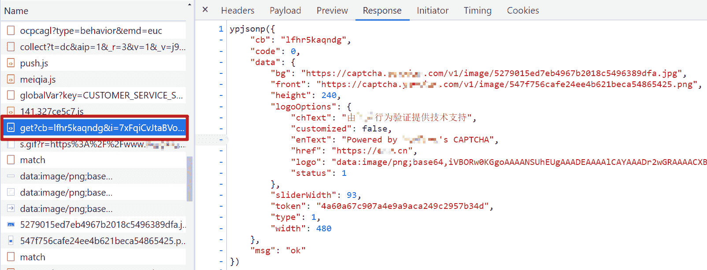
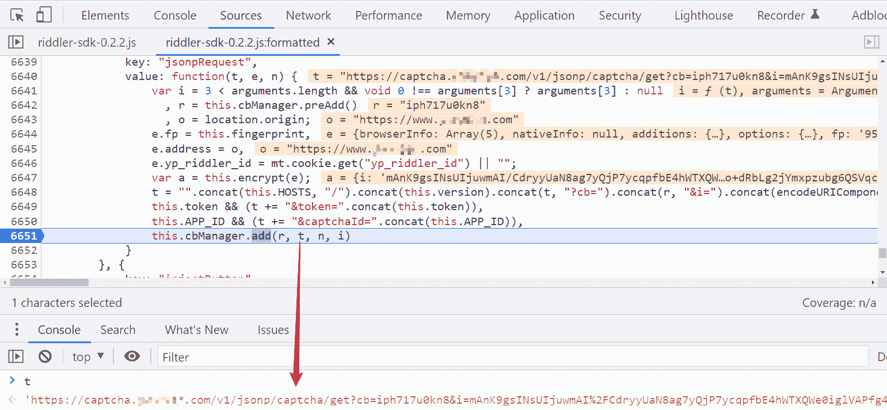

# [Web逆向] 【验证码逆向专栏】某片滑块、点选验证码逆向分析

- 原帖: https://www.52pojie.cn/forum.php?mod=viewthread&tid=1756692
- 抓取时间: 2026-11-01T22:59:03


## 声明

本文章中所有内容仅供学习交流使用，不用于其他任何目的，不提供完整代码，抓包内容、敏感网址、数据接口等均已做脱敏处理，严禁用于商业用途和非法用途，否则由此产生的一切后果均与作者无关！
本文章未经许可禁止转载，禁止任何修改后二次传播，擅自使用本文讲解的技术而导致的任何意外，作者均不负责，若有侵权，请联系作者立即删除！

## 逆向目标

- 目标：某片的滑动验证码和点选验证码逆向
- 主页：aHR0cHM6Ly93d3cueXVucGlhbi5jb20vcHJvZHVjdC9jYXB0Y2hh


## 抓包分析

验证码图片获取接口，`GET`请求，包含四个参数：`cb`、`i`、`k`、`captchaId`，有时候可能也会有`token`参数，那是因为不是第一次加载图片，比如刷新图片，会将之前接口的`token`值带上。

接口返回，如果是滑动验证码，则`bg`是背景图，`front`是滑块图，还有个`token`值后续会用到。

如果是点选验证码，则`captchaImage`是底图，`wordsImage`是需要点击的文字，同样的有个`token`值后续会用到。

验证接口，包含五个参数：`cb`、`i`、`k`、`token`、`captchaId`，其中`token`就是获取验证码接口返回的。


## 逆向分析

### 图片接口

先来看看获取验证码图片的接口，全局搜索关键字`captchaId`即可定位到 key 为`jsonpRequest`的地方，下图中的`t`就是完整的接口 URL 了：

往上挨个找，先看看`captchaId`，其实就是`this.APP_ID`，多次刷新你会发现，对于滑块来讲，是定值`974cd565f11545b6a5006d10dc324281`，对于点选来讲，是定值`e1e7be036f9242c7aed023438af66f46`，这两个值在一个 JS 里是写死的，如下图所示：


再往上看，`HOSTS`啥的是定值就不用说了，`cb`就是`r`，`i`就是`a.i`，`k`就是`a.k`，通过`concat()`方法连接起来，所以只需要搞定`r`和`a`的值就行了，如下图所示：

`a`的值是通过`encrypt(e)`得到的，`e`里面有`fp`、`address`、`yp_riddler_id`等值，如下图所示：

先看看这个`encrypt`方法，最终返回的是`i`和`k`，瞧瞧这熟悉的`iv`、`parse`，一看就是`AES`、`DES`之类的，试一下就知道了，或者跟进`lt.a.encrypt()`看看他的源码，对比一下标准算法里的源码，就可以发现是`AES`，`k`就很明显了，`RSA`加密，公钥啥的一搜就有。

然后往上有个`yp_riddler_id`，貌似是从 cookie 中拿的，直接搜索这个关键字，可以找到其设置值的地方，就是一个`UUID`，其中有个`window.performance.now()`方法，其作用是返回一个当前页面执行的时间的时间戳，用来精确计算程序执行时间，在 node 实现方法如下：
```
var perf = require('perf_hooks');

performance = perf.performance.now()
console.log(performance);
```


然后再往上有个`e.fp = this.fingerprint`，这里用到的应该是一个指纹库：[//github.com/fingerprintjs/fingerprintjs" target="_blank" rel="noopener noreferrer nofollow"](https://github.com/fingerprintjs/fingerprintjs:rel="nofollow noopener" href="https) ，感兴趣的可以了解一下，同一个浏览器得到的指纹是一样的，这里固定即可。

然后就是`r`的值，`preAdd`方法，直接扣就行了


然后这个`e`的值，再传到`jsonpRequest`之前就已经有一些值了，所以我们还得往前跟栈看看：

来到`getCaptcha`这里，没啥特别的，扣就完事儿了，其中有个`browserInfo`是浏览器的一些东西，copy下来就行了。


### 验证接口

验证接口最后也是走的`jsonpRequest`，和前面的获取图片接口类似，不同之处就是传入的`e`里面包含的值不一样，先来看看滑块：

包含`distanceX`和`points`，很明显`points`就是轨迹了，再往前跟看看，如下图所示，我们只需要`i`和`r`参数就行了，参数是一些图片高宽，固定就行，`offsetX`是滑动的距离。

主要看看这个轨迹`i = this.reducePoints()`，跟进`reducePoints()`方法里，`this.position`是轨迹信息，这个方法对轨迹做了一些处理再返回的，直接把逻辑扣下来即可。

滑块就到这儿了，再来看看点选验证，同样的还是`jsonpRequest`，传入的`e`包含了三个点的坐标。

同样往上跟栈，这里的`this.position`才是真实坐标，后面每个坐标分别对 x 和 y 与图片的宽和高进行相除，如下图所示：


### 结果验证


