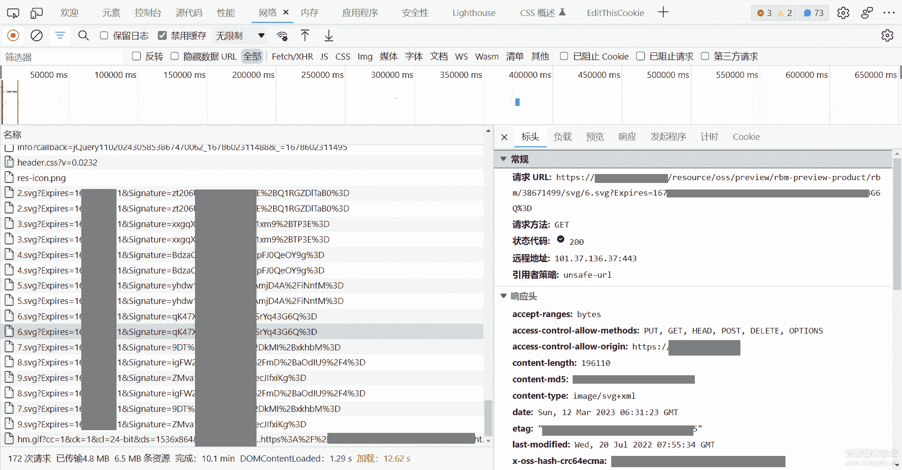
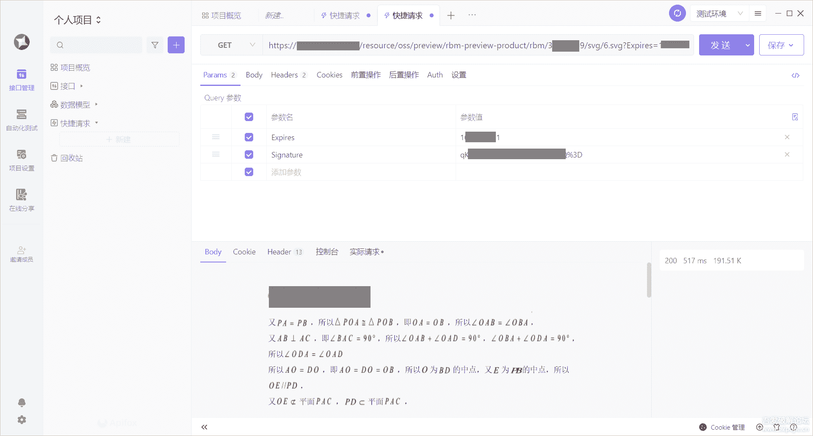
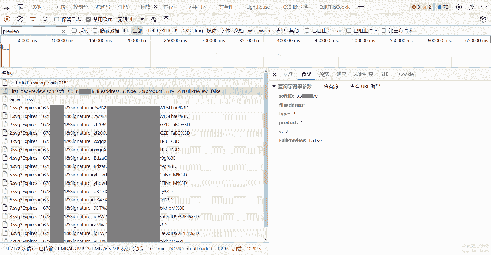
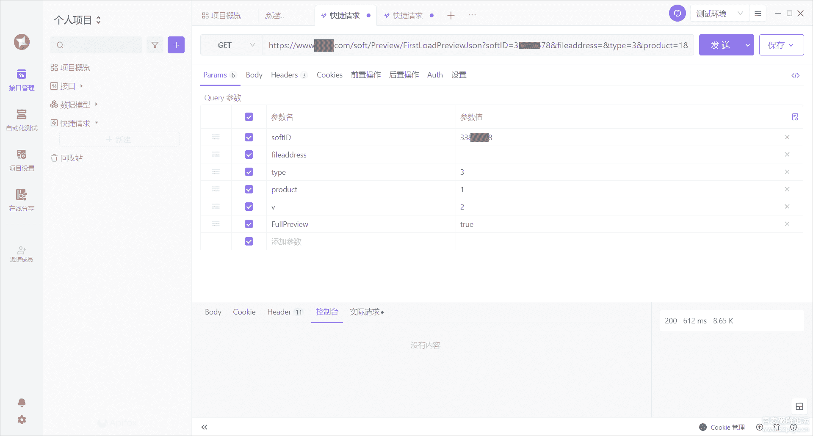
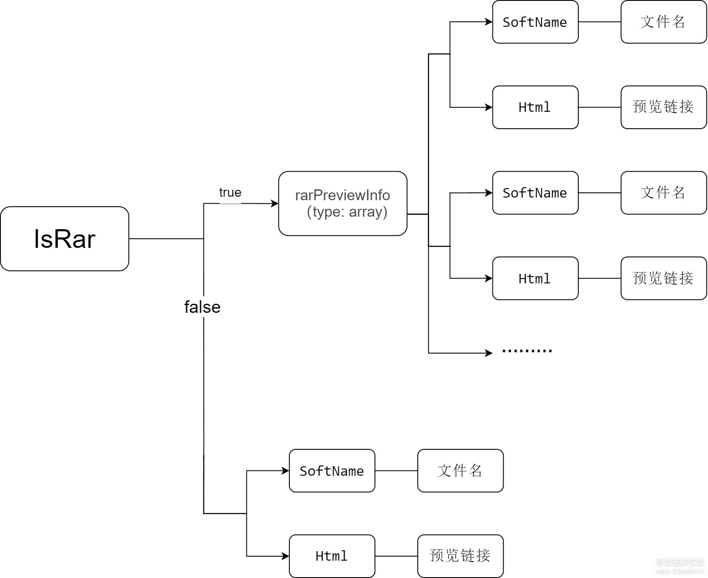

# [Web逆向] 对于某网站预览文档分析

- 原帖：https://www.52pojie.cn/forum.php?mod=viewthread&tid=1757323
- 抓取时间：2026-11-01T22:58:54

## 背景

某网站资源页面存在预览，有的只有部分，有的能显示全部。对于文字版文档，文件是矢量版，看起来效果很好。

## 预览数据抓包

在页面内打开一个没有打开的文档，抓包找到大量 `svg` 文件请求：



`1.png`（223 KB，下载次数：0）；附件：[1](https://www.52pojie.cn/forum.php?mod=attachment&aid=MjU5NTk0M3xkNjMwNjYxZXwxNzkzNTczOTMyfDE2ODA4NnwxNzU3MzIz&nothumb=yes)（2023-3-12 15:32 上传）

链接（已隐藏部分数据）：

```text
https://preview.*****.com/resource/oss/preview/rbm-preview-product/rbm/*******/svg/6.svg?Expires=167*****11&Signature=qK47**********rYq43G6Q%3D
```

将抓包数据导入apifox，删除 `cookie` 和 `header` 测试是否存在验证，结果证明不存在除了 `url param` 外的其他认证。



`2.png`（156.18 KB，下载次数：1）；附件：[2](https://www.52pojie.cn/forum.php?mod=attachment&aid=MjU5NTk0NHxlMzVmOGMyYnwxNzkzNTczOTMyfDE2ODA4NnwxNzU3MzIz&nothumb=yes)（2023-3-12 15:32 上传）

### 寻找根源请求数据

上文已经找到了每一页预览的请求，但是由于 `Signature` 的存在还是无法实现自动请求。刷新页面，搜索上述链接可能的关键词 `preview`。



`3.png`（186.01 KB，下载次数：0）；附件：[3](https://www.52pojie.cn/forum.php?mod=attachment&aid=MjU5NTk0NXxlOWI5ZWU4M3wxNzkzNTczOTMyfDE2ODA4NnwxNzU3MzIz&nothumb=yes)（2023-3-12 15:32 上传）

观察到有一个疑似请求：

```text
https://www.****.com/soft/Preview/FirstLoadPreviewJson?softID=33****78&fileaddress=&type=3&product=1&v=2&FullPreview=false
```

响应内容是一个 JSON：

```json
{
    "code": 0,
    "success": false,
    "data": {
        "IsSuccess": true,
        "IsRar": true,
        "SoftExt": null,
        "Html": "\r\n\u003cstyle\u003e\r\n  {{请求内容过长忽略}}  \u003e\r\nHHHHHHisrar",
        "PreviewPage": 0,
        "TotalPage": 0,
        "rarPreviewInfo": [
            {
                "FileId": 38****99,
                "Html": "\r\n\u003cdiv class=\"multiple-date-preview-file\" data-index=\"3****499\"\u003e\r\n    \u003cdiv class=\"preview-main\"\u003e\r\n        \r\n        \u003cimg data-original=\"https://preview.***.com/resource/oss/preview/rbm-preview-product/rbm/38****99/svg/1.svg?Expires=1678604711\u0026Signature=7w%2BPVktPi********5Lha0%3D\" onselectstart=\"return false\" /\u003e\u003cimg data-original=\"https://preview.***.com/resource/oss/preview/rbm-preview-product/rbm/38****99/svg/2.svg?Expires=16****4711\u0026Signature=zt20********BQ1RGZDlTaB0%3D\" onselectstart=\"return false\" /\u003e\u003c  {{以下存在类似内容，忽略}}    \u003c/div\u003e\r\n\u003c/div\u003e\r\n\u003cscript\u003e\r\n    document.oncontextmenu = function () {\r\n        window.event.returnValue = false;\r\n    };\r\n    var pageNum = 9;\r\n    var hasPreview = true;\r\n    if (pageNum \u0026\u0026 window.setDocumentPageNum) {\r\n        window.setDocumentPageNum(pageNum, hasPreview);\r\n    }\r\n\u003c/script\u003e\r\n\r\n",
                "SoftName": "************.docx",
                "IconClassName": "icon-doc-doc",
                "TotalPage": 9,
                "PreviewPage": 9,
                "IsMedia": false,
                "Url": null
            },
            {
                "FileId": 3****500,
                "Html": "{{类似上文}}",
                "SoftName": "********.docx",
                "IconClassName": "icon-doc-doc",
                "TotalPage": 5,
                "PreviewPage": 5,
                "IsMedia": false,
                "Url": null
            }
        ]
    },
    "msg": "预览错误",
    "message": null
}
```

PS：上文中的 `"msg": "预览错误"` 对任意都相同，忽略。

经分析，上文的第一个 `Html` 内容基本无效，都时限制用户的脚本。

`rarPreviewInfo` 中的 `Html` 内容格式化后如下：

```javascript
document.oncontextmenu = function () {
    window.event.returnValue = false;
};

var pageNum = 9;
var hasPreview = true;
if (pageNum && window.setDocumentPageNum) {
    window.setDocumentPageNum(pageNum, hasPreview);
}
```

显然，`preview` 链接被直接返回了，经检验该链接可以直接请求。

最后导入apifox验证后可以确定无需特殊 `headers` 或 `cookies`。

### 最小化请求链接和寻找相关参数

当前链接参数：



`4.png`（105.08 KB，下载次数：1）；附件：[4](https://www.52pojie.cn/forum.php?mod=attachment&aid=MjU5NTk0NnwxMTVhODQwY3wxNzkzNTczOTMyfDE2ODA4NnwxNzU3MzIz&nothumb=yes)（2023-3-12 15:32 上传）

`SoftID` 可以直接在文档页面的链接中找到：

```text
https://www.****.com/soft/33****78.html
```

上文的 `33****78` 即为 `softID`。

`type`、`product`、`v` 参数不知道用途，对任意文档都是相同的，疑似网站作者还没有实现，直接引用原文了。

`FullPreview` 原本是 `false`，改为 `true` 就直接返回全部内容的预览了.....

### 分析返回的 JSON

测试了多个文档后确定一下结论：



`5.png`（97.15 KB，下载次数：0）；附件：[5](https://www.52pojie.cn/forum.php?mod=attachment&aid=MjU5NTk0N3w1MTAyM2I3YnwxNzkzNTczOTMyfDE2ODA4NnwxNzU3MzIz&nothumb=yes)（2023-3-12 15:32 上传）

### demo 代码

代码无法运行，因为关键域名被 `*` 替代。

```python
import requests

from re import findall, sub

from hashlib import md5

HTML_FORMAT ='''

{title}

{body}

'''

def writefile(filename,text):

    filename = sub(r"""[\*\/\\\|\\? \:\.\'\"\!]""", "", filename)

    unique = md5(text.encode())

    filename += "_"+unique.hexdigest()[:5]

    filename+=".html"

    print("Writing "+filename)

    # print("-=-=-=-=\n",text,"\n-=-=-=-=")

    with open(filename+'.html', 'w', encoding="utf-8") as f:

        f.write(text)

def main():

    softID=input("ID: ")

    url = "https://www.*******.com/soft/Preview/FirstLoadPreviewJson?softID={}&type=3&product=1&v=2&FullPreview=true"

    response = requests.get(url.format(softID))

    if response.status_code!=200:

        print("ERROR")

        print(response.status_code)

        return -1

    ret=response.json()["data"]

    if not ret["IsSuccess"]:

        print("ERROR: IsSuccess option is not true")

        print(ret)

    if not ret['IsRar']:

        print("Not rar")

        print("TotalPage=%d" % ret['TotalPage'])

        print("SoftExt=%s" % ret['SoftExt'])

        try:

            html=ret["Html"]

            print(ret)

        except:

            print(ret)

            exit(1)

        # replace "data-original" to "src" for showing in browser

        html=html.replace("data-original", "src")

        writefile(f"{softID}",html)

    else:

        print("is RAR")

        rar=ret['rarPreviewInfo']

        for file in rar:

            html=file["Html"]

            title=file["SoftName"]

            # replace "data-original" to "src" for showing in browser

            # html=html.replace("data-original", "src")

            urls=findall("(?")
                    continue

                page=requests.get(url,cookies=response.cookies)

                if not page.status_code==200:

                    print(page)

                    print(page.status_code)

                    print(page.text)

                assert page.status_code==200

                l.append(page.text)

            format_html=HTML_FORMAT.format(title=title,body="\n".join(l))

            writefile(title,format_html)

if __name__  == "__main__":

    while True:

        main()
```
