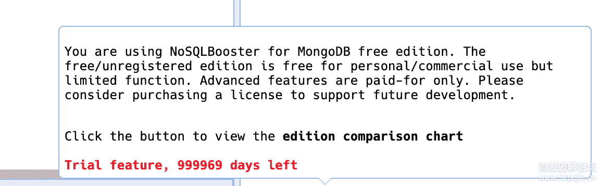

# [MacOS逆向] 修改 NoSQLBooster for MongoDB 试用时间

- 原帖: https://www.52pojie.cn/forum.php?mod=viewthread&tid=1758253
- 抓取时间: 2026-11-01T22:58:49

> 修改 mac端 NoSQLBooster for MongoDB 的专业版试用时长

NoSQLBooster for MongoDB 是一款优秀的 MongoDB 客户端工具，基于 Electro 开发实现。

这里介绍下修改其专业版试用时长，仅作为思路分析。

## 安装依赖工具

解析`asar`格式的文件包需要安装`node`的`asar`依赖。

这里使用全局模式安装

```
npm install asar -g
```

## 解包

找到应用程序的`asar`格式的文件包，然后进行解压。

`asar`格式的文件包一般在这个位置`/Applications/NoSQLBooster for MongoDB.app/Contents/Resources`。

```
cd /Applications/NoSQLBooster for MongoDB.app/Contents/Resources
asar extract app.asar app
```

## 修改试用时间

打开解压目录`app`里的`lmCore.js`文件，在`app\shared\lmCore.js`位置。

找到`MAX_TRIAL_DAYS`和`TRIAL_DAYS`两个信息，并对其进行修改。

```
MAX_TRIAL_DAYS=999999,TRIAL_DAYS=999999
```

我这里将其修改为`999999`，退休之前够用了。

## 重新打包

对修改完成后的`app`文件夹进行重新打包替换原来的`asar`文件。

```
asar pack app app.asar
```

## 运行软件查看

重新打开软件，查看试用信息截图如下。



image.png (66.52 KB, 下载次数: 2)

[href="forum.php?mod=attachment&aid=MjU5Njc0NHw3ZTdkZjY3ZnwxNzkzNTczOTI3fDE2ODA4NnwxNzU4MjUz&nothumb=yes" target="_blank"](https://www.52pojie.cn/forum.php?mod=attachment&aid=MjU5Njc0NHw3ZTdkZjY3ZnwxNzkzNTczOTI3fDE2ODA4NnwxNzU4MjUz&nothumb=yes)

2023-3-14 12:19 上传

## 总结

基于 Electro 客户端工具，基本上思路都是如此，重点是打包后的 js 文件的解析。
