# [Web逆向] 【验证码逆向专栏】某验三代、四代点选类验证码逆向分析

- 原帖：https://www.52pojie.cn/forum.php?mod=viewthread&tid=1758943
- 抓取时间：2026-11-01T22:58:43

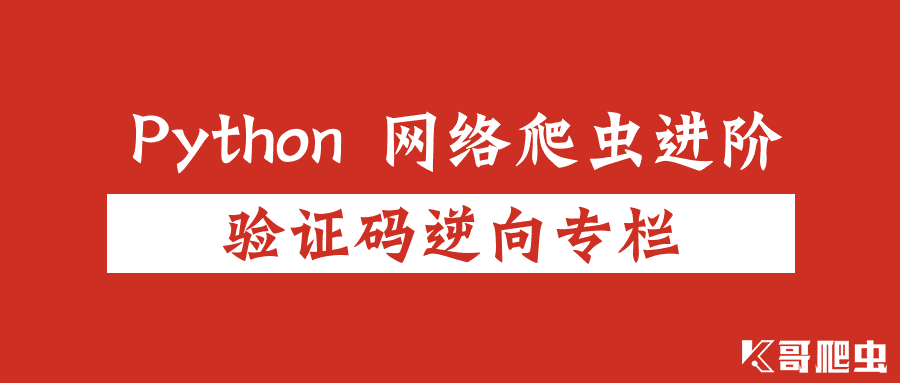

## 声明

本文章中所有内容仅供学习交流使用，不用于其他任何目的，不提供完整代码，抓包内容、敏感网址、数据接口等均已做脱敏处理，严禁用于商业用途和非法用途，否则由此产生的一切后果均与作者无关！

本文章未经许可禁止转载，禁止任何修改后二次传播，擅自使用本文讲解的技术而导致的任何意外，作者均不负责，若有侵权，请联系作者立即删除！

## 逆向目标

- 目标：某验三代、四代点选类验证码（文字、字序、图标、九宫格）逆向分析
- 三代主页：`aHR0cHM6Ly93d3cuZ2VldGVzdC5jb20vc2hvdw==`
- 四代主页：`aHR0cHM6Ly9ndDQuZ2VldGVzdC5jb20v`
- 大部分参数和滑块之类的都一样，这里不在重复叙述，不理解的可以查看往期文章

## 通讯流程

接口相关：

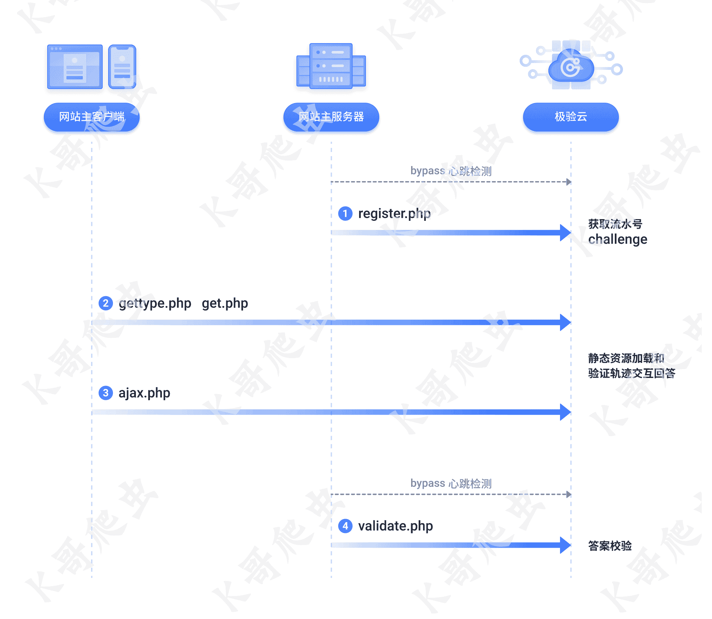

完整流程：

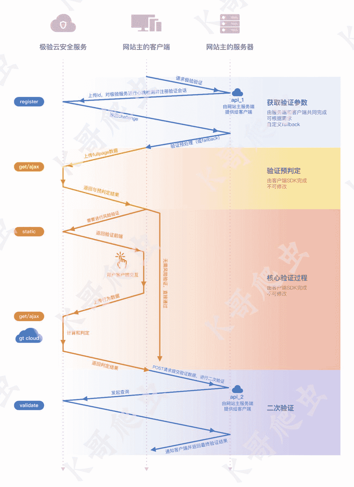

## 三代抓包情况

通过抓包发现，`register-click-official` 接口会返回 `challenge` 和 `gt` 值，为 `get.php` 接口的关键请求参数：

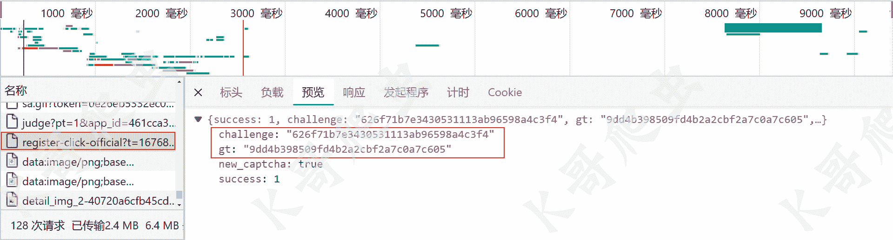

`get.php` 会返回 `c` 和 `s`，同样后面会用到，这个接口的 `w` 值与三代无感不同，可以置空：

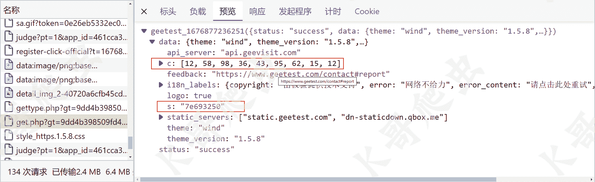

点击按钮进行验证，会弹出文字点选框，此时抓包到第一个 `ajax.php` 接口，虽然只返回了验证码类型，没什么关键参数，但是不请求会报错，点击文字进行验证后，抓到第二个 `ajax.php` 接口，返回验证结果及 `validate` 参数的值，该值登录接口会用到：

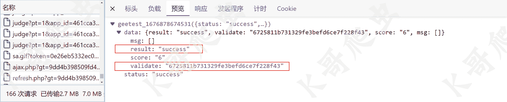

## 三代逆向分析

### `w` 参数逆向

从 `ajax.php` 接口处跟栈或者直接搜索特征码 `"\u0077"` 即可定位到 `w` 参数值生成的位置，位于 `click.3.0.7.js` 文件的第 5839 行：

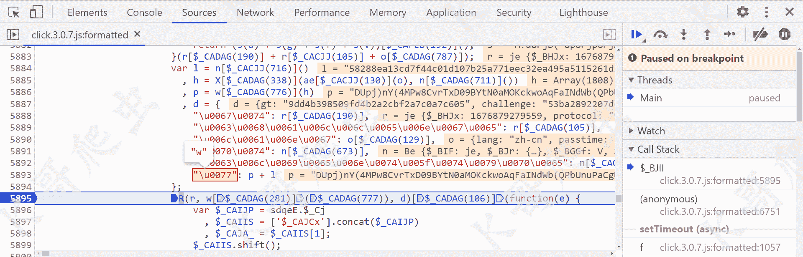

`p + l = w`，关键代码：

```javascript
var l = n[$_CACJJ(716)]()
, h = X[$_CADAG(338)](ae[$_CACJJ(130)](o), n[$_CADAG(711)]())
, p = w[$_CADAG(776)](h)
```

先来看看 `l` 参数，跟到 `n[$_CACJJ(716)]` 中去，`this[$_CBFJA(711)](e)` 为十六位随机字符串，跟到 `this[$_CBFJA(711)]` 中将算法扣下来即可：

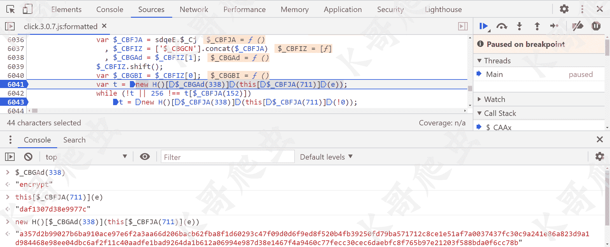

因此 `t` 是将十六位随机字符串加密后得到的，这里为 RSA 加密，从原型链中跟进去即可找到公钥和模值，将代码扣下来或者直接用库都行，至此 `l` 值分析完了，接下来是 `h` 值，`n[$_CADAG(711)]()` 同样是十六位随机字符串，`h` 参数的加密方法为 `X[$_CADAG(338)]`，跟进去打断分析会发现是 AES 加密，初始向量 `iv` 为 `0000000000000000`：

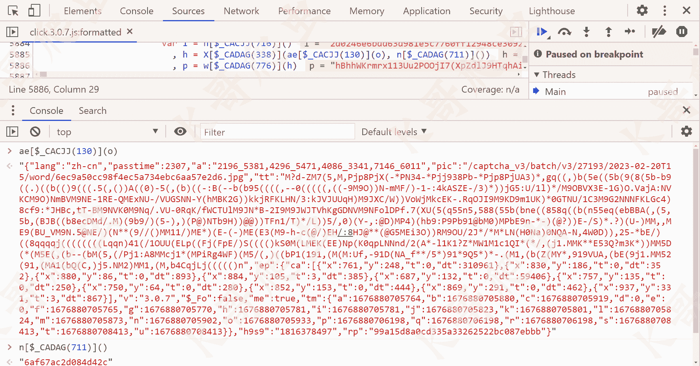

`o` 值的关键参数如下：

- `passtime`：图片加载时间
- `a`：点选文字位置
- `pic`：背景图片链接
- `tt`：将 `c`、`s`、鼠标信息等进行加密，某些值可以固定，加密方法直接扣下来即可
- `h9s9: "1816378497"`：该键值对每天变化，扣法往期文章讲过
- `rp`：将 `gt`、`challenge`、`passtime` 经过 MD5 加密

将 `h` 经过 `w[$_CADAG(776)]` 方法加密后得到 `p`，跟进去扣下来即可，三代图标、语序除了 `a` 的写法，其他逻辑都是一样的。

### 结果验证

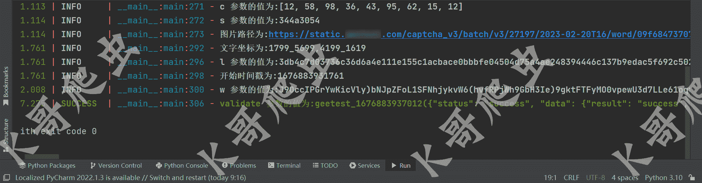

## 四代抓包情况

抓包，`load` 接口返回值如下：

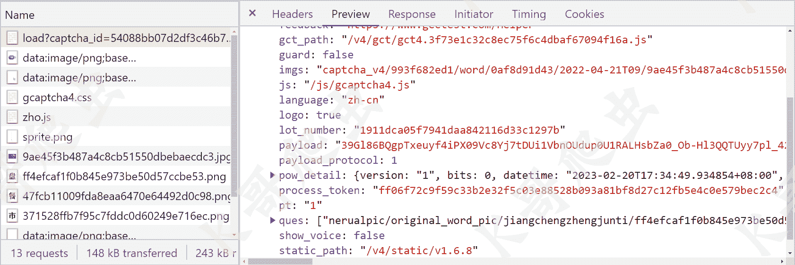

- `captcha_type`：验证码类型，文字点选为 `word`
- `gct_path`：`gct4` 文件路径
- `lot_number`：生成 `pow_msg`、`w` 的关键参数
- `pow_detail`：`bits`、`datetime`、`hashfunc` 都与 `w` 参数有关
- `payload`：`verify` 请求参数
- `process_token`：`verify` 请求参数
- `ques`：各文字图片的链接

点击验证后，`verify` 接口返回校验结果及 `login` 请求参数：

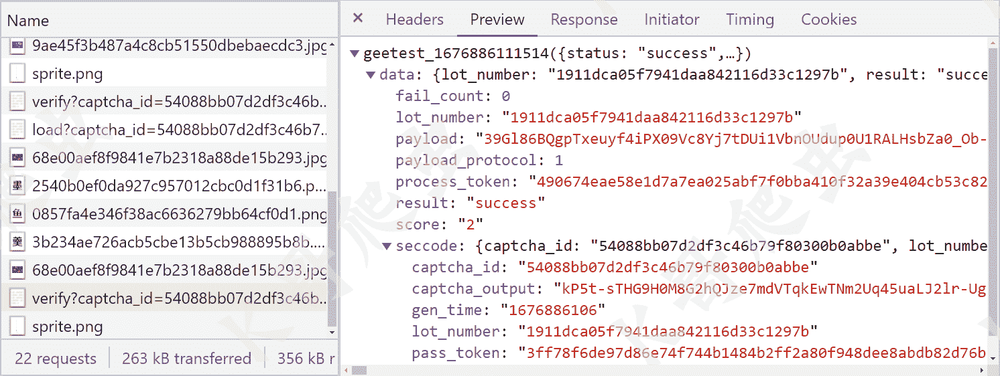

- `result`：校验结果，成功即 `success`，失败为 `fail`
- `captcha_id`：验证码 id
- `captcha_output`：`login` 请求参数
- `gen_time`：`login` 请求参数
- `lot_number`：`login` 请求参数
- `pass_token`：`login` 请求参数

`login` 接口验证登录成功则返回：

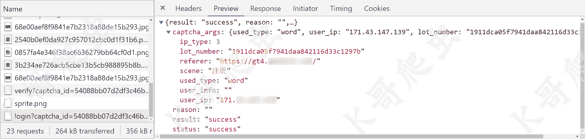

## 四代逆向分析

### `w` 参数

与三代文字点选一样，四代的 `w` 参数同样直接搜索 `"\u0077"` 即可定位到，`r` 为 `w` 参数的值：

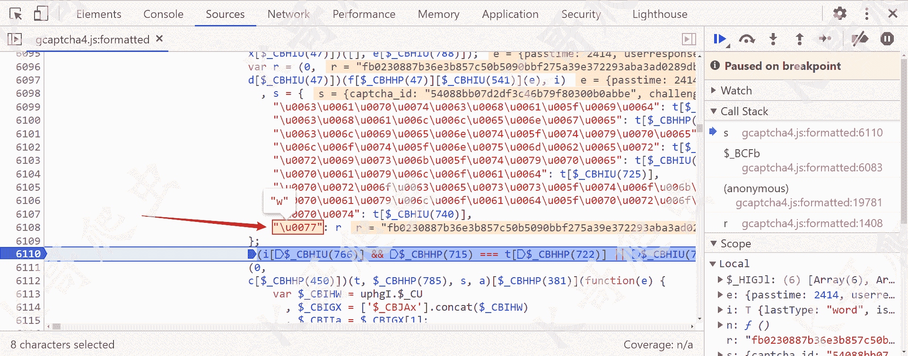

`r` 参数定义在第 6096 行，内容如下：

```javascript
var r = (0, d[$_CBHIU(47)])(f[$_CBHHP(47)][$_CBHIU(541)](e), i)
```

跟进到 `d[$_CBHIU(47)]` 中，`(0, d[$_DIEHV(186)])(c) + u` 即 `w` 值：

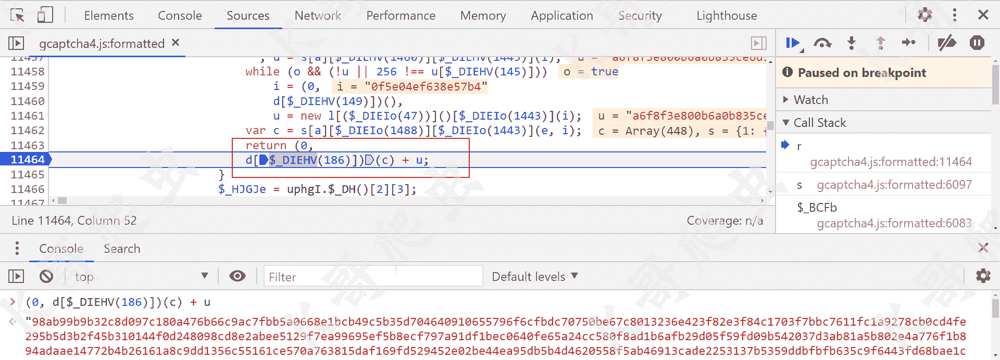

`u` 定义在第 11461 行：

```javascript
u = new l[($_DIEIo(47))]()[$_DIEIo(1443)](i)
```

由上可知，`u` 是将 `i` 经过加密后得到的值，`i` 定义在上面一行，跟进去会发现是十六位随机字符串，`u` 的加密方式为 RSA，公钥和模值如下，将加密算法扣下来或者直接用库都可：

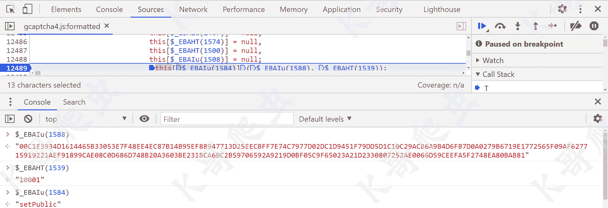

`(0, d[$_DIEHV(186)])(c)` 是将 `c` 进行了加密处理，`c` 定义在第 11462 行：

```javascript
var c = s[a][$_DIEIo(1488)][$_DIEIo(1443)](e, i);
```

`i` 上文讲了，为十六位随机字符串，`e` 中 `device_id`、`lot_number` 由 `load` 接口返回，`userresponse` 为点选坐标，`pow_msg` 为 `"1|0|md5|" + datetime + "|" + captcha_id + "|" + lot_number + "||" + 16位随机数`，`pow_msg` 经过 MD5 加密即为 `pow_sign`，`"f019":"1024281898"` 为动态变化的键值对，在往期四代滑块的文章中均有详细介绍，其他值固定即可：

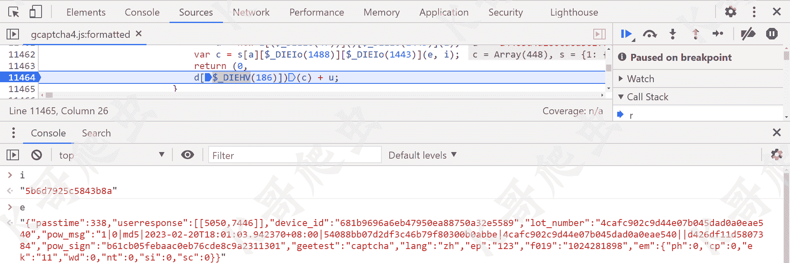

接下来跟进到 `s[a][$_DIEIo(1488)][$_DIEIo(1443)]` 中，`c` 为 AES 加密，扣代码或者直接用库：

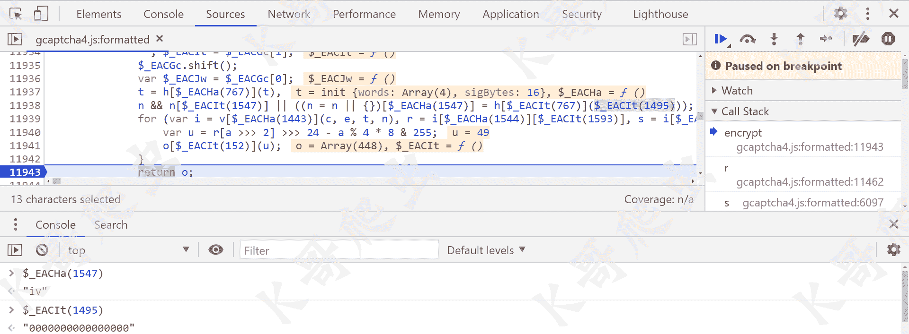

四代图标、字序、九宫格除了 `userresponse` 的写法，其他逻辑都是一样的。

### 结果验证

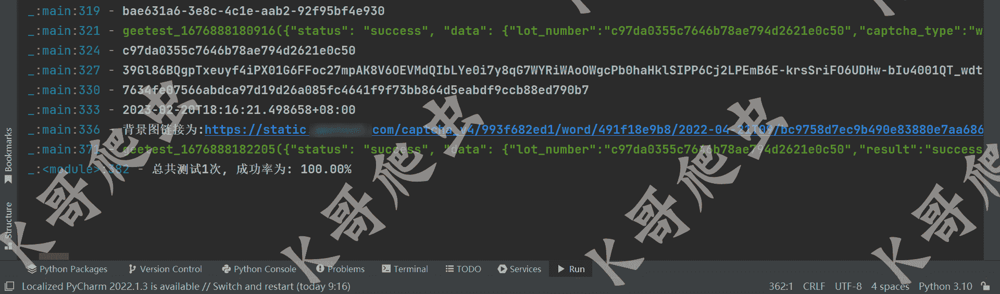
