# [Web逆向] 【验证码逆向专栏】某验四代五子棋、消消乐验证码逆向分析

- 原帖：https://www.52pojie.cn/forum.php?mod=viewthread&tid=1758969
- 抓取时间：2026-11-01T22:58:42

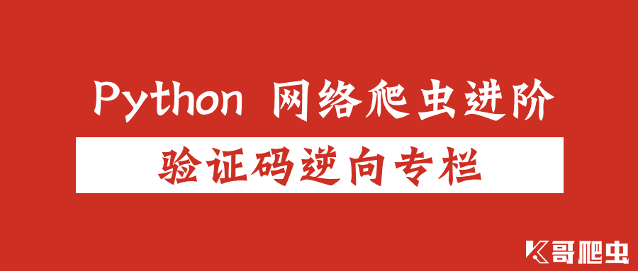

## 声明

本文章中所有内容仅供学习交流使用，不用于其他任何目的，不提供完整代码，抓包内容、敏感网址、数据接口等均已做脱敏处理，严禁用于商业用途和非法用途，否则由此产生的一切后果均与作者无关！

本文章未经许可禁止转载，禁止任何修改后二次传播，擅自使用本文讲解的技术而导致的任何意外，作者均不负责，若有侵权，请联系作者立即删除！

## 逆向目标

- 目标：某验四代消消乐、五子棋验证码，`w` 参数逆向及算法分析
- 行为验证 4.0 demo：aHR0cHM6Ly9ndDQuZ2VldGVzdC5jb20v
- 加密算法：RSA、AES、MD5

## 通讯流程

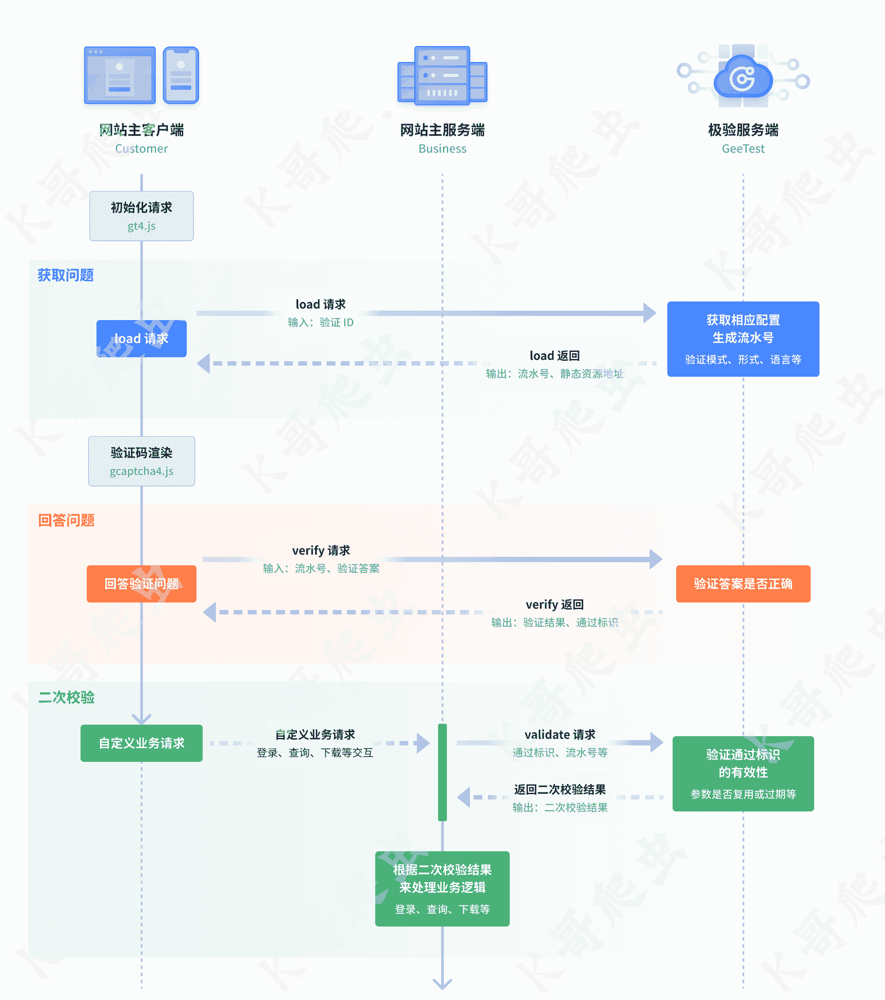

## 消消乐流程分析

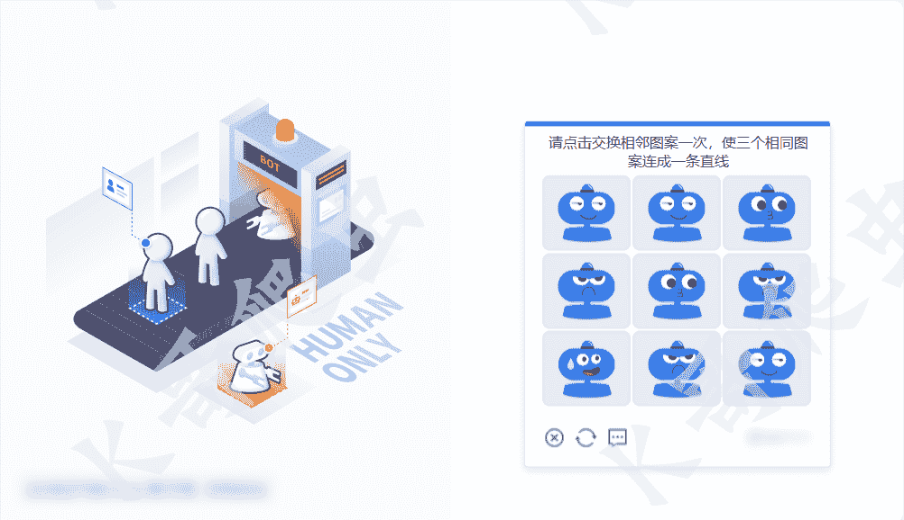

进入网页后，F12 进行抓包，选择消消乐验证码，抓包到 `load` 接口：

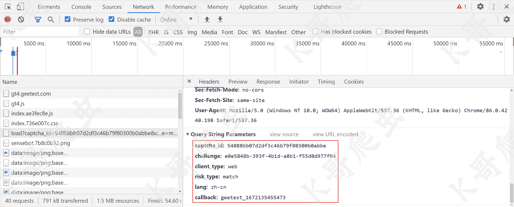

- `captcha_id`：验证码 id，固定值，四代滑块文章中有讲；
- `challenge`：动态变化，由 `gtc4.js` 文件生成，四代滑块文章中有讲；
- `client_type`：`web` 端；
- `risk_type`：验证码类型，例如滑块为 `slide`，无感为 `ai`，消消乐为 `match`；
- `lang`：语言；
- `callback`：回调参数，`geetest_` + 时间戳。

响应预览中返回的关键内容如下：

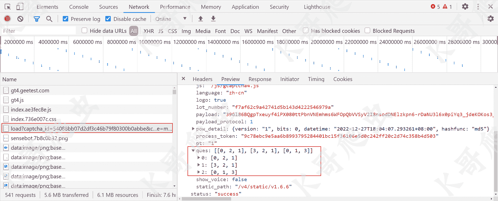

- `captcha_type`：验证码类型；
- `gct_path`：`gct4` 文件路径；
- `lot_number`：生成 `pow_msg`、`w` 的关键参数；
- `payload`：`verify` 请求参数；
- `datetime`：ISO 8601 扩展格式的日期，生成 `pow_msg` 的关键参数；
- `process_token`：`verify` 请求参数；
- `ques`：消消乐矩阵（3x3），每个数字代表一种颜色，将三个相同数字换到同一列或同一行即可通过。

点击验证按钮，弹出消消乐验证码，移动图案之后，抓包到 `verify` 校验接口：

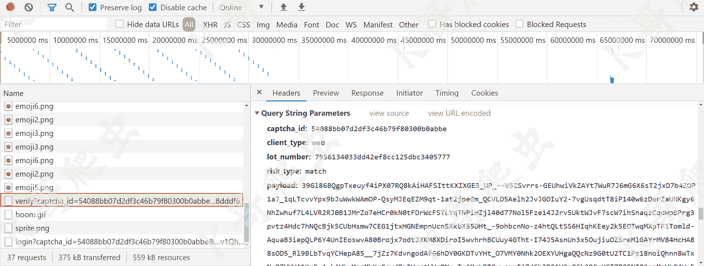

- `captcha_id`：与 `load` 请求头中的 `captcha_id` 一致；
- `client_type`：`web` 端；
- `lot_number`：`load` 响应返回；
- `risk_type`：验证码类型；
- `payload`：`load` 响应返回；
- `process_token`：`load` 响应返回；
- `payload_protocol`：1；
- `pt`：1；
- `w`：加密参数，由轨迹、`passtime`、`userresponse` 等参数加密得到；
- `callback`：回调参数，`geetest_` + 时间戳。

响应预览中返回的内容如下，`result` 值为 `success` 即校验通过，`fail` 即校验失败，携带 `seccode` 下的五个参数请求 `login` 接口，即可登录成功：

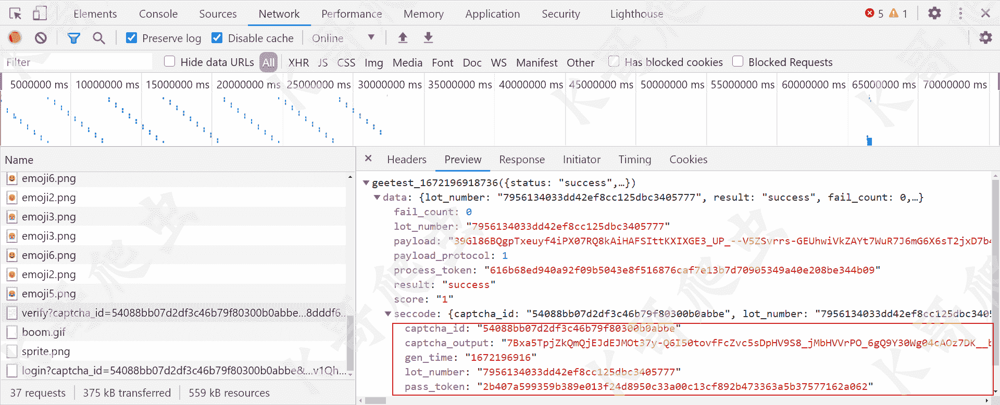

## 逆向分析

### `w` 参数

四代的基本流程都是差不多的，直接搜索特征值 `"\u0077"` 即可定位到 `w` 参数生成的位置，先全局搜索 `"\u0077"`，找到对应的 js 文件，点击进去格式化后，再 `ctrl + f` 局部搜索定位关键位置：

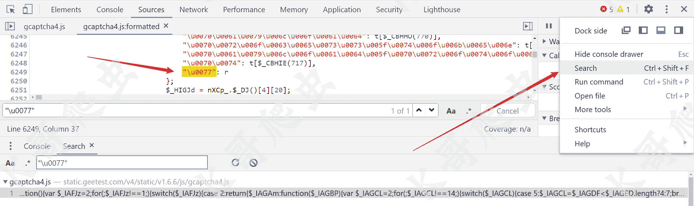

在第 6251 行打下断点，移动图案即会断住，`r` 即 `w` 参数的值：

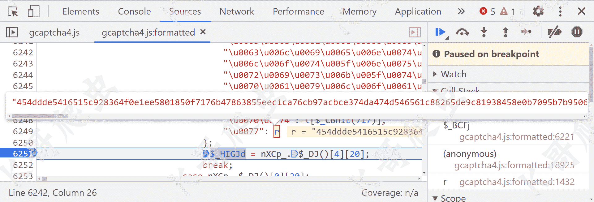

跟进 `r` 生成的位置，其定义在第 6237 行，可以看到加密方式与四代滑块是一样的：

```
var r = (0,d.default)(f.default.stringify(e), i)
```

唯一不同的就是 `e` 中参数值的构成，以下是四代滑块与消消乐的对比：

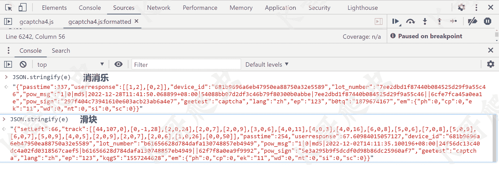

可以看到不同点在于四代滑块 `e` 中参数包括 `setLeft`（缺口距离）、`track`（滑动轨迹），自然消消乐是没有的，`userresponse` 在滑块中是数值计算，而消消乐中是交换的两个图片的坐标，举个例子：

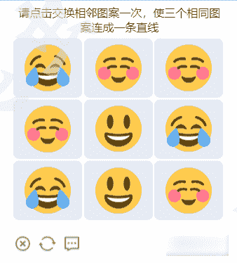

上图中的验证码，接口返回的 `ques` 值为：

```
ques = [
    [0, 1, 0],
    [1, 3, 3],
    [1, 0, 1]
]
```

`ques[0]`、`ques[1]`、`ques[2]` 分别对应验证码的第0列、第1列、第2列，注意是列，不是行！而我们只需要关心 `ques` 数组里的交换即可，正确应该交换第0行第1列和第0行第0列，那么 `userresponse` 的值应该为：`[[0, 1], [0, 0]]`。

其他参数值的生成都是一样的方式，具体可以阅读 K 哥往期文章[K 哥往期文章](https://www.52pojie.cn/thread-1749842-1-1.html)，这里就不再重复写了。

### 消消乐结果验证

只要 JS 和交换的坐标没问题，成功率就为 100%。

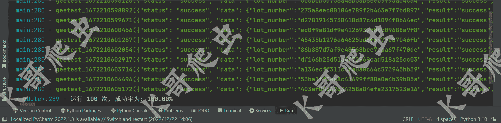

## 五子棋流程分析

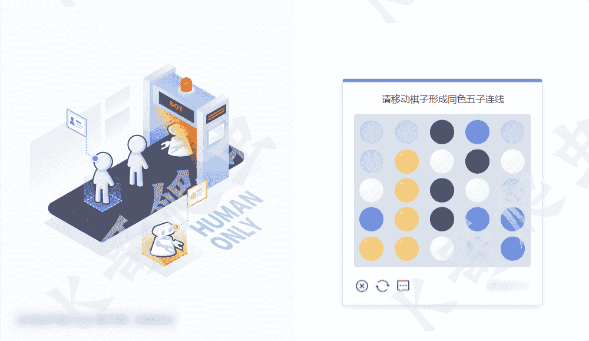

五子棋的流程跟消消乐一样，进入网页后，F12 进行抓包，选择五子棋验证码，抓包到 `load` 接口：

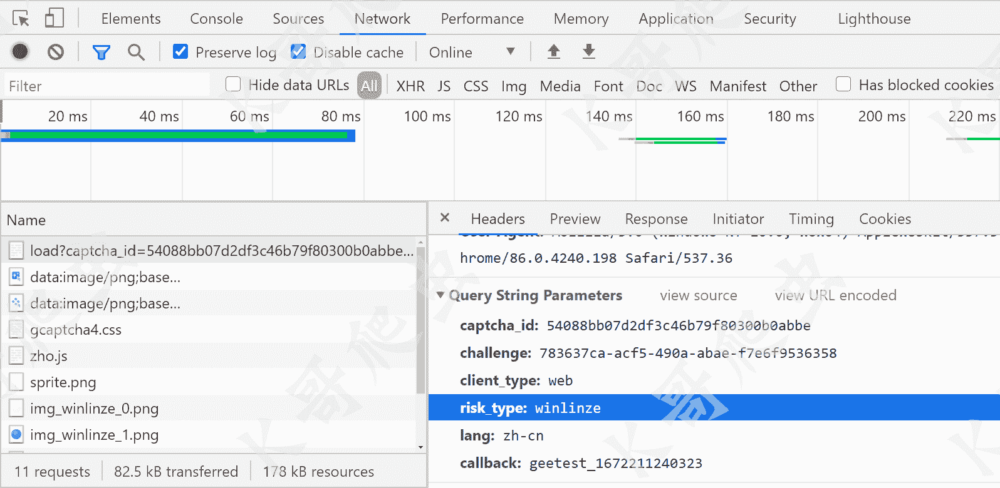

- `captcha_id`：验证码 id，固定值，四代滑块文章中有讲；
- `challenge`：动态变化，由 `gtc4.js` 文件生成，四代滑块文章中有讲；
- `client_type`：`web` 端；
- `risk_type`：验证码类型，例如滑块为 `slide`，无感为 `ai`，五子棋为 `winlinze`；
- `lang`：语言；
- `callback`：回调参数，`geetest_` + 时间戳。

响应预览中返回的关键内容如下：

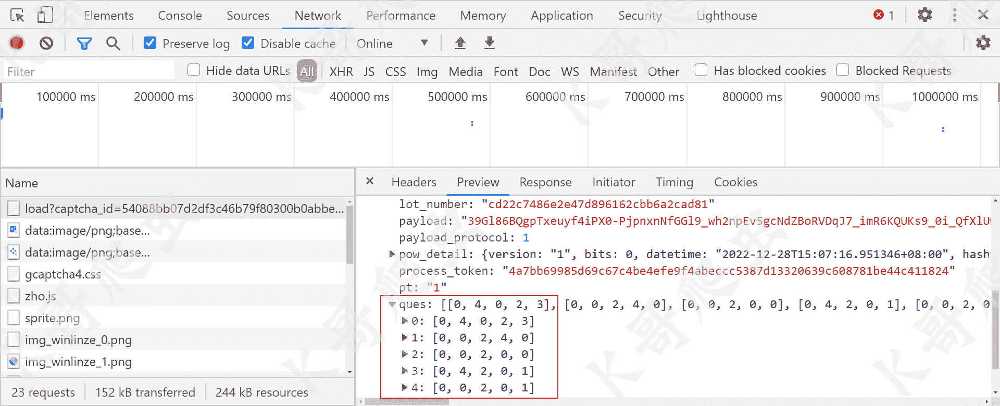

- `captcha_type`：验证码类型；
- `gct_path`：`gct4` 文件路径；
- `lot_number`：生成 `pow_msg`、`w` 的关键参数；
- `payload`：`verify` 请求参数；
- `datetime`：ISO 8601 扩展格式的日期，生成 `pow_msg` 的关键参数；
- `process_token`：`verify` 请求参数；
- `ques`：五子棋矩阵（5x5），每个数字代表一种颜色，0 表示空位，将五个相同数字换到同一列、同一行或对角线上即可通过。

其他的与消消乐是一样的，`e` 参数如下，其中 `userresponse` 就是需要交换的两个棋子的坐标：

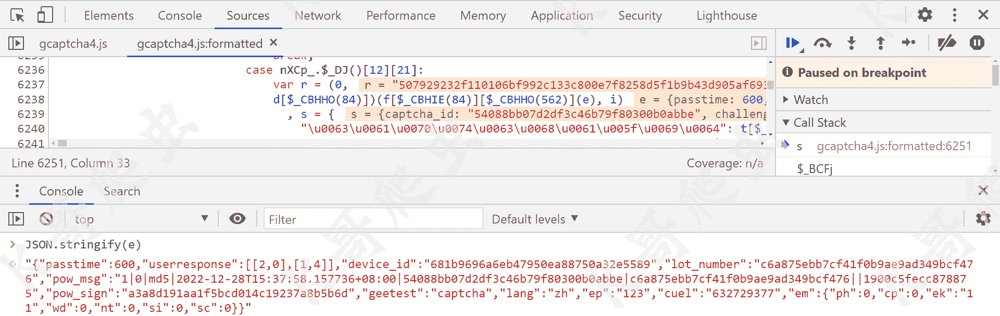

### 五子棋结果验证

同样的，只要 JS 和交换的坐标没问题，成功率就为 100%。

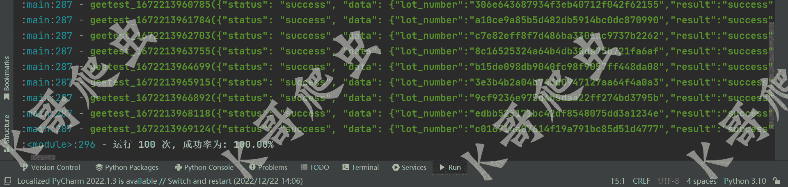
