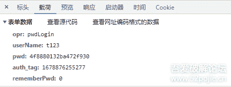
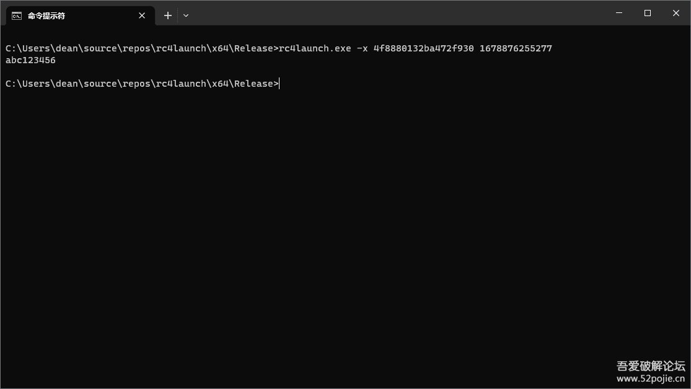

# [Web逆向] 校园网交流

- 原帖：<https://www.52pojie.cn/forum.php?mod=viewthread&tid=1759425>
- 抓取时间：2026-11-01T22:58:33

## 1. 介绍

今天看到一个有关校园网安全的[帖子](https://www.52pojie.cn/thread-1758599-1-1.html)，后察觉和我们学校的一样，过多分析的也不赘述了，参考[该帖](https://www.52pojie.cn/thread-1758599-1-1.html)。

原帖子的思路是使用弱口令爆破密码，这边的思路利用arp攻击获取网络的通信，再将密文解密即可。

## 2. 数据解密

使用C语言算法实现一个简单的RC4加解密。

```c
#include "RC4.h"
#include 

static char IS_INIT = 0;
static unsigned char
        *temp = NULL,
        *output = NULL,
        *key = NULL,
        *sbox = NULL;

void initializationRC4(int srcSize, int pwdSize)
{
        if (srcSize == 0 || pwdSize == 0)
                return;

        temp = (char *)malloc(128 * sizeof(char));
        key = (char *)malloc(256 * sizeof(char));
        sbox = (char *)malloc(256 * sizeof(char));
        output = (char *)malloc(srcSize * sizeof(char));
        IS_INIT = 1;
}

void freeRC4Source()
{
        if (IS_INIT == 0)
                return;

        free(key);key = NULL;
        free(sbox);sbox = NULL;
        free(temp);temp = NULL;
        free(output);output = NULL;

        IS_INIT = 0;
}

char *getOutputStreamPointer()
{
        return output;
}

char *RC4_Encrypt(char *src, short srcSize, char *passwd, short pwdSize)
{
        if (IS_INIT == 0)
                initializationRC4(srcSize, pwdSize);

        // generate key box
        for (int i = 0; i
```

## 3. 工具编译

### `rc4launch` 用法

```bash
./rc4launch -[参数] src pwd
```

参数为十六进制（`x`）和字符串（`s`）。

e.g.

```bash
./rc4launch -sx hello rc4
# 输入值为字符串，输出为16进制

./rc4launch -ss hello rc4
# 输入值为字符串，输出为字符串

#...
```

`pwd` 即是密码但被加密了，`auth_tag` 是请求的时间戳也即是密钥。



`f20bbe5dfff02a21d3a8e0bc744dff3.png` (18.07 KB, 下载次数: 8)

[附件](https://www.52pojie.cn/forum.php?mod=attachment&aid=MjU5Nzc4OXw0Y2M2Mjk4ZXwxNzkzNTczOTEwfDE2ODA4NnwxNzU5NDI1&nothumb=yes)

2023-3-15 18:37 上传



`f0b803f54bb261cc73f113c1e385326.png` (22.84 KB, 下载次数: 2)

[附件](https://www.52pojie.cn/forum.php?mod=attachment&aid=MjU5Nzc4OHxlOTEyNzRlZnwxNzkzNTczOTEwfDE2ODA4NnwxNzU5NDI1&nothumb=yes)

2023-3-15 18:37 上传

## 4. 项目代码

- [RC4-By-C](https://github.com/Jones-Ding/RC4-By-C)
- [`rc4launch`](https://github.com/Jones-Ding/rc4launch)


[下载附件](https://www.52pojie.cn/forum.php?mod=attachment&aid=MjU5Nzc4N3xiZTRkNWQyZXwxNzkzNTczOTEwfDE2ODA4NnwxNzU5NDI1)

(2.24 MB, 下载次数: 115)

2023-3-15 18:29 上传

点击文件名下载附件

算法工具

下载积分：吾爱币 -1 CB
