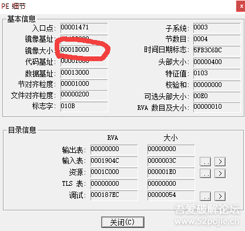
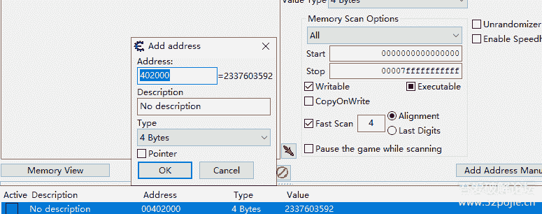
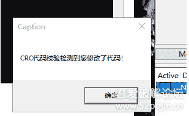
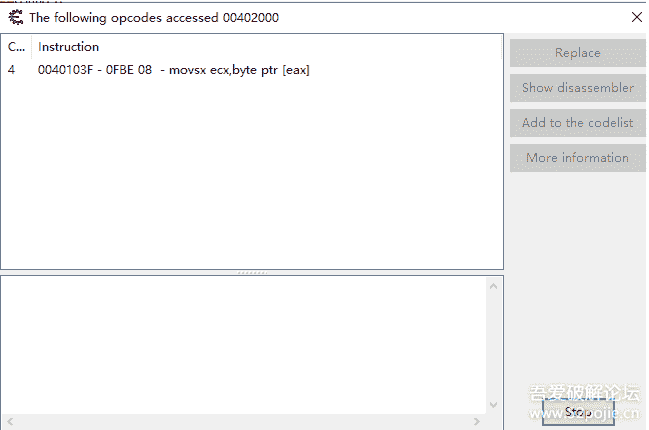
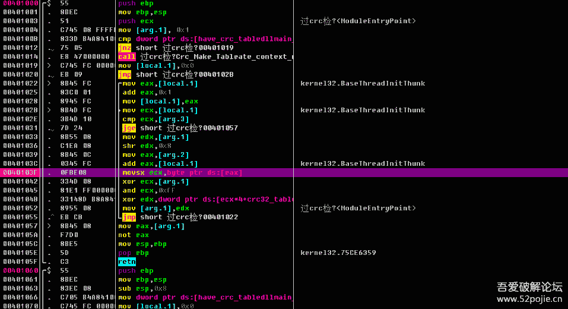
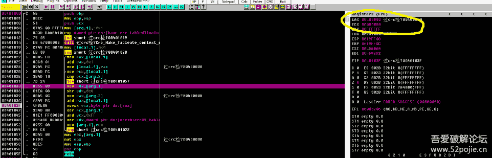
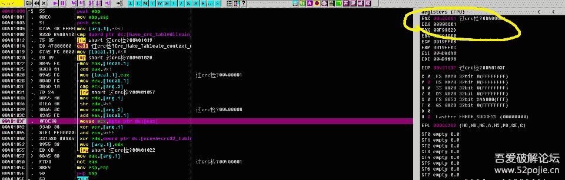
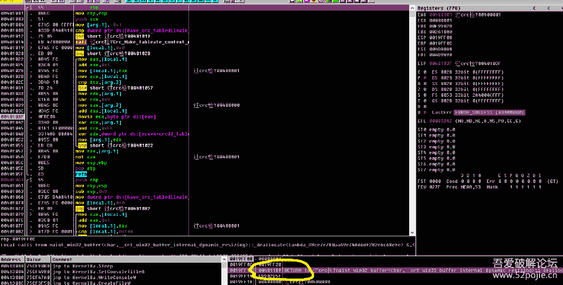
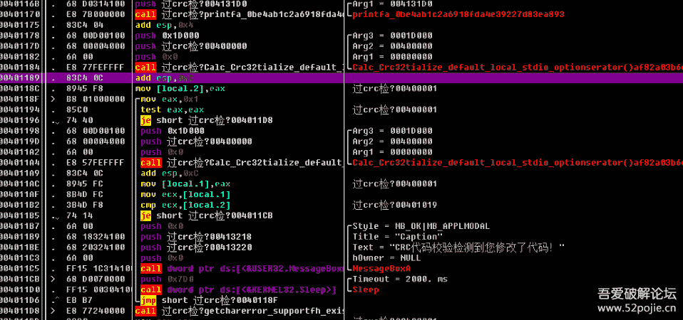

# [.NET逆向] 软件破解逆向安全之CRC检测

- 原帖: https://www.52pojie.cn/forum.php?mod=viewthread&tid=1762793
- 抓取时间: 2026-11-01T22:58:18

## 对抗游戏作弊的技术

我们先了解一下几种对抗游戏作弊的技术：

⒈ 数据检测：对基础的游戏数据进行校验，例如坐标是否违规越界地图（坐标瞬移功能），人物短时间位移距离是否过大（人物加速功能）等等

⒉ CRC检测：基于游戏程序代码的检验，例如将人物移动中判断障碍物的 `je` 条件跳转修改为 `jmp` 强制跳转（人物穿墙功能）等等

⒊ 封包检测：将游戏数据封包进行校验，防止利用封包漏洞实现违规操作，例如之前的穿X火线强登（可以登录任意账号）等等

⒋ 机器检测：现在鹅厂 安全组好像换人了 ，游戏机器码封的都挺狠，一封就十年，不过道高一尺，魔高一丈，目前依然不够完善，很多朋友还是可以Pass

⒌ Call检测：非法调用 `Call` 导致校验值非法，例如攻击 `Call` 的严格校验（角色扮演游戏自动打怪脚本都是调用 `Call` 的）等等

⒍ 堆栈检测：该检测归于调用 `Call` 过程中产生的问题

⒎ 文件检测：对于游戏本地文件的检测，例如之前穿X火线几年前风靡一时的 `REZ` 文件（快刀秒杀，穿墙，遁地，飞天）等等

⒏ 模块检测：很多外x挂采用“注入”的形式，所以模块检测在游戏安全对抗中也扮演着极其重要的作用

⒐ 特征检测：这个主要检测典型的使用“易语言”开发的程序，或者部分外x挂市场比较大的毒瘤程序，或者菜单绘制（`imgui` 绘制）等等

⒑ 调试检测：针对调试器和调试行为的检测，对 [//www.52pojie.cn/thread-350397-1-1.html" target="_blank" class="relatedlink"](https://www.52pojie.cn/thread-350397-1-1.html:href="https)，`CheatEngine` 等调试器特征和调试行为的检测等。

⒒ 游戏保护：主要是利用 `R3` 各种反调试技术以及驱动层的 `HOOK` 等技术实现的游戏保护，例如鹅厂的 `TP` 等等

## 什么是 CRC 检测

说过检测之前我们先了解一下什么是 `crc` 检测。`CRC`，中文名称为循环冗余校验，`CRC` 属于密码学一类算法，常用于数据校验，一般会用来检测程序是否被 [//www.52pojie.cn/forum-5-1.html" target="_blank" class="relatedlink"](https://www.52pojie.cn/forum-5-1.html:href="https) 或者被修改，以达到防 [//www.52pojie.cn" target="_blank" class="relatedlink"](https://www.52pojie.cn:href="https) 的目的。

## CRC 算法原理

### 数据发送过程

多项式转化为二进制数，这个2进制数作为除数。

`CRC` 校验码的位数 = 上面计算除数的位数 - 1

校验码的位数是多少，就把需要校验的数据左移多少位，得到的就是被除数

被除数 模二除 除数 = 商 + 余数

余数就是我们需要的 `CRC` 校验码

### 数据接收过程

多项式转化为二进制数，这个2进制数作为除数。

接收到的数据和 `CRC` 码拼接起来，作为被除数

除数确定了，被除数也确定了，接下来再次使用“模2除法”校验

结果为0，则接受的数据正确，结果不为0接收的数据不正确

### 再解释

还是不懂，很好，再翻译一遍

多项式就是一个指定的数值，用我们需要校验的数据模二除这个多项式的数值，得到的余数就是 `CRC` 校验码。

## CRC 算法实现

首先生成 `CRC` 校验码，我们这里按字节计算 `CRC`，先写个函数生成一张字节 `CRC` 校验码的表，因为每个字节从 `00` - `FF` 有256个组合，所以每个字节有256种不同的校验码。

简单一句话总结一下：`CRC` 是一种校验算法并且该算法被广泛应用于文件，数据等的校验

光说不练假把式，我们来动手写一个 `crc` 校验：

[Asm] 纯文本查看 复制代码

```
#include
#include


int crc = NULL;
int have_crc_table = NULL;
unsigned int crc32_table[256];


//生成具有256个元素的CRC32表
void Crc_Make_Table()
{
    have_crc_table = 1;


    for (int i = 0; i > 1) ^ 0xEDB88320; //CRC32 多项式的值,也可以是0x04C11DB7
            else
                crc >>= 1;
        }
        crc32_table[i] = crc; //生成并存储CRC32数据表
    }
}


//根据CRC32数据表计算内存或文件CRC校验码
unsigned int Calc_Crc32(unsigned int crc, char* Data, int len)
{
    crc = 0xFFFFFFFF; //将CRC初始化为-1


    //判断CRC32表是否生成
    if (!have_crc_table)
        Crc_Make_Table();


    for (int i = 0; i > 8) ^ crc32_table[(crc ^ Data[i]) & 0xff];
    }
    return ~crc;
}


int main()
{
    SetConsoleTitleA("Crc检测过掉学习工具");


    printf("使用CE工具->添加地址0x402000->查找访问并尝试过掉检测！\n\n");


    printf("如果修改主程序模块，将会提示 “CRC代码校验检测到您修改了代码！”：\n\n\n\n\n");


    //初始内存校验值
    unsigned int uMainMoudleSumA = Calc_Crc32(0, (char*)0x400000, 0x1F000);//400000- 41D000


    //while循环开启CRC检测
    while (1)
    {
        //CRC循环检测内存实时校验值
        unsigned int TmpCrcSum = Calc_Crc32(0, (char*)0x400000, 0x1F000);


        if (TmpCrcSum != uMainMoudleSumA)
        {
            //封号处理-掉线处理
            MessageBoxA(NULL, "CRC代码校验检测到您修改了代码！", "Caption", MB_OK);
        }


        //为了方便，我在这里使用的Sleep函数控制检测的周期
        Sleep(2000);
    }


    getchar();
```

注：`release` 编译的时候记得关一下各种优化这里有一点注意的，//计算内存校验值 `Calc_Crc32(0, (char*)0x400000, 0x1F000);`

最后一个参数是一个校验的范围，我们用 `PE` 相关工具去确定程序主模块镜像大小。



image.png (17.79 KB, 下载次数: 1)

[href="forum.php?mod=attachment&aid=MjYwMDMyMHwxNjk1NjM0N3wxNzkzNTczODk1fDE2ODA4NnwxNzYyNzkz&nothumb=yes" target="_blank"](https://www.52pojie.cn/forum.php?mod=attachment&aid=MjYwMDMyMHwxNjk1NjM0N3wxNzkzNTczODk1fDE2ODA4NnwxNzYyNzkz&nothumb=yes)

2023-3-22 02:12 上传

我们看我这里就要改一下，要不会出问题。



image.png (30.82 KB, 下载次数: 1)

[href="forum.php?mod=attachment&aid=MjYwMDMyMXxhNzNmNWM2MnwxNzkzNTczODk1fDE2ODA4NnwxNzYyNzkz&nothumb=yes" target="_blank"](https://www.52pojie.cn/forum.php?mod=attachment&aid=MjYwMDMyMXxhNzNmNWM2MnwxNzkzNTczODk1fDE2ODA4NnwxNzYyNzkz&nothumb=yes)

2023-3-22 02:13 上传

我们改一下这里的数值就相当于改了代码，就触发了 `crc` 校验



image.png (16.92 KB, 下载次数: 0)

[href="forum.php?mod=attachment&aid=MjYwMDMyMnxhZWI0ODliMXwxNzkzNTczODk1fDE2ODA4NnwxNzYyNzkz&nothumb=yes" target="_blank"](https://www.52pojie.cn/forum.php?mod=attachment&aid=MjYwMDMyMnxhZWI0ODliMXwxNzkzNTczODk1fDE2ODA4NnwxNzYyNzkz&nothumb=yes)

2023-3-22 02:13 上传

那么接下来，我们就想办法给他搞掉。

首先，在攻击前，我们要知道代码的 `CRC` 检测是针对代码段的

代码段是用来执行的，正常情况下不会有其他数据访问代码段，被访问的大多是数据段，代码段被访问，很可疑就是 `CRC` 检测

此处说的“访问”的概念，大家可以通过 `CheatEngine` 工具中的“找出是什么访问了这个地址”来理解

针对 `0x402000` 这个地址，我们去看一下什么访问了



image.png (18.02 KB, 下载次数: 1)

[href="forum.php?mod=attachment&aid=MjYwMDMyM3w0NzM1OWE2ZHwxNzkzNTczODk1fDE2ODA4NnwxNzYyNzkz&nothumb=yes" target="_blank"](https://www.52pojie.cn/forum.php?mod=attachment&aid=MjYwMDMyM3w0NzM1OWE2ZHwxNzkzNTczODk1fDE2ODA4NnwxNzYyNzkz&nothumb=yes)

2023-3-22 02:14 上传

记住这行汇编，出现这个基本上就是 `crc` 检测了。同时记住 `40103f` 这个地址，我们去 `od` 里跟一下。



image.png (116.75 KB, 下载次数: 1)

[href="forum.php?mod=attachment&aid=MjYwMDMyNHwyNjJhOTI3Y3wxNzkzNTczODk1fDE2ODA4NnwxNzYyNzkz&nothumb=yes" target="_blank"](https://www.52pojie.cn/forum.php?mod=attachment&aid=MjYwMDMyNHwyNjJhOTI3Y3wxNzkzNTczODk1fDE2ODA4NnwxNzYyNzkz&nothumb=yes)

2023-3-22 02:14 上传

我们单步的走一走看看



image.png (93.24 KB, 下载次数: 0)

[href="forum.php?mod=attachment&aid=MjYwMDMyNXwwYWNlMzYwMHwxNzkzNTczODk1fDE2ODA4NnwxNzYyNzkz&nothumb=yes" target="_blank"](https://www.52pojie.cn/forum.php?mod=attachment&aid=MjYwMDMyNXwwYWNlMzYwMHwxNzkzNTczODk1fDE2ODA4NnwxNzYyNzkz&nothumb=yes)

2023-3-22 02:15 上传

第一次这里是 `400000`，走了一遍后



image.png (90.1 KB, 下载次数: 1)

[href="forum.php?mod=attachment&aid=MjYwMDMyNnxiMjVjOTcwN3wxNzkzNTczODk1fDE2ODA4NnwxNzYyNzkz&nothumb=yes" target="_blank"](https://www.52pojie.cn/forum.php?mod=attachment&aid=MjYwMDMyNnxiMjVjOTcwN3wxNzkzNTczODk1fDE2ODA4NnwxNzYyNzkz&nothumb=yes)

2023-3-22 02:15 上传

变成了 `400001`，，也就是说，它在循环的递增检测所有范围内的内存代码数据。这块的代码时 `crc` 校验的那里，我们要到的是 `if` 比较那一块，很明显我们要跳出这个 `call`。但是下面有一个 `jmp`，很明显我们正常跑是出不去的，我们需要到函数头那里找出返回地址



image.png (134.73 KB, 下载次数: 1)

[href="forum.php?mod=attachment&aid=MjYwMDMyN3w0YjY4NjA0YnwxNzkzNTczODk1fDE2ODA4NnwxNzYyNzkz&nothumb=yes" target="_blank"](https://www.52pojie.cn/forum.php?mod=attachment&aid=MjYwMDMyN3w0YjY4NjA0YnwxNzkzNTczODk1fDE2ODA4NnwxNzYyNzkz&nothumb=yes)

2023-3-22 02:16 上传

我们在这里回车就到我们的主程序里了



image.png (156.54 KB, 下载次数: 1)

[href="forum.php?mod=attachment&aid=MjYwMDMyOHw3Y2VmMGI2Y3wxNzkzNTczODk1fDE2ODA4NnwxNzYyNzkz&nothumb=yes" target="_blank"](https://www.52pojie.cn/forum.php?mod=attachment&aid=MjYwMDMyOHw3Y2VmMGI2Y3wxNzkzNTczODk1fDE2ODA4NnwxNzYyNzkz&nothumb=yes)

2023-3-22 02:16 上传

找到我们就要修改，`call` 下面的 `eax` 是 `call` 返回的数值。大概看一下（因为是我们自己写的），我们就知道这个汇编程序的逻辑，先运行一个 `crc` 校验给 `local.1`，然后不断的重复运行 `crc` 校验给 `local.2`，这俩进行比较，不一样就弹对话框，那么我们破解的思路就有了，一个是把 `cmp xxx` 改成 `cmp eax, eax`，这样就永远一样了，还有一种就是把 `je` 改成 `jmp`，这样不管比较如何都不执行错误的代码，当然还有很多思路，大家可以试这改改，然后发现不管我们怎么改代码的数据都不会被 `crc` 检测出来了。
