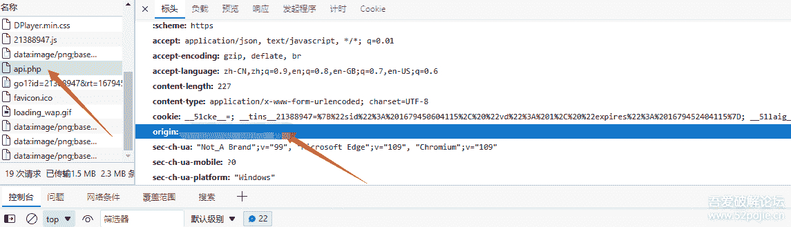
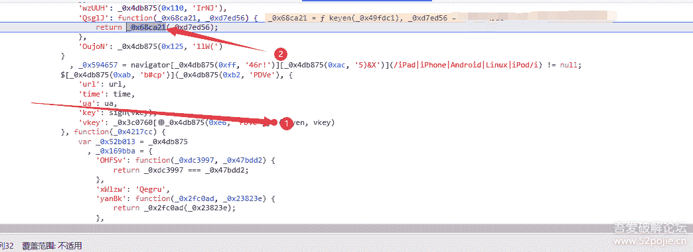
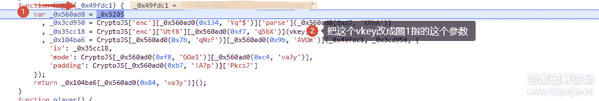
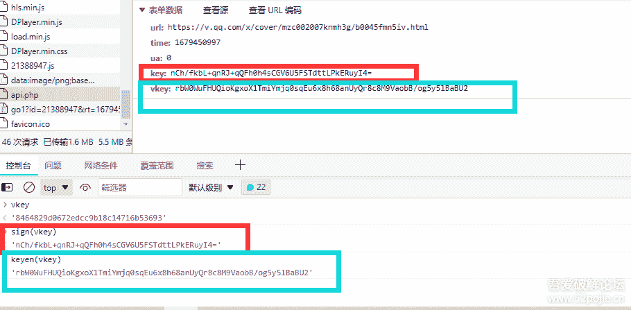
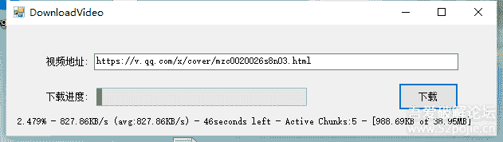

# [Web逆向] C#实现某视频地址的解析及下载

- 原帖: https://www.52pojie.cn/forum.php?mod=viewthread&tid=1762934
- 抓取时间: 2026-11-01T22:58:13

首先声明文章借鉴 [//www.52pojie.cn/home.php?mod=space&uid=1767695" target="_blank"](https://www.52pojie.cn/home.php?mod=space&uid=1767695:href="https) 大佬的 文章地址是:[//www.52pojie.cn/thread-1752674-1-1.html" target="_blank"](https://www.52pojie.cn/thread-1752674-1-1.html:href="https)[//www.52pojie.cn" target="_blank"](http://www.52pojie.cn:href="http)

看了大佬的文章以后自己研究了一下发现请求一直会403,请求错误

困惑了比较久,刚要放弃但是发现了转机



api请求.jpg (60.05 KB, 下载次数: 0)

[href="forum.php?mod=attachment&aid=MjYwMDQwMXxkMmM5NzQ4ZHwxNzkzNTczODkxfDE2ODA4NnwxNzYyOTM0&nothumb=yes" target="_blank"](https://www.52pojie.cn/forum.php?mod=attachment&aid=MjYwMDQwMXxkMmM5NzQ4ZHwxNzkzNTczODkxfDE2ODA4NnwxNzYyOTM0&nothumb=yes)

2023-3-22 10:08 上传

首先请求的时候要带上 `Origin` 这个参数



vkey参数.jpg (57.64 KB, 下载次数: 2)

[href="forum.php?mod=attachment&aid=MjYwMDQwMnwyMDg0ZTMxOHwxNzkzNTczODkxfDE2ODA4NnwxNzYyOTM0&nothumb=yes" target="_blank"](https://www.52pojie.cn/forum.php?mod=attachment&aid=MjYwMDQwMnwyMDg0ZTMxOHwxNzkzNTczODkxfDE2ODA4NnwxNzYyOTM0&nothumb=yes)

2023-3-22 10:11 上传

计算 `vkey` 的时候会跳转到圈2的地方,这个地方点击单步会进入 `keyen`



keyen.jpg (39.78 KB, 下载次数: 0)

[href="forum.php?mod=attachment&aid=MjYwMDQxNnwwZmI5NTI2MXwxNzkzNTczODkxfDE2ODA4NnwxNzYyOTM0&nothumb=yes" target="_blank"](https://www.52pojie.cn/forum.php?mod=attachment&aid=MjYwMDQxNnwwZmI5NTI2MXwxNzkzNTczODkxfDE2ODA4NnwxNzYyOTM0&nothumb=yes)

2023-3-22 10:14 上传

把圈2这个 `vkey` 改成圈1这个参数名即可,在计算的时候 `sign` 和 `keyen` 传递的都是从 `html` 中获取的 `vkey`

这样计算出来的值就与发起请求时候的一样了



1679451450189.jpg (52.56 KB, 下载次数: 1)

[href="forum.php?mod=attachment&aid=MjYwMDQyMHxkYTcxNTE5MHwxNzkzNTczODkxfDE2ODA4NnwxNzYyOTM0&nothumb=yes" target="_blank"](https://www.52pojie.cn/forum.php?mod=attachment&aid=MjYwMDQyMHxkYTcxNTE5MHwxNzkzNTczODkxfDE2ODA4NnwxNzYyOTM0&nothumb=yes)

2023-3-22 10:17 上传

这是计算的示例,大家自行参考

然后我用 C# 写了下载的小程序,没有原作者的 python 写的强,没有多集下载的这一块功能,大家根据需要自己改造把

[C#] 纯文本查看 复制代码
```
 string VideoUrl = "视频url";
                Dictionary header = new Dictionary();
                header.Add("UserAgent", "你的UserAgent");
//HttpRequest封装的HttpClient,参数都在外面声明的
                string html = await HttpRequest.Get("https://123123.com/?url=" + VideoUrl, header);
                // time
                var time = Regex.Match(html, "var time = '(.*?)'").ToString();
                time = Regex.Match(time, "'(.*?)'").ToString().Replace("'", "");

                //vkey
                var vkey = Regex.Match(html, "var vkey = '(.*?)'").ToString();
                vkey = Regex.Match(vkey, "'(.*?)'").ToString().Replace("'", "");

                //计算两个必要参数
//Nuget包:Microsoft.ClearScript.V8
                JSHelper jSHelper = new JSHelper(FileHelper.GetApplicationPath("JS\\crypto.js"));
                string keyFrom = jSHelper.signV8(vkey);
                string vkeyFrom = jSHelper.keyenV8(vkey);

                Dictionary form = new Dictionary();
                form.Add("url", VideoUrl);
                form.Add("time", time);
                form.Add("ua", "0");
                form.Add("key", keyFrom);
                form.Add("vkey", vkeyFrom);
                var content = new FormUrlEncodedContent(form);
                header.Add("origin", "https://jx.xmflv.com");
                dynamic downJson = (await HttpRequest.Post("https:/123123.com/api.php", content, header)).ConvertTodynamic();
                if (downJson.code != "200")
                {
                    throw new Exception("当前接口返回异常!");
                }
                SaveFileDialog saveFileDialog = new SaveFileDialog();
                saveFileDialog.Title = "选择保存地址,取消将不保存!";
                saveFileDialog.Filter = $"this FileType(*.{downJson.type})|*.{downJson.type}";
                saveFileDialog.RestoreDirectory = true;
                saveFileDialog.InitialDirectory = FileHelper.GetDesktopPath();
                if (saveFileDialog.ShowDialog() == DialogResult.OK)
                {
//NuGet包:Downloader  如果不会用的话直接把这行注释了把下面的取消注释
                     await Task.Run(async () => await DownloadVideoFile.DownloadAsync((string)downJson.url, saveFileDialog.FileName));
                    //if (!File.Exists(saveFileDialog.FileName))
                    //{
                    //    using (var web = new WebClient())
                    //    {
                    //        try
                    //        {
                    //            await web.DownloadFileTaskAsync((string)downJson.url, saveFileDialog.FileName);
                    //        }
                    //        catch
                    //        {
                    //            if (File.Exists(saveFileDialog.FileName))
                    //            {
                    //                File.Delete(saveFileDialog.FileName);
                    //            }
                    //            throw;
                    //        }
                    //    }
                    //}
                    MessageBox.Show("100% Done");
```

上述代码借鉴了一些第三方库,代码中已经注明了,可能还需要根据实际大家自行修改一下啦

附上一张运行的软件截图



1679452710815.jpg (17.59 KB, 下载次数: 0)

[href="forum.php?mod=attachment&aid=MjYwMDQzOHw1OWUyYmU0YXwxNzkzNTczODkxfDE2ODA4NnwxNzYyOTM0&nothumb=yes" target="_blank"](https://www.52pojie.cn/forum.php?mod=attachment&aid=MjYwMDQzOHw1OWUyYmU0YXwxNzkzNTczODkxfDE2ODA4NnwxNzYyOTM0&nothumb=yes)

2023-3-22 10:38 上传

有啥错误欢迎大家留言指正!
