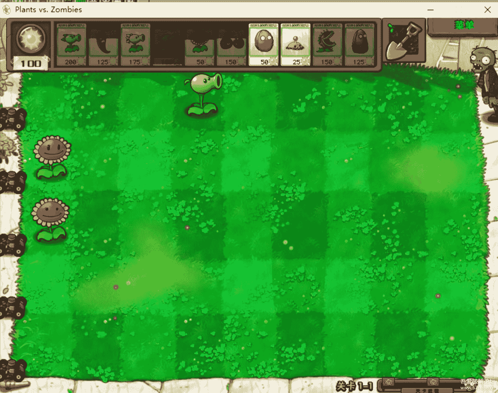
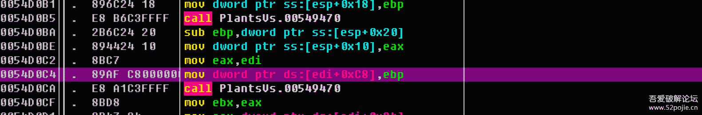
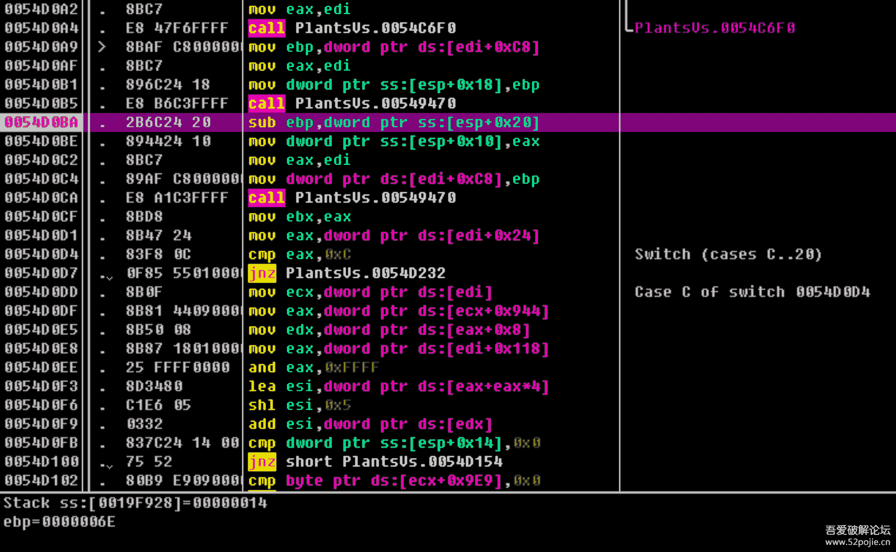
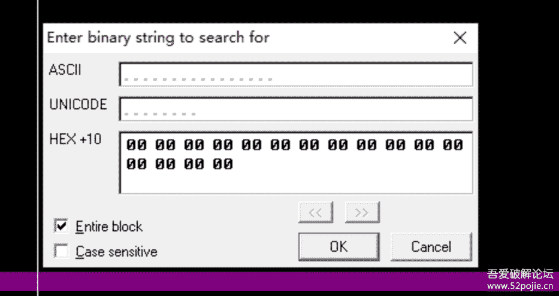
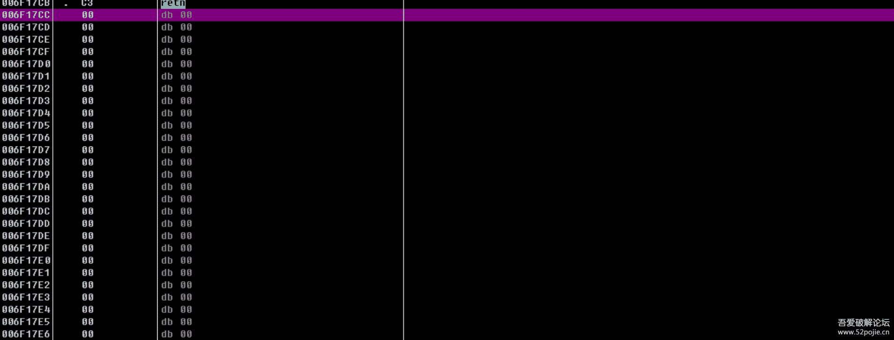
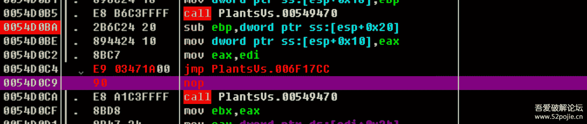
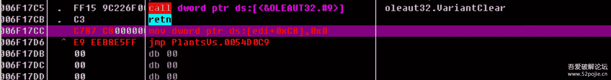

# [原创] 软件破解逆向安全之初识HOOK

- 原帖：`https://www.52pojie.cn/forum.php?mod=viewthread&tid=1763223`
- 抓取时间：2026-11-01T22:58:10

## 什么是HOOK？

这是逆向工程里的一个大块，我在这里几句话是一定说不清楚的，如果大家想深入了解，可以去学习一下。我这里简单说一下，hook，中文就是钩子的意思，简单理解为勾住一切事物，来实现我们想要的功能。

外挂中的体现：实时读取数据（例如坐标），修改数据，不执行某处代码，过检测等等。

HOOK的方式可以分为：

直接修改，间接修改（找到空白地址写入自己想要执行的数据，原地址的区域做跳转，空白地址出跳转），直接修改。

## 实例一：种植物而不掉阳光

接下来我们还是通过植物大战僵尸作为今天的实例，我们要做的是种植物而不掉阳光。

首先我们通过`ce`找出阳光的第一层偏移。

我们看一下阳光减少什么访问了这个地址，

之前说过`mov esi,[]`是非常值得我们关注的地方，看一下地址。

到`OD`里去跟踪`427681`这个地址看看附近是什么样的代码。

我们可以看到我们把阳光的值给了`esi`，然后进行了个比较，这个应该是判断阳光的值够不够买植物，如果够，下面的`sub`就是减少阳光，所以我们要hook此处，这里直接给`nop`掉就好。

我么种植物去试试。

[附件](https://www.52pojie.cn/forum.php?mod=attachment&aid=MjYwMDY3MnxhNjg4Y2U1NnwxNzkzNTczODg4fDE2ODA4NnwxNzYzMjIz&nothumb=yes)

`1.png` (2.27 MB, 下载次数: 0)

2023-3-22 19:07 上传

这样我们就实现了种植植物不减阳光了，哈哈哈哈哈。

除了这种方式，我们还可以修改内存地址数据或者远程汇编方式进行HOOK，接下来大家可以试试hook增加阳光100，动起手来非常有意思的。

## 实例二：间接修改实现一击必杀

接下来我们通过间接修改来实现一击必杀，原理就是修改数据。

我们先了解一下在游戏中对象的概念。在游戏里，很多物体都可以叫做一个对象，一个人，一个武器都可以。我们实现一击必杀的原理是什么呢？可以改枪械的威力，对象的血量，或者对象受到攻击的位置，不同游戏描述可能不一样但是原理都是一样的。

再次请出我们的受害者植物大战僵尸，我们这回要先找到对象（这里是僵尸）血量发生变化的滴地方，搜索到时候我们是这个思路，植物打到搜减少，没打到搜不变，僵尸血量应该在0-1000之间，我们不断去搜索一下。

最后发现了这个，观察了一下，很明显最后一个是僵尸的血量，每次豌豆打会掉20血。我们接着去看看什么地方访问了这个地址。

发现有很多，我们记录一下这里的地址，去`od`里看看那里可以进行HOOK。我们可以猜测一下减血的代码，应该是先一个`sub`，然后一个`mov`赋值，看看能不能找到。跟进第一个地址：发现不是很像我们的猜测，也没什么好改的，看下一个，也没什么，但我们看到`54d0c4`的时候发现不一般。

[附件](https://www.52pojie.cn/forum.php?mod=attachment&aid=MjYwMDY3OXw0NmU1ZjYxNnwxNzkzNTczODg4fDE2ODA4NnwxNzYzMjIz&nothumb=yes)

`image.png` (32.51 KB, 下载次数: 0)

2023-3-22 19:10 上传

发现和我们想象的差不多啊，我们在这里下个断点，看看各个寄存器的值是什么。植物快打到僵尸的时候断了下来。

[附件](https://www.52pojie.cn/forum.php?mod=attachment&aid=MjYwMDY4MHw1MzExM2ZmOHwxNzkzNTczODg4fDE2ODA4NnwxNzYzMjIz&nothumb=yes)

`image.png` (97.42 KB, 下载次数: 0)

2023-3-22 19:11 上传

看下面可以知道，减数是20，被减数是110，很明显是豌豆的攻击力和僵尸血量，下面`call`上面的`mov`就是把血量赋值给对象，这样我们一击必杀的思路就有了，直接hook `54d0ba`地址，赋值直接给0。这时候我们可能就会想直接把`ebp`改成0，你可以试试改了之后的效果，程序会直接崩掉。所以我们这里需要简介hook，找到一个`00 00 00 00`……的地址空间，我们在那里进行0的赋值，跳到那里再跳回来，这样就实现了我们的hook。

[附件](https://www.52pojie.cn/forum.php?mod=attachment&aid=MjYwMDY4MXw3NTE3MjE0MXwxNzkzNTczODg4fDE2ODA4NnwxNzYzMjIz&nothumb=yes)

`image.png` (28.29 KB, 下载次数: 0)

2023-3-22 19:11 上传

[附件](https://www.52pojie.cn/forum.php?mod=attachment&aid=MjYwMDY4Mnw0MDFmNjEzMHwxNzkzNTczODg4fDE2ODA4NnwxNzYzMjIz&nothumb=yes)

`image.png` (119.28 KB, 下载次数: 0)

2023-3-22 19:12 上传

我们在这里找到一块，先把`54d0ba`处的代码改为`jmp 此处`，然后我们把`mov dword ptr ds:[edi+0xC8],0`写到这里，再写一个`jmp 54d0ba`下面自动填充`nop`的地址，这样我们就已经hook完成了。

[附件](https://www.52pojie.cn/forum.php?mod=attachment&aid=MjYwMDY4M3xhOTI1NTlhM3wxNzkzNTczODg4fDE2ODA4NnwxNzYzMjIz&nothumb=yes)

`image.png` (31.54 KB, 下载次数: 0)

2023-3-22 19:12 上传

[附件](https://www.52pojie.cn/forum.php?mod=attachment&aid=MjYwMDY4NHxhZDQ1NTZjY3wxNzkzNTczODg4fDE2ODA4NnwxNzYzMjIz&nothumb=yes)

`image.png` (23.92 KB, 下载次数: 0)

2023-3-22 19:12 上传

接下来我们试试是不是碰一下僵尸就死。这样就成功了，哈哈哈哈哈。

我们也许会有这样一个疑问，我们只改了一个僵尸的地方为什么全部的僵尸全是一击必杀呢？因为我们改的是一个对象，而所有的僵尸在游戏里都是一个对象，都要经过这一块的代码处理，所以我们改了一处就相当于改了所有的僵尸。

我们注重的是原理，理解了植物大战僵尸，其他的游戏也都是差不多的，多多练习，我们有一天会驰骋于游戏之中的，当然这不是我们的目的。
