# [原创] 【新手向】在 Win11 系统一行代码解决 Lafarge 的 crackme 挑战

- 原帖：[https://www.52pojie.cn/forum.php?mod=viewthread&tid=1763262](https://www.52pojie.cn/forum.php?mod=viewthread&tid=1763262)
- 抓取时间：2026-11-01T22:58:08

## 准备文件

我们需要下载两个文件来完成这个挑战，一个是 `crackme` 文件，另一个是反汇编的工具（可以使用自己喜欢的软件）。

- 挑战文件官网下载链接：[crackmes.one/crackme/5ab77f5633c5d40ad448c2f2](https://crackmes.one/crackme/5ab77f5633c5d40ad448c2f2)
- 教程中使用的工具为 `x64dbg`，这是一款开源的软件，官方下载地址：[x64dbg.com](https://x64dbg.com/)
- 百度网盘下载链接：[https://pan.baidu.com/s/1JCeCsgjoa0QkMAEtdqqLYw?pwd=52pj](https://pan.baidu.com/s/1JCeCsgjoa0QkMAEtdqqLYw?pwd=52pj)
- 提取码：52pj

这个挑战需要逆向修改软件的源码来获得证书（license）以登录软件。

## 破解思路

将程序反编译并且修改源码，以跳过验证步骤直接登录。

打开“LaFarge's crackme”软件之后可以看到下面这个界面（记得以管理员的身份运行软件），我们可以填写一下信息查看一下：

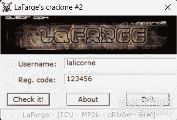

点击“Check it!”进行验证，得到了下面的弹框：

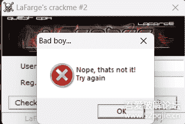

这个不能忍，必须要破解它！

## 使用 `x64dbg` 反汇编

为了可以将二进制码转换成为汇编语言，我们需要使用一种反汇编的工具（disassembler）。

`x64dbg` 是一款开源的软件。本教程使用的是目前最新的版本：[snapshot_2023-03-04_02-26.zip/download](https://sourceforge.net/projects/x64dbg/files/snapshots/snapshot_2023-03-04_02-26.zip/download)。

打开解压文件夹中的 exe 文件之后选择 `x32dbg`，打开之后的界面如下：

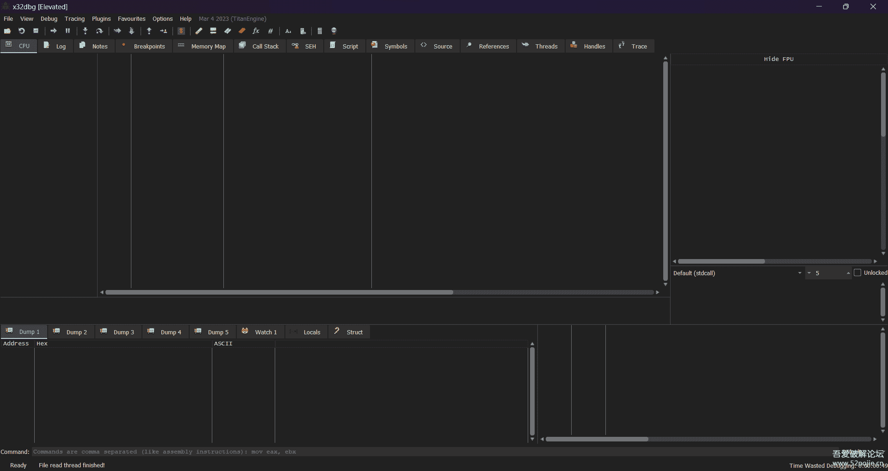

为了方便查看可以将软件调至浅色模式：点击 `Options->Theme->Default`。

随后将 `crackme.exe` 拖拽到 `x32dbg` 软件内会自动进行反编译，完成之后的界面如下：

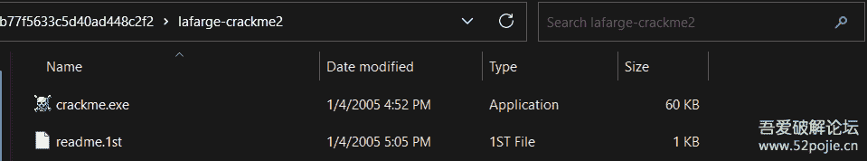

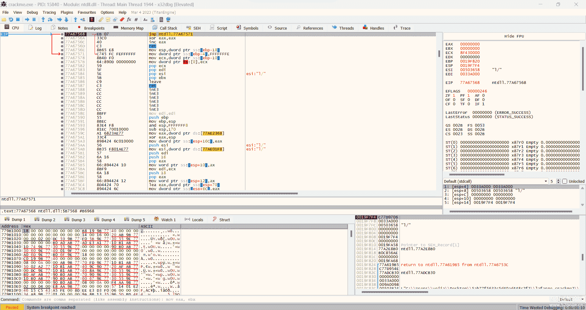

主界面为汇编代码，是计算机指令的列表，在“Hide FPU”界面下的是寄存器，用于储存数据，底部的两个窗口为程序的内存。

## 定位验证逻辑

我们想要做的是改变程序以获得登录许可，如果我们的登录并不符合要求会得到如下的提示：

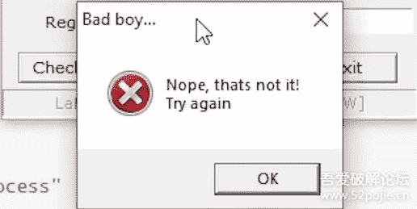

像是正己大佬做的安卓逆向破解思路一样，我们可以尝试搜索弹出提示框内的字符串以定位源码位置，在界面内右键找到搜索字符串的选项：

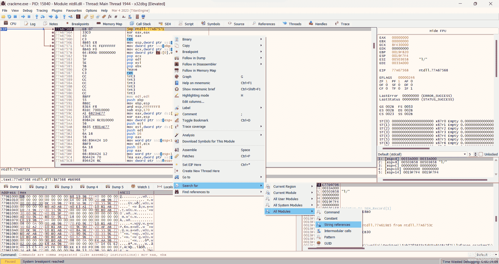

完成搜索之后，我们找到了提示框内的字符串：

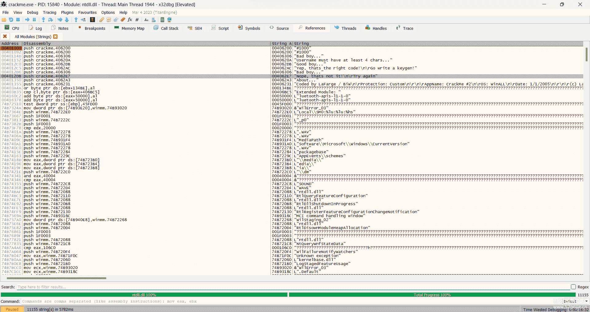

之后右键选中的字符串点击 `Follow in Disassembler` 以找出在程序中的位置：

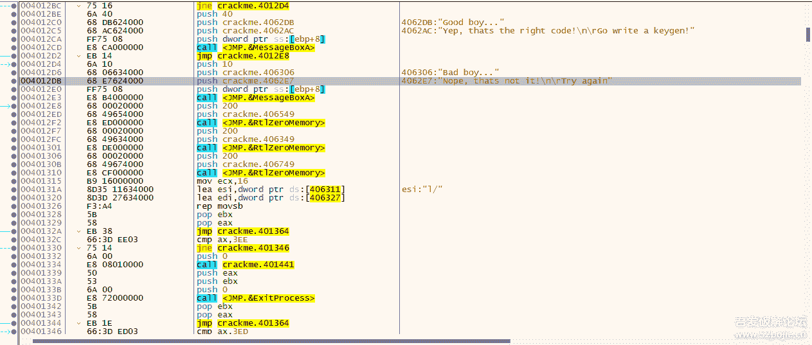

```
004012A6 | E8 E5000000 | call |
004012AB | 68 49654000 | push crackme.406549 |
004012B0 | 68 49694000 | push crackme.406949 |
004012B5 | E8 36010000 | call |
```

以上代码中做的是将记忆点 `406549` 与记忆点 `406949` 进行比较，以确认输入的注册码是否与我们输入的注册码一致。如果一致的话，我们就可以成功登录进软件；如果不一致的话，我们就会得到一个错误窗口。

## 修改跳转指令

我们可以做的是让程序直接跳到让我们进入的指令，具体的修改方法为：

将 `jne`（如果不等于就跳转，Jump if not equal）改为 `jmp`（总是跳转，Jump），右键选中的代码点击 `Assemble` 进行修改。

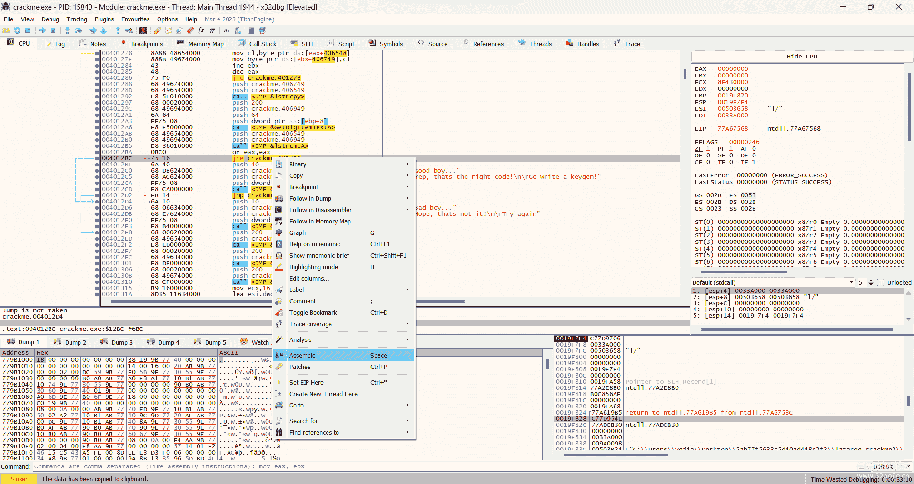

因为登录成功的提示为代码下面一行的 `0x004012BE`，所以我们让它直接跳到下面的这一行。具体修改如下图：

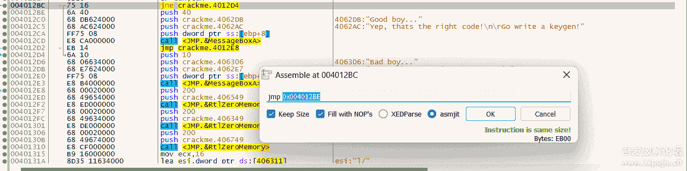

## 保存修改并测试

然后我们可以保存修改之后的代码，也就是我们成功破解的软件，尝试进行登录！！！

右键点击 `Patches` 或者 `Ctrl+P` 保存更改：

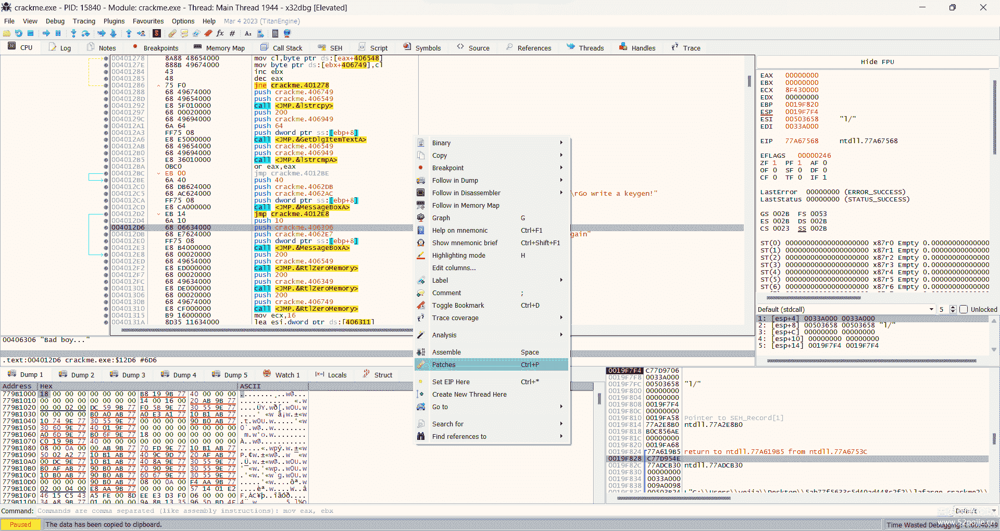

然后起一个比较皮的名字进行保存：

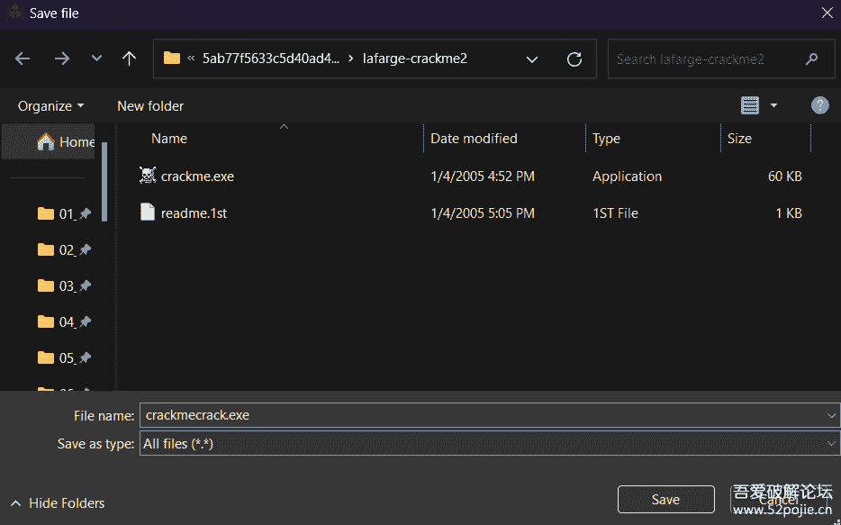

出现这个提示就说明保存成功了：

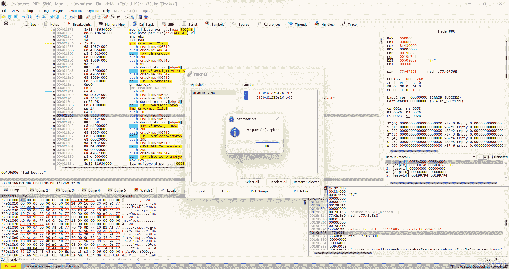

然后进行测试！

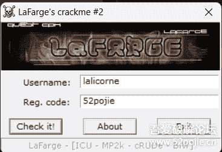


`Screenshot 2023-03-22 133958.png` (70.92 KB, 下载次数: 0)

[href="forum.php?mod=attachment&aid=MjYwMDcxNHw2MTEyMDU3Y3wxNzkzNTczODg2fDE2ODA4NnwxNzYzMjYy&nothumb=yes" target="_blank"](https://www.52pojie.cn/forum.php?mod=attachment&aid=MjYwMDcxNHw2MTEyMDU3Y3wxNzkzNTczODg2fDE2ODA4NnwxNzYzMjYy&nothumb=yes)

2023-3-22 20:36 上传

然后出现这个提示说明我们破解成功！

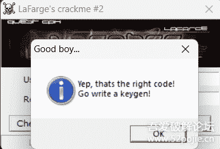

`Screenshot 2023-03-22 134026.png` (50.91 KB, 下载次数: 0)

[href="forum.php?mod=attachment&aid=MjYwMDcxNXxmZDU1NzIwNnwxNzkzNTczODg2fDE2ODA4NnwxNzYzMjYy&nothumb=yes" target="_blank"](https://www.52pojie.cn/forum.php?mod=attachment&aid=MjYwMDcxNXxmZDU1NzIwNnwxNzkzNTczODg2fDE2ODA4NnwxNzYzMjYy&nothumb=yes)

2023-3-22 20:36 上传

之后会更新怎么写出这个挑战的下一部分--`Keygen`（注册码生成器）
