# [MacOS逆向] 破解Navicat Premium 16.1.7 基于`lldb`动态调试配合静态注入+FridaHook

- 原帖: https://www.52pojie.cn/forum.php?mod=viewthread&tid=1763309
- 抓取时间: 2026-11-01T22:58:06

## 破解Navicat Premium 16.1.7 MAS订阅版本

### 1. 准备工作

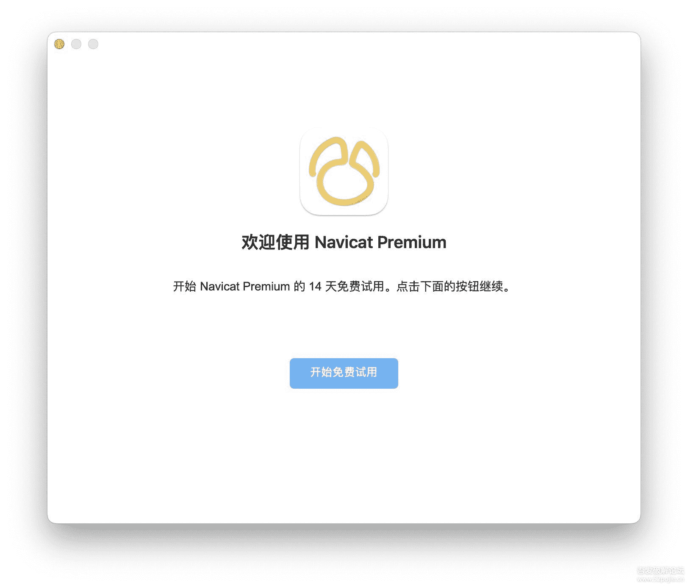

`16794781375687.jpg` (84.55 KB，下载次数: 2)

下载地址是 Mac App Store 应用商店。

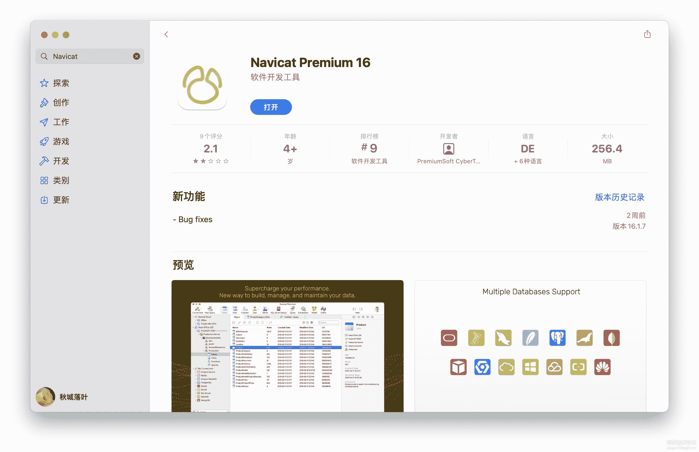

`16794781620369.jpg` (265.89 KB，下载次数: 0)

工具：

- IDA 7.0
- Hopper Disassembler 5.7.7
- Xcode
- VS Code + Frida

### 2. 开始分析

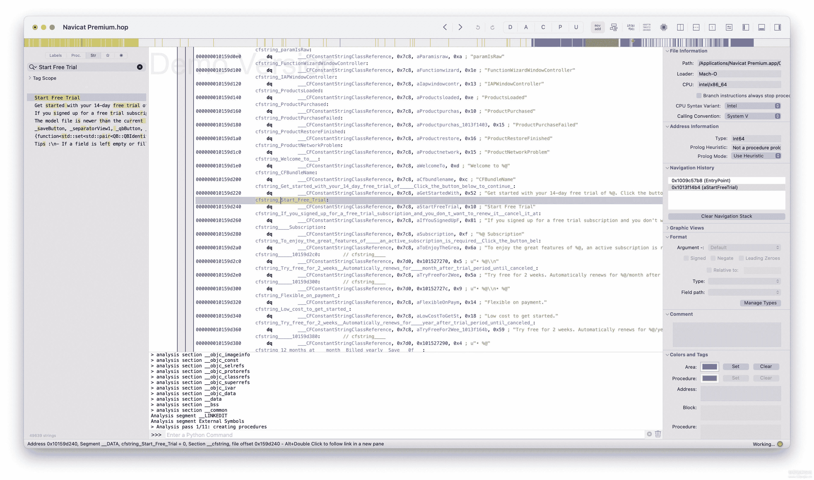

`16794784253230.jpg` (876.52 KB，下载次数: 1)

首先老样子找到界面上的关键字，在 HP 里面找到对应的地址。

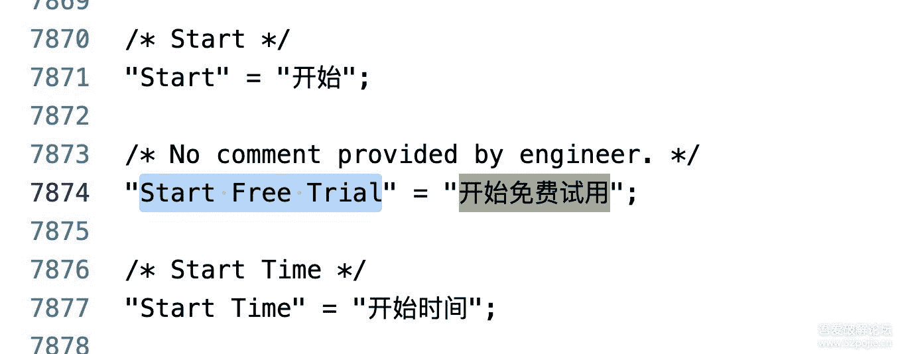

`16794784436888.jpg` (64.82 KB，下载次数: 1)

我们看到只有一个地方引用了。

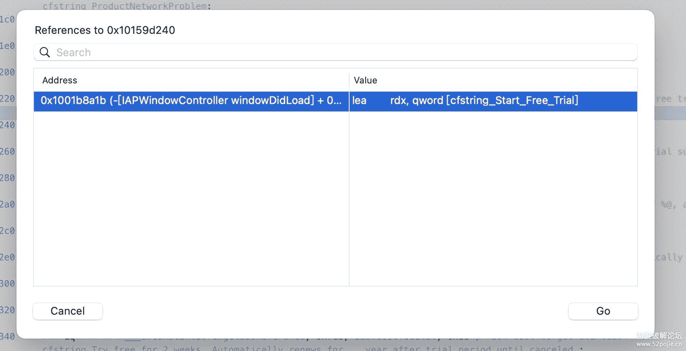

`16794784950620.jpg` (90.35 KB，下载次数: 3)

跟到这里你会发现：

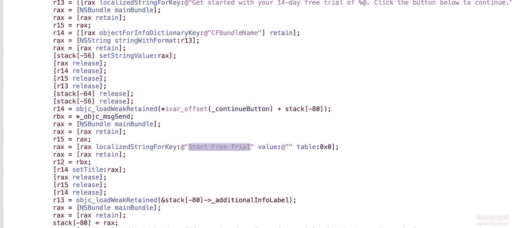

`16794847504949.jpg` (139.27 KB，下载次数: 3)

这个地方引用了这个字符串，那么我们看看上面有没有 `jmp` 大跳：

一翻发现有这段代码：

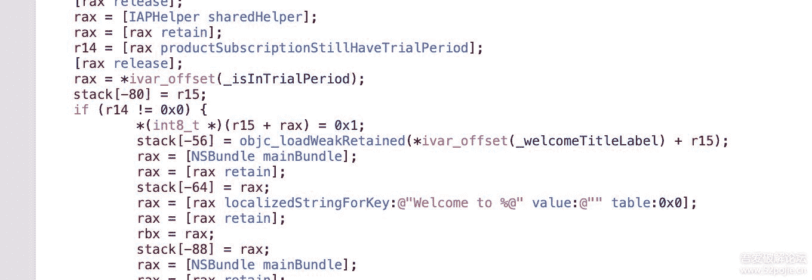

`16794848089681.jpg` (83.35 KB，下载次数: 2)

首先他获取了 `IAPHelper` 这个类拿到了 `insatnce`，然后 `rax` 执行了一个方法。

```
r14 = [rax productSubscriptionStillHaveTrialPeriod];
    [rax release];
    rax = *ivar_offset(_isInTrialPeriod);
    stack[-80] = r15;
    if (r14 != 0x0) {
            *(int8_t *)(r15 + rax) = 0x1;
            stack[-56] = objc_loadWeakRetained(*ivar_offset(_welcomeTitleLabel) + r15);
            rax = [NSBundle mainBundle];
            rax = [rax retain];
            stack[-64] = rax;
            rax = [rax localizedStringForKey:@"Welcome to %@" value:@"" table:0x0];
            rax = [rax retain];
            rbx = rax;
            stack[-88] = rax;
            rax = [NSBundle mainBundle];
            rax = [rax retain];
            r15 = rax;
            rax = [rax objectForInfoDictionaryKey:@"CFBundleName", @"", 0x0];
            rax = [rax retain];
            r14 = rax;
            rax = [NSString stringWithFormat:rbx, rax, 0x0];
            rax = [rax retain];
            [stack[-56] setStringValue:rax, rcx, 0x0];
            [rax release];
            [r14 release];
            [r15 release];
            [stack[-88] release];
            [stack[-64] release];
            [stack[-56] release];
            r14 = objc_loadWeakRetained(*ivar_offset(_purchaseViewTitleLabel) + stack[-80]);
            r13 = *_objc_msgSend;
            rax = [NSBundle mainBundle];
            rax = [rax retain];
            r15 = rax;
            rax = [rax objectForInfoDictionaryKey:@"CFBundleName"];
            rax = [rax retain];
            [r14 setStringValue:rax];
            [rax release];
            [r15 release];
            [r14 release];
            stack[-56] = objc_loadWeakRetained(*ivar_offset(_welcomeMessageLabel) + stack[-80]);
            rax = [NSBundle mainBundle];
            rax = [rax retain];
            stack[-64] = rax;
            r13 = [[rax localizedStringForKey:@"Get started with your 14-day free trial of %@. Click the button below to continue." value:@"" table:0x0] retain];
            rax = [NSBundle mainBundle];
```

通过这个方法得到了返回值如果是 `1` 那就进入开始试用阶段。

我们编写简单的 `frida` 试一下：

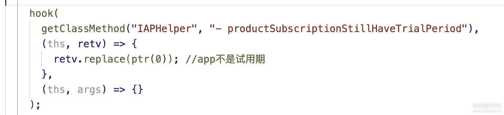

`16794849694265.jpg` (63.64 KB，下载次数: 0)

然后用 `python` 启动：

```python
def navicat():
    launchApp(
        "/Applications/Navicat Premium.app/Contents/MacOS/Navicat Premium"
    )

def launchApp(image, args=[], js="_index.js"):
    pid = frida.spawn(image, argv=args)
    frida.resume(pid)
    os.system(f"frida -p {pid} -l {js} --debug --runtime=v8")
```

`js` 脚本的代码可以参阅我其他的帖子，这里就不重复贴出来了。

启动发现变成了这样：

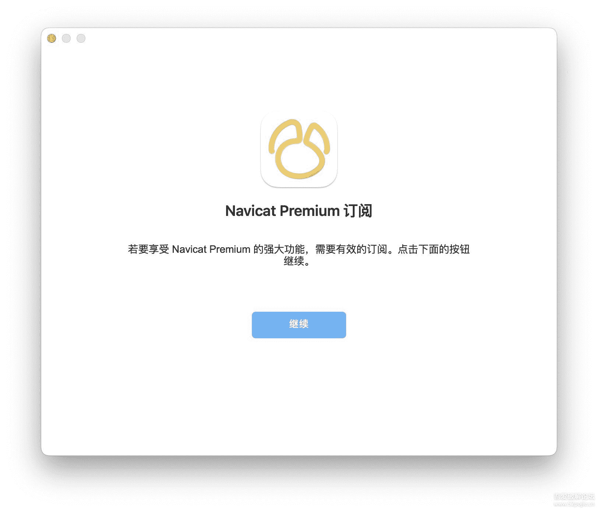

`16794850801590.jpg` (85.42 KB，下载次数: 0)

显然光绕过不行，这里是免费试用到期的状态，因为上面那个 `if` 完事了有一个 `else`。

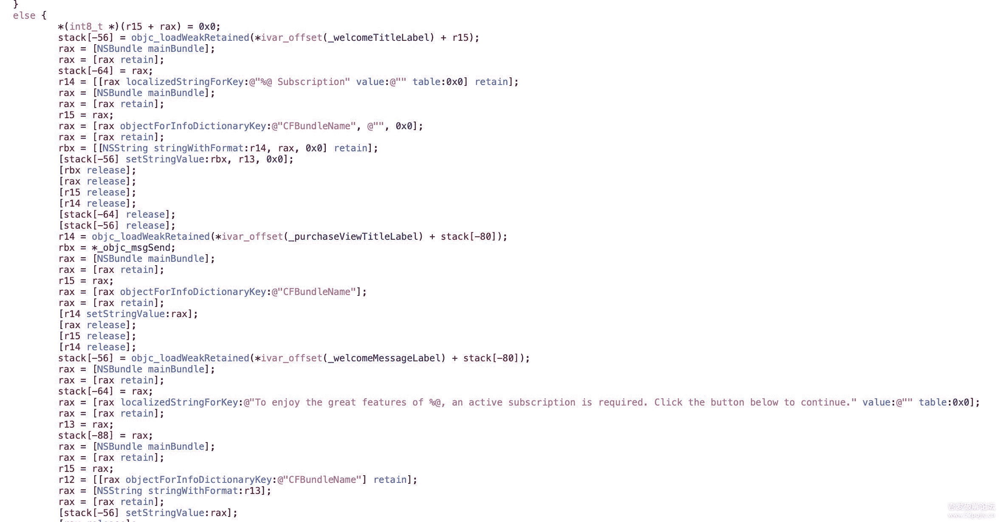

`16794851700593.jpg` (244.91 KB，下载次数: 0)

这里就是继续享受强大功能的提示。

注意，我们这个时候其实是 `frida` 把 App 挂在了 Hook 上，所以我们需要用 `lldb` 来动态调试反汇编：

`lldb --attach-name Navicat\ Premium`

加载完之后可以看到 stop 在这里了：

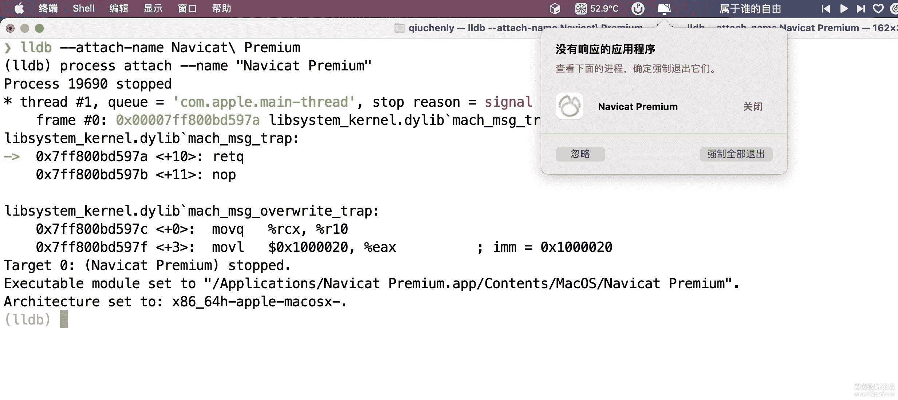

`16794853584044.jpg` (284.97 KB，下载次数: 1)

为了反汇编代码与 IDA/Hopper Disassembler 一致，我们需要将其反汇编代码风格改为 `intel`：

`settings set target.x86-disassembly-flavor intel`

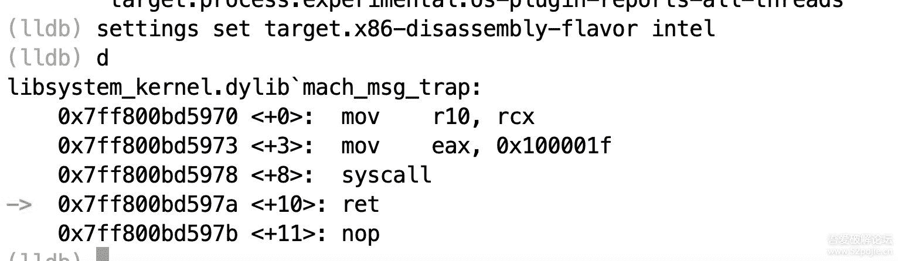

`16794855871942.jpg` (95.2 KB，下载次数: 3)

这样就可以和 IDA 里的反汇编代码风格一致了。

这里是自动断下的，我们先输入 `c` 让他继续运行：


`16794856648971.jpg` (12.09 KB，下载次数: 0)


## 添加断点

[href="forum.php?mod=attachment&aid=MjYwMDc1OXxiOWJhNzYxNHwxNzkzNTczODg0fDE2ODA4NnwxNzYzMzA5&nothumb=yes" target="_blank"](https://www.52pojie.cn/forum.php?mod=attachment&aid=MjYwMDc1OXxiOWJhNzYxNHwxNzkzNTczODg0fDE2ODA4NnwxNzYzMzA5&nothumb=yes)

2023-3-22 22:20 上传

那么我们需要下个断点在这个调用函数上。

前面我们说到这里是通过搜索`string`找到的`windowDidLoad`函数引用，所以我们就要在这个函数的开头下`breakpoint`让他`Suspend`，方便我观察`Stack`。

```
/ @Class IAPWindowController /

-(void)windowDidLoad {}
```

输入：

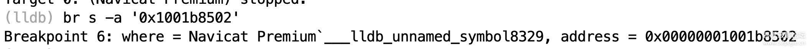

`16794859424946.jpg` (43.16 KB, 下载次数: 1)

[href="forum.php?mod=attachment&aid=MjYwMDc2MHxhZTU4MmUwYXwxNzkzNTczODg0fDE2ODA4NnwxNzYzMzA5&nothumb=yes" target="_blank"](https://www.52pojie.cn/forum.php?mod=attachment&aid=MjYwMDc2MHxhZTU4MmUwYXwxNzkzNTczODg0fDE2ODA4NnwxNzYzMzA5&nothumb=yes)

2023-3-22 22:20 上传

这里地址是

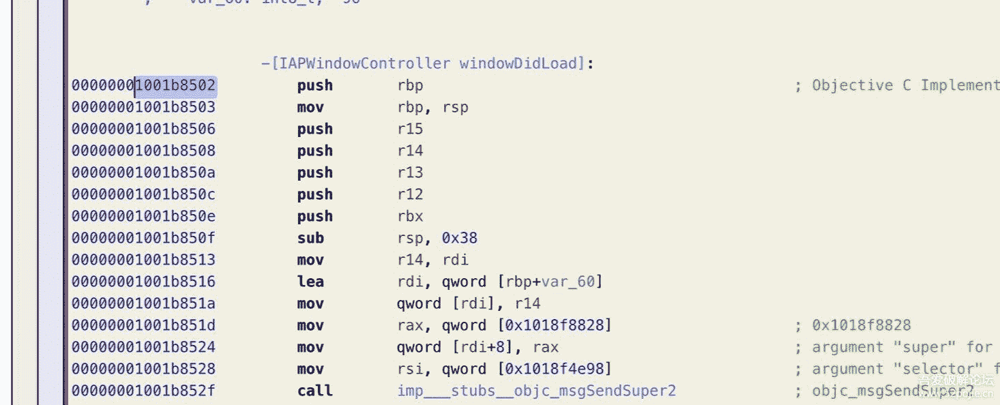

`16794859687803.jpg` (108.12 KB, 下载次数: 1)

[href="forum.php?mod=attachment&aid=MjYwMDc2MXw0MDcwYjQ4ZHwxNzkzNTczODg0fDE2ODA4NnwxNzYzMzA5&nothumb=yes" target="_blank"](https://www.52pojie.cn/forum.php?mod=attachment&aid=MjYwMDc2MXw0MDcwYjQ4ZHwxNzkzNTczODg0fDE2ODA4NnwxNzYzMzA5&nothumb=yes)

2023-3-22 22:20 上传

这个地方得到的偏移地址。

然后我们输入`r`重启 app。


`16794860158708.jpg` (29.53 KB, 下载次数: 0)

[href="forum.php?mod=attachment&aid=MjYwMDc2MnwxOTFiYzdhNHwxNzkzNTczODg0fDE2ODA4NnwxNzYzMzA5&nothumb=yes" target="_blank"](https://www.52pojie.cn/forum.php?mod=attachment&aid=MjYwMDc2MnwxOTFiYzdhNHwxNzkzNTczODg0fDE2ODA4NnwxNzYzMzA5&nothumb=yes)

2023-3-22 22:20 上传

直接回车即可。

可以看到函数这个时候被断下了：

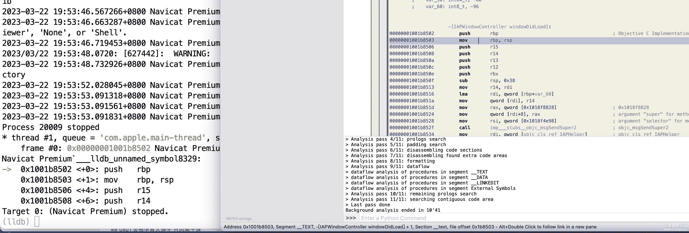

`16794860719195.jpg` (532.96 KB, 下载次数: 2)

[href="forum.php?mod=attachment&aid=MjYwMDc2M3w5MGQwZTI0MXwxNzkzNTczODg0fDE2ODA4NnwxNzYzMzA5&nothumb=yes" target="_blank"](https://www.52pojie.cn/forum.php?mod=attachment&aid=MjYwMDc2M3w5MGQwZTI0MXwxNzkzNTczODg0fDE2ODA4NnwxNzYzMzA5&nothumb=yes)

2023-3-22 22:20 上传

## 查看调用堆栈

现在我们要查这个函数从哪里调用的堆栈，输入简写`bt`看堆栈：

```
* thread #1, queue = 'com.apple.main-thread', stop reason = breakpoint 6.1
    frame #0: 0x00000001001b8502 Navicat Premium`___lldb_unnamed_symbol8329
Navicat Premium`___lldb_unnamed_symbol8329:
->  0x1001b8502 : push   rbp
    0x1001b8503 : mov    rbp, rsp
    0x1001b8506 : push   r15
    0x1001b8508 : push   r14
Target 0: (Navicat Premium) stopped.
(lldb) bt
* thread #1, queue = 'com.apple.main-thread', stop reason = breakpoint 6.1
  * frame #0: 0x00000001001b8502 Navicat Premium`___lldb_unnamed_symbol8329
    frame #1: 0x00007ff8038d00aa AppKit`-[NSWindowController _windowDidLoad] + 548
    frame #2: 0x00007ff8038cbc87 AppKit`-[NSWindowController window] + 110
    frame #3: 0x00000001001b7fee Navicat Premium`___lldb_unnamed_symbol8326 + 142
    frame #4: 0x0000000100ab284a Navicat Premium`___lldb_unnamed_symbol28791 + 892
    frame #5: 0x00007ff801b16b21 Foundation`__NSBLOCKOPERATION_IS_CALLING_OUT_TO_A_BLOCK__ + 7
    frame #6: 0x00007ff801b16a19 Foundation`-[NSBlockOperation main] + 98
    frame #7: 0x00007ff801b169af Foundation`__NSOPERATION_IS_INVOKING_MAIN__ + 17
    frame #8: 0x00007ff801b15c1b Foundation`-[NSOperation start] + 785
    frame #9: 0x00007ff801b158f1 Foundation`__NSOPERATIONQUEUE_IS_STARTING_AN_OPERATION__ + 17
    frame #10: 0x00007ff801b157c8 Foundation`__NSOQSchedule_f + 182
    frame #11: 0x00007ff800a683c0 libdispatch.dylib`_dispatch_block_async_invoke2 + 83
    frame #12: 0x00007ff800a5b317 libdispatch.dylib`_dispatch_client_callout + 8
    frame #13: 0x00007ff800a67c78 libdispatch.dylib`_dispatch_main_queue_drain + 943
    frame #14: 0x00007ff800a678bb libdispatch.dylib`_dispatch_main_queue_callback_4CF + 31
    frame #15: 0x00007ff800d16f37 CoreFoundation`__CFRUNLOOP_IS_SERVICING_THE_MAIN_DISPATCH_QUEUE__ + 9
    frame #16: 0x00007ff800cd7fcf CoreFoundation`__CFRunLoopRun + 2771
    frame #17: 0x00007ff800cd6e3c CoreFoundation`CFRunLoopRunSpecific + 562
    frame #18: 0x00007ff8099865e6 HIToolbox`RunCurrentEventLoopInMode + 292
    frame #19: 0x00007ff80998634a HIToolbox`ReceiveNextEventCommon + 594
    frame #20: 0x00007ff8099860e5 HIToolbox`_BlockUntilNextEventMatchingListInModeWithFilter + 70
    frame #21: 0x00007ff803710fad AppKit`_DPSNextEvent + 927
    frame #22: 0x00007ff80370f66a AppKit`-[NSApplication(NSEvent) _nextEventMatchingEventMask:untilDate:inMode:dequeue:] + 1394
    frame #23: 0x00007ff803701d19 AppKit`-[NSApplication run] + 586
    frame #24: 0x00007ff8036d5c97 AppKit`NSApplicationMain + 817
    frame #25: 0x00000001009c6562 Navicat Premium`___lldb_unnamed_symbol27130 + 3498
    frame #26: 0x0000000101b3152e dyld`start + 462
(lldb) 
```

可以看到调用方来自`frame #3`，我们输入`up`来跳到调用方：

```
(lldb) up
frame #1: 0x00007ff8038d00aa AppKit`-[NSWindowController _windowDidLoad] + 548
AppKit`-[NSWindowController _windowDidLoad]:
->  0x7ff8038d00aa : jmp    0x7ff8038d018a            ; 
    0x7ff8038d00af : mov    r12, qword ptr [rip + 0x3eb7c1c2] ; "owner"
    0x7ff8038d00b6 : mov    rdi, rbx
    0x7ff8038d00b9 : mov    rsi, r12
(lldb) 
```

可以看到我们在`frame #1`，我们跳两次到`frame #3`：

```
(lldb) up 3
frame #4: 0x0000000100ab284a Navicat Premium`___lldb_unnamed_symbol28791 + 892
Navicat Premium`___lldb_unnamed_symbol28791:
->  0x100ab284a : mov    rdi, qword ptr [rip + 0xe42a07] ; (void *)0x00000001019c8cf0
    0x100ab2851 : mov    rsi, qword ptr [rip + 0xe1f2d8] ; "backend"
    0x100ab2858 : call   r12
    0x100ab285b : mov    rdi, rax
(lldb) down 1
frame #3: 0x00000001001b7fee Navicat Premium`___lldb_unnamed_symbol8326 + 142
Navicat Premium`___lldb_unnamed_symbol8326:
->  0x1001b7fee : mov    rdi, rax
    0x1001b7ff1 : call   0x1011fdbae               ; symbol stub for: objc_retainAutoreleasedReturnValue
    0x1001b7ff6 : mov    rbx, rax
    0x1001b7ff9 : mov    rsi, qword ptr [rip + 0x172ee48] ; "runModalForWindow:"
(lldb) 
```

这里输入`up 3`就是跳3次堆栈，我这里还`down 1`是因为我跳到`frame #4`了，所以往回跳1个堆栈。

### 查看调用方代码

我们看下这个代码：

```
    0x1001b7fb6 :  mov    rsi, qword ptr [rip + 0x173304b] ; "setIsStartup:"
    0x1001b7fbd :  movsx  ebx, bl
    0x1001b7fc0 :  mov    edx, ebx
    0x1001b7fc2 :  call   qword ptr [rip + 0x13d05d0] ; (void *)0x00007ff800aa5400: objc_msgSend
    0x1001b7fc8 : test   bl, bl
    0x1001b7fca : je     0x1001b800b               ; 
    0x1001b7fcc : mov    rax, qword ptr [rip + 0x13d009d] ; (void *)0x00007ff8421b99b0: NSApp
    0x1001b7fd3 : mov    r14, qword ptr [rax]
    0x1001b7fd6 : mov    rdi, qword ptr [rip + 0x183676b]
    0x1001b7fdd : mov    rsi, qword ptr [rip + 0x173ce8c] ; "window"
    0x1001b7fe4 : mov    r15, qword ptr [rip + 0x13d05ad] ; (void *)0x00007ff800aa5400: objc_msgSend
    0x1001b7feb : call   r15
->  0x1001b7fee : mov    rdi, rax
    0x1001b7ff1 : call   0x1011fdbae               ; symbol stub for: objc_retainAutoreleasedReturnValue
    0x1001b7ff6 : mov    rbx, rax
    0x1001b7ff9 : mov    rsi, qword ptr [rip + 0x172ee48] ; "runModalForWindow:"
    0x1001b8000 : mov    rdi, r14
    0x1001b8003 : mov    rdx, rax
    0x1001b8006 : call   r15
    0x1001b8009 : jmp    0x1001b8042               ; 
    0x1001b800b : mov    rdi, qword ptr [rip + 0x1836736]
    0x1001b8012 : mov    rsi, qword ptr [rip + 0x173ce57] ; "window"
    0x1001b8019 : mov    r14, qword ptr [rip + 0x13d0578] ; (void *)0x00007ff800aa5400: objc_msgSend
    0x1001b8020 : call   r14
    0x1001b8023 : mov    rdi, rax
    0x1001b8026 : call   0x1011fdbae               ; symbol stub for: objc_retainAutoreleasedReturnValue
    0x1001b802b : mov    rbx, rax
    0x1001b802e : mov    rdx, qword ptr [rip + 0x1836713]
    0x1001b8035 : mov    rsi, qword ptr [rip + 0x1728d64] ; "makeKeyAndOrderFront:"
    0x1001b803c : mov    rdi, rax
    0x1001b803f : call   r14
    0x1001b8042 : mov    rdi, rbx
    0x1001b8045 : add    rsp, 0x8
    0x1001b8049 : pop    rbx
    0x1001b804a : pop    r14
    0x1001b804c : pop    r15
    0x1001b804e : pop    rbp
```


```
0x1001b804f : jmp    qword ptr [rip + 0x13d054b] ; (void *)0x00007ff800aa8000: objc_release

(lldb)
```

我们看->的指向位置,回到`Hopper`我们看下对应位置到底写了什么.

```
frame #0: 0x00000001001ec52f Noto`___lldb_unnamed_symbol44926 + 1151
Noto`___lldb_unnamed_symbol44926:
->  0x1001ec52f : cmp    qword ptr [r13 + 0x10], 0x0
    0x1001ec534 : je     0x1001ec8c9               ; 
    0x1001ec53a : mov    rdi, r13
    0x1001ec53d : call   0x100da89f0               ; symbol stub for: swift_bridgeObjectRetain
(lldb) gui
```

为了方便操作堆栈，我们输入`gui`切换到`GUI`模式.

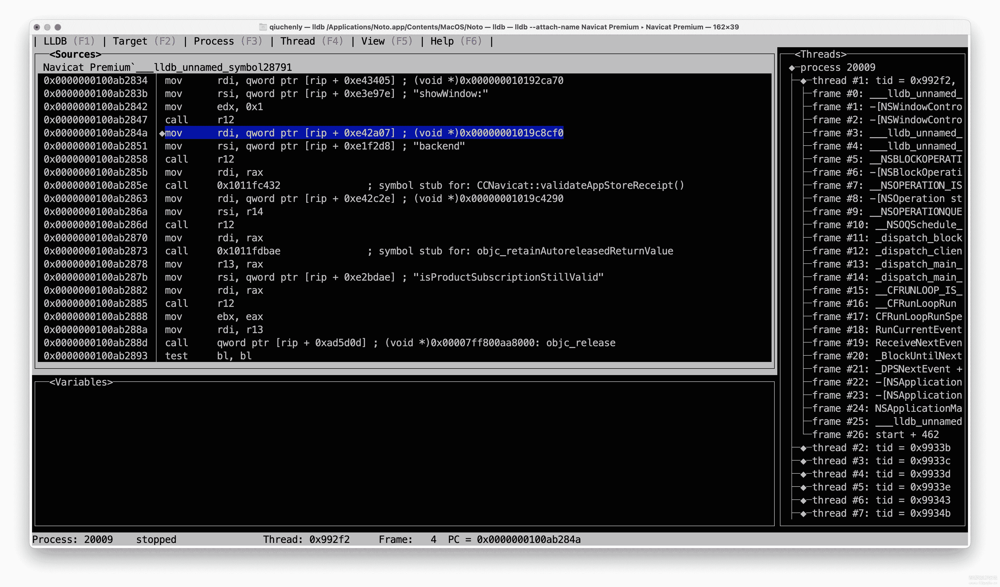

16794869404815.jpg (874.38 KB, 下载次数: 2)

[href="forum.php?mod=attachment&aid=MjYwMDc2NHxmYjFhZTNlY3wxNzkzNTczODg0fDE2ODA4NnwxNzYzMzA5&nothumb=yes" target="_blank"](https://www.52pojie.cn/forum.php?mod=attachment&aid=MjYwMDc2NHxmYjFhZTNlY3wxNzkzNTczODg0fDE2ODA4NnwxNzYzMzA5&nothumb=yes)

2023-3-22 22:20 上传

现在他默认在堆栈顶部,我们要切换到右侧"`___lldbunnamed`"开头的堆栈查看源代码:

按下`TAB`，我们会按顺序切换到右侧:

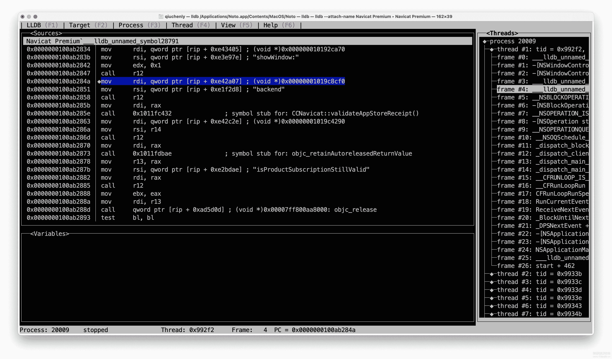

16794870127516.jpg (876.44 KB, 下载次数: 3)

[href="forum.php?mod=attachment&aid=MjYwMDc2NXwwOThlYjlhNHwxNzkzNTczODg0fDE2ODA4NnwxNzYzMzA5&nothumb=yes" target="_blank"](https://www.52pojie.cn/forum.php?mod=attachment&aid=MjYwMDc2NXwwOThlYjlhNHwxNzkzNTczODg0fDE2ODA4NnwxNzYzMzA5&nothumb=yes)

2023-3-22 22:20 上传

现在高亮#4就代表我们在堆栈#4，左侧的代码会对应显示出来.我们记下这个地址到`Hopper`里面查一下:

`0x0000000100ab284a`

按下`G`键开始跳转:

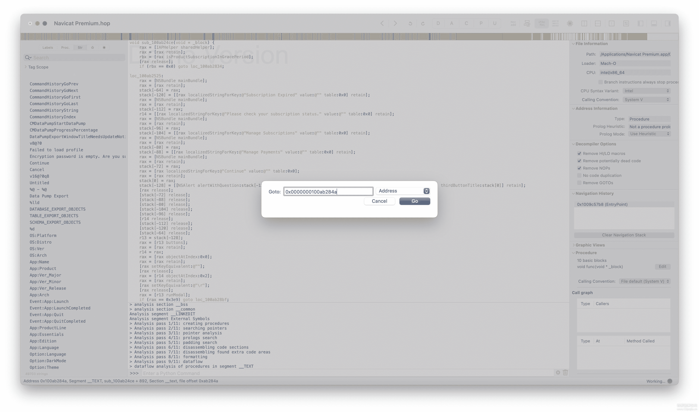

16794870713008.jpg (559.07 KB, 下载次数: 1)

[href="forum.php?mod=attachment&aid=MjYwMDc2NnwyZjI1OWE1NnwxNzkzNTczODg0fDE2ODA4NnwxNzYzMzA5&nothumb=yes" target="_blank"](https://www.52pojie.cn/forum.php?mod=attachment&aid=MjYwMDc2NnwyZjI1OWE1NnwxNzkzNTczODg0fDE2ODA4NnwxNzYzMzA5&nothumb=yes)

2023-3-22 22:21 上传

```
void sub_100ab24ce(void * _block) {

    rax = [IAPHelper sharedHelper];

    rax = [rax retain];

    rbx = [rax isProductSubscriptionInGracePeriod];

    [rax release];

    if (rbx == 0x0) goto loc_100ab2834;

loc_100ab2525:

    rax = [NSBundle mainBundle];

    rax = [rax retain];

    stack[-64] = rax;

    stack[-120] = [[rax localizedStringForKey:@"Subscription Expired" value:@"" table:0x0] retain];

    rax = [NSBundle mainBundle];

    rax = [rax retain];

    stack[-112] = rax;

    r14 = [[rax localizedStringForKey:@"Please check your subscription status." value:@"" table:0x0] retain];

    rax = [NSBundle mainBundle];

    rax = [rax retain];

    stack[-96] = rax;

    stack[-104] = [[rax localizedStringForKey:@"Manage Subscriptions" value:@"" table:0x0] retain];

    rax = [NSBundle mainBundle];

    rax = [rax retain];

    stack[-80] = rax;

    stack[-88] = [[rax localizedStringForKey:@"Manage Payments" value:@"" table:0x0] retain];

    rax = [NSBundle mainBundle];

    rax = [rax retain];

    stack[-72] = rax;

    rax = [rax localizedStringForKey:@"Continue" value:@"" table:0x0];

    rax = [rax retain];

    stack[0] = rax;

    stack[-128] = [[NSAlert alertWithQuestion:stack[-120] details:r14 firstButtonTitle:stack[-104] secondButtonTitle:stack[-88] thirdButtonTitle:stack[0]] retain];

    [rax release];

    [stack[-72] release];

    [stack[-88] release];

    [stack[-80] release];

    [stack[-104] release];

    [stack[-96] release];

    [r14 release];

    [stack[-112] release];

    [stack[-120] release];

    [stack[-64] release];

    r13 = stack[-128];

    rax = [r13 buttons];

    rax = [rax retain];

    r14 = rax;

    rax = [rax objectAtIndex:0x0];

    rax = [rax retain];

    [rax setKeyEquivalent:@""];

    [rax release];

    rax = [r14 objectAtIndex:0x2];

    rax = [rax retain];

    [rax setKeyEquivalent:@"\r"];

    [rax release];

    rax = [r13 runModal];

    if (rax == 0x3e9) goto loc_100ab28bf;

loc_100ab27cb:

    if (rax != 0x3e8) goto loc_100ab2928;

loc_100ab27d7:

    r15 = [[NSWorkspace sharedWorkspace] retain];

    rax = [NSURL URLWithString:@"itms-apps://apps.apple.com/account/subscriptions"];

    rax = [rax retain];

    rbx = rax;

    [r15 openURL:rax];

    goto loc_100ab2917;

loc_100ab2917:

    [rbx release];

    [r15 release];

    goto loc_100ab2928;

loc_100ab2928:

    [r14 release];

    [r13 release];

    return;

loc_100ab28bf:

    r15 = [[NSWorkspace sharedWorkspace] retain];

    rax = [NSURL URLWithString:@"itms-apps://apps.apple.com/account/billing"];

    rax = [rax retain];

    rbx = rax;

    [r15 openURL:rax];

    goto loc_100ab2917;

loc_100ab2834:

    [IAPWindowController showWindow:0x1];

    CCNavicat::validateAppStoreReceipt([CCCore backend]);

    rax = [IAPHelper sharedHelper];

    rax = [rax retain];

    rbx = [rax isProductSubscriptionStillValid];

    [rax release];

    if (rbx == 0x0) {

            [**_NSApp terminate:0x0];

    }

    return;

}
```

很明显 我们看到上面调用了一个函数:`isProductSubscriptionInGracePeriod`,以楼主没几两墨水的肚子勉强猜出来这个函数是否产品订阅在宽容周期内，也就是已过期但是你还可以用.

由于`Hopper`对原始`C`函数反编译能力较弱，我们用`IDA`看下比较精确的伪代码:


## 函数 `sub_100AB24CE` 实现

```
void *sub_100AB24CE()
{
  struct objc_object *v0; // rax
  void *v1; // r13
  char v2; // bl
  void *v3; // rax
  void *v4; // rax
  void *v5; // ST48_8
  void *v6; // rax
  __int64 v7; // ST10_8
  void *v8; // rax
  void *v9; // rax
  void *v10; // ST18_8
  void *v11; // rax
  __int64 v12; // r14
  void *v13; // rax
  void *v14; // rax
  void *v15; // ST28_8
  void *v16; // rax
  __int64 v17; // ST20_8
  void *v18; // rax
  void *v19; // rax
  void *v20; // ST38_8
  void *v21; // rax
  __int64 v22; // ST30_8
  void *v23; // rax
  void *v24; // rax
  void *v25; // ST40_8
  void *v26; // rax
  __int64 v27; // rax
  __int64 v28; // r13
  void *v29; // rax
  void *v30; // rax
  void *v31; // rax
  void *v32; // r14
  void *v33; // rax
  void *v34; // rbx
  void *v35; // rax
  void *v36; // rbx
  void *v37; // rax
  void *v38; // rax
  void *v39; // r15
  void *v40; // rax
  __int64 v41; // rbx
  CCNavicat *v42; // rax
  struct objc_object *v43; // rax
  void *v44; // r13
  char v45; // bl
  void *result; // rax
  void *v47; // rax
  void *v48; // rax
  void *v49; // [rsp+8h] [rbp-78h]
  __int64 retaddr; // [rsp+88h] [rbp+8h]

  v0 = +[IAPHelper sharedHelper](&OBJC_CLASS___IAPHelper, "sharedHelper");
  v1 = (void *)((__int64 (__fastcall *)(struct objc_object *))objc_retainAutoreleasedReturnValue)(v0);
  v2 = (unsigned __int64)objc_msgSend(v1, "isProductSubscriptionInGracePeriod");
  objc_release(v1);
  if ( v2 )
  {
    v3 = objc_msgSend(&OBJC_CLASS___NSBundle, "mainBundle");
    v4 = (void *)((__int64 (__fastcall *)(void *))objc_retainAutoreleasedReturnValue)(v3);
    v5 = v4;
    v6 = objc_msgSend(v4, "localizedStringForKey:value:table:", CFSTR("Subscription Expired"), &stru_101595060, 0LL);
    v7 = ((__int64 (__fastcall *)(void *))objc_retainAutoreleasedReturnValue)(v6);
    v8 = objc_msgSend(&OBJC_CLASS___NSBundle, "mainBundle");
    v9 = (void *)((__int64 (__fastcall *)(void *))objc_retainAutoreleasedReturnValue)(v8);
    v10 = v9;
    v11 = objc_msgSend(
            v9,
            "localizedStringForKey:value:table:",
            CFSTR("Please check your subscription status."),
            &stru_101595060,
            0LL);
    v12 = ((__int64 (__fastcall *)(void *))objc_retainAutoreleasedReturnValue)(v11);
    v13 = objc_msgSend(&OBJC_CLASS___NSBundle, "mainBundle");
    v14 = (void *)((__int64 (__fastcall *)(void *))objc_retainAutoreleasedReturnValue)(v13);
    v15 = v14;
    v16 = objc_msgSend(v14, "localizedStringForKey:value:table:", CFSTR("Manage Subscriptions"), &stru_101595060, 0LL);
    v17 = ((__int64 (__fastcall *)(void *))objc_retainAutoreleasedReturnValue)(v16);
    v18 = objc_msgSend(&OBJC_CLASS___NSBundle, "mainBundle");
    v19 = (void *)((__int64 (__fastcall *)(void *))objc_retainAutoreleasedReturnValue)(v18);
    v20 = v19;
    v21 = objc_msgSend(v19, "localizedStringForKey:value:table:", CFSTR("Manage Payments"), &stru_101595060, 0LL);
    v22 = ((__int64 (__fastcall *)(void *))objc_retainAutoreleasedReturnValue)(v21);
    v23 = objc_msgSend(&OBJC_CLASS___NSBundle, "mainBundle");
    v24 = (void *)((__int64 (__fastcall *)(void *))objc_retainAutoreleasedReturnValue)(v23);
    v25 = v24;
    v26 = objc_msgSend(v24, "localizedStringForKey:value:table:", CFSTR("Continue"), &stru_101595060, 0LL);
    v27 = ((__int64 (__fastcall *)(void *))objc_retainAutoreleasedReturnValue)(v26);
    v28 = v27;
    retaddr = v27;
    v29 = objc_msgSend(
            &OBJC_CLASS___NSAlert,
            "alertWithQuestion:details:firstButtonTitle:secondButtonTitle:thirdButtonTitle:",
            v7,
            v12,
            v17,
            v22);
    v49 = (void *)((__int64 (__fastcall *)(void *))objc_retainAutoreleasedReturnValue)(v29);
    objc_release(v28);
    objc_release(v25);
    objc_release(v22);
    objc_release(v20);
    objc_release(v17);
    objc_release(v15);
    objc_release(v12);
    objc_release(v10);
    objc_release(v7);
    objc_release(v5);
    v30 = objc_msgSend(v49, "buttons");
    v31 = (void *)((__int64 (__fastcall *)(void *))objc_retainAutoreleasedReturnValue)(v30);
    v32 = v31;
    v33 = objc_msgSend(v31, "objectAtIndex:", 0LL);
    v34 = (void *)((__int64 (__fastcall *)(void *))objc_retainAutoreleasedReturnValue)(v33);
    objc_msgSend(v34, "setKeyEquivalent:", &stru_101595060);
    objc_release(v34);
    v35 = objc_msgSend(v32, "objectAtIndex:", 2LL);
    v36 = (void *)((__int64 (__fastcall *)(void *))objc_retainAutoreleasedReturnValue)(v35);
    objc_msgSend(v36, "setKeyEquivalent:", CFSTR("\r"));
    objc_release(v36);
    v37 = objc_msgSend(v49, "runModal");
    if ( v37 == (void *)1001 )
    {
      v47 = objc_msgSend(&OBJC_CLASS___NSWorkspace, "sharedWorkspace");
      v39 = (void *)((__int64 (__fastcall *)(void *))objc_retainAutoreleasedReturnValue)(v47);
      v48 = objc_msgSend(&OBJC_CLASS___NSURL, "URLWithString:", CFSTR("itms-apps://apps.apple.com/account/billing"));
      v41 = ((__int64 (__fastcall *)(void *))objc_retainAutoreleasedReturnValue)(v48);
      objc_msgSend(v39, "openURL:", v41);
    }
    else
    {
      if ( v37 != (void *)1000 )
      {
LABEL_10:
        objc_release(v32);
        return (void *)objc_release(v49);
      }
      v38 = objc_msgSend(&OBJC_CLASS___NSWorkspace, "sharedWorkspace");
      v39 = (void *)((__int64 (__fastcall *)(void *))objc_retainAutoreleasedReturnValue)(v38);
      v40 = objc_msgSend(
              &OBJC_CLASS___NSURL,
              "URLWithString:",
              CFSTR("itms-apps://apps.apple.com/account/subscriptions"));
      v41 = ((__int64 (__fastcall *)(void *))objc_retainAutoreleasedReturnValue)(v40);
      objc_msgSend(v39, "openURL:", v41);
    }
    objc_release(v41);
    objc_release(v39);
    goto LABEL_10;
  }
  +[IAPWindowController showWindow:](&OBJC_CLASS___IAPWindowController, "showWindow:", 1LL);
  v42 = +[CCCore backend](&OBJC_CLASS___CCCore, "backend");
  CCNavicat::validateAppStoreReceipt(v42);
  v43 = +[IAPHelper sharedHelper](&OBJC_CLASS___IAPHelper, "sharedHelper");
  v44 = (void *)((__int64 (__fastcall *)(struct objc_object *))objc_retainAutoreleasedReturnValue)(v43);
  v45 = (unsigned __int64)objc_msgSend(v44, "isProductSubscriptionStillValid");
  result = (void *)objc_release(v44);
  if ( !v45 )
    result = objc_msgSend(NSApp, "terminate:", 0LL);
  return result;
}
```

可以看到 `isProductSubscriptionInGracePeriod` 如果返回 1 那么就会提示你 product expired，这显然不是我们需要的结果。那如果不在宽容周期内呢？

我们直接翻到最底下赫然发现函数 `isProductSubscriptionStillValid`：

```
  v45 = (unsigned __int64)objc_msgSend(v44, "isProductSubscriptionStillValid");

  result = (void *)objc_release(v44);

  if ( !v45 )

    result = objc_msgSend(NSApp, "terminate:", 0LL);

  return result;
```

如果产品一直验证通过，那么直接返回 `v45`，也就是说 `v45` 必须等于 1 否则 `terminate`.

我们 `Hook` 一下看看.

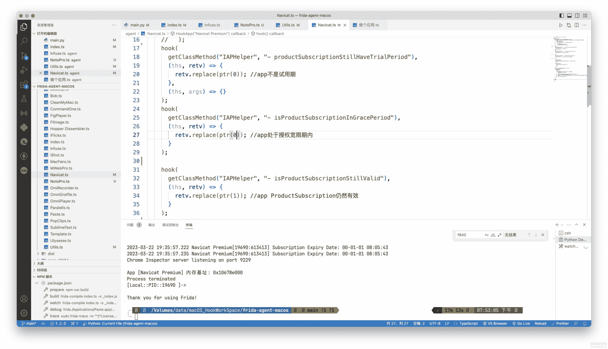

16794876026368.jpg (558.88 KB, 下载次数: 0)

[href="forum.php?mod=attachment&aid=MjYwMDc2N3wyNTc4MWU1ZHwxNzkzNTczODg0fDE2ODA4NnwxNzYzMzA5&nothumb=yes" target="_blank"](https://www.52pojie.cn/forum.php?mod=attachment&aid=MjYwMDc2N3wyNTc4MWU1ZHwxNzkzNTczODg0fDE2ODA4NnwxNzYzMzA5&nothumb=yes)

2023-3-22 22:21 上传

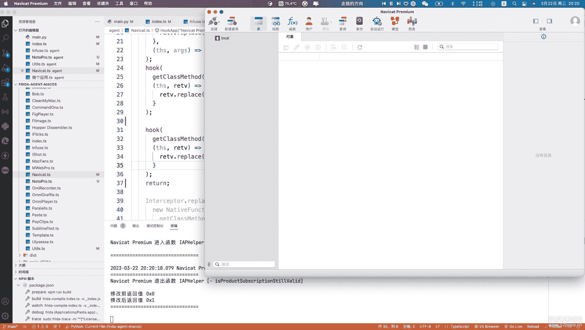

16794876428937.jpg (205.49 KB, 下载次数: 0)

[href="forum.php?mod=attachment&aid=MjYwMDc2OHwyMzk0ZDNkNnwxNzkzNTczODg0fDE2ODA4NnwxNzYzMzA5&nothumb=yes" target="_blank"](https://www.52pojie.cn/forum.php?mod=attachment&aid=MjYwMDc2OHwyMzk0ZDNkNnwxNzkzNTczODg0fDE2ODA4NnwxNzYzMzA5&nothumb=yes)

2023-3-22 22:21 上传

可以看到确实调用了这个函数，crack OK！

现在可以直接体验正版。但是我们显然不能每次都要开 `frida`，有没有办法静态注入进 `app` 呢？

### 3. 编写 `Object Dylib` 注入进 `App` Hook 函数

我们发现 `isProductSubscriptionStillValid` 是一个 `ObjectC` 函数，那么 `ObjectC` 有一个 `method Swizzing` 技术，也就是替换 `IMP` 函数具体实现的地址来用我们的代码替换原始函数实现代码。我们只需要 `Hook` 掉 `isProductSubscriptionStillValid` 这个函数返回值即可：


```
- (BOOL)new_activated {
    return 1;
}

-(void) validate{
    NSLog(@"==== validate 函数绕过成功。");
}

/**
 * Navicat Premium 16.1.7
 * MAS版本 https://apps.apple.com/cn/app/navicat-premium-16/id1594061654?mt=12
 */
void NavicatPremium(void){
    if (!checkSelfInject("com.navicat.NavicatPremium")) return;

    //class_getInstanceMethod 得到类的实例方法
    //class_getClassMethod 得到类的类方法

    if (!checkAppVersion("16.1.7.x")){

        uint32_t size = _dyld_image_count();//获取所有加载的映像
        NSLog(@"==== 加载的映像数量: %i",size);

        NSLog(@"==== 函数地址：validate = %p ，函数地址：isProductSubscriptionStillValid = %p",
              getMethodStrByCls(@"AppStoreReceiptValidation",@"validate"),
              getMethodStr(@"IAPHelper", @"isProductSubscriptionStillValid")
        );

        for(int a=0;a
```
```
这里`switchMethod`和`getMethod`/`getMethodStr`函数我也贴一下避免有些朋友看不懂。

而实际上我们注入只需要一行代码即可，由于这个插件我写了二十多个app的激活hook代码，所以可以看到上面有很多的app版本和bundleid检查。

```
switchMethod(getMethodStr(@"IAPHelper", @"isProductSubscriptionStillValid"), getMethod([InlineInjectPlugin class], @selector(new_activated)));
```

至于如何新建Xcode项目，可以看我之前的帖子，也有详细说明，这里再写就万字长文了，就不贴了。

`command b` 编译注入，我们挑一个好欺负的framework来注入：

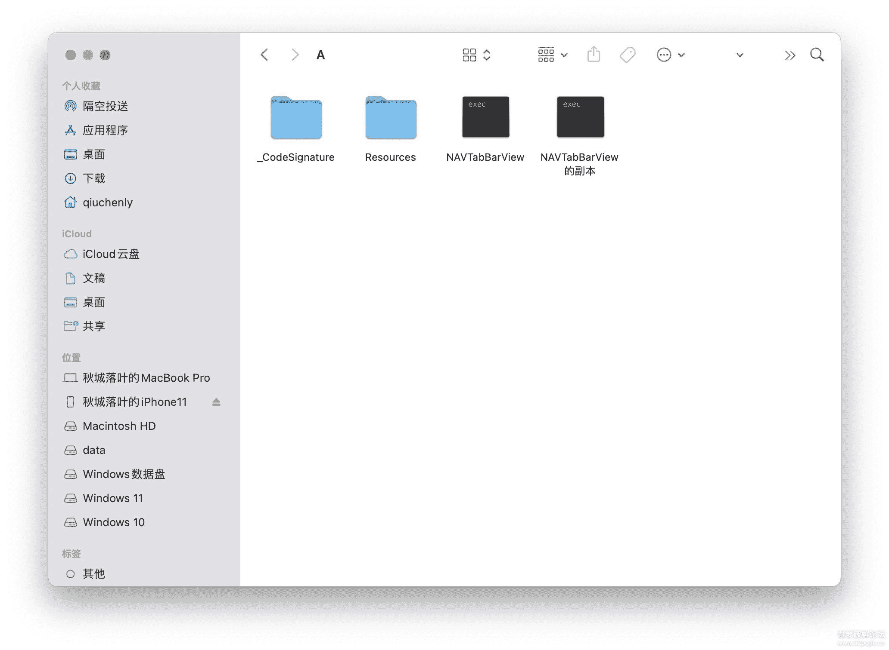

`16794886699745.jpg`（128.86 KB，下载次数：1）

[下载附件](https://www.52pojie.cn/forum.php?mod=attachment&aid=MjYwMDc2OXw2YjZiNzE0YXwxNzkzNTczODg0fDE2ODA4NnwxNzYzMzA5&nothumb=yes)

2023-3-22 22:21 上传

选它没别的原因，就是这个文件只有800KB方便复制，你也不想选个10MB的大文件Copy来Copy去吧？

注入工具和编译后的dylib文件可以查阅我的github，这里就不写了。

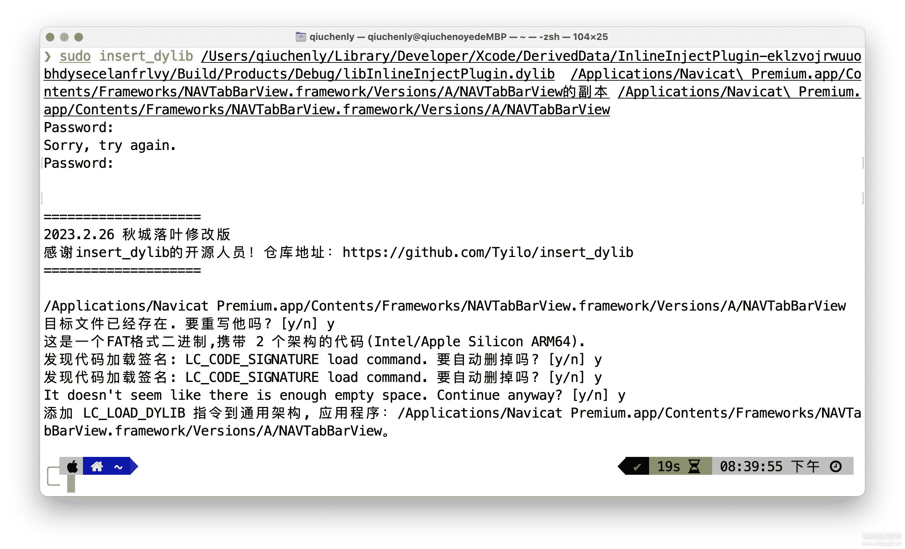

`16794888087527.jpg`（464.28 KB，下载次数：3）

[下载附件](https://www.52pojie.cn/forum.php?mod=attachment&aid=MjYwMDc3MHw2MDE3MDI1YnwxNzkzNTczODg0fDE2ODA4NnwxNzYzMzA5&nothumb=yes)

2023-3-22 22:21 上传

我们直接打开App看看。

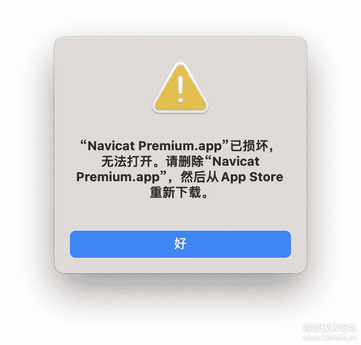

`16794889138274.jpg`（38.57 KB，下载次数：0）

[下载附件](https://www.52pojie.cn/forum.php?mod=attachment&aid=MjYwMDc3MXxhMDZlNTEzNHwxNzkzNTczODg0fDE2ODA4NnwxNzYzMzA5&nothumb=yes)

2023-3-22 22:21 上传

小小的脑袋大大的疑惑，大无语事件发生，集美们！那么这种情况我们不慌，可以看到app实际上是打开了的。这种错误其实是`exit(173)`，也就是告诉macOS用户授权票不匹配或者不存在，也就是说他检测到了app不是你购买过的，没有有效的订阅授权文件。

那么我们怎么去调试他？

很简单，直接`lldb` hook `exit`函数即可。因为我阿妈每天早上六点起来给我充电子烟，所以`exit(173)`是固定写法，不这么写是不会弹出这个提示的。

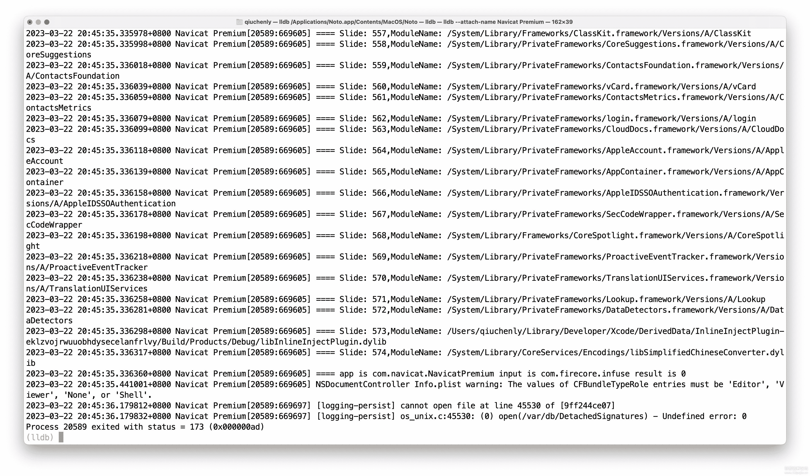

`16794891482082.jpg`（1.34 MB，下载次数：2）

[下载附件](https://www.52pojie.cn/forum.php?mod=attachment&aid=MjYwMDc3MnxiOGY5Y2M3ZHwxNzkzNTczODg0fDE2ODA4NnwxNzYzMzA5&nothumb=yes)

2023-3-22 22:21 上传

我们来看下，直接通过`lldb`可以看出他`exited with status = 173 (0x000000ad)`，说明我所言非虚。

```
Process 20625 stopped
* thread #1, queue = 'com.apple.main-thread', stop reason = breakpoint 7.1
    frame #0: 0x00007ff800bdb1e0 libsystem_kernel.dylib`__exit
libsystem_kernel.dylib`:
->  0x7ff800bdb1e0 :  mov    eax, 0x2000001
    0x7ff800bdb1e5 :  mov    r10, rcx
    0x7ff800bdb1e8 :  syscall 
    0x7ff800bdb1ea : jae    0x7ff800bdb1f4            ; 
Target 0: (Navicat Premium) stopped.
(lldb) bt
* thread #1, queue = 'com.apple.main-thread', stop reason = breakpoint 7.1
  * frame #0: 0x00007ff800bdb1e0 libsystem_kernel.dylib`__exit
    frame #1: 0x00007ff800b0ac13 libsystem_c.dylib`exit + 56
    frame #2: 0x0000000108b70734 libcc-premium.dylib`___lldb_unnamed_symbol81087 + 1448
    frame #3: 0x0000000108676b38 libcc-premium.dylib`___lldb_unnamed_symbol59527 + 24
    frame #4: 0x0000000107a2ea10 libcc-premium.dylib`CCNavicat::setupContext(bool, bool) + 2100
    frame #5: 0x0000000100ab34d1 Navicat Premium`___lldb_unnamed_symbol28793 + 323
    frame #6: 0x00007ff800cce75c CoreFoundation`__CFNOTIFICATIONCENTER_IS_CALLING_OUT_TO_AN_OBSERVER__ + 12
    frame #7: 0x00007ff800d6bb32 CoreFoundation`___CFXRegistrationPost_block_invoke + 49
    frame #8: 0x00007ff800d6bab0 CoreFoundation`_CFXRegistrationPost + 496
    frame #9: 0x00007ff800ca03e8 CoreFoundation`_CFXNotificationPost + 735
    frame #10: 0x00007ff801ade7fe Foundation`-[NSNotificationCenter postNotificationName:object:userInfo:] + 82
    frame #11: 0x00007ff80371985e AppKit`-[NSApplication _postDidFinishNotification] + 305
    frame #12: 0x00007ff8037195ac AppKit`-[NSApplication _sendFinishLaunchingNotification] + 208
    frame #13: 0x00007ff80371717c AppKit`-[NSApplication(NSAppleEventHandling) _handleAEOpenEvent:] + 541
    frame #14: 0x00007ff803716dd0 AppKit`-[NSApplication(NSAppleEventHandling) _handleCoreEvent:withReplyEvent:] + 665
    frame #15: 0x00007ff801b09724 Foundation`-[NSAppleEventManager dispatchRawAppleEvent:withRawReply:handlerRefCon:] + 308
    frame #16: 0x00007ff801b09596 Foundation`_NSAppleEventManagerGenericHandler + 80
    frame #17: 0x00007ff807390470 AE`___lldb_unnamed_symbol826 + 1849
    frame #18: 0x00007ff80738fcda AE`___lldb_unnamed_symbol825 + 34
    frame #19: 0x00007ff80738931f AE`aeProcessAppleEvent + 419
    frame #20: 0x00007ff809997ce2 HIToolbox`AEProcessAppleEvent + 54
    frame #21: 0x00007ff803711402 AppKit`_DPSNextEvent + 2036
    frame #22: 0x00007ff80370f66a AppKit`-[NSApplication(NSEvent) _nextEventMatchingEventMask:untilDate:inMode:dequeue:] + 1394
    frame #23: 0x00007ff803701d19 AppKit`-[NSApplication run] + 586
    frame #24: 0x00007ff8036d5c97 AppKit`NSApplicationMain + 817
    frame #25: 0x00000001009c6562 Navicat Premium`___lldb_unnamed_symbol27130 + 3498
    frame #26: 0x0000000101b3152e dyld`start + 462
(lldb) br s -n '_exit'
```

我们输入`br s -n '_exit'`来设置当App退出时的断点，这样app退出时我们可以让`lldb`接收到堆栈信息。

我们看上面的堆栈，可以看到`libsystem_c.dylib`和`libsystem_kernel.dylib`都不谈了，妥妥的系统库。

但是下面这个内存地址不是以`0x00007ff8`随机化地址开头的函数就有意思了，`0x0000000108b70734`显然是在app的内存空间里，说明了一个问题，这个库是App的。那么我们就需要知道这个库到底搞了什么鬼让他`exit`。我们记下偏移地址`0x0000000108b70734`去查一下。

在查之前我们需要一个概念，Apple有一个技术叫ASLR，随机化虚拟内存启动地址，也就是说，我们要找到偏移需要通过ASLR偏移计算出原始二进制文件的偏移。我们先看一下内存地址模块导出的基本地址：

输入`image list -o -f`回车。

```
(lldb) image list -o -f
[  0] 0x0000000000000000 /Applications/Navicat Premium.app/Contents/MacOS/Navicat Premium
[  1] 0x0000000101b2c000 /usr/lib/dyld
[  2] 0x00000001033e7000 /Applications/Navicat Premium.app/Contents/Frameworks/libmozjs-52.dylib
[  3] 0x0000000107a02000 /Applications/Navicat Premium.app/Contents/Frameworks/libcc-premium.dylib
[  4] 0x0000000101efe000 /Applications/Navicat Premium.app/Contents/Frameworks/libdbdiagram.dylib
[  5] 0x0000000102649000 /Applications/Navicat Premium.app/Contents/Frameworks/libncharts.dylib
[  6] 0x0000000101ce4000 /Applications/Navicat Premium.app/Contents/Frameworks/libcf.dylib
[  7] 0x00000001028e5000 /Applications/Navicat Premium.app/Contents/Frameworks/libdv.dylib
[  8] 0x0000000101df8000 /Applications/Navicat Premium.app/Contents/Frameworks/libvf.dylib
[  9] 0x00000001021e5000 /Applications/Navicat Premium.app/Contents/Frameworks/libsv.dylib
[ 10] 0x000000010217e000 /Applications/Navicat Premium.app/Contents/Frameworks/libstat.dylib
[ 11] 0x0000000102362000 /Applications/Navicat Premium.app/Contents/Frameworks/libssl.1.1.dylib
[ 12] 0x00000001023f6000 /Applications/Navicat Premium.app/Contents/Frameworks/libsqlite3mc.0.dylib
[ 13] 0x0000000102f99000 /Applications/Navicat Premium.app/Contents/Frameworks/libcrypto.1.1.dylib
[ 14] 0x0000000104af3000 /Applications/Navicat Premium.app/Contents/Frameworks/EE.framework/Versions/A/EE
[ 15] 0x0000000102245000 /Applications/Navicat Premium.app/Contents/Frameworks/HexFiend.framework/Versions/A/HexFiend
[ 16] 0x0000000102148000 /Applications/Navicat Premium.app/Contents/Frameworks/FileMonitor.framework/Versions/A/FileMonitor
```


## 地址计算

```
[ 17] 0x0000000103225000 /Applications/Navicat Premium.app/Contents/Frameworks/qb.framework/Versions/A/qb

[ 18] 0x00000001025c6000 /Applications/Navicat Premium.app/Contents/Frameworks/NAVTabBarView.framework/Versions/A/NAVTabBarView
```

我们看下这里起始地址为：

```
[  3] 0x0000000107a02000 /Applications/Navicat Premium.app/Contents/Frameworks/libcc-premium.dylib
```

计算公式为 `0x0000000107a02000 + 文件二进制偏移 = 内存地址偏移0x0000000108b70734`。

所以 `0x108676b38 - 0x0000000107a02000 = 0x116E734`。

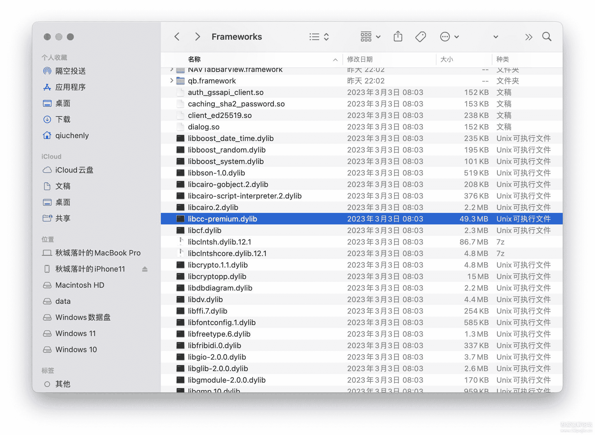

`16794896037816.jpg`（399.77 KB，下载次数：1）

[forum.php?mod=attachment&aid=MjYwMDc3M3xjZjdlOThiM3wxNzkzNTczODg0fDE2ODA4NnwxNzYzMzA5&nothumb=yes](https://www.52pojie.cn/forum.php?mod=attachment&aid=MjYwMDc3M3xjZjdlOThiM3wxNzkzNTczODg0fDE2ODA4NnwxNzYzMzA5&nothumb=yes)

`2023-3-22 22:21 上传`

## Hopper 与 lldb 查看

确实存在，我们用 `hopper` 看下。

直接 `G` 跳转到 `0x116E734` 看一下：

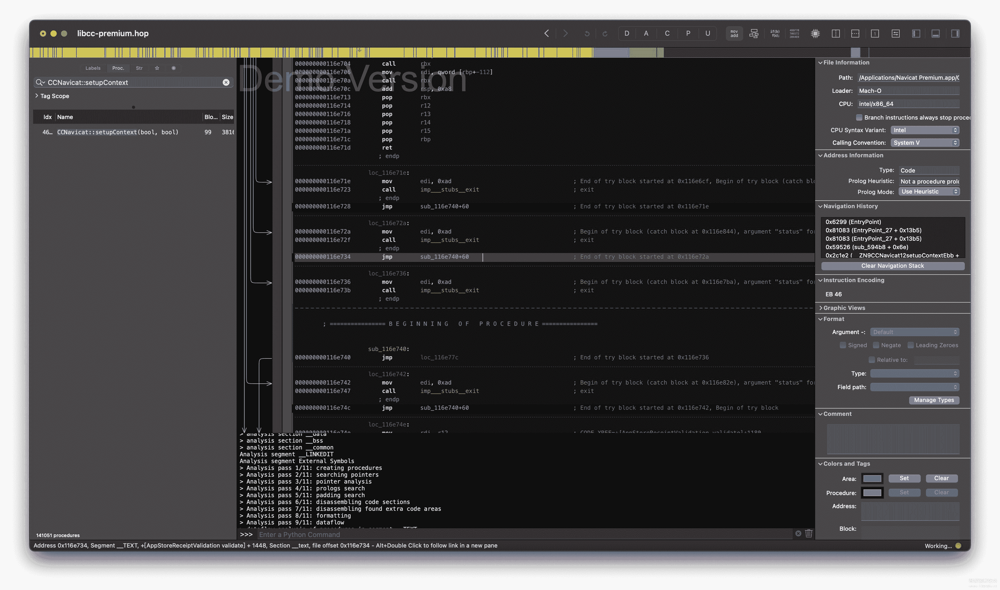

`16794912655677.jpg`（692.12 KB，下载次数：2）

[forum.php?mod=attachment&aid=MjYwMDc3NHw5ODMwNWMwMnwxNzkzNTczODg0fDE2ODA4NnwxNzYzMzA5&nothumb=yes](https://www.52pojie.cn/forum.php?mod=attachment&aid=MjYwMDc3NHw5ODMwNWMwMnwxNzkzNTczODg0fDE2ODA4NnwxNzYzMzA5&nothumb=yes)

`2023-3-22 22:21 上传`

其实我们直接 `lldb` 里面可以看到

```
                     loc_116e71e:
000000000116e71e         mov        edi, 0xad                                   ; End of try block started at 0x116e6cf, Begin of try block (catch block at 0x116e83a), argument "status" for method imp___stubs__exit, CODE XREF=+[AppStoreReceiptValidation validate]+267
000000000116e723         call       imp___stubs__exit                           ; exit
                        ; endp
000000000116e728         jmp        sub_116e740+60                              ; End of try block started at 0x116e71e

                     loc_116e72a:
000000000116e72a         mov        edi, 0xad                                   ; Begin of try block (catch block at 0x116e844), argument "status" for method imp___stubs__exit, CODE XREF=+[AppStoreReceiptValidation validate]+523
000000000116e72f         call       imp___stubs__exit                           ; exit
                        ; endp
000000000116e734         jmp        sub_116e740+60                              ; End of try block started at 0x116e72a

                     loc_116e736:
000000000116e736         mov        edi, 0xad                                   ; Begin of try block (catch block at 0x116e7ba), argument "status" for method imp___stubs__exit, CODE XREF=+[AppStoreReceiptValidation validate]+586
000000000116e73b         call       imp___stubs__exit                           ; exit
                        ; endp
```

`mov edi, 0xad` 就是 `173`，`call exit` 就不谈了，懂得都懂。

## IDA 伪代码与 Hook

`IDA` 看下伪代码：

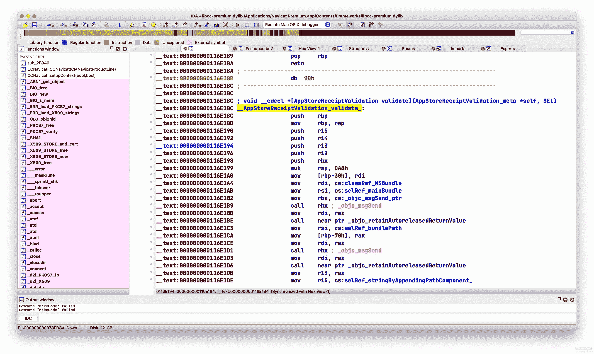

`16794917761708.jpg`（1.02 MB，下载次数：0）

[forum.php?mod=attachment&aid=MjYwMDc3NXxkNDAxYjQxZXwxNzkzNTczODg0fDE2ODA4NnwxNzYzMzA5&nothumb=yes](https://www.52pojie.cn/forum.php?mod=attachment&aid=MjYwMDc3NXxkNDAxYjQxZXwxNzkzNTczODg0fDE2ODA4NnwxNzYzMzA5&nothumb=yes)

`2023-3-22 22:21 上传`

我们发现这个函数中执行了 `exit(173)` 的操作。

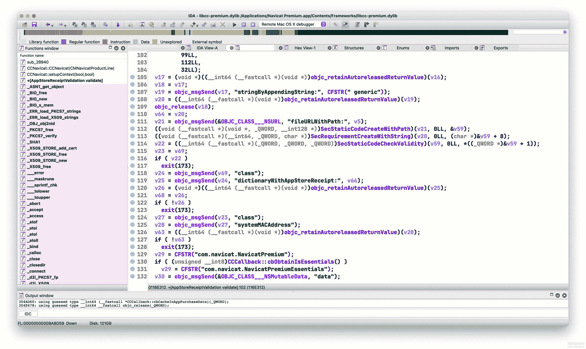

`16794918477494.jpg`（990.48 KB，下载次数：3）

[forum.php?mod=attachment&aid=MjYwMDc3Nnw0Yjg4ZTY1ZHwxNzkzNTczODg0fDE2ODA4NnwxNzYzMzA5&nothumb=yes](https://www.52pojie.cn/forum.php?mod=attachment&aid=MjYwMDc3Nnw0Yjg4ZTY1ZHwxNzkzNTczODg0fDE2ODA4NnwxNzYzMzA5&nothumb=yes)

`2023-3-22 22:21 上传`

稍有不慎就是 `exit(173)`，好狠的手段！欺我风灵月影宗无人！今日我倒要看看，就算我实力不足全盛时期十之二三，你 Navicat 代码混淆就算没有符号表又能奈我何？区区蝼蚁罢了，本座反手堆栈跟踪覆灭之！

话到一半，却又眉头一紧：“这厮竟然无法使用 `xref` 大法查找溯源？事情有些棘手，我却要如何？不如查看堆栈#3看调用方。”

当即长啸一声，回到终端：

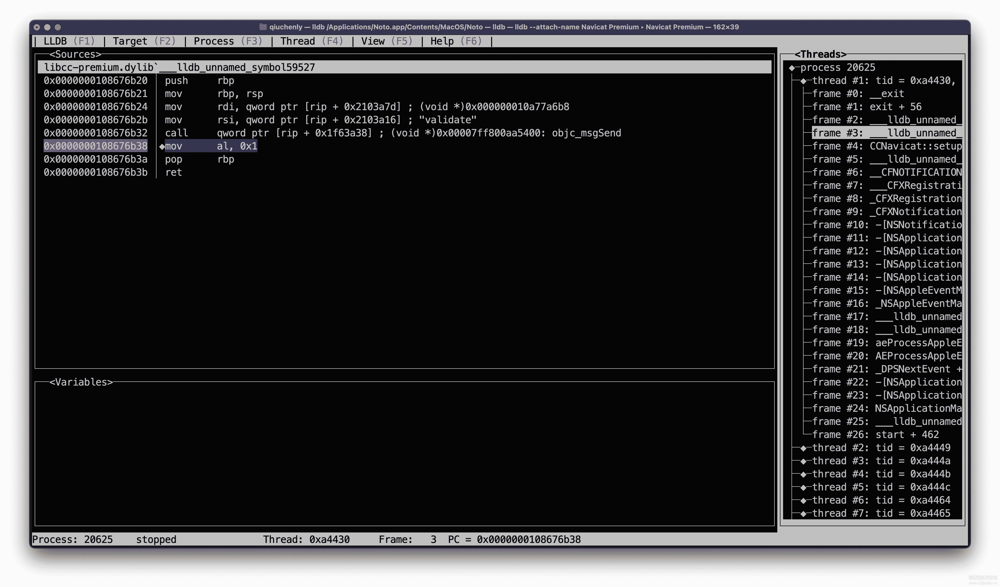

`16794925172169.jpg`（674.77 KB，下载次数：1）

[forum.php?mod=attachment&aid=MjYwMDc3N3xlNjY5ZDJlMHwxNzkzNTczODg0fDE2ODA4NnwxNzYzMzA5&nothumb=yes](https://www.52pojie.cn/forum.php?mod=attachment&aid=MjYwMDc3N3xlNjY5ZDJlMHwxNzkzNTczODg0fDE2ODA4NnwxNzYzMzA5&nothumb=yes)

`2023-3-22 22:21 上传`

按下 `Tab` 键切换到 `Threads`，找到 `#3`。当即便复制 `0x0000000108676b38 - 0x0000000107a02000 = 0xC74B38`，拿到地址后质问 `IDA Pro`，冷笑道：“你可知此地址为何处？我已知晓其中关键，再敢搪塞本座，必要你小命！”

那 `IDA` 惶恐道：

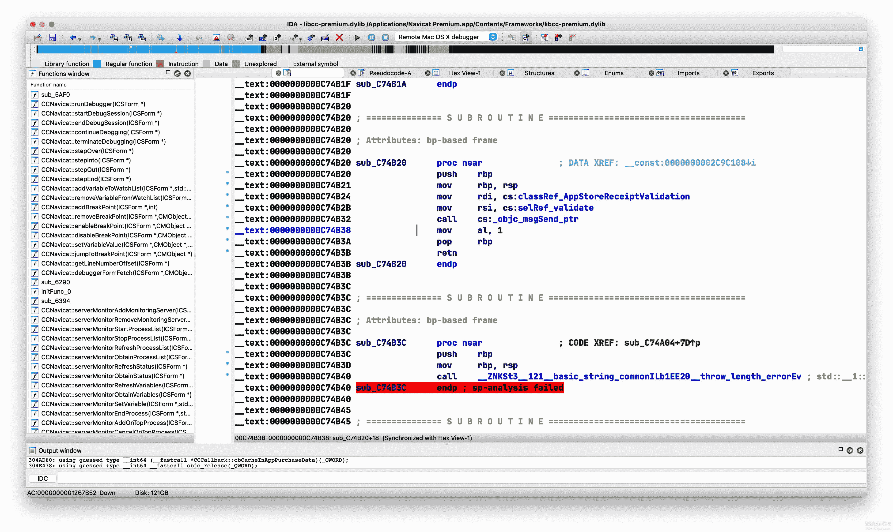

`16794933004868.jpg`（1.14 MB，下载次数：0）

[forum.php?mod=attachment&aid=MjYwMDc3OHxkN2NiOGU0NHwxNzkzNTczODg0fDE2ODA4NnwxNzYzMzA5&nothumb=yes](https://www.52pojie.cn/forum.php?mod=attachment&aid=MjYwMDc3OHxkN2NiOGU0NHwxNzkzNTczODg0fDE2ODA4NnwxNzYzMzA5&nothumb=yes)

`2023-3-22 22:21 上传`

```
char sub_C74B20()

{

  +[AppStoreReceiptValidation validate](&OBJC_CLASS___AppStoreReceiptValidation, "validate");

  return 1;

}
```

原来此乃 Navicat 不知名内存偏移调用方，以指针方式访问内存地址，故不可得到其实际引用。

既然 `+[AppStoreReceiptValidation validate]` 是 `exit(173)` 祸首，那么此人也不必留着，该永绝后患。适时眼中寒芒一闪，表面却淡淡一笑“这次就饶你一条狗命！滚！”

那 Navicat 正兀自暗喜自以为暗桩未被神识检测到，却不料被反手 Hook 掉了要害罩门：

```
    hook(
      getClassMethod("IAPHelper", "- isProductSubscriptionStillValid"),
      (ths, retv) => {
        retv.replace(ptr(1)); //app ProductSubscription仍然有效
      }
    );

    Interceptor.replace(
      new NativeFunction(
        getClassMethod("AppStoreReceiptValidation", "+ validate").target,
        "void",
        []
      ),
      new NativeCallback(
        function () {
          console.log("Hook ptrace Bypass!!!");
        },
        "void",
        []
      )
    );
```

我冷笑一声按下 `F5` 启动 `frida`。

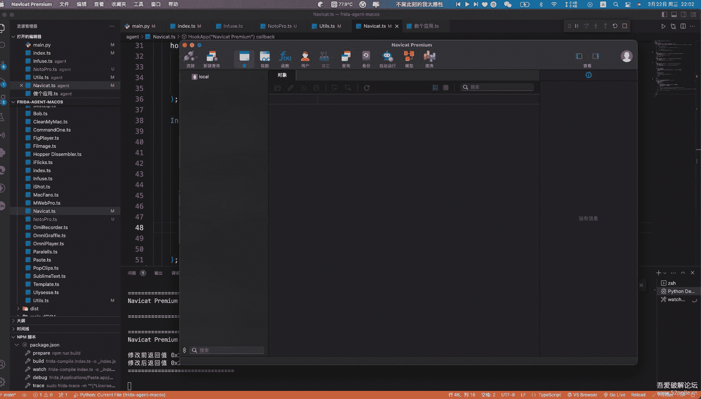

`16794937396788.jpg`（183.18 KB，下载次数：1）

[forum.php?mod=attachment&aid=MjYwMDc3OXw0YmVkN2E5NHwxNzkzNTczODg0fDE2ODA4NnwxNzYzMzA5&nothumb=yes](https://www.52pojie.cn/forum.php?mod=attachment&aid=MjYwMDc3OXw0YmVkN2E5NHwxNzkzNTczODg0fDE2ODA4NnwxNzYzMzA5&nothumb=yes)

`2023-3-22 22:21 上传`

霎时间之间 Navicat 惨叫一声，当场殒命。

“灭你如灭蝼蚁！”

## 4. 收尾

最后将

```
//switchMethod(getMethodStrByCls(@"AppStoreReceiptValidation",@"validate"), getMethod([InlineInjectPlugin class], @selector(validate)));
```

取消注释，替换原始函数，编译后完美启动 Navicat。

阿妈不准我说藏话，但是如果你需要鼓励，那么--我测你码。

由于使用的方法为 `Method Swizzing`，并没有用偏移地址做 `hook`，所以只要 Navicat 不改函数名称不删除符号表，这个 `hook` 代码将一直通杀后续版本。

二进制参考 GitHub：[QiuChenly/MyMacsAppCrack](https://github.com/QiuChenly/MyMacsAppCrack)
