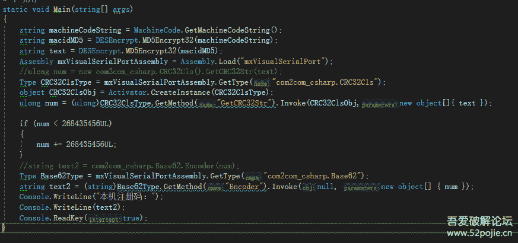
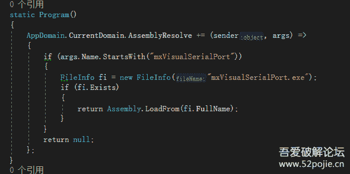

# [.NET逆向] 小白上路之第一次编写注册机

- 原帖：https://www.52pojie.cn/forum.php?mod=viewthread&tid=1763558
- 抓取时间：2026-11-01T22:58:04


这种混淆不是很厉害的，然后没用什么 `RSA`，并且逻辑简单的……可以直接反射……下面借花献佛一下。主要核心逻辑就两段。

```csharp
private void initMachineCode()
{
    string machineCodeString = MachineCode.GetMachineCodeString();
    this.macidMD5 = DESEncrypt.MD5Encrypt32(machineCodeString);
    string text = "MXPORT" + this.macidMD5;
    string text2 = new CRC32Cls().GetCRC32Str(text).ToString("X8");
    this.mxcode = "MXPORT" + this.macidMD5 + text2;
}

private void checkAuth()
{
    if (string.IsNullOrEmpty(this.licenecode))
    {
        this.isAuth = false;
        return;
    }
    string text = DESEncrypt.MD5Encrypt32(this.macidMD5);
    ulong num = new CRC32Cls().GetCRC32Str(text);
    if (num
```

```csharp
// 全局类型:
// 入口点: com2com_csharp.Program.Main
// 架构: AnyCPU (32位优先)
// 运行库: .NET Framework 4.5.2
// 时间戳: 61EE65E7 (2022/1/24 16:40:07)
```

那么直接起个 .NET Framework 4.5.2 相同或以上 .NET 控制台，添加主程序 `exe` 的引用。调试时工作目录指定 `exe` 的目录。核心逻辑一抽，开整！



`1.png`（93.91 KB，下载次数：3）

[附件](https://www.52pojie.cn/forum.php?mod=attachment&aid=MjYwMTMyNnxhMDk0MmUwMnwxNzkzNTczODgxfDE2ODA4NnwxNzYzNTU4&nothumb=yes)

2023-3-24 14:13 上传

然后注释部分是非公共对象，直接用反射构建。避免引用丢失，让它能自己找相关联的文件。



`2.png`（31.99 KB，下载次数：2）

[附件](https://www.52pojie.cn/forum.php?mod=attachment&aid=MjYwMTMyN3xhMzNiMjMzNnwxNzkzNTczODgxfDE2ODA4NnwxNzYzNTU4&nothumb=yes)

2023-3-24 14:09 上传

那一系列运算逻辑直接用程序本身的逻辑。不用额外抄代码了……

以彼之道，还彼之身，简单粗暴有效……

然后成品，以后直接往应用目录一扔就自动生成注册码了……


PS. 字符串加密的部分可以直接拿 `de4dot` 直接解。记住字符串加密函数上面的 Token 值，比如 `0x01010101`。

使用 `de4dot` 的时候加上参数 `--strtyp delegate --strtok 0x01010101`，就可以解码了……处理完后基本明文。

另外就是 `de4dot` 好像是 `DNF` 编译的，所以 `DNF` 的库和 `exe` 能这么玩；.netcore 的好像不能解字符串
