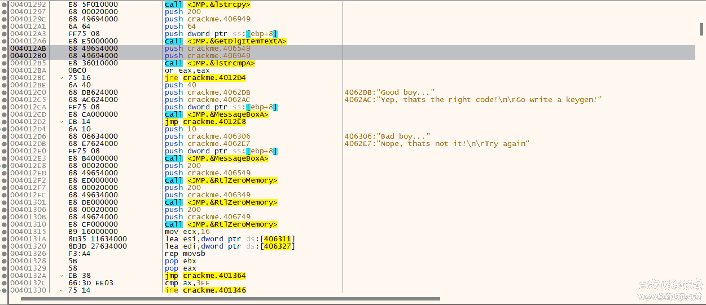
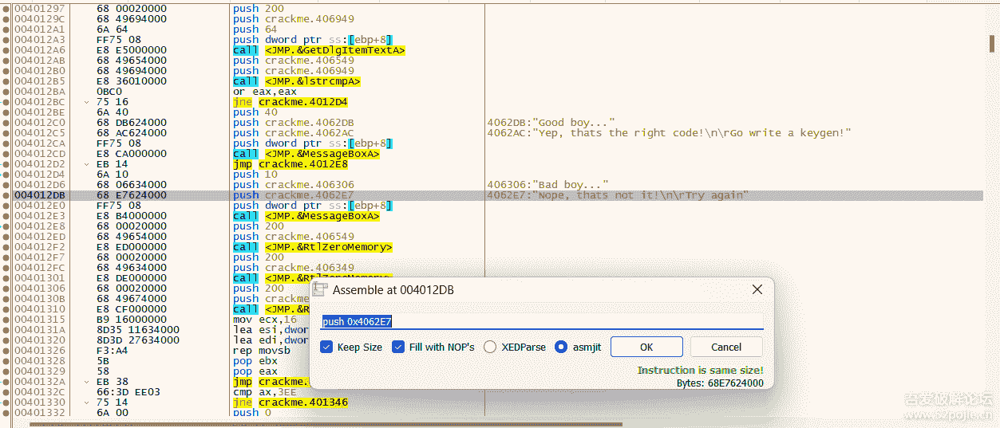
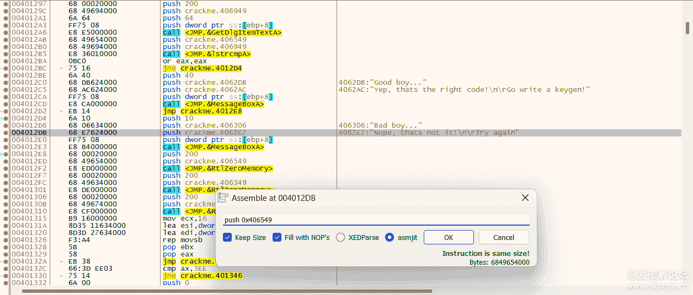
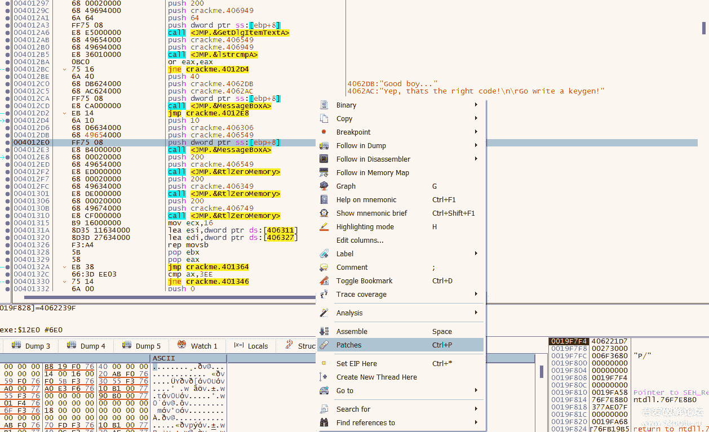
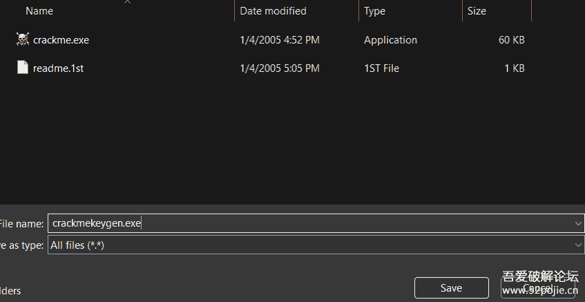
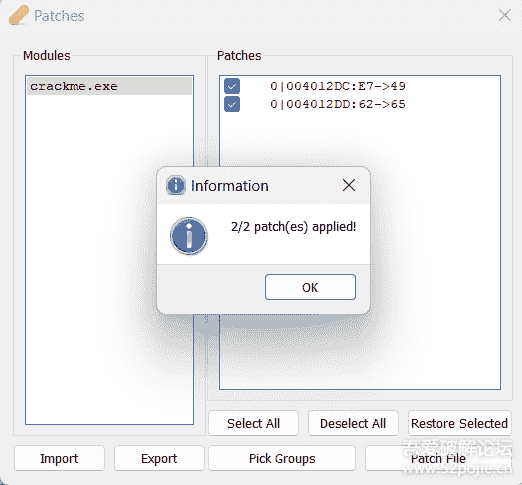
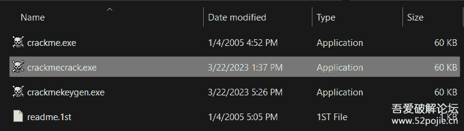
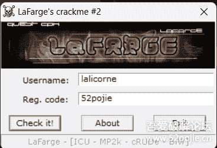
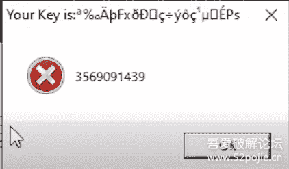

# [原创] 【新手向】在win11系统写一个Lafarge-crackme的keygen

- 原帖: https://www.52pojie.cn/forum.php?mod=viewthread&tid=1764260
- 抓取时间: 2026-11-01T22:57:58

## 前言
上一期跳过验证直接登录的教程传送门：https://www.52pojie.cn/forum.php?mod=viewthread&tid=1763262&page=1#pid46110364

这回我们来完成Keygen挑战（注册码生成器），我们需要和上一期一样的两个文件来完成这个挑战，一个是`crackme`文件，另一个是反汇编的工具（可以使用自己喜欢的软件）

## 资源准备
挑战文件的官网下载链接：https://crackmes.one/crackme/5ab77f5633c5d40ad448c2f2

教程中使用的工具为`x64dbg`，这是一款开源的软件，官方下载地址为：https://x64dbg.com/

百度网盘打包下载链接：

链接：https://pan.baidu.com/s/1JCeCsgjoa0QkMAEtdqqLYw?pwd=52pj

提取码：52pj

## 破解思路
这个挑战需要逆向修改软件的源码，来显示软件内用来对比输入信息的证书（`license`）以登录软件。

破解思路：将程序反编译并且修改源码，最后将正确的注册码通过提示框展示出来。因为我们知道它是将我们输入的证书与它内部正确的证书进行对比校验，所以我们就可以直接把它用于对比的正确凭证在提示框上显示出来。

举个例子方便理解，我们考试需要填答案（用户填写的注册码），考完之后老师要拿正确答案（正确的注册码）来给给我们打分，我们直接把老师的参考答案给显示出来，然后我们抄了得满分（登录成功）。

注意：这边强烈建议使用一个新的`crackme.exe`文件，不然会直接跳过验证直接显示“登录成功”

在上回我们尝试跳过验证直接登录的时候，发现源代码是通过对比记忆点`406549`和`406949`来知道输入的注册码是否正确：

因此我们可以尝试将软件内部用于对比的正确注册码通过提示框打印出来。

问题来了，我本人并不知道我们输入的信息是存在了这两个记忆点中的哪一个里面...所以我这边采用的是笨方法，两个地方挨个试，看哪一个是对的。如果有大佬知道怎么直接判断哪一个记忆点是正确的，麻烦留言告诉我一下 ^V^

## 操作步骤
好的，我们继续快乐的逆向。

因为我们输入的注册码肯定是不对的，所以我们需要在错误的提示框这边把注册码给打印出来：

首先修改`push 0x4062E7`为`push 0x406549`，如果不正确的话我们再尝试改为`push 0x406949`

点击`OK`之后直接关掉上图的窗口，然后右键点击`Patches`或者`Ctrl+P`保存更改：

然后还是自己起一个比较皮的名字作为`Keygen`的名字（有朋友问是不是打开这个新保存的程序，答案是：是的！因为我们修改之后的代码是打包到了这个新的程序）：

反编译界面出现这个提示说明打包成功：

打开刚刚生成的`keygen`程序尝试：

打开之后尝试输入信息：

运气还是比较好的，一次就成功了：

## 总结
总结：一般这种程序内部存在一种检验输入用户名与输入的注册码是否一致的算法，因此输入不同的用户名会产生不同的注册码，通过显示出来的注册码，我们可以在没有修改过的原版`crackme.exe`上进行登录，因此`keygen`可以变相将原软件的正确注册码提供给我们。

这两个教程我写的很详细，并且操作非常简单，强烈推荐新手跟着步骤一步一步做来完成自己的第一个crackme挑战。

破解方法并不止于以上方法，可以自己尝试别的方法完成挑战。
