# [原创] 带壳爆破一个VMP3.X的辅助

- 原帖: <https://www.52pojie.cn/forum.php?mod=viewthread&tid=1765488>
- 抓取时间: 2026-11-01T22:57:51

好久没发帖子了，今天给大家带来VMP壳内爆破的教程，特别适合新手学习

废话不多说，教程开始。

## 第一步还是查下壳：

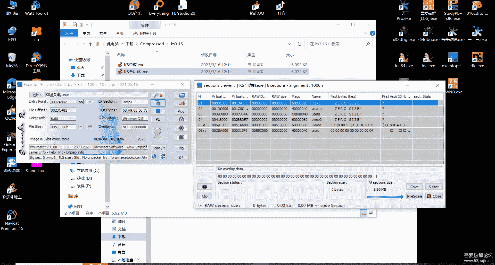

`1.png` (489.26 KB, 下载次数: 3) · 2023-3-27 15:15 上传 · <https://www.52pojie.cn/forum.php?mod=attachment&aid=MjYwMjE5MHw1ZTJlNWQ2NnwxNzkzNTczODY4fDE2ODA4NnwxNzY1NDg4&nothumb=yes>

直接开始爆破，载入OD，让程序跑起来，来到`00401000`处，右键分析-从模块中删除分析

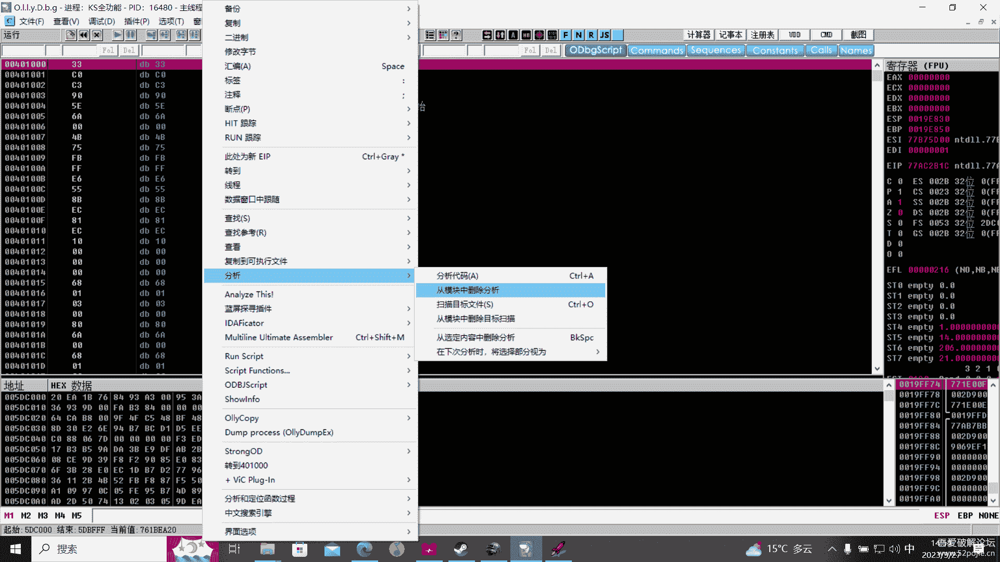

`2.png` (412.43 KB, 下载次数: 2) · 2023-3-27 15:17 上传 · <https://www.52pojie.cn/forum.php?mod=attachment&aid=MjYwMjE5MXw2N2MwOTYzZXwxNzkzNTczODY4fDE2ODA4NnwxNzY1NDg4&nothumb=yes>

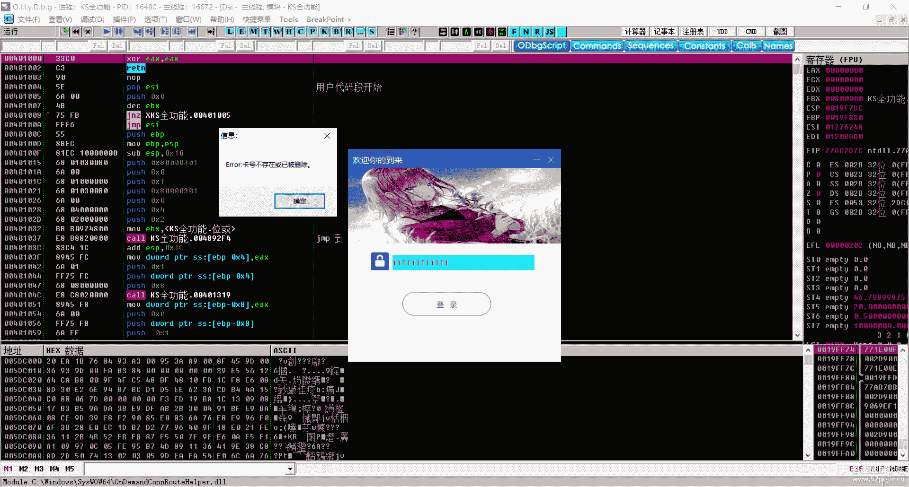

`3.png` (481.82 KB, 下载次数: 3) · 2023-3-27 15:17 上传 · <https://www.52pojie.cn/forum.php?mod=attachment&aid=MjYwMjE5MnxhNmE4NjljM3wxNzkzNTczODY4fDE2ODA4NnwxNzY1NDg4&nothumb=yes>

输入假码点登录 弹出一个信息框，然后下一个信息框的断点，一般是`MessageBoxA`

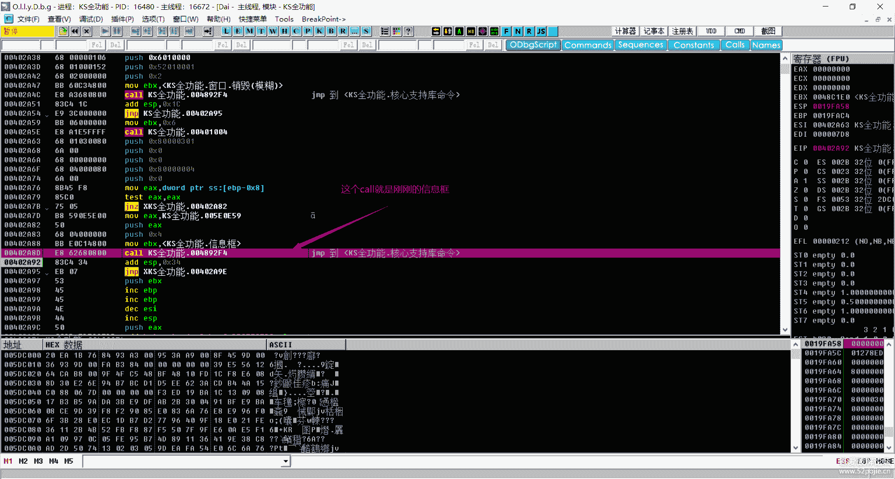

`5.png` (362.99 KB, 下载次数: 2) · 2023-3-27 15:17 上传 · <https://www.52pojie.cn/forum.php?mod=attachment&aid=MjYwMjE5NHxmNDQyMzE4YnwxNzkzNTczODY4fDE2ODA4NnwxNzY1NDg4&nothumb=yes>

找到信息框的`call`，往上找跳转，看看有没有能跳过它的

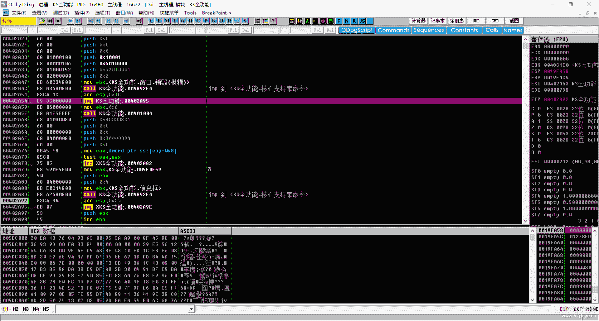

`6.png` (359.58 KB, 下载次数: 2) · 2023-3-27 15:17 上传 · <https://www.52pojie.cn/forum.php?mod=attachment&aid=MjYwMjE5NXxkYjRiZGNhZnwxNzkzNTczODY4fDE2ODA4NnwxNzY1NDg4&nothumb=yes>

就在它上面就有一个`jmp`跳过了它，因为`jmp`是无条件跳转，那么上面肯定有跳转跳到了它的下面

我们往上找找看

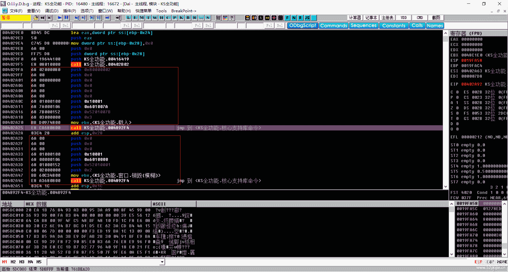

`7.png` (356.37 KB, 下载次数: 1) · 2023-3-27 15:17 上传 · <https://www.52pojie.cn/forum.php?mod=attachment&aid=MjYwMjE5Nnw4MTBkMjhlM3wxNzkzNTczODY4fDE2ODA4NnwxNzY1NDg4&nothumb=yes>

可以看到它上面已经出现了`push`窗口的特征了，我们再往上找

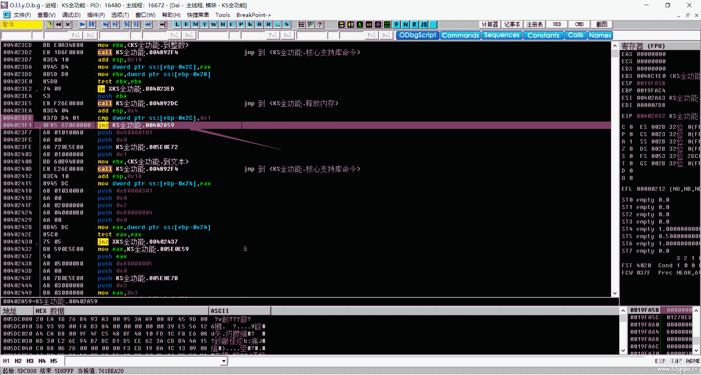

`9.png` (368.44 KB, 下载次数: 1) · 2023-3-27 15:17 上传 · <https://www.52pojie.cn/forum.php?mod=attachment&aid=MjYwMjE5OHxiMWJhODU5YnwxNzkzNTczODY4fDE2ODA4NnwxNzY1NDg4&nothumb=yes>

就是这个`jnz`跳到了`jmp`下面，直接`nop`掉

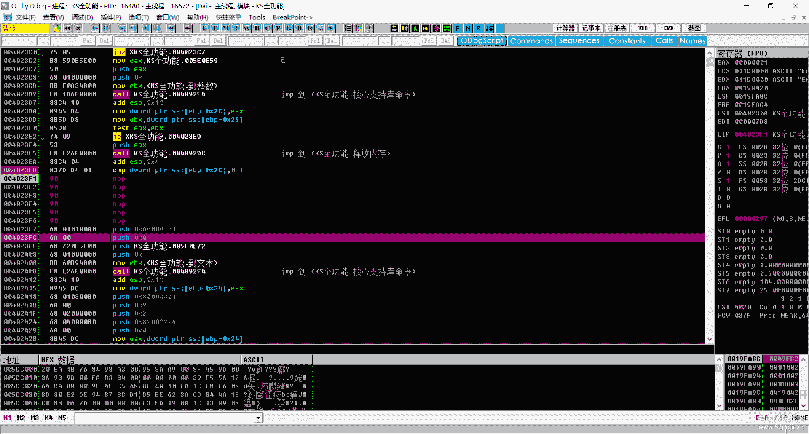

`10.png` (345.48 KB, 下载次数: 1) · 2023-3-27 15:17 上传 · <https://www.52pojie.cn/forum.php?mod=attachment&aid=MjYwMjE5OXwwYzI2NWM5YXwxNzkzNTczODY4fDE2ODA4NnwxNzY1NDg4&nothumb=yes>

再运行一遍

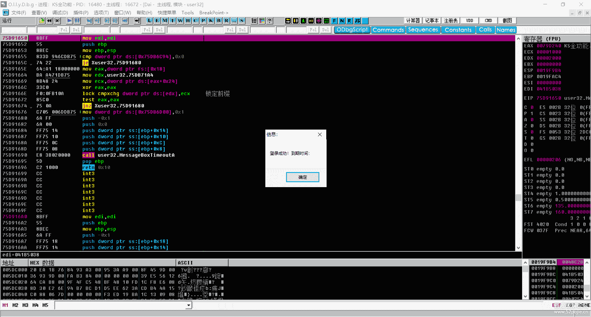

`11.png` (320.5 KB, 下载次数: 2) · 2023-3-27 15:17 上传 · <https://www.52pojie.cn/forum.php?mod=attachment&aid=MjYwMjIwMHw2ZjE0MjFkOXwxNzkzNTczODY4fDE2ODA4NnwxNzY1NDg4&nothumb=yes>

弹出了登录成功的信息框，我们继续单步走走看

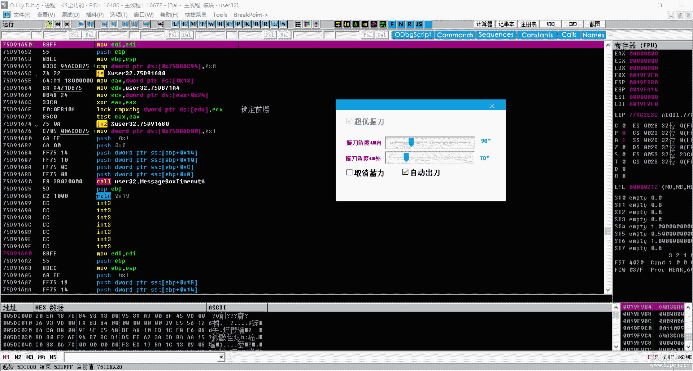

`13.png` (326.52 KB, 下载次数: 2) · 2023-3-27 15:17 上传 · <https://www.52pojie.cn/forum.php?mod=attachment&aid=MjYwMjIwMnw2OTJlNTgxNXwxNzkzNTczODY4fDE2ODA4NnwxNzY1NDg4&nothumb=yes>

此时功能窗口已经出来了，这个软件没有暗桩，作者也不怎么会用VMP，到这里就爆破成功了

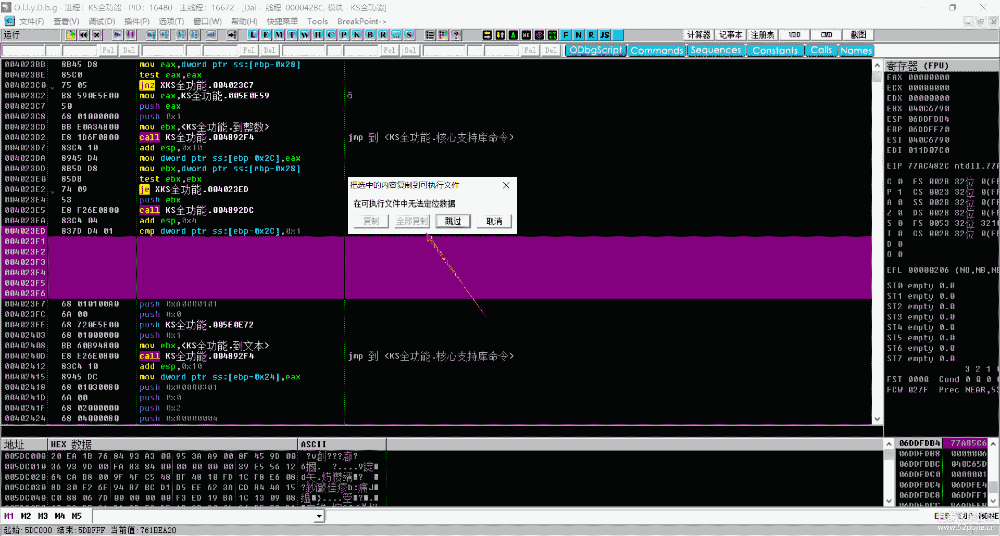

`14.png` (353.46 KB, 下载次数: 2) · 2023-3-27 15:17 上传 · <https://www.52pojie.cn/forum.php?mod=attachment&aid=MjYwMjIwM3wzOGEyNDc0M3wxNzkzNTczODY4fDE2ODA4NnwxNzY1NDg4&nothumb=yes>

但是保存不了怎么办呢？打个补丁就好了，我用的是樱花补丁工具（论坛有）

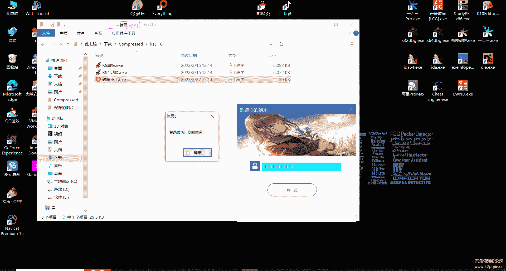

`15.png` (513.94 KB, 下载次数: 2) · 2023-3-27 15:17 上传 · <https://www.52pojie.cn/forum.php?mod=attachment&aid=MjYwMjIwNHw5ZTFmYWVlZnwxNzkzNTczODY4fDE2ODA4NnwxNzY1NDg4&nothumb=yes>

欧克，完事！

最后附上蓝奏链接：<https://wwai.lanzouy.com/im7C00r887bc>

各位不要吝啬自己的CB！！！
