# [.NET逆向] 某.net组件库 注册码逆向分析

- 原帖: https://www.52pojie.cn/forum.php?mod=viewthread&tid=1766183
- 抓取时间: 2026-11-01T22:57:46

## 前情提要

在摸鱼时翻nuget，发现有个 组件库 ，组件还不少，感觉可以分析一波。

PS.发帖的时候 用MD 图片打算先占位，结果直接拦截，内容全丢了，导致重写了一次...

实惨！！！QAQ{:301_972:}

## 受害者 介绍

```
aHR0cHM6Ly93d3cucmViZXgubmV0L3RvdGFsLXBhY2sv
```

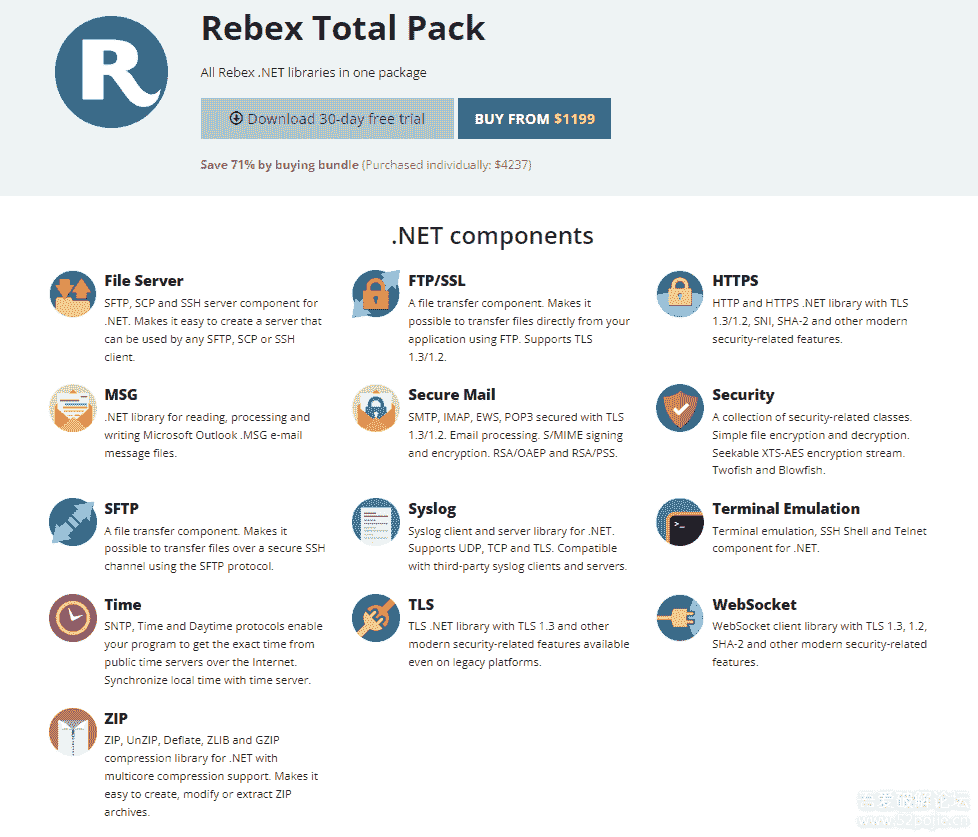

0.png (128.24 KB, 下载次数: 0)

[href="forum.php?mod=attachment&aid=MjYwMjY5OXxmMTY3ZTZmOXwxNzkzNTczODYzfDE2ODA4NnwxNzY2MTgz&nothumb=yes" target="_blank"](https://www.52pojie.cn/forum.php?mod=attachment&aid=MjYwMjY5OXxmMTY3ZTZmOXwxNzkzNTczODYzfDE2ODA4NnwxNzY2MTgz&nothumb=yes)

2023-3-28 21:18 上传

## 准备工作

```
//Rebex.Licensing.Key = RebexPatch.GetLicense();

using (var client = new Rebex.Net.Sftp())

{

    // connect and log in

    client.Connect("127.0.0.1",2222);

    client.Login("tester", "password");

    // download a file

    SftpItemCollection list = client.GetList();

}
```

## 分析

然后没加Key 跑起来直接提示异常。

临时Key 可以在 下面地址申请。（好感+1

```
aHR0cHM6Ly93d3cucmViZXgubmV0L3N1cHBvcnQvdHJpYWwv
```

那么来看看它都干了啥吧。

首先当然是扔 dnspy 里面 看看

定位点是

```
Rebex.Licensing.Key
```

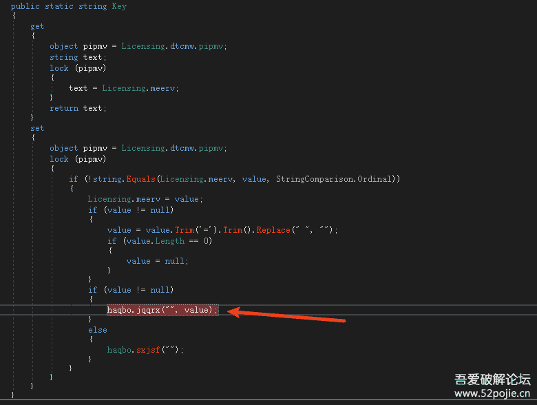

1.png (21.51 KB, 下载次数: 0)

[href="forum.php?mod=attachment&aid=MjYwMjY4MXwwOTM2NTMzNXwxNzkzNTczODYzfDE2ODA4NnwxNzY2MTgz&nothumb=yes" target="_blank"](https://www.52pojie.cn/forum.php?mod=attachment&aid=MjYwMjY4MXwwOTM2NTMzNXwxNzkzNTczODYzfDE2ODA4NnwxNzY2MTgz&nothumb=yes)

2023-3-28 20:22 上传

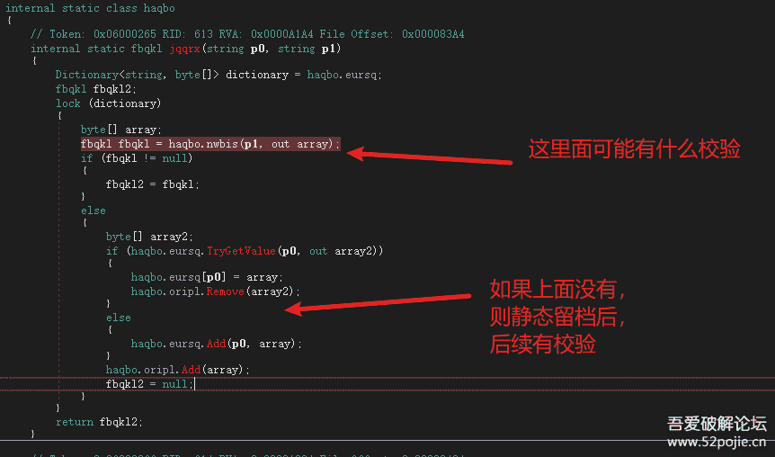

2.png (38.96 KB, 下载次数: 0)

[href="forum.php?mod=attachment&aid=MjYwMjY4MnwzNTc2NDZlYnwxNzkzNTczODYzfDE2ODA4NnwxNzY2MTgz&nothumb=yes" target="_blank"](https://www.52pojie.cn/forum.php?mod=attachment&aid=MjYwMjY4MnwzNTc2NDZlYnwxNzkzNTczODYzfDE2ODA4NnwxNzY2MTgz&nothumb=yes)

2023-3-28 20:23 上传

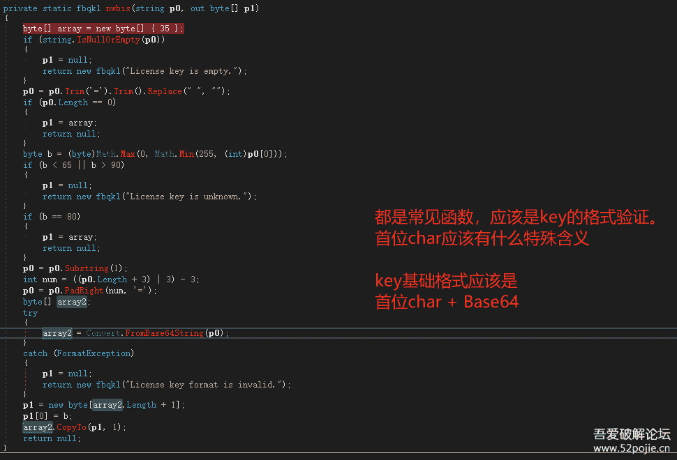

3.png (51.44 KB, 下载次数: 0)

[href="forum.php?mod=attachment&aid=MjYwMjY4M3wxM2U1Y2Q4N3wxNzkzNTczODYzfDE2ODA4NnwxNzY2MTgz&nothumb=yes" target="_blank"](https://www.52pojie.cn/forum.php?mod=attachment&aid=MjYwMjY4M3wxM2U1Y2Q4N3wxNzkzNTczODYzfDE2ODA4NnwxNzY2MTgz&nothumb=yes)

2023-3-28 20:23 上传

一般用到静态类和静态字段的话，鉴权一般也会放在对应的类里面。

所以简单看了下这个类`haqbo`

发现了两个可疑的函数，然后查查他们的调用链

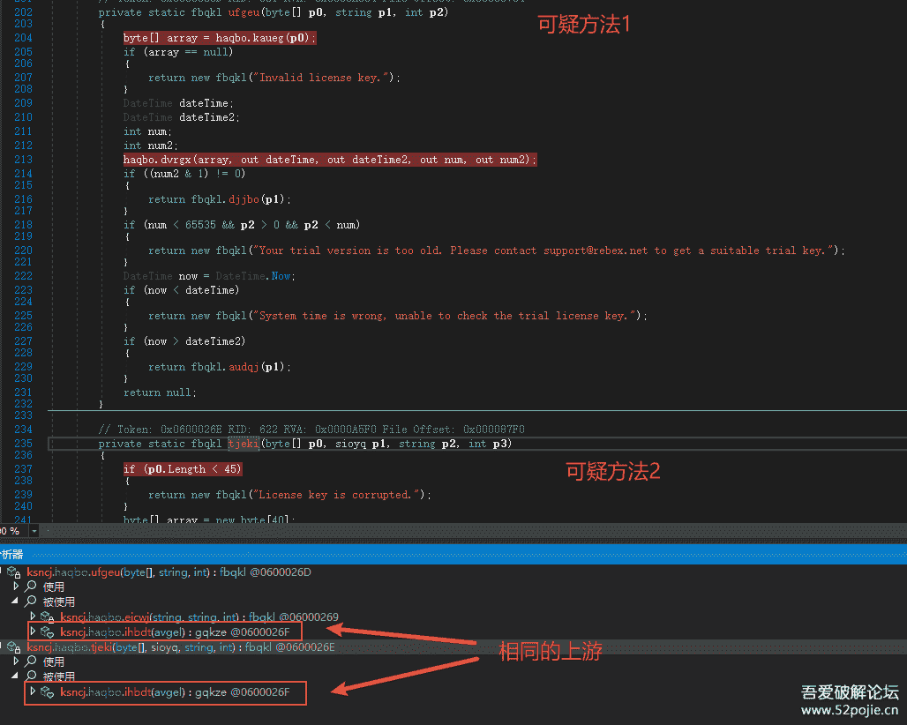

4.png (68.05 KB, 下载次数: 0)

[href="forum.php?mod=attachment&aid=MjYwMjY4NHw3ZjJiN2MxYnwxNzkzNTczODYzfDE2ODA4NnwxNzY2MTgz&nothumb=yes" target="_blank"](https://www.52pojie.cn/forum.php?mod=attachment&aid=MjYwMjY4NHw3ZjJiN2MxYnwxNzkzNTczODYzfDE2ODA4NnwxNzY2MTgz&nothumb=yes)

2023-3-28 20:23 上传

拥有相同的调用链

那么进去就看看

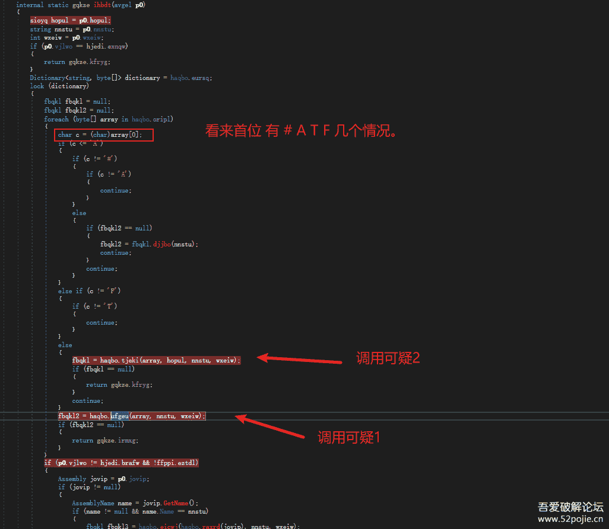

5.png (113.93 KB, 下载次数: 0)

[href="forum.php?mod=attachment&aid=MjYwMjY4NXw0MTYyMGU2ZXwxNzkzNTczODYzfDE2ODA4NnwxNzY2MTgz&nothumb=yes" target="_blank"](https://www.52pojie.cn/forum.php?mod=attachment&aid=MjYwMjY4NXw0MTYyMGU2ZXwxNzkzNTczODYzfDE2ODA4NnwxNzY2MTgz&nothumb=yes)

2023-3-28 20:23 上传

里面返回的是一个枚举，有两个值，然后 优化下函数逻辑后可知。

```
internal static gqkze ihbdt(avgel p0)
{
  sioyq hopul = p0.hopul;
  string nnstu = p0.nnstu;
  int wxeiw = p0.wxeiw;
  if (p0.vjlwo == hjedi.exnqw)
    return gqkze.kfryg;
  Dictionary eursq = haqbo.eursq;
  bool lockTaken = false;
  try
  {
    Monitor.Enter((object) eursq, ref lockTaken);
    fbqkl fbqkl1 = (fbqkl) null;
    fbqkl fbqkl2 = (fbqkl) null;
    foreach (byte[] p0_1 in haqbo.oripl)
    {
      switch ((char) p0_1[0])
      {
        case '#':
          if (fbqkl2 == null)
          {
            fbqkl2 = fbqkl.djjbo(nnstu);
            continue;
          }
          continue;
        case 'A':
        case 'T':
          fbqkl2 = haqbo.ufgeu(p0_1, nnstu, wxeiw);
          if (fbqkl2 == null)
            return gqkze.irmxg;
          continue;
        case 'F':
          fbqkl1 = haqbo.tjeki(p0_1, hopul, nnstu, wxeiw);
          if (fbqkl1 == null)
            return gqkze.kfryg;
          continue;
        default:
          continue;
      }
    }
    if (p0.vjlwo != hjedi.brafw && !ffppi.eztdl)
    {
      Assembly jovip = p0.jovip;
      if (jovip != (Assembly) null)
      {
        AssemblyName name = jovip.GetName();
        if (name != null && name.Name == nnstu)
        {
          fbqkl fbqkl3 = haqbo.eicwj(haqbo.raxrd(jovip), nnstu, wxeiw);
          if (fbqkl3 == null)
            return gqkze.irmxg;
          fbqkl2 = fbqkl2 ?? fbqkl3;
        }
      }
    }
    throw (fbqkl1 ?? fbqkl2) ?? fbqkl.djjbo(nnstu);
  }
  finally
  {
    if (lockTaken)
      Monitor.Exit((object) eursq);
  }
}

internal enum gqkze
{
    // Token: 0x04000074 RID: 116
    kfryg, //prod
    // Token: 0x04000075 RID: 117
    irmxg  //trial
}
```

我们可以直接在这个类 return `gqkze.kfryg`!

yeah！搞定收工！（bushi

继续分析...

其中有 `fbqkl.djjbo` 和 `fbqkl.audqj`

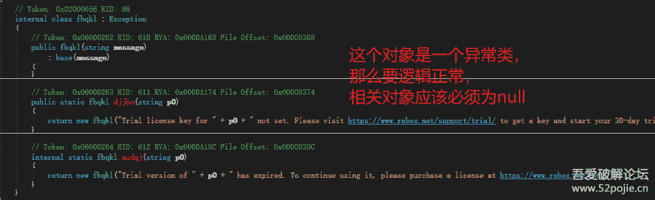

6.png (68.8 KB, 下载次数: 0)

[href="forum.php?mod=attachment&aid=MjYwMjY4NnxlMTE4MzVkM3wxNzkzNTczODYzfDE2ODA4NnwxNzY2MTgz&nothumb=yes" target="_blank"](https://www.52pojie.cn/forum.php?mod=attachment&aid=MjYwMjY4NnxlMTE4MzVkM3wxNzkzNTczODYzfDE2ODA4NnwxNzY2MTgz&nothumb=yes)

2023-3-28 20:23 上传

可知 `fbqkl` 类 是个异常类 所以后续可以忽略。

我们先瞅瞅 T 和 A 的逻辑。

```
private static void dvrgx(byte[] p0, out DateTime p1, out DateTime p2, out int p3, out int p4)

{

    int num = (int)p0[0] * 256 + (int)p0[1];

    p3 = (int)p0[2] * 256 + (int)p0[3];

    p4 = (int)p0[4];

    p2 = new DateTime(2010, 12, 31).AddDays((double)num);

    p1 = p2.AddDays(-64.0);

    //这里给了两个时间， 其中有个 -64天

    //p2=trial 到期时间

    //p1=trial - 64天

}

//p0 trialKey

//p1 程序集名

//p2 程序集版号

private static fbqkl ufgeu(byte[] p0, string p1, int p2)

{

    byte[] array = haqbo.kaueg(p0); // 下面函数 对trialKey 进行了一个处理

    if (array == null)

    {

        return new fbqkl("Invalid license key.");

    }

    DateTime dateTime;

    DateTime dateTime2;

    int num;

    int num2;

    haqbo.dvrgx(array, out dateTime, out dateTime2, out num, out num2);//处理完的数据 在上面 进行关键值提取

    if ((num2 & 1) != 0)

    {

        return fbqkl.djjbo(p1);//异常

    }

    if (num  0 && p2  dateTime2)

    {

        //异常

        return fbqkl.audqj(p1);  //这里trial到期

    }

    return null;

}

private static byte[] kaueg(byte[] p0)

{

    RSAParameters rsaparameters = default(RSAParameters);

    rsaparameters.Modulus = new byte[]

    {

        182, 28, 156, 84, 172, 217, 205, 220, 65, 15,

        164, 101, 241, 26, 18, 244, 193, 44, 214, 186,

        203, 99, 154, 131, 134, 199, 190, 107, 233, 99,

        126, 147

    };

    rsaparameters.Exponent = new byte[] { 1, 0, 1 };

    RSAManaged rsamanaged = new RSAManaged(true);

    rsamanaged.ImportParameters(rsaparameters);

    byte[] array = new byte[p0.Length - 1];

    Array.Copy(p0, 1, array, 0, array.Length);

    byte[] array2;

    try

    {

        //说实话 这里为什么要用加密函数？？？ 这套trial 的逻辑 我反而没看懂

        //但是这里不是系统库，可能重写了什么RSA的逻辑，不过这不是这次的重点不深究了

        array2 = rsamanaged.EncryptValue(array); 

        array2 = RSAManaged.tclma(array2, 7, true);

    }

    catch (CryptographicException)

    {

        array2 = null;

    }

    return array2;

}
```

还是回到 F 的吧...


# 逆向分析笔记

## 入口函数 `tjeki`
```csharp
//p0 key 字节数组
//p1 鉴权枚举
//p2 程序集名
//p3 程序集版本
private static fbqkl tjeki(byte[] p0, sioyq p1, string p2, int p3)
{
    //这里知道 字节数组 长度要大于 45
    if (p0.Length
```
有个明显的 `DSAManaged` 应该是用到一些 `DSA` 的逻辑。

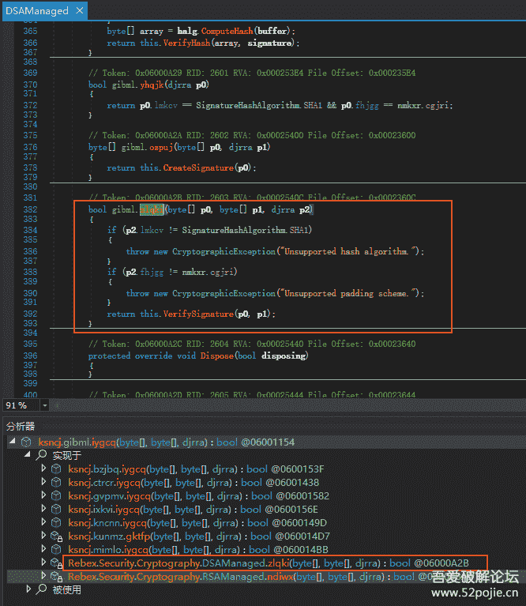

7.png (129.56 KB, 下载次数: 0)

[href="forum.php?mod=attachment&aid=MjYwMjY4N3wyZTE5ZmY0OXwxNzkzNTczODYzfDE2ODA4NnwxNzY2MTgz&nothumb=yes" target="_blank"](https://www.52pojie.cn/forum.php?mod=attachment&aid=MjYwMjY4N3wyZTE5ZmY0OXwxNzkzNTczODYzfDE2ODA4NnwxNzY2MTgz&nothumb=yes)

2023-3-28 20:23 上传

分析一下 发现 接口实现挺多，但是总之应该 `DSA` 的鉴权。

先跳过，继续分析。。。。

## License 解析类 `jveps`
这里有个 `jveps` 类用来解析 `license` 的真实数据。

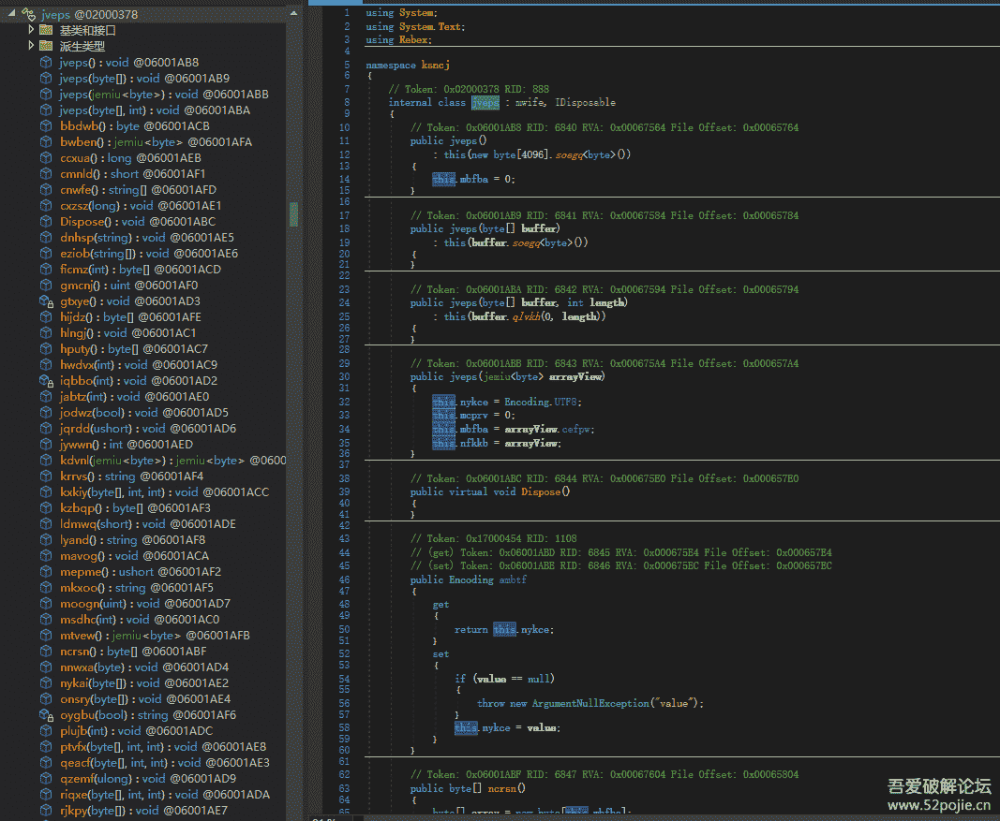

8.png (248.31 KB, 下载次数: 0)

[href="forum.php?mod=attachment&aid=MjYwMjY4OHwyMWZiYTY5MXwxNzkzNTczODYzfDE2ODA4NnwxNzY2MTgz&nothumb=yes" target="_blank"](https://www.52pojie.cn/forum.php?mod=attachment&aid=MjYwMjY4OHwyMWZiYTY5MXwxNzkzNTczODYzfDE2ODA4NnwxNzY2MTgz&nothumb=yes)

2023-3-28 20:23 上传

其中用到的几个函数

```csharp
public uint wsbya()
{
    this.kxkiy(this.kzdmt, 0, 4);
    if (BitConverter.IsLittleEndian)
    {
        Array.Reverse(this.kzdmt, 0, 4);
    }
    return BitConverter.ToUInt32(this.kzdmt, 0);
}
public int jywwn()
{
    this.kxkiy(this.kzdmt, 0, 4);
    if (BitConverter.IsLittleEndian)
    {
        Array.Reverse(this.kzdmt, 0, 4);
    }
    return BitConverter.ToInt32(this.kzdmt, 0);
}
public byte bbdwb()
{
    if (this.mcprv >= this.mbfba)
    {
        throw new fyvfn("Not enough data available.");
    }
    byte b = this.nfkkb[this.mcprv];
    this.mcprv++;
    return b;
}
public ushort mepme()
{
    this.kxkiy(this.kzdmt, 0, 2);
    if (BitConverter.IsLittleEndian)
    {
        Array.Reverse(this.kzdmt, 0, 2);
    }
    return BitConverter.ToUInt16(this.kzdmt, 0);
}
```
直觉上来说就是自制的字节流处理类。类似 `ByteArray` `BinaryReader` 什么的。

### 逆推伪代码
```
var br = new BinaryReader();
br.ReadUInt32();
while (br.BaseStream.Position
```
其中我们能知道

`num2` 为 1或2

`num3` 越大越好

那么这个 `num` 是什么呢？

继续看

## 权限枚举

```csharp
[Flags]
internal enum sioyq
{
    // Token: 0x04000054 RID: 84
    rcuhg = 1,
    // Token: 0x04000055 RID: 85
    fibxo = 2,
    // Token: 0x04000056 RID: 86
    odpil = 4,
    // Token: 0x04000057 RID: 87
    ztmcw = 8,
    // Token: 0x04000058 RID: 88
    iuqnd = 16,
    // Token: 0x04000059 RID: 89
    nyqjp = 32,
    // Token: 0x0400005A RID: 90
    xsxcx = 64,
    // Token: 0x0400005B RID: 91
    gzzvp = 128,
    // Token: 0x0400005C RID: 92
    tvtws = 256,
    // Token: 0x0400005D RID: 93
    jalwj = 512,
    // Token: 0x0400005E RID: 94
    gnjbt = 1024,
    // Token: 0x0400005F RID: 95
    nfklw = 2048,
    // Token: 0x04000060 RID: 96
    nquoh = 4096,
    // Token: 0x04000061 RID: 97
    cocit = 8192,
    // Token: 0x04000062 RID: 98
    tcmnt = 16384,
    // Token: 0x04000063 RID: 99
    mbwum = 65536,
    // Token: 0x04000064 RID: 100
    ltklj = 131072,
    // Token: 0x04000065 RID: 101
    ejqlp = 262144,
    // Token: 0x04000066 RID: 102
    icusp = 524288,
    // Token: 0x04000067 RID: 103
    bvrug = 1048576,
    // Token: 0x04000068 RID: 104
    udpdo = 2097152,
    // Token: 0x04000069 RID: 105
    eynsu = 4194304,
    // Token: 0x0400006A RID: 106
    jncra = 8388608,
    // Token: 0x0400006B RID: 107
    evzga = 33554432
}
internal enum vshmk
{
    // Token: 0x0400007B RID: 123
    iwkpg = 1,
    // Token: 0x0400007C RID: 124
    cxbcm,
    // Token: 0x0400007D RID: 125
    olrse = 4,
    // Token: 0x0400007E RID: 126
    qnxpz = 8,
    // Token: 0x0400007F RID: 127
    oglpz = 16,
    // Token: 0x04000080 RID: 128
    oelig = 32,
    // Token: 0x04000081 RID: 129
    fsikk = 64,
    // Token: 0x04000082 RID: 130
    awqdf = 128,
    // Token: 0x04000083 RID: 131
    zugrh = 256,
    // Token: 0x04000084 RID: 132
    ojtis = 512,
    // Token: 0x04000085 RID: 133
    yckct = 1024,
    // Token: 0x04000086 RID: 134
    lacls = 2048,
    // Token: 0x04000087 RID: 135
    yjmkv = 4096,
    // Token: 0x04000088 RID: 136
    mnbep = 15728816,
    // Token: 0x04000089 RID: 137
    xcpuh = 251658296,
    // Token: 0x0400008A RID: 138
    brzmp = 2147483647
}
```
两个枚举 还有一个 `[Flags]`

配上函数

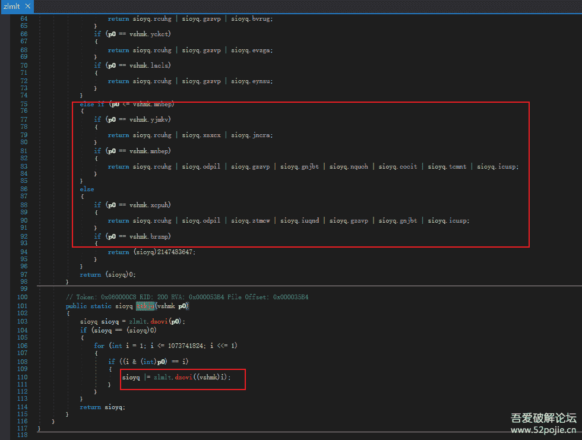

9.png (105.59 KB, 下载次数: 0)

[href="forum.php?mod=attachment&aid=MjYwMjY4OXwxZDZlNDJjOHwxNzkzNTczODYzfDE2ODA4NnwxNzY2MTgz&nothumb=yes" target="_blank"](https://www.52pojie.cn/forum.php?mod=attachment&aid=MjYwMjY4OXwxZDZlNDJjOHwxNzkzNTczODYzfDE2ODA4NnwxNzY2MTgz&nothumb=yes)

2023-3-28 20:23 上传

就是拼装权限了，那么能不能一个值就拿到最大权限呢？

写个demo 试试。。。

```csharp
//evzga = 33554432
var foo = (2147483647 & 33554432) == 33554432;
//foo = true
```
那么三个值就都有了。

我们可以自己尝试去加，如果类自身包含写的逻辑也可以用 `反射` 去实现。

这里推荐反射，以彼之道还至彼身。

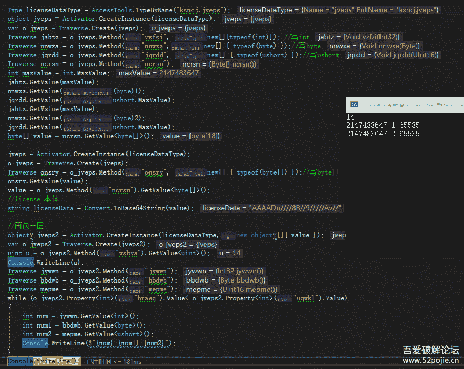

10.png (201.82 KB, 下载次数: 0)

[href="forum.php?mod=attachment&aid=MjYwMjY5MHwyNzU4YmFkOXwxNzkzNTczODYzfDE2ODA4NnwxNzY2MTgz&nothumb=yes" target="_blank"](https://www.52pojie.cn/forum.php?mod=attachment&aid=MjYwMjY5MHwyNzU4YmFkOXwxNzkzNTczODYzfDE2ODA4NnwxNzY2MTgz&nothumb=yes)

2023-3-28 20:23 上传

`license` 结构已经搞定，还差个 `Sign`

我们先就用系统的 `DSA` 试试，只要没啥魔改。

```csharp
DSA dsa = DSA.Create();

//备用 之后 有用
byte[] priKey = dsa.ExportPkcs8PrivateKey();
byte[] signByte = dsa.SignData(value,HashAlgorithmName.SHA1);
```
有了 `Sign` 那注册码的最终形态就呼之欲出了！

```csharp
byte[] xor = new byte[value.Length];
for (int i = 0; i
```
接着我们来处理鉴权逻辑的处理。

如果用的是系统函数，那么我们 `True` 就行了。但是这次的受害者好像有自己的想法。

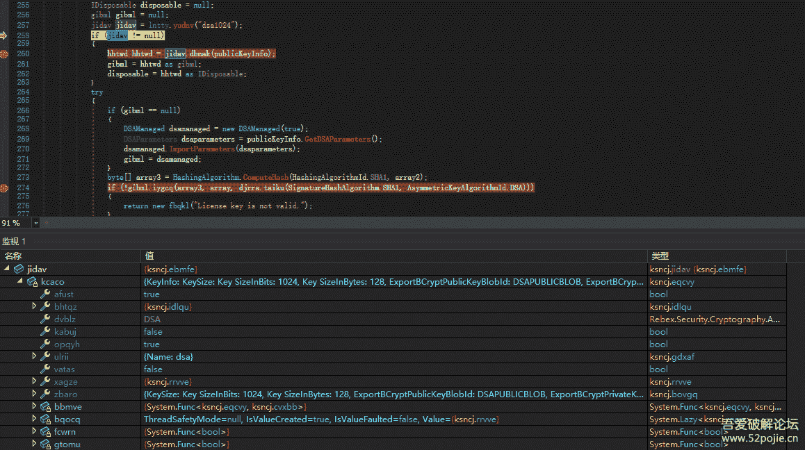

11.png (114.82 KB, 下载次数: 0)

[href="forum.php?mod=attachment&aid=MjYwMjY5MXxiN2NlMjE0NXwxNzkzNTczODYzfDE2ODA4NnwxNzY2MTgz&nothumb=yes" target="_blank"](https://www.52pojie.cn/forum.php?mod=attachment&aid=MjYwMjY5MXxiN2NlMjE0NXwxNzkzNTczODYzfDE2ODA4NnwxNzY2MTgz&nothumb=yes)

2023-3-28 20:23 上传

接口的实现是自制的。

## 公钥处理 `jidav.dbmak`
先看看公钥部分 `jidav.dbmak`

```csharp
//jidav.dbmak 的实现
hhtwd jidav.zmris(PublicKeyInfo p0)
{
    cvxbb cvxbb = this.kcaco.iyfql();
    cvxbb.fkqdt(p0);
    return cvxbb;
}
public virtual void fkqdt(PublicKeyInfo p0)
{
    this.fqoio();
    if (this.ihotv())
    {
        cvxbb.qapbb();
    }
    byte[] array = this.gjnry.vonlf(p0);//又是接口
    this.ymifo(array);
}
public byte[] vonlf(PublicKeyInfo p0)
{
    if (p0 == null)
    {
        throw new ArgumentNullException("publicKeyInfo");
    }
    DSAParameters dsaparameters = p0.GetDSAParameters();//这个函数可以入手
    return this.yrqtx(ref dsaparameters, false);
}
private byte[] yrqtx(ref DSAParameters p0, bool p1)
{
    nwyxq.prftd(ref p0, p1);
    if (p1)
    {
        nwyxq.bwert(ref p0);
    }
    int num = p0.P.Length;
    int num2 = Marshal.SizeOf(typeof(ogska.jajew)) + p0.P.Length + p0.G.Length + num;
    if (p1)
    {
        num2 += 20;
    }
    byte[] array = new byte[num2];
    jveps jveps = new jveps(array); //熟悉的流操作对象 
    int num3 = (p1 ? 1448104772 : 1112560452);
    jveps.jabtz(num3);
    jveps.jabtz(p0.P.Length);
    if (p0.Counter
```
鉴权的实现也是...


```
public virtual bool iygcq(byte[] p0, byte[] p1, djrra p2)
{
    this.fqoio();
    return this.tdrmf(p0, p1, p2);
}
protected virtual bool tdrmf(byte[] p0, byte[] p1, djrra p2)
{
    if (p0 == null)
    {
        throw new ArgumentNullException("hash");
    }
    if (p1 == null)
    {
        throw new ArgumentNullException("signature");
    }
    if (p2 == null)
    {
        throw new ArgumentNullException("signVerifyParameters");
    }
    this.oqsoc();
    bool flag;
    using (cvxbb.jzvtl jzvtl = this.ylokf(p2))
    {
        uint num = ogska.BCryptVerifySignature(this.fygoz, jzvtl.negbf, p0, p0.Length, p1, p1.Length, jzvtl.zrnyc);
        if (num == 3221266432U)
        {
            flag = false;
        }
        else if (num == 3221225485U)
        {
            flag = false;
        }
        else
        {
            ogska.kwiot(num);
            flag = true;
        }
    }
    return flag;
}
[DllImport("Bcrypt.dll", CharSet = CharSet.Unicode, SetLastError = true)]
public static extern uint BCryptVerifySignature(ogska.svapf hKey, IntPtr pPaddingInfo, byte[] hashBytes, int hashBytesSize, byte[] signatureBytes, int signatureBytesSize, uint flags);
```

所以下手点就决定是你了`PublicKeyInfo.GetDSAParameters`

## 4> 开工

祭出神器`HarmonyLib`

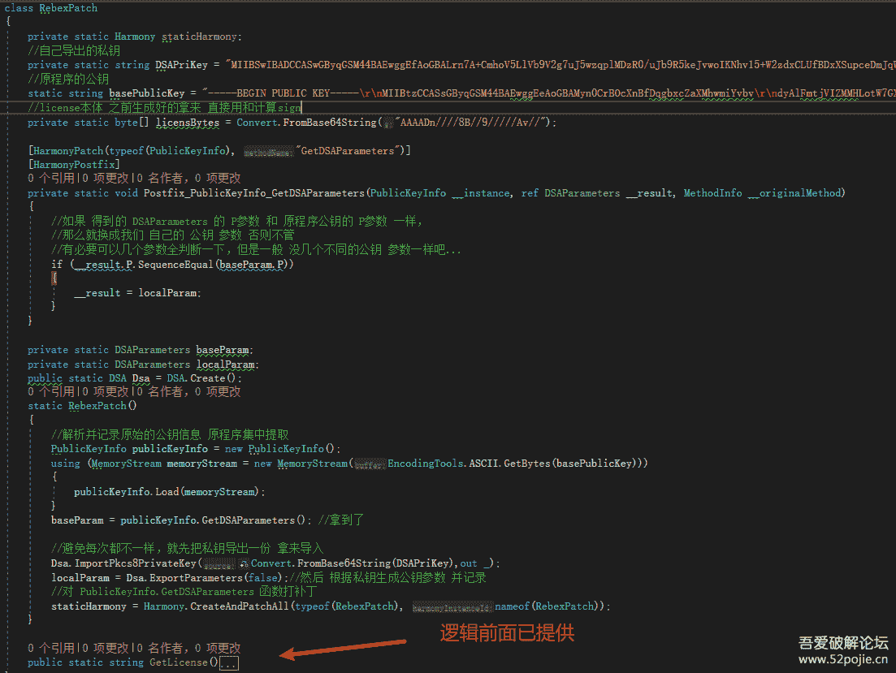

12.png (160.48 KB, 下载次数: 0)

[12.png](https://www.52pojie.cn/forum.php?mod=attachment&aid=MjYwMjY5MnwwMDgzZTJiNHwxNzkzNTczODYzfDE2ODA4NnwxNzY2MTgz&nothumb=yes)

2023-3-28 20:23 上传

## 4> 结果

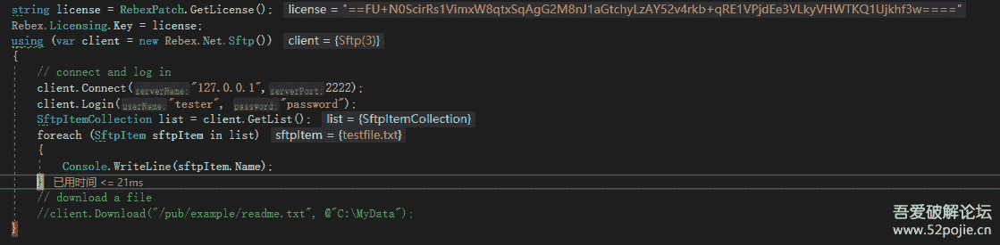

13.png (58.38 KB, 下载次数: 0)

[13.png](https://www.52pojie.cn/forum.php?mod=attachment&aid=MjYwMjY5M3w1YjZlY2FhYnwxNzkzNTczODYzfDE2ODA4NnwxNzY2MTgz&nothumb=yes)

2023-3-28 20:23 上传

搞定收工！

## 4> 关于Hook用到的技术

可以参考[https://www.52pojie.cn/thread-1737340-1-1.html](https://www.52pojie.cn/thread-1737340-1-1.html)

`HarmonyLib`的具体用法可以百度、谷歌和看官方文档。最好自己实际操作下
