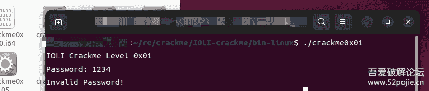
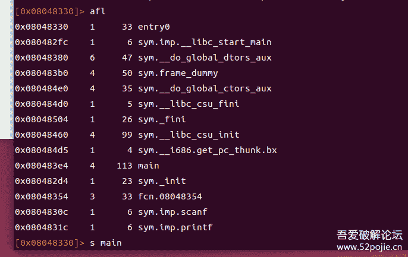
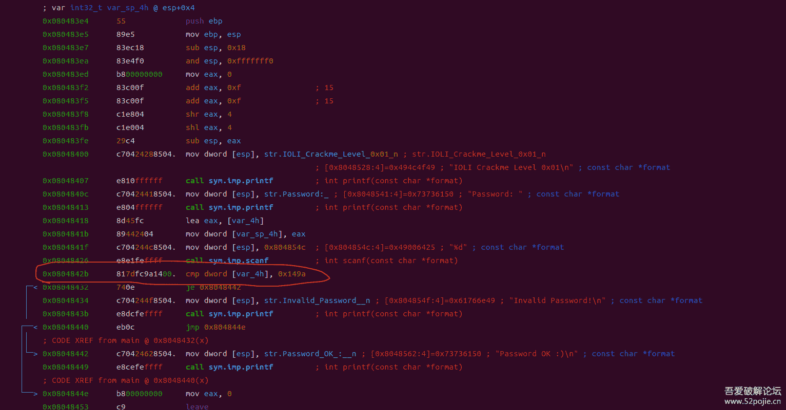
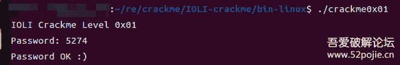

# [原创] 菜鸟起步-记一次简单逆向破解

- 原帖: https://www.52pojie.cn/forum.php?mod=viewthread&tid=1767893
- 抓取时间: 2026-11-01T22:57:36

刚接触逆向，在此开始记录一下自己的历程。

运行一下文件，发现需要输入密码，随便输入`1234`，得到反馈密码错误

运行文件.png (47.56 KB, 下载次数: 0)

[href="forum.php?mod=attachment&aid=MjYwMzY1MXwyZTQ0ZTU5NXwxNzkzNTczODUzfDE2ODA4NnwxNzY3ODkz&nothumb=yes" target="_blank"](https://www.52pojie.cn/forum.php?mod=attachment&aid=MjYwMzY1MXwyZTQ0ZTU5NXwxNzkzNTczODUzfDE2ODA4NnwxNzY3ODkz&nothumb=yes)

2023-3-31 20:49 上传

这里我用的是`radare2`进行的分析，用`r2`进行调试分析，我们发现主要的代码集中在主函数，直接进主函数

选择主函数.png (75.39 KB, 下载次数: 1)

[href="forum.php?mod=attachment&aid=MjYwMzY1NXw4Mjc4NjU1M3wxNzkzNTczODUzfDE2ODA4NnwxNzY3ODkz&nothumb=yes" target="_blank"](https://www.52pojie.cn/forum.php?mod=attachment&aid=MjYwMzY1NXw4Mjc4NjU1M3wxNzkzNTczODUzfDE2ODA4NnwxNzY3ODkz&nothumb=yes)

2023-3-31 20:51 上传

前面语句分析较为简单，这里就不一一赘述，我们看到在输出正确与否的前面有个判断

找出判断语句.png (199.38 KB, 下载次数: 1)

[href="forum.php?mod=attachment&aid=MjYwMzY1N3wwNmViM2UxYnwxNzkzNTczODUzfDE2ODA4NnwxNzY3ODkz&nothumb=yes" target="_blank"](https://www.52pojie.cn/forum.php?mod=attachment&aid=MjYwMzY1N3wwNmViM2UxYnwxNzkzNTczODUzfDE2ODA4NnwxNzY3ODkz&nothumb=yes)

2023-3-31 20:54 上传

显然`149a`就是密码，16进制转10进制后得到密码`5274`

密码正确.png (21.49 KB, 下载次数: 0)

[href="forum.php?mod=attachment&aid=MjYwMzY2MHw0NjE4YzZjZHwxNzkzNTczODUzfDE2ODA4NnwxNzY3ODkz&nothumb=yes" target="_blank"](https://www.52pojie.cn/forum.php?mod=attachment&aid=MjYwMzY2MHw0NjE4YzZjZHwxNzkzNTczODUzfDE2ODA4NnwxNzY3ODkz&nothumb=yes)

2023-3-31 20:56 上传
