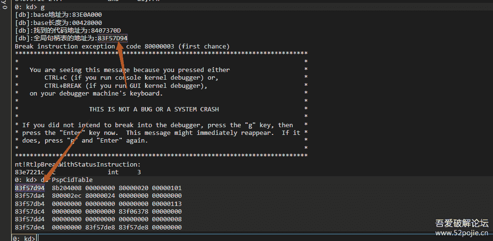
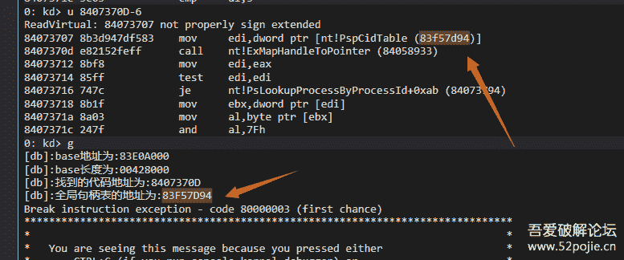

# [原创] 就是你，进来看看如何优雅地使用内存暴力搜索！

- 原帖：`https://www.52pojie.cn/forum.php?mod=viewthread&tid=1768476`
- 抓取时间：2026-11-01T22:57:30

## 就是你，进来看看如何优雅地使用内存暴力搜索！

### 0x1：什么是内存暴力搜索？

答：查找指定内存区段是否存在指定的值。

### 0x2：内存暴力搜索原理是啥？

答：从目标内存区段起始地址到内存区段结束位置去判断其中是否有满足我们条件的值，有则搜索到了目标地址。

### 0x3：用途

答：

1. 恶意程序特征提取；
2. 特殊变量获取；
3. 获取未公开函数地址；
4. and so on.

### 0x4：例子

#### 获取Windows 7 x86的`PspCidTable`值：

通过`windbg`我们可以使用`dd PspCidTable`命令获取到全局句柄表相关结构`HANDLE_TABLE`的地址，但是我们写代码的过程中却没办法通过这个命令拿到`PspCidTable`的值，所以我们有一个方法就是通过字节特征码去查找到这个值，通过实验发现在`PsLookupProcessByProcessId`这个函数通过进程id查找进程的`eprocess`时使用到了这个`PspCidTable`，那我们就可以通过在驱动加载的时候去查找这个函数地址引用那块数据，从而便可以找到我们的`PspCidTable`了。

#### 咱们先看看`PsLookupProcessByProcessId`函数的特征：

```asm
PAGE:006696E9                                                 var_C= dword ptr -0Ch
PAGE:006696E9                                                 var_8= dword ptr -8
PAGE:006696E9                                                 var_4= dword ptr -4
PAGE:006696E9                                                 ProcessId= dword ptr  8
PAGE:006696E9                                                 Process= dword ptr  0Ch
PAGE:006696E9
PAGE:006696E9 8B FF                                           mov     edi, edi
PAGE:006696EB 55                                              push    ebp
PAGE:006696EC 8B EC                                           mov     ebp, esp
PAGE:006696EE 83 EC 0C                                        sub     esp, 0Ch
PAGE:006696F1 53                                              push    ebx
PAGE:006696F2 56                                              push    esi
PAGE:006696F3 64 8B 35 24 01 00 00                            mov     esi, large fs:124h
PAGE:006696FA 33 DB                                           xor     ebx, ebx
PAGE:006696FC 66 FF 8E 84 00 00 00                            dec     word ptr [esi+84h]
PAGE:00669703 57                                              push    edi
PAGE:00669704 FF 75 08                                        push    [ebp+ProcessId]
PAGE:00669707 8B 3D 94 DD 54 00                               mov     edi, _PspCidTable
PAGE:0066970D E8 21 52 FE FF                                  call    _ExMapHandleToPointer@8         ; ExMapHandleToPointer(x,x)
```

从上面可以看到`mov edi, _PspCidTable`这个指令使用到了`PspCidTable`的值，但是这个值不是固定的，是运行时才能得到值的，所以咱们需要用相邻的字节特征来找到这个`PspCidTable`的值，那咱们就用`call  _ExMapHandleToPointer`特征查找：

`E8 21 52 FE FF           call    _ExMapHandleToPointer@8`

当然我选用上面这段指令的特征没去确定有没有其他地方也调用了这段指令，但是我就是头铁我就要选它，你们也可以选则`push edi`上面那条指令，特征性相对来说比我选的这个强，好了，我以这个例子来说一下代码思路，也是暴力搜索思路：

1. 获取`PsLookupProcessByProcessId`所在模块地址和模块大小，模块名为`ntkrnlpa.exe`，模块地址便是内存搜索起始地址，模块地址+模块大小便是搜索结束地址；
2. 从搜索起始地址不停判断是否存在一块连续内存是符合我们特征的是的话就找到了，返回这个地址；
3. `PspCidTable`地址占4个字节，所以我们通过特征拿到的地址减去4个字节就得到了`PspCidTable`的地址了；

奉上代码：

```c
#include 

typedef struct _RTL_PROCESS_MODULE_INFORMATION {

        HANDLE Section;                 // Not filled in

        PVOID MappedBase;

        PVOID ImageBase;

        ULONG ImageSize;

        ULONG Flags;

        USHORT LoadOrderIndex;

        USHORT InitOrderIndex;

        USHORT LoadCount;

        USHORT OffsetToFileName;

        UCHAR  FullPathName[256];

} RTL_PROCESS_MODULE_INFORMATION, *PRTL_PROCESS_MODULE_INFORMATION;

typedef struct _RTL_PROCESS_MODULES {

        ULONG NumberOfModules;

        RTL_PROCESS_MODULE_INFORMATION Modules[1];

} RTL_PROCESS_MODULES, *PRTL_PROCESS_MODULES;

typedef enum _SYSTEM_INFORMATION_CLASS {

        SystemBasicInformation,

        SystemProcessorInformation,             // obsolete...delete

        SystemPerformanceInformation,

        SystemTimeOfDayInformation,

        SystemPathInformation,

        SystemProcessInformation,

        SystemCallCountInformation,

        SystemDeviceInformation,

        SystemProcessorPerformanceInformation,

        SystemFlagsInformation,

        SystemCallTimeInformation,

        SystemModuleInformation,

        SystemLocksInformation,

        SystemStackTraceInformation,

        SystemPagedPoolInformation,

        SystemNonPagedPoolInformation,

        SystemHandleInformation,

        SystemObjectInformation,

        SystemPageFileInformation,

        SystemVdmInstemulInformation,

        SystemVdmBopInformation,

        SystemFileCacheInformation,

        SystemPoolTagInformation,

        SystemInterruptInformation,

        SystemDpcBehaviorInformation,

        SystemFullMemoryInformation,

        SystemLoadGdiDriverInformation,

        SystemUnloadGdiDriverInformation,

        SystemTimeAdjustmentInformation,

        SystemSummaryMemoryInformation,

        SystemMirrorMemoryInformation,

        SystemPerformanceTraceInformation,

        SystemObsolete0,

        SystemExceptionInformation,

        SystemCrashDumpStateInformation,

        SystemKernelDebuggerInformation,

        SystemContextSwitchInformation,

        SystemRegistryQuotaInformation,

        SystemExtendServiceTableInformation,

        SystemPrioritySeperation,

        SystemVerifierAddDriverInformation,

        SystemVerifierRemoveDriverInformation,

        SystemProcessorIdleInformation,

        SystemLegacyDriverInformation,

        SystemCurrentTimeZoneInformation,

        SystemLookasideInformation,

        SystemTimeSlipNotification,

        SystemSessionCreate,

        SystemSessionDetach,

        SystemSessionInformation,

        SystemRangeStartInformation,

        SystemVerifierInformation,

        SystemVerifierThunkExtend,

        SystemSessionProcessInformation,

        SystemLoadGdiDriverInSystemSpace,

        SystemNumaProcessorMap,

        SystemPrefetcherInformation,

        SystemExtendedProcessInformation,

        SystemRecommendedSharedDataAlignment,

        SystemComPlusPackage,

        SystemNumaAvailableMemory,

        SystemProcessorPowerInformation,

        SystemEmulationBasicInformation,

        SystemEmulationProcessorInformation,

        SystemExtendedHandleInformation,

        SystemLostDelayedWriteInformation,

        SystemBigPoolInformation,

        SystemSessionPoolTagInformation,

        SystemSessionMappedViewInformation,

        SystemHotpatchInformation,

        SystemObjectSecurityMode,

        SystemWatchdogTimerHandler,

        SystemWatchdogTimerInformation,

        SystemLogicalProcessorInformation,

        SystemWow64SharedInformation,

        SystemRegisterFirmwareTableInformationHandler,

        SystemFirmwareTableInformation,

        SystemModuleInformationEx,

        SystemVerifierTriageInformation,

        SystemSuperfetchInformation,

        SystemMemoryListInformation,

        SystemFileCacheInformationEx,

        MaxSystemInfoClass  // MaxSystemInfoClass should always be the last enum

} SYSTEM_INFORMATION_CLASS;

NTSYSAPI NTSTATUS NTAPI ZwQuerySystemInformation(

        __in SYSTEM_INFORMATION_CLASS SystemInformationClass,

        __out_bcount_opt(SystemInformationLength) PVOID SystemInformation,

        __in ULONG SystemInformationLength,

        __out_opt PULONG ReturnLength

        );

ULONG_PTR GetKernelModuleBase(PUCHAR moduleName, PULONG pModuleSize) {

        RTL_PROCESS_MODULES SysModules = { 0 };

        PRTL_PROCESS_MODULES pModules = &SysModules;

        ULONG SystemInformationLength = 0;

        //查询系统中所有内核模块，底层也是遍历链表

        NTSTATUS status = ZwQuerySystemInformation(SystemModuleInformation, pModules, sizeof(RTL_PROCESS_MODULES), &SystemInformationLength);

        if (status == STATUS_INFO_LENGTH_MISMATCH) {

                pModules = ExAllocatePool(NonPagedPool, SystemInformationLength + sizeof(RTL_PROCESS_MODULES));

                RtlZeroMemory(pModules, SystemInformationLength + sizeof(RTL_PROCESS_MODULES));

                status = ZwQuerySystemInformation(SystemModuleInformation, pModules, SystemInformationLength + sizeof(RTL_PROCESS_MODULES), &SystemInformationLength);

                if (!NT_SUCCESS(status)) {
```


```c
ExFreePool(pModules);

return 0;
}
}
if (!strcmp("ntkrnlpa.exe", moduleName)) {
    ULONG_PTR ret = pModules->Modules[0].ImageBase;
    *pModuleSize = pModules->Modules[0].ImageSize;
    if (SystemInformationLength) {
        ExFreePool(pModules);
    }
    return ret;
}
for (ULONG i = 0; i NumberOfModules; i++) {
    if (strstr(pModules->Modules[i].FullPathName, moduleName)) {
        ULONG_PTR ret = pModules->Modules[i].ImageBase;
        *pModuleSize = pModules->Modules[0].ImageSize;
        if (SystemInformationLength) {
            ExFreePool(pModules);
        }
        //返回模块地址
        return ret;
    }
}
if (SystemInformationLength) {
    ExFreePool(pModules);
}
return 0;
}

PVOID SearchSpecialCode(PVOID pSearchBeginAddr, ULONG ulSearchLength, PUCHAR pSpecialCode, ULONG ulSpecialCodeLength)
{
    PVOID pDestAddr = NULL;
    PUCHAR pBeginAddr = (PUCHAR)pSearchBeginAddr;
    PUCHAR pEndAddr = pBeginAddr + ulSearchLength;
    PUCHAR i = NULL;
    ULONG j = 0;
    for (i = pBeginAddr; i = ulSpecialCodeLength)
    {
        pDestAddr = (PVOID)i;
        break;
    }
    }
    return pDestAddr;
}

VOID UnloadDriver(PDRIVER_OBJECT pDriver)
{
}

NTSTATUS DriverEntry(PDRIVER_OBJECT pDriver, PUNICODE_STRING pRegPath)
{
    ULONG sizeofcode = 0;
    ULONG_PTR baseaddr = GetKernelModuleBase("ntkrnlpa.exe", &sizeofcode);
    DbgPrintEx(77, 0, "[db]:base地址为:%p\n", baseaddr);
    DbgPrintEx(77, 0, "[db]:base长度为:%p\n", sizeofcode);
    UCHAR specode[4] = { 0xE8, 0x21, 0x52, 0xFE,0xFF };
    ULONG_PTR codeaddr = SearchSpecialCode(baseaddr, sizeofcode, specode,5);
    DbgPrintEx(77, 0, "[db]:找到的代码地址为:%p\n", codeaddr);
    ULONG_PTR uGetPspGet = (*(PULONG)((PUCHAR)codeaddr - 6 + 2));
    DbgPrintEx(77, 0, "[db]:全局句柄表的地址为:%p\n", uGetPspGet);
    pDriver->DriverUnload = UnloadDriver;
    return STATUS_SUCCESS;
}
```

## 5> 效果：



image-20230402133539413.png (67.12 KB, 下载次数: 0)

[href="forum.php?mod=attachment&aid=MjYwNDA5MnxjOGVmMGNjOHwxNzkzNTczODQ4fDE2ODA4NnwxNzY4NDc2&nothumb=yes" target="_blank"](https://www.52pojie.cn/forum.php?mod=attachment&aid=MjYwNDA5MnxjOGVmMGNjOHwxNzkzNTczODQ4fDE2ODA4NnwxNzY4NDc2&nothumb=yes)

2023-4-2 13:39 上传



image-20230402133603083.png (51.96 KB, 下载次数: 1)

[href="forum.php?mod=attachment&aid=MjYwNDA5M3wxY2RjNTU1MXwxNzkzNTczODQ4fDE2ODA4NnwxNzY4NDc2&nothumb=yes" target="_blank"](https://www.52pojie.cn/forum.php?mod=attachment&aid=MjYwNDA5M3wxY2RjNTU1MXwxNzkzNTczODQ4fDE2ODA4NnwxNzY4NDc2&nothumb=yes)

2023-4-2 13:39 上传

## 4> Tip：

以上打印的把`PspCidTable`说成全局句柄表地址了，但是实际上不是哈，严谨点说是全局句柄表相关结构地址
