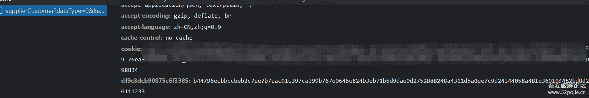
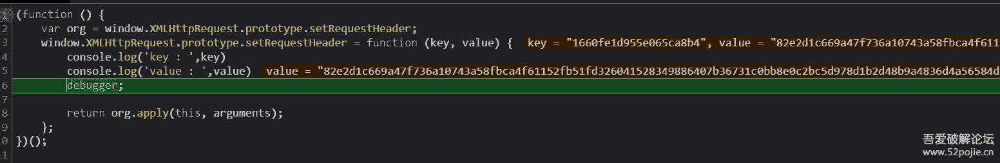
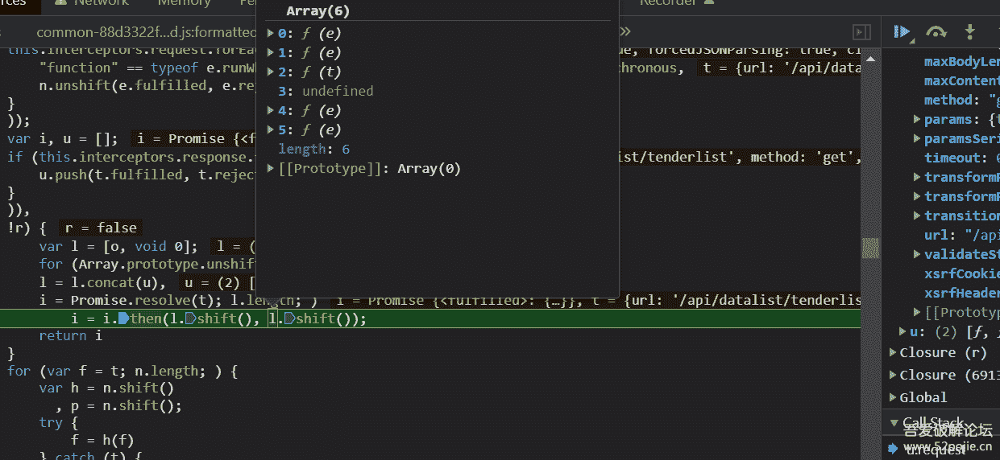
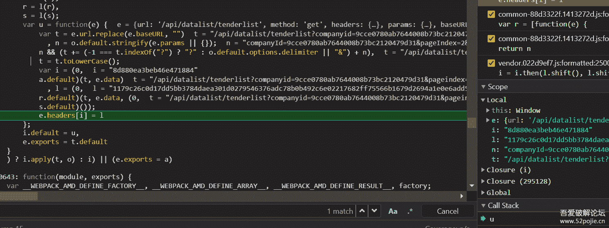
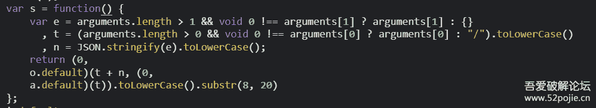
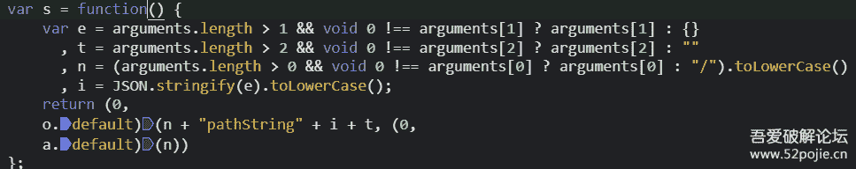
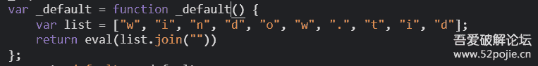
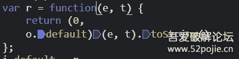
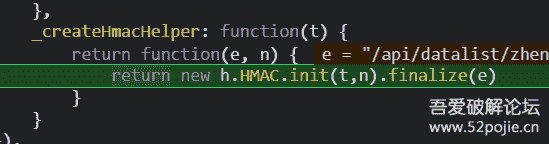

# [Web逆向] 《某查查》详情页请求头随机参数 ( 新人水第二帖 )

- 原帖: https://www.52pojie.cn/forum.php?mod=viewthread&tid=1768953
- 抓取时间: 2026-11-01T22:57:28

1. 抓包

2.png (49.94 KB, 下载次数: 2)
[href="forum.php?mod=attachment&aid=MjYwNDM2MXxiZjkwOTkxZXwxNzkzNTczODQ1fDE2ODA4NnwxNzY4OTUz&nothumb=yes" target="_blank"](https://www.52pojie.cn/forum.php?mod=attachment&aid=MjYwNDM2MXxiZjkwOTkxZXwxNzkzNTczODQ1fDE2ODA4NnwxNzY4OTUz&nothumb=yes)
2023-4-3 14:42 上传

2. Hook headers

3.png (50.08 KB, 下载次数: 2)
[href="forum.php?mod=attachment&aid=MjYwNDM2Mnw5YjQ4N2ViMHwxNzkzNTczODQ1fDE2ODA4NnwxNzY4OTUz&nothumb=yes" target="_blank"](https://www.52pojie.cn/forum.php?mod=attachment&aid=MjYwNDM2Mnw5YjQ4N2ViMHwxNzkzNTczODQ1fDE2ODA4NnwxNzY4OTUz&nothumb=yes)
2023-4-3 14:42 上传

3. 向上查堆栈，确定异步走的是哪一个函数(不确定的都打上断点，一个个看)

4.png (114.39 KB, 下载次数: 2)
[href="forum.php?mod=attachment&aid=MjYwNDM2M3wwOTFjYzJkYnwxNzkzNTczODQ1fDE2ODA4NnwxNzY4OTUz&nothumb=yes" target="_blank"](https://www.52pojie.cn/forum.php?mod=attachment&aid=MjYwNDM2M3wwOTFjYzJkYnwxNzkzNTczODQ1fDE2ODA4NnwxNzY4OTUz&nothumb=yes)
2023-4-3 14:42 上传

4. 找到加密参数构成位置

5.png (133.57 KB, 下载次数: 2)
[href="forum.php?mod=attachment&aid=MjYwNDM2NHwxYzg2MzVkZHwxNzkzNTczODQ1fDE2ODA4NnwxNzY4OTUz&nothumb=yes" target="_blank"](https://www.52pojie.cn/forum.php?mod=attachment&aid=MjYwNDM2NHwxYzg2MzVkZHwxNzkzNTczODQ1fDE2ODA4NnwxNzY4OTUz&nothumb=yes)
2023-4-3 14:42 上传

5. 跟进去 `a.default`，`r.default`，`s.default`，`o.default` 函数
`a.default`：

a.png (35.55 KB, 下载次数: 2)
[href="forum.php?mod=attachment&aid=MjYwNDM2NXwxNDYzYzg0NXwxNzkzNTczODQ1fDE2ODA4NnwxNzY4OTUz&nothumb=yes" target="_blank"](https://www.52pojie.cn/forum.php?mod=attachment&aid=MjYwNDM2NXwxNDYzYzg0NXwxNzkzNTczODQ1fDE2ODA4NnwxNzY4OTUz&nothumb=yes)
2023-4-3 14:42 上传

`r.default`：

r.png (40.5 KB, 下载次数: 2)
[href="forum.php?mod=attachment&aid=MjYwNDM2OXxmYWYwOWVmNXwxNzkzNTczODQ1fDE2ODA4NnwxNzY4OTUz&nothumb=yes" target="_blank"](https://www.52pojie.cn/forum.php?mod=attachment&aid=MjYwNDM2OXxmYWYwOWVmNXwxNzkzNTczODQ1fDE2ODA4NnwxNzY4OTUz&nothumb=yes)
2023-4-3 14:42 上传

`s.default`：

s.png (16.39 KB, 下载次数: 1)
[href="forum.php?mod=attachment&aid=MjYwNDM3MHxjODljOWFiNHwxNzkzNTczODQ1fDE2ODA4NnwxNzY4OTUz&nothumb=yes" target="_blank"](https://www.52pojie.cn/forum.php?mod=attachment&aid=MjYwNDM3MHxjODljOWFiNHwxNzkzNTczODQ1fDE2ODA4NnwxNzY4OTUz&nothumb=yes)
2023-4-3 14:42 上传

`o.default`：

o.png (14.59 KB, 下载次数: 3)
[href="forum.php?mod=attachment&aid=MjYwNDM2OHxjMmM0Yzg1MnwxNzkzNTczODQ1fDE2ODA4NnwxNzY4OTUz&nothumb=yes" target="_blank"](https://www.52pojie.cn/forum.php?mod=attachment&aid=MjYwNDM2OHxjMmM0Yzg1MnwxNzkzNTczODQ1fDE2ODA4NnwxNzY4OTUz&nothumb=yes)
2023-4-3 14:42 上传

6. 找到加密算法

m.png (19.08 KB, 下载次数: 2)
[href="forum.php?mod=attachment&aid=MjYwNDM2N3w2M2JkZjcyMXwxNzkzNTczODQ1fDE2ODA4NnwxNzY4OTUz&nothumb=yes" target="_blank"](https://www.52pojie.cn/forum.php?mod=attachment&aid=MjYwNDM2N3w2M2JkZjcyMXwxNzkzNTczODQ1fDE2ODA4NnwxNzY4OTUz&nothumb=yes)
2023-4-3 14:42 上传

7. python 或 js 模拟一下 Hmac md5 加密
